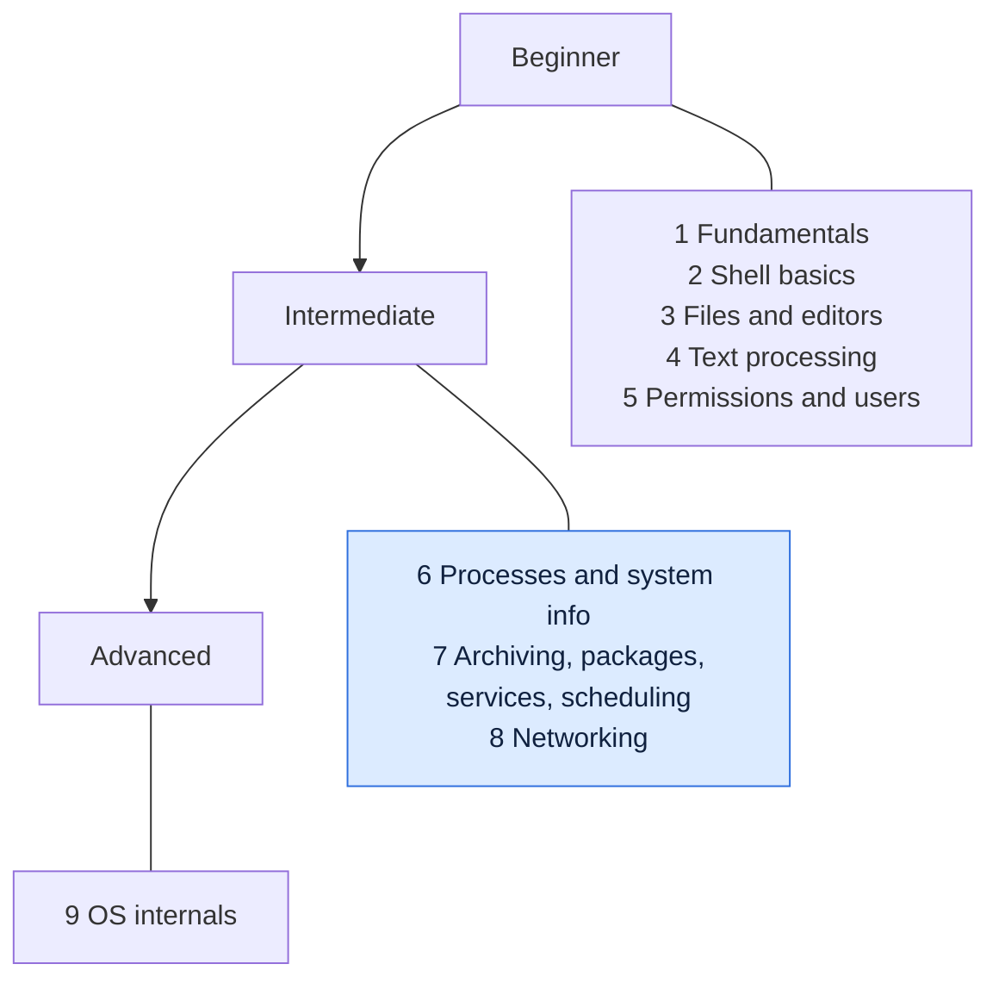

# Linux Learning Path

Start here. The folders are not in alphabetical order of difficulty, so follow the steps below from top to bottom. Each step says what to read and why it comes at that point.

## The path at a glance

> Follow the steps in this order. Each step uses what the earlier ones taught.

| Level | Steps | Goal |
|-------|-------|------|
| Beginner | 1 to 5 | Move around, edit and read files, search text, understand permissions and users |
| Intermediate | 6 to 8 | Manage processes, packages, services and the network |
| Advanced | 9 | Understand how Linux works inside |

## Step by step

### Step 1: Fundamentals (read in order)
Folder: [fundamentals/](fundamentals/). These pages explain ideas that every later page assumes. Read them **in number order**, `01` to `12`.

| Page | You learn |
|------|-----------|
| [01 What is Linux](fundamentals/01-what-is-linux.md) | Kernel, distros, which Linux you are on |
| [02 Installing Linux](fundamentals/02-installing-linux.md) | Get a practice machine (WSL, VM, cloud) |
| [03 Terminal, shell and bash](fundamentals/03-terminal-shell-bash.md) | The prompt, commands, options, exit codes |
| [04 Filesystem hierarchy](fundamentals/04-filesystem-hierarchy.md) | Where things live: `/etc`, `/var`, `/home` |
| [05 Paths](fundamentals/05-paths.md) | Absolute and relative paths, hidden files |
| [06 Wildcards and globbing](fundamentals/06-wildcards-globbing.md) | `*`, `?`, `[ ]`, `{ }` |
| [07 Quoting](fundamentals/07-quoting.md) | Single and double quotes, escaping |
| [08 Redirection and pipes](fundamentals/08-redirection-and-pipes.md) | `>`, `>>`, `2>`, `\|`, file descriptors |
| [09 Links and inodes](fundamentals/09-links-and-inodes.md) | Hard and soft links |
| [10 The permission model](fundamentals/10-permission-model.md) | `rwx`, owner, group, others |
| [11 Shortcuts and tab completion](fundamentals/11-shortcuts-and-tab-completion.md) | Work faster at the prompt |
| [12 Regular expressions](fundamentals/12-regular-expressions.md) | Patterns for `grep`, `sed` and `awk`, BRE vs ERE |

You can start Step 2 after page `05`, but come back for pages `06` to `11` before Step 4, and read page `12` (regular expressions) before `sed` and `awk`.

### Step 2: Shell basics
Folder: [shell-basics/](shell-basics/). Start with these, in this order:
[`echo`](shell-basics/echo.md), [`man`](shell-basics/man.md), [`help`](shell-basics/help.md), [`type`](shell-basics/type.md), [`which`](shell-basics/which.md), [`history`](shell-basics/history.md), [`clear`](shell-basics/clear.md), [`alias`](shell-basics/alias.md), [`env`](shell-basics/env.md), [`export`](shell-basics/export.md).
Later: [`set`](shell-basics/set.md), [`source`](shell-basics/source.md), [`read`](shell-basics/read.md), [`test`](shell-basics/test.md), [`time`](shell-basics/time.md), [`sleep`](shell-basics/sleep.md), [`exit`](shell-basics/exit.md).

### Step 3: File management and editors
Folder: [file-management/](file-management/). Read in this order:
1. Move and look: [`pwd`](file-management/pwd.md), [`ls`](file-management/ls.md), [`cd`](file-management/cd.md), [`tree`](file-management/tree.md)
2. Create and change: [`mkdir`](file-management/mkdir.md), [`touch`](file-management/touch.md), [`cp`](file-management/cp.md), [`mv`](file-management/mv.md), [`rm`](file-management/rm.md), [`rmdir`](file-management/rmdir.md)
3. Read files: [`cat`](file-management/cat.md), [`less`](file-management/less.md), [`more`](file-management/more.md), [`head`](file-management/head.md), [`tail`](file-management/tail.md), [`file`](file-management/file.md)
4. Find and link: [`find`](file-management/find.md), [`locate`](file-management/locate.md), [`ln`](file-management/ln.md), [`rsync`](file-management/rsync.md)

**Editing files:** you can already read and copy files, now learn to change them. Folder: [editors/](editors/). Start with [`nano`](editors/nano.md), the easy one, then learn [`vim`](editors/vim.md), which you will find on every server.

### Step 4: Text processing
Folder: [text-processing/](text-processing/). Read in this order:
[`wc`](text-processing/wc.md), [`grep`](text-processing/grep.md), [`cut`](text-processing/cut.md), [`sort`](text-processing/sort.md), [`uniq`](text-processing/uniq.md), [`tr`](text-processing/tr.md), [`tee`](text-processing/tee.md), [`diff`](text-processing/diff.md), [`sed`](text-processing/sed.md), [`awk`](text-processing/awk.md), [`xargs`](text-processing/xargs.md), [`printf`](text-processing/printf.md), [`tac`](text-processing/tac.md), [`nl`](text-processing/nl.md).
`grep`, `sed` and `awk` are the big three, give each its own day.

### Step 5: Permissions and users
Folders: [permissions/](permissions/) and [user-management/](user-management/).
- Permissions: [`chmod`](permissions/chmod.md), [`chown`](permissions/chown.md), [`chgrp`](permissions/chgrp.md), [`umask`](permissions/umask.md)
- Users first: [`whoami`](user-management/whoami.md), [`id`](user-management/id.md), [`who`](user-management/who.md), [`sudo`](user-management/sudo.md), [`su`](user-management/su.md)
- Then manage accounts: [`useradd`](user-management/useradd.md), [`passwd`](user-management/passwd.md), [`usermod`](user-management/usermod.md), [`userdel`](user-management/userdel.md), [`groupadd`](user-management/groupadd.md), [`visudo`](user-management/visudo.md)

### Step 6: Processes and system information
Folders: [process-management/](process-management/) and [system-info/](system-info/).
- Processes: [`ps`](process-management/ps.md), [`top`](process-management/top.md), [`kill`](process-management/kill.md), [`jobs`](process-management/jobs.md), [`bg`](process-management/bg.md), [`fg`](process-management/fg.md), [`nohup`](process-management/nohup.md), then the rest.
- System: [`uname`](system-info/uname.md), [`uptime`](system-info/uptime.md), [`free`](system-info/free.md), [`df`](system-info/df.md), [`du`](system-info/du.md), [`lscpu`](system-info/lscpu.md), [`date`](system-info/date.md), then the rest.

### Step 7: Archiving, packages, services and scheduling
Folders: [archiving/](archiving/), [package-management/](package-management/), [services-logging/](services-logging/) and [scheduling/](scheduling/).
1. [`tar`](archiving/tar.md) and [`zip-unzip`](archiving/zip-unzip.md)
2. [Package management overview](package-management/README.md), then [`apt`](package-management/apt.md) (Debian and Ubuntu) or [`dnf`](package-management/dnf.md) (Red Hat family)
3. [`systemctl`](services-logging/systemctl.md), then [`journalctl`](services-logging/journalctl.md)
4. Run jobs on a schedule: [`cron`](scheduling/cron.md) (how the scheduler works), then [`crontab`](scheduling/crontab.md) (your own jobs)

### Step 8: Networking
Folder: [networking/](networking/). Read in this order:
[`ping`](networking/ping.md), [`ip`](networking/ip.md), [`ss`](networking/ss.md), [`curl`](networking/curl.md), [`wget`](networking/wget.md), [`ssh`](networking/ssh.md), [`scp`](networking/scp.md), [`dig`](networking/dig.md), [`traceroute`](networking/traceroute.md), [`nc`](networking/nc.md), [`tcpdump`](networking/tcpdump.md).

### Step 9: OS internals
Folder: [os-internals/](os-internals/). Read in number order, `01` to `06`. These pages explain **why** things work: the kernel, user and kernel mode, system calls, processes, threads and kernel modules. They need the commands from Step 6 first.

## Quick rules for choosing where to go

| If you are... | Start at |
|---------------|----------|
| New to Linux | Step 1, page `01` |
| Comfortable at the prompt, new to scripting | Step 1 pages `06` to `08`, then Step 4 |
| Looking up one command | Open the folder for its topic, every command has its own page |
| Preparing for DevOps work | Complete Steps 1 to 8, then read Step 9 |
