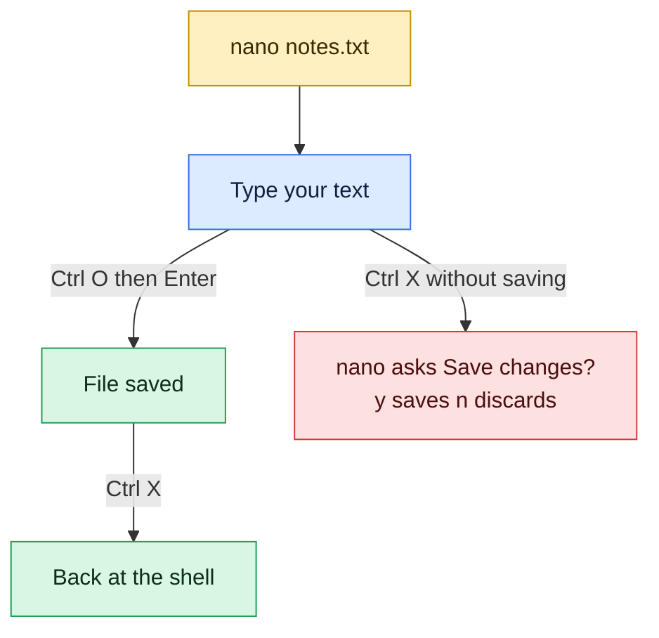

# nano

## What is it?
`nano` is a small, easy text editor for the terminal. Unlike [`vim`](vim.md) it has no modes: you open a file, **just type**, and the most important shortcuts are printed at the bottom of the screen. It is the best choice for a beginner who needs to change a config file quickly. In the shortcut list, `^` means the **Ctrl** key (`^X` is `Ctrl+X`) and `M-` means the **Alt** key.

## Syntax
```bash
nano [OPTIONS] [[+LINE[,COLUMN]] FILE]...
nano FILE              # open or create FILE
nano +25 FILE          # open at line 25
nano -l FILE           # show line numbers
```

## Visual Overview
> `nano` shows its shortcuts at the bottom of the screen. The minimum you need is: type, save with Ctrl O, leave with Ctrl X.



## Options/Flags
**Essential shortcuts**

| Keys | Action |
|------|--------|
| `Ctrl+O`, then Enter | Write out (save) |
| `Ctrl+X` | Exit (asks to save if there are changes: `y` save, `n` discard) |
| `Ctrl+G` | Help |
| `Ctrl+C` | Show the current line and column |
| `Ctrl+K` | Cut the current line |
| `Ctrl+U` | Paste (uncut) |
| `Ctrl+W` | Search (where is) |
| `Alt+W` | Search again |
| `Ctrl+\` | Search and replace |
| `Ctrl+_` (or `Ctrl+/`) | Go to line (and column) |
| `Ctrl+R` | Insert another file |
| `Ctrl+T` | Run a command or spell check (depends on the version) |
| `Alt+U` / `Alt+E` | Undo / redo |
| `Alt+6` | Copy the current line (or selection) |
| `Alt+A` | Start selecting text (press again to stop) |
| `Alt+#` | Turn line numbers on or off |
| `Ctrl+A` / `Ctrl+E` | Start / end of the line |
| `Ctrl+Y` / `Ctrl+V` | Page up / page down |
| `Alt+\` / `Alt+/` | First / last line of the file |

**Prompts while saving or replacing**

| Keys | Meaning |
|------|---------|
| `Enter` | Accept the suggested file name or text |
| `Ctrl+C` | Cancel |
| `Alt+D` / `Alt+M` | Save in DOS / Mac line ending format |
| `Alt+B` | Make a backup copy of the old file |
| `y`, `n`, `a` | In replace: replace this one, skip it, replace **all** |

**Options**

| Option | Meaning |
|--------|---------|
| `-l`, `--linenumbers` | Show line numbers |
| `-B`, `--backup` | Keep a backup of the old file (`file~`) |
| `-c`, `--constantshow` | Always show the cursor position |
| `-m`, `--mouse` | Enable the mouse |
| `-w`, `--nowrap` | Do not wrap long lines |
| `-i`, `--autoindent` | Keep the indentation of the previous line |
| `-E`, `--tabstospaces` | Type tabs as spaces |
| `-T N`, `--tabsize=N` | Tab width |
| `-R`, `--restricted` | Restricted mode, no shell or other files (also `rnano`) |
| `-v`, `--view` | Read only |
| `-S`, `--smooth` | Scroll line by line |
| `+N` | Start at line `N` |
| `--version`, `--help` | Show the version or the options |

Settings can be saved in `~/.nanorc`, for example `set linenumbers` and `set tabsize 4`.

## Usage Examples
All the results below come from real runs of `nano` with the keystrokes shown. Press the keys in the order listed.

### Example 1: Create a new file and save it
**Command:**
```bash
nano new.txt
```
**Keys:** type `hello`, `Ctrl+O`, Enter (accept the name `new.txt`), `Ctrl+X`

**Result:**
```bash
cat new.txt
```
```text
hello
```
The bottom of the screen showed `[ New File ]` when nano started, and `[ Wrote 1 line ]` after `Ctrl+O`.

### Example 2: Go to a line and replace it
Let's say we have this file:

**Input file** (`c.txt`):
```text
server=web1
port=8080
```

**Command:**
```bash
nano c.txt
```
**Keys:** `Ctrl+_` (go to line), type `2`, Enter, `Ctrl+A` (start of line), `Ctrl+K` (cut the line), type `debug=true`, `Ctrl+O`, Enter, `Ctrl+X`

**Result:**
```bash
cat c.txt
```
```text
server=web1
debug=true
```
`Ctrl+K` cut line 2 (`port=8080`), then the typed text took its place.

### Example 3: Cut and paste lines
Let's say we have this file:

**Input file** (`k.txt`):
```text
one
two
three
```

**Command:**
```bash
nano k.txt
```
**Keys:** `Ctrl+K`, `Ctrl+K` (cut `one` and `two`), `Ctrl+U`, `Ctrl+U` (paste them twice), `Ctrl+O`, Enter, `Ctrl+X`

**Result:**
```bash
cat k.txt
```
```text
one
two
one
two
three
```
Two `Ctrl+K` in a row put both lines into the paste buffer. Each `Ctrl+U` inserted them once at the cursor.

### Example 4: Leave without saving
Let's say we have this file:

**Input file** (`e.txt`):
```text
keep
```

**Command:**
```bash
nano e.txt
```
**Keys:** type `zzz`, `Ctrl+X`, then `n` (do not save)

**Result:**
```bash
cat e.txt
```
```text
keep
```
Nano asked `Save modified buffer?` and the answer `n` threw the typing away.

### Example 5: Search and replace all
Let's say we have this file:

**Input file** (`r.txt`):
```text
port=8080
name=a
port=8080
```

**Command:**
```bash
nano r.txt
```
**Keys:** `Ctrl+\`, type `8080`, Enter, type `9090`, Enter, press `a` (replace **all**), `Ctrl+O`, Enter, `Ctrl+X`

**Result:**
```bash
cat r.txt
```
```text
port=9090
name=a
port=9090
```
Nano asks `Search (to replace):`, then `Replace with:`, then for each match `Replace this instance?`. The answer `a` replaces everything.

### Example 6: Search and delete a line
Let's say we have this file:

**Input file** (`w.txt`):
```text
alpha beta gamma
second
```

**Command:**
```bash
nano w.txt
```
**Keys:** `Ctrl+W`, type `second`, Enter (the cursor jumps to `second`), `Ctrl+K` (cut that line), `Ctrl+O`, Enter, `Ctrl+X`

**Result:**
```bash
cat w.txt
```
```text
alpha beta gamma
```

### Example 7: Version and help
**Command:**
```bash
nano --version | head -1
```
**Sample Output:**
```text
 GNU nano, version 6.2
```
Your version may be different. Older nano versions (below 4) used different keys for a few functions, so check the shortcut list at the bottom of the screen.

## Sample Output
What the nano screen looks like when you open a file (the top and bottom bars):

```text
  GNU nano 6.2                          new.txt
hello

^G Help      ^O Write Out  ^W Where Is   ^K Cut        ^T Execute    ^C Location
^X Exit      ^R Read File  ^\ Replace    ^U Paste      ^J Justify    ^/ Go To Line
```
The exact spacing depends on the width of your terminal. The title bar shows the file name, and `Modified` appears on the right after a change. The two lines at the bottom list the most useful shortcuts. On a new file nano also prints `[ New File ]` for a moment.

## Pitfalls / Gotchas
- `^` means **Ctrl**, not the caret key. `^X` is `Ctrl+X`. `M-` is **Alt** (Meta). On macOS Terminal turn on "Use Option as Meta key".
- `Ctrl+O` writes the file but does **not** exit, and `Ctrl+X` exits but asks to save first. Both need `Enter` to confirm the file name.
- `Ctrl+K` **cuts** a line. It is not "delete" but the line goes into the paste buffer, and `Ctrl+U` pastes it back.
- Pressing `Ctrl+S` in some terminals freezes the display (flow control), press `Ctrl+Q` to continue. Nano uses `Ctrl+O` to save, not `Ctrl+S`.
- A long line is **wrapped** visually only. Nano does not add line breaks unless you press Enter, but some versions break lines at 72 characters when you use `Ctrl+J` (justify).
- For config files that need exact line endings use `nano -w` (no wrapping) so long lines in `sshd_config`, `fstab` or `sudoers` are not changed. Edit `/etc/sudoers` only with `visudo`.
- To edit a root file, run `sudo nano /etc/hosts` or `sudoedit /etc/hosts`. A normal user can open it but cannot save: you get `Error writing /etc/hosts: Permission denied`.
- Nano may add a **trailing newline** and keeps the file mode, but it changes the owner if you save as another user (for example with `sudo`). Check with `ls -l`.
- Two sessions editing the same file: nano creates a lock file `.file.swp`. If it says the file is being edited, make sure nobody else is working on it.
- `nano file` creates the file **only when you save**. If you quit without saving, nothing is created.
- Nano is not on every minimal image (Alpine and some containers only have `vi`). Install it with the package manager, for example `apt install nano`.
- Tabs and spaces look the same on screen. For YAML use `nano -E -T 2 file.yml` (or put `set tabstospaces` and `set tabsize 2` in `~/.nanorc`).

## DevOps Use Cases

### Use Case 1: Quick config change over SSH
**Situation:** Change the port of a service in its config file.

Using the `c.txt` file from Example 2 (before the change it holds `server=web1` and `port=8080`).

**Command:**
```bash
nano c.txt
```
**Keys:** `Ctrl+\`, `port`, Enter, `listen`, Enter, `a`, `Ctrl+O`, Enter, `Ctrl+X`

**Result:**
```bash
cat c.txt
```
```text
server=web1
listen=8080
```
For a system file use `sudo nano /etc/app/app.conf` (or `sudoedit`). After the change test the configuration and reload the service (`nginx -t && sudo systemctl reload nginx`).

### Use Case 2: Choose nano as your default editor
**Situation:** `crontab -e`, `git commit` and `kubectl edit` should open nano.

**Command:**
```bash
export EDITOR=nano
echo "editor is $EDITOR"
```
**Sample Output:**
```text
editor is nano
```
Add the `export` line to `~/.bashrc`. On Debian and Ubuntu `sudo update-alternatives --config editor` sets the default for the whole system, and `select-editor` sets it for your user.

### Use Case 3: Line numbers for a log or a script
**Situation:** An error message says "line 42" and you must find it.

Let's say we have this file:

**Input file** (`v.txt`):
```text
a
b
```

**Command:**
```bash
nano -l +2 v.txt
```
**Sample Output (the text area of the screen, after the start up message):**
```text
  GNU nano 6.2                          v.txt
1 a
2 b
```
Nano opens the file with line numbers on, and the cursor on line 2 (`+2`). For a real error message such as "line 42" use `nano -l +42 script.sh`. The same works for `nano +42,10 file` (line 42, column 10).

### Use Case 4: Start a script with a safe copy
**Situation:** You must edit a production config and want a way back.

Let's say we have this file:

**Input file** (`app.conf`):
```text
old=1
```

**Command:**
```bash
nano -B app.conf
```
**Keys:** at the start of the line type `new=2`, `Ctrl+O`, Enter, `Ctrl+X`

**Result:**
```bash
ls
cat app.conf
cat app.conf~
```
```text
app.conf
app.conf~
new=2old=1
old=1
```
With `-B` nano saves the old content as `app.conf~` every time you write the file. The new text was typed in front of the old line, because the cursor starts at the beginning of the file. You can also make your own copy first: `cp app.conf app.conf.$(date +%F)`.

### Use Case 5: Read a file without changing it
**Situation:** Look at a config in a safe way.

Using the `v.txt` file from Use Case 3.

**Command:**
```bash
nano -v v.txt
```
**Sample Output (the title bar of the screen):**
```text
  GNU nano 6.2                          v.txt View
```
`-v` opens the file read only (the word `View` appears in the title bar), so a stray key cannot change it. `less` is another good tool for reading, see [`less`](../file-management/less.md).

## Related Commands
- [`vim`](vim.md) - a more powerful editor with modes
- [`cat`](../file-management/cat.md) / [`less`](../file-management/less.md) - read a file
- [`sed`](../text-processing/sed.md) - change files from the command line
- [`sudo`](../user-management/sudo.md) - edit root files
- [`visudo`](../user-management/visudo.md) - the only safe way to edit `sudoers`
- [`crontab`](../scheduling/crontab.md) - uses your `EDITOR` for `crontab -e`
- [`export`](../shell-basics/export.md) - set `EDITOR`
