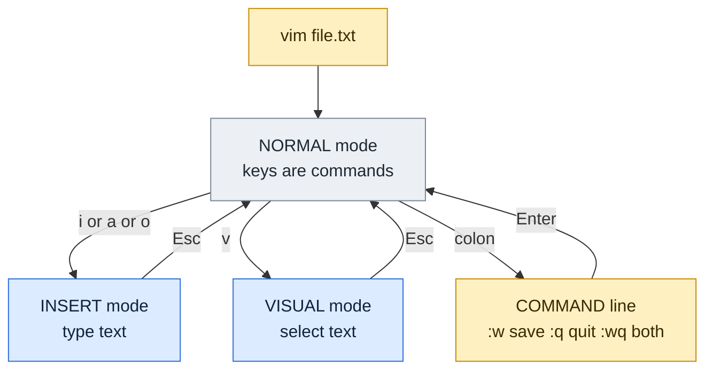

# vim

## What is it?
`vim` (Vi IMproved) is a text editor that runs inside the terminal. It is installed, or one package away, on almost every Linux server, so it is the editor you can count on when you log in over SSH to change a config file. Vim is **modal**: the same key does different things depending on the **mode** you are in. That is what makes it fast, and also what confuses beginners.

`vi` is the older editor that Vim is based on. On most systems `vi` starts Vim (or a small version of it).

## Syntax
```bash
vim [OPTIONS] [FILE...]
vim +N FILE            # open at line N
vim +/pattern FILE     # open at the first match
vim -R FILE            # read only (also: view FILE)
vim -d FILE1 FILE2     # show the differences (also: vimdiff)
```

## Visual Overview
> `vim` has modes. You start in Normal mode, where keys are commands. Press `i` to type text, `Esc` to come back, `:` to save or quit.



## Options/Flags
**Survival kit (learn these first)**

| Keys | Action |
|------|--------|
| `i` | Insert before the cursor (start typing) |
| `Esc` | Back to Normal mode |
| `:w` + Enter | Save |
| `:q` + Enter | Quit |
| `:wq` or `ZZ` | Save and quit |
| `:q!` | Quit and **throw away** the changes |
| `u` | Undo |
| `Ctrl+r` | Redo |

**Moving (Normal mode)**

| Keys | Move |
|------|------|
| `h` `j` `k` `l` | Left, down, up, right (the arrow keys also work) |
| `w` / `b` | Next / previous word |
| `0` / `$` | Start / end of the line |
| `gg` / `G` | First / last line |
| `NG` or `:N` | Go to line `N` (for example `12G`) |
| `Ctrl+f` / `Ctrl+b` | Page down / up |
| `/text` + Enter | Search forward (`n` next, `N` previous) |
| `?text` + Enter | Search backward |
| `*` | Search for the word under the cursor |

**Editing (Normal mode)**

| Keys | Action |
|------|--------|
| `i` / `a` | Insert before / after the cursor |
| `I` / `A` | Insert at the start / end of the line |
| `o` / `O` | Open a new line below / above |
| `x` | Delete the character under the cursor |
| `dw` | Delete a word |
| `dd` | Delete (cut) the line, `3dd` deletes 3 lines |
| `D` | Delete to the end of the line |
| `cw` / `cc` | Change a word / the whole line (delete, then insert) |
| `ci"` | Change the text inside double quotes |
| `yy` / `p` / `P` | Copy the line / paste below / paste above |
| `J` | Join the next line to this one |
| `>>` / `<<` | Indent / unindent the line |
| `.` | Repeat the last change |
| `u` | Undo |
| `3x`, `2dd`, `5j` | A number before a command repeats it |

**Command line (`:` commands)**

| Command | Action |
|---------|--------|
| `:w`, `:w name` | Save, save as |
| `:q`, `:q!`, `:wq`, `:x` | Quit, force quit, save and quit, save if changed and quit |
| `:e file` | Open another file |
| `:r file` | Insert a file below the cursor |
| `:r !cmd` | Insert the output of a command |
| `:s/old/new/` | Replace on the current line |
| `:%s/old/new/g` | Replace in the whole file, `c` flag asks for each one |
| `:g/pat/d` | Delete every line that matches |
| `:v/pat/d` | Delete every line that does **not** match |
| `:N,Md` | Delete lines `N` to `M` |
| `:%!sort` | Send the whole file through a command and replace it |
| `:set number` | Show line numbers (`:set nonumber` hides) |
| `:set tabstop=4 expandtab` | Tabs of width 4, typed as spaces |
| `:set paste` | Paste without auto indent mangling |
| `:w !sudo tee % > /dev/null` | Save a file you opened without root |
| `:help topic` | Built in help |

**Command line options**

| Option | Meaning |
|--------|---------|
| `-u NONE` | Do not read any `.vimrc` (clean, predictable behaviour) |
| `-N` | Not compatible with old `vi` |
| `-es` | Silent Ex mode, used for scripts |
| `-c 'cmd'` | Run a command after opening the file |
| `-R` | Read only |
| `-d` | Diff mode |
| `-O` / `-o` | Open several files side by side / one above the other |
| `+N` | Start at line `N` |

**Visual mode:** `v` selects characters, `V` selects lines, `Ctrl+v` selects a block (a column). Then press `d`, `y`, `>`, `:`, or `I` (in block mode) to act on the selection.

For the examples let's say we have this file:

**Input file** (`conf.txt`):
```text
server=web1
port=8080
# old setting
port=8080
debug=false
name=app
```

Each example shows the **keys** you type in Vim, and an equivalent **command** that does the same without opening the screen, so that you can check the result. The command uses `-u NONE -N -es -c '...' -c 'wq'`, where `normal ...` plays the keys of Normal mode. Restore `conf.txt` between examples.

## Usage Examples

### Example 1: Delete a line (`dd`)
**Keys:** `3G` (go to line 3), `dd`, `:wq`

**Command:**
```bash
vim -u NONE -N -es -c 'normal 3Gdd' -c 'wq' conf.txt
cat conf.txt
```
**Sample Output:**
```text
server=web1
port=8080
port=8080
debug=false
name=app
```
The comment line is gone.

### Example 2: Delete several lines (`2dd`)
**Keys:** `2G`, `2dd`, `:wq`

**Command:**
```bash
vim -u NONE -N -es -c 'normal 2Gd2d' -c 'wq' conf.txt
cat conf.txt
```
**Sample Output:**
```text
server=web1
port=8080
debug=false
name=app
```
Lines 2 and 3 were deleted (`2dd` is the same as `d2d`).

### Example 3: Copy and paste a line (`yy`, `p`)
**Keys:** `1G`, `yy`, `6G`, `p`, `:wq`

**Command:**
```bash
vim -u NONE -N -es -c 'normal 1Gyy' -c 'normal 6Gp' -c 'wq' conf.txt
cat conf.txt
```
**Sample Output:**
```text
server=web1
port=8080
# old setting
port=8080
debug=false
name=app
server=web1
```
`yy` copied line 1, `p` pasted it below line 6.

### Example 4: Replace text on one line (`:s`)
**Keys:** `:2s/8080/9090/` + Enter, `:wq`

**Command:**
```bash
vim -u NONE -N -es -c '2s/8080/9090/' -c 'wq' conf.txt
cat conf.txt
```
**Sample Output:**
```text
server=web1
port=9090
# old setting
port=8080
debug=false
name=app
```
Only line 2 changed.

### Example 5: Replace in the whole file (`:%s///g`)
**Keys:** `:%s/8080/9090/g` + Enter, `:wq`

**Command:**
```bash
vim -u NONE -N -es -c '%s/8080/9090/g' -c 'wq' conf.txt
cat conf.txt
```
**Sample Output:**
```text
server=web1
port=9090
# old setting
port=9090
debug=false
name=app
```
`%` means "all lines" and `g` means "every match on the line". Add `c` (`:%s/8080/9090/gc`) to confirm each change.

### Example 6: Delete all comment lines (`:g/pat/d`)
**Keys:** `:g/^#/d` + Enter, `:wq`

**Command:**
```bash
vim -u NONE -N -es -c 'g/^#/d' -c 'wq' conf.txt
cat conf.txt
```
**Sample Output:**
```text
server=web1
port=8080
port=8080
debug=false
name=app
```
`^#` is a regular expression for "starts with `#`", see [Regular expressions](../fundamentals/12-regular-expressions.md).

### Example 7: Keep only the lines that match (`:v/pat/d`)
**Keys:** `:v/port/d` + Enter, `:wq`

**Command:**
```bash
vim -u NONE -N -es -c 'v/port/d' -c 'wq' conf.txt
cat conf.txt
```
**Sample Output:**
```text
port=8080
port=8080
```
`:v` is the opposite of `:g`. It deletes every line that does **not** contain `port`.

### Example 8: Add text at the end of the file (`G`, `A`)
**Keys:** `G` (last line), `A` (append at end of line), type `x`, `Esc`, `:wq`

**Command:**
```bash
vim -u NONE -N -es -c 'normal GAx' -c 'wq' conf.txt
tail -1 conf.txt
```
**Sample Output:**
```text
name=appx
```

### Example 9: Insert a new line above (`O`) and below (`o`)
**Keys:** `1G`, `O`, type `new=first`, `Esc`, `:wq`

**Command:**
```bash
vim -u NONE -N -es -c 'normal 1GOnew=first' -c 'wq' conf.txt
head -2 conf.txt
```
**Sample Output:**
```text
new=first
server=web1
```
With `o` instead of `O` the new line opens **below** line 1:

```bash
vim -u NONE -N -es -c 'normal 1Gonew=second' -c 'wq' conf.txt
head -3 conf.txt
```
```text
server=web1
new=second
port=8080
```
(Restore `conf.txt` before the second command.)

### Example 10: Change a word (`cw`)
**Keys:** `1G`, `f=` (jump to `=`), `l` (one right), `cw`, type `app9`, `Esc`, `:wq`

**Command:**
```bash
vim -u NONE -N -es -c 'normal 1Gf=lcwapp9' -c 'wq' conf.txt
head -1 conf.txt
```
**Sample Output:**
```text
server=app9
```
`cw` deletes the word `web1` and enters Insert mode.

### Example 11: Delete a word, to end of line, characters (`dw`, `D`, `x`)
**Keys / commands:**

```bash
vim -u NONE -N -es -c 'normal 6Gdw' -c 'wq' conf.txt     # delete a word on line 6
tail -1 conf.txt
```
**Sample Output:**
```text
=app
```
`dw` removed `name`, so only `=app` is left on line 6. Restore the file, then:

```bash
vim -u NONE -N -es -c 'normal 1Gf=lD' -c 'wq' conf.txt   # delete to the end of line 1 after the =
head -1 conf.txt
```
```text
server=
```
Restore the file, then:

```bash
vim -u NONE -N -es -c 'normal 1G5x' -c 'wq' conf.txt     # delete 5 characters
head -1 conf.txt
```
```text
r=web1
```

### Example 12: Undo (`u`) and join lines (`J`)
**Keys:** `1G`, `dd`, `u`

**Command:**
```bash
vim -u NONE -N -es -c 'normal 1Gddu' -c 'wq' conf.txt
head -1 conf.txt
```
**Sample Output:**
```text
server=web1
```
The line was deleted and `u` brought it back. Now join line 1 and 2 with `J`, after restoring the file:

```bash
vim -u NONE -N -es -c 'normal 1GJ' -c 'wq' conf.txt
head -1 conf.txt
```
```text
server=web1 port=8080
```

### Example 13: Indent lines (`>`)
**Keys:** `:1,2>` + Enter, `:wq`

**Command:**
```bash
vim -u NONE -N -es -c '1,2>' -c 'wq' conf.txt
head -2 conf.txt | cat -A
```
**Sample Output:**
```text
^Iserver=web1$
^Iport=8080$
```
`cat -A` makes the tab (`^I`) and the end of line (`$`) visible.

### Example 14: Work on a range of lines (`:N,Md`, `:t`, `:m`)
**Keys:** `:2,4d` + Enter, `:wq`

**Command:**
```bash
vim -u NONE -N -es -c '2,4d' -c 'wq' conf.txt
cat conf.txt
```
**Sample Output:**
```text
server=web1
debug=false
name=app
```
Copy line 1 to the end with `:1t$`, move it with `:1m$`.

### Example 15: Insert another file or a command output (`:r`)
Let's say we have also this file:

**Input file** (`extra.txt`):
```text
extra=1
```

**Command:**
```bash
vim -u NONE -N -es -c '$r extra.txt' -c 'wq' conf.txt
tail -2 conf.txt
```
**Sample Output:**
```text
name=app
extra=1
```
Use `:r !date` or `:r !hostname` to insert the output of a command.

```bash
vim -u NONE -N -es -c '$r !echo from-command' -c 'wq' conf.txt
tail -1 conf.txt
```
```text
from-command
```
(Restore `conf.txt` before the second command.)

### Example 16: Sort the lines with a filter (`:%!sort`)
Let's say we have this file:

**Input file** (`fr.txt`):
```text
pear
apple
fig
```

**Command:**
```bash
vim -u NONE -N -es -c '%!sort' -c 'wq' fr.txt
cat fr.txt
```
**Sample Output:**
```text
apple
fig
pear
```
`%!command` sends all lines through any program, here `sort`. Useful with `uniq`, `jq`, `column -t`, `awk`.

### Example 17: Save part of a file (`:w`) and quit without saving (`:q!`)
**Command:**
```bash
vim -u NONE -N -es -c '1,2w part.txt' -c 'q!' conf.txt
cat part.txt
```
**Sample Output:**
```text
server=web1
port=8080
```
Now throw away a change:

```bash
vim -u NONE -N -es -c 'normal ggdd' -c 'q!' conf.txt
head -1 conf.txt
```
```text
server=web1
```
The `dd` was discarded, `conf.txt` still starts with `server=web1`.

### Example 18: Change text inside quotes (`ci"`)
Let's say we have this file:

**Input file** (`q.txt`):
```text
name="old value"
```

**Command:**
```bash
vim -u NONE -N -es -c 'normal f"ci"new' -c 'wq' q.txt
cat q.txt
```
**Sample Output:**
```text
name="new"
```
`f"` jumps to the first quote, `ci"` changes everything inside the pair of quotes. Also try `ci(`, `ci{`, `ci[`, `cit` (inside an HTML tag).

### Example 19: Repeat a change with the dot key
Let's say we have this file:

**Input file** (`d.txt`):
```text
a
a
a
```

**Command:**
```bash
vim -u NONE -N -es -c 'normal 1Gxj.j.' -c 'wq' d.txt
cat d.txt | tr '\n' '|'
echo
```
**Sample Output:**
```text
|||
```
`x` deleted the `a` on line 1, `j` moved down, and `.` repeated the `x` for lines 2 and 3. Three empty lines are left (shown as `|||`).

### Example 20: Comment out several lines (visual block)
Let's say we have this file:

**Input file** (`vb.txt`):
```text
a
b
c
```

**Keys:** `1G`, `Ctrl+v`, `jj` (select the first column of three lines), `I`, type `# `, `Esc`

**Command:**
```bash
vim -u NONE -N -es -c 'exe "normal gg\<C-v>jjI# "' -c 'wq' vb.txt
cat vb.txt
```
**Sample Output:**
```text
# a
# b
# c
```
When you leave Insert mode, the text appears on all selected lines.

### Example 21: Settings in a `vimrc`
Let's say we have this file:

**Input file** (`myvimrc`):
```text
set number
set tabstop=4
```

**Command:**
```bash
vim -u myvimrc -N -es -c 'redir! >opts.txt' -c 'echo &tabstop' -c 'echo &number' -c 'redir END' -c 'q!'
tr '\n' ' ' < opts.txt
echo
```
**Sample Output:**
```text
 4 1
```
The file is read at start up. `~/.vimrc` is your personal one. A starter for server work:

```text
set number
set expandtab
set tabstop=2
set shiftwidth=2
set hlsearch
set ignorecase smartcase
syntax on
```

### Example 22: Compare two files (`vim -d`)
Let's say we have these files:

**Input file** (`da.txt`):
```text
a
b
```
**Input file** (`db.txt`):
```text
a
c
```

**Command:**
```bash
diff da.txt db.txt
```
**Sample Output:**
```text
2c2
< b
---
> c
```
`vim -d da.txt db.txt` shows the same difference side by side with colours. Jump with `]c` (next change) and `[c`, copy a change with `dp` (put to the other file) and `do` (obtain), close with `:qa`.

### Example 23: File type detection
Let's say we have this file:

**Input file** (`s.sh`):
```text
#!/bin/bash
echo hi
```

**Command:**
```bash
vim -u NORC -N -es -c 'filetype detect' -c 'redir! >ft.txt' -c 'echo &ft' -c 'redir END' -c 'q!' s.sh
tr -d '\n' < ft.txt
echo
```
**Sample Output:**
```text
sh
```
Vim detects the language from the name and the first line, and applies the right colours and indentation rules.

## Sample Output
Check the version and the main features of the Vim on a server:

```bash
vim --version | head -1
vim --version | grep -oE '[+-](syntax|clipboard|python3)' | tr '\n' ' '
echo
```
```text
VIM - Vi IMproved 8.2 (2019 Dec 12, compiled Aug 24 2026 22:13:24)
-clipboard +python3 +syntax
```
`+` means the feature is compiled in, `-` means it is not. A server often has `-clipboard`, so copying to the system clipboard (`"+y`) does not work there.

## Pitfalls / Gotchas
- **"I cannot type"**: you are in Normal mode. Press `i`. **"I cannot quit"**: press `Esc`, then `:q!` + Enter to leave without saving, or `:wq` to save.
- **Caps Lock** on turns every command into another one (`dd` becomes `DD`, which does nothing useful). Check it first when Vim behaves strangely.
- **Swap files** (`.file.swp`) appear when Vim crashes or the file is open in another session. Vim offers to recover. Delete the `.swp` only after you made sure nobody else is editing.
- You cannot save a file owned by root when you started `vim` as a normal user ("E45: readonly option is set", "E212: Can't open file for writing"). Use `:w !sudo tee % > /dev/null`, or better, start with `sudoedit file` (it edits a temporary copy and writes it back with root rights).
- Pasting indented text into Insert mode can add staircase indentation. Use `:set paste` first (and `:set nopaste` after).
- YAML and Python need **spaces**, not tabs. Add `set expandtab tabstop=2 shiftwidth=2` to `~/.vimrc`.
- `:%s/old/new/g` works with **regular expressions**: `.` and `*` are special. Escape them with `\`, or start with `\V` for plain text. Use `/` inside the pattern as `\/` or change the separator: `:%s#/usr/bin#/opt/bin#g`.
- `dd` and `yy` put the text into a register that the next delete overwrites. Copy first, then paste, then delete.
- `u` undoes the last change, `Ctrl+r` redoes it. `U` undoes all changes on a line, which is rarely what you want.
- Vim keeps the file open. If you edit a log file that is still growing, use `:e!` to reload it, or use `tail -f` to follow it.
- `ZZ` saves and quits, `ZQ` quits without saving. Typing them by mistake can lose work.
- Files with Windows line endings show `^M`. Convert them with `:%s/\r//` or `:set ff=unix`.
- `vim -es` without `-u NONE` loads your `.vimrc`, so a script behaves differently on every machine. Always add `-u NONE -N`.
- On a minimal server `vim` may not be installed, only `vi` (or `vim.tiny`) with fewer features. The basic keys on this page work in all of them.

## DevOps Use Cases

### Use Case 1: Change a setting on a server over SSH
**Situation:** The port in a config file must change from 8080 to 9090 on every line.

Using the `conf.txt` file shown above.

**Command:**
```bash
vim -u NONE -N -es -c '%s/8080/9090/g' -c 'wq' conf.txt
grep -c 9090 conf.txt
```
**Sample Output:**
```text
2
```
In an interactive session you open the file with `vim conf.txt`, type `:%s/8080/9090/g`, press Enter, and then `:wq`. Take a copy first: `cp conf.txt conf.txt.bak`.

### Use Case 2: Clean a file in a script without a screen
**Situation:** A deploy script must strip comments and sort a list before it uses the file.

Let's say we have these two files:

**Input file** (`fr.txt`, with a comment line added):
```text
# fruit list
pear
apple
fig
```

**Command:**
```bash
vim -u NONE -N -es -c 'g/^#/d' -c '%!sort' -c 'wq' fr.txt
cat fr.txt
```
**Sample Output:**
```text
apple
fig
pear
```
Ex mode (`-es`) is a scripting tool that is on every server where Vim is. For plain substitutions `sed -i` is usually simpler, see [`sed`](../text-processing/sed.md).

### Use Case 3: Edit a file that needs root
**Situation:** You must change `/etc/hosts` and forgot `sudo`.

**Command:**
```bash
echo ':w !sudo tee % > /dev/null'
```
**Sample Output:**
```text
:w !sudo tee % > /dev/null
```
Type that line in Command mode (not in the shell) and Vim writes the file through `sudo tee`. Afterwards use `:q!`, because Vim still thinks the file is modified. The cleaner habit is `sudo -e /etc/hosts` or `sudoedit /etc/hosts`.

### Use Case 4: See what differs between two config files
**Situation:** Compare the config of two servers.

Using the `da.txt` and `db.txt` files from Example 22.

**Command:**
```bash
diff da.txt db.txt
```
**Sample Output:**
```text
2c2
< b
---
> c
```
Open the same files with `vimdiff da.txt db.txt` to see them side by side, and merge with `do` and `dp`.

### Use Case 5: The editor behind other tools
**Situation:** `crontab -e`, `visudo`, `git commit` and `kubectl edit` all open your editor.

**Command:**
```bash
export EDITOR=vim
echo "editor is $EDITOR"
```
**Sample Output:**
```text
editor is vim
```
Put `export EDITOR=vim` (or `nano`) in `~/.bashrc` to choose. `visudo` ignores `EDITOR` on some systems for safety, and uses the one configured in `sudoers`. Debian and Ubuntu also have `sudo update-alternatives --config editor` for the system default.

## Related Commands
- [`nano`](nano.md) - a simpler editor with the keys shown on screen
- [`sed`](../text-processing/sed.md) - edit files from the command line
- [`diff`](../text-processing/diff.md) - compare files
- [`cat`](../file-management/cat.md) / [`less`](../file-management/less.md) - look at a file without editing it
- [`crontab`](../scheduling/crontab.md) - opens your editor with `crontab -e`
- [`sudo`](../user-management/sudo.md) - `sudoedit` edits a root file safely
- [`visudo`](../user-management/visudo.md) - safe editing of `sudoers`
- [Regular expressions](../fundamentals/12-regular-expressions.md) - the patterns used by `/`, `:s` and `:g`
- `vimtutor` - a 30 minute interactive lesson that comes with Vim

---
<!-- nav -->
[← Previous: `nano`](nano.md) | [Learning path](../README.md) | [Next: `wc` →](../text-processing/wc.md)
