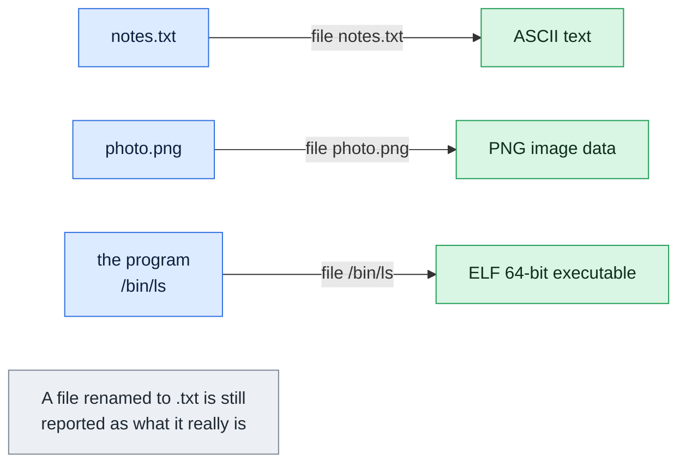

# file

## What is it?
`file` tells you what kind of data a file contains. Linux does not rely on file extensions, so `file` looks at the content: it checks the first bytes (the "magic number") against a database and runs a few text tests. It can tell a shell script from a binary, a gzip archive from an HTML page, UTF-8 from plain ASCII and Windows from Unix line endings.

## Syntax
```bash
file [OPTIONS] FILE...
```

## Visual Overview
> `file` looks at the first bytes inside a file, not at its name or extension, and tells you what it really is.



## Options/Flags
| Flag | Description |
|------|-------------|
| `-b` / `--brief` | Do not print the file name, only the type |
| `-i` / `--mime` | Print the MIME type and the character set, for example `text/plain; charset=us-ascii` |
| `--mime-type` | Print only the MIME type |
| `--mime-encoding` | Print only the character encoding |
| `--extension` | Print the usual file extensions for this type |
| `-L` / `--dereference` | Follow symbolic links and describe the target |
| `-h` / `--no-dereference` | Do not follow symbolic links. This is the default |
| `-s` / `--special-files` | Also read block or character special files, such as disk partitions |
| `-z` / `--uncompress` | Look inside compressed files |
| `-Z` / `--uncompress-noreport` | Look inside compressed files and show only the type of the content |
| `-f FILE` / `--files-from FILE` | Read the list of files to check from `FILE`, one per line |
| `-F STR` / `--separator STR` | Use `STR` between the file name and the type instead of `:` |
| `-N` / `--no-pad` | Do not align the output of several files |
| `-0` / `--print0` | Put a NUL character after the file name |
| `-v` / `--version` | Show the version |
| `--help` | Show the help text |

## Usage Examples

Let's say we have this file `app.log`:

**Input file** (`app.log`):
```text
2026-10-06 10:00:01 INFO Service started
2026-10-06 10:00:05 WARN Disk usage at 82%
2026-10-06 10:00:09 ERROR Connection refused
```

Let's say we have this file `deploy.sh`:

**Input file** (`deploy.sh`):
```text
#!/bin/bash
echo "deploying"
```

Let's say we have this file `windows.sh` (every line ends with the Windows characters `CR LF`):

**Input file** (`windows.sh`):
```text
echo hi
ls
```

Let's say we have this file `notes.txt` (the second letter is `é`, saved as UTF-8):

**Input file** (`notes.txt`):
```text
héllo
```

Let's say we have this file `page.html`:

**Input file** (`page.html`):
```text
<html><body>404</body></html>
```

Let's say we also have:
- an empty file `empty.txt` (0 bytes)
- a directory `logs/`
- a symbolic link `latest.log` that points to `app.log`
- a gzip archive `app.log.gz` made with `gzip -k app.log`
- a text file `filelist.txt` that lists `app.log` and `deploy.sh`, one per line

**Input file** (`filelist.txt`):
```text
app.log
deploy.sh
```

### Example 1: Identify a text file
**Command:**
```bash
file app.log
```
**Sample Output:**
```text
app.log: ASCII text
```

### Example 2: Identify a script
**Command:**
```bash
file deploy.sh
```
**Sample Output:**
```text
deploy.sh: Bourne-Again shell script, ASCII text executable
```

### Example 3: Detect Windows line endings
**Command:**
```bash
file windows.sh
```
**Sample Output:**
```text
windows.sh: ASCII text, with CRLF line terminators
```

### Example 4: Detect UTF-8 text
**Command:**
```bash
file notes.txt
```
**Sample Output:**
```text
notes.txt: Unicode text, UTF-8 text
```

### Example 5: Empty files, directories and links
**Command:**
```bash
file empty.txt logs latest.log
```
**Sample Output:**
```text
empty.txt:  empty
logs:       directory
latest.log: symbolic link to app.log
```

### Example 6: Several files
Names are padded so that the types line up.

**Command:**
```bash
file app.log deploy.sh page.html
```
**Sample Output:**
```text
app.log:   ASCII text
deploy.sh: Bourne-Again shell script, ASCII text executable
page.html: HTML document, ASCII text
```

### Example 7: Hide the file name (`-b`)
**Command:**
```bash
file -b deploy.sh
```
**Sample Output:**
```text
Bourne-Again shell script, ASCII text executable
```

### Example 8: MIME type and character set (`-i`)
**Command:**
```bash
file -i notes.txt
```
**Sample Output:**
```text
notes.txt: text/plain; charset=utf-8
```

### Example 9: MIME type only (`--mime-type`)
**Command:**
```bash
file --mime-type page.html
```
**Sample Output:**
```text
page.html: text/html
```

### Example 10: Encoding only (`--mime-encoding`)
**Command:**
```bash
file --mime-encoding notes.txt
```
**Sample Output:**
```text
notes.txt: utf-8
```

### Example 11: Common extensions of the type (`--extension`)
**Command:**
```bash
file --extension app.log.gz
```
**Sample Output:**
```text
app.log.gz: gz/tgz/tpz/zabw/svgz/adz/kmy/xcfgz
```

### Example 12: Follow a symbolic link (`-L`)
**Command:**
```bash
file -L latest.log
```
**Sample Output:**
```text
latest.log: ASCII text
```

### Example 13: Do not follow a symbolic link (`-h`)
This is the default behavior on Linux, so the output is the same as in Example 5.

**Command:**
```bash
file -h latest.log
```
**Sample Output:**
```text
latest.log: symbolic link to app.log
```

### Example 14: Describe a disk partition (`-s`)
Block devices need `-s` (and root access) because `file` otherwise reports only that it is a block device.

**Command:**
```bash
sudo file -s /dev/sda1
```
**Sample Output:**
```text
/dev/sda1: Linux rev 1.0 ext4 filesystem data, UUID=8c5b1a52-3f0e-4e0b-9d6c-1b2f4a7c9e10 (extents) (64bit) (large files) (huge files)
```

### Example 15: Look inside a compressed file (`-z`)
**Command:**
```bash
file app.log.gz
file -z app.log.gz
```
**Sample Output:**
```text
app.log.gz: gzip compressed data, was "app.log", last modified: Mon Oct 12 11:59:00 2026, from Unix, original size modulo 2^32 129
app.log.gz: ASCII text (gzip compressed data, was "app.log", last modified: Mon Oct 12 11:59:00 2026, from Unix, original size modulo 2^32 129)
```

### Example 16: Show only the content type of a compressed file (`-Z`)
**Command:**
```bash
file -Z app.log.gz
```
**Sample Output:**
```text
app.log.gz: ASCII text
```

### Example 17: Read file names from a list (`-f`)
**Command:**
```bash
file -f filelist.txt
```
**Sample Output:**
```text
app.log:   ASCII text
deploy.sh: Bourne-Again shell script, ASCII text executable
```

### Example 18: Change the separator (`-F`)
**Command:**
```bash
file -F ' =>' deploy.sh app.log
```
**Sample Output:**
```text
deploy.sh => Bourne-Again shell script, ASCII text executable
app.log =>   ASCII text
```

### Example 19: Do not align the output (`-N`)
**Command:**
```bash
file -N deploy.sh app.log
```
**Sample Output:**
```text
deploy.sh: Bourne-Again shell script, ASCII text executable
app.log: ASCII text
```

### Example 20: NUL after the file name (`-0`)
Useful when file names may contain a colon or spaces. `tr` turns the NUL into `|` so you can see it.

**Command:**
```bash
file -0 deploy.sh | tr '\0' '|'
```
**Sample Output:**
```text
deploy.sh|: Bourne-Again shell script, ASCII text executable
```

### Example 21: Check the version (`-v`)
**Command:**
```bash
file -v | head -n 1
```
**Sample Output:**
```text
file-5.41
```

### Example 22: Show the help (`--help`)
**Command:**
```bash
file --help | head -n 1
```
**Sample Output:**
```text
Usage: file [OPTION...] [FILE...]
```

## Pitfalls / Gotchas
- **`file` guesses.** It is based on patterns, so it can be wrong for odd or damaged files. Treat the answer as a strong hint.
- **The extension is ignored.** A file named `photo.jpg` that holds text is reported as text. That is the purpose of the command.
- **Symbolic links are not followed by default.** Use `-L` to describe the target.
- **Block devices need `-s`** (and usually `sudo`) to be inspected.
- **Large compressed files:** `-z` has to decompress some of the data, so it is slower.
- **The wording of the answer can change between versions** of `file`. Do not parse the human text in scripts. For scripts use `--mime-type`, which is stable.
- **A script without a shebang** (`#!`) is reported only as `ASCII text`, not as a shell script.
- **An empty MIME type is reported as `inode/x-empty`** for empty files and `inode/directory` for directories.

## DevOps Use Cases

### Use Case 1: Find out why a script fails with `bad interpreter`
**Situation:** `./deploy.sh` fails with `/bin/bash^M: bad interpreter`. The script was edited on Windows and has CRLF line endings.

**Input file** (`windows.sh`): same file as in the Usage Examples.

**Command:**
```bash
file windows.sh
sed -i 's/\r$//' windows.sh
file windows.sh
```
**Output:**
```text
windows.sh: ASCII text, with CRLF line terminators
windows.sh: ASCII text
```

### Use Case 2: Check that a download is really an archive
**Situation:** A `curl` download of `tool.tar.gz` saved an HTML error page instead.

**Input file** (`tool.tar.gz`, really an HTML page):
```text
<html><body>404</body></html>
```
**Command:**
```bash
file tool.tar.gz
```
**Output:**
```text
tool.tar.gz: HTML document, ASCII text
```

### Use Case 3: Check the CPU architecture of a binary
**Situation:** A container fails with `exec format error`. Check if the binary was built for another CPU, for example ARM instead of x86-64.

**Command:**
```bash
file ./myapp
```
**Output:**
```text
./myapp: ELF 64-bit LSB executable, ARM aarch64, version 1 (SYSV), statically linked, Go BuildID=abc123, not stripped
```
On an x86-64 host this is the wrong binary. A correct build shows `x86-64` instead of `ARM aarch64`.

### Use Case 4: Verify that a binary is statically linked for a minimal image
**Situation:** A `scratch` Docker image has no libc. The binary must be static.

**Command:**
```bash
file ./myapp
```
**Output:**
```text
./myapp: ELF 64-bit LSB executable, x86-64, version 1 (SYSV), statically linked, Go BuildID=abc123, not stripped
```
If it said `dynamically linked`, the container would fail to start.

### Use Case 5: Find every shell script, even without `.sh`
**Situation:** Some scripts in `bin/` have no extension. Find them to lint in CI.

**Input (directory content)** (`bin/`): `bin/deploy` (a bash script), `bin/backup` (a bash script), `bin/tool` (a compiled program).

**Command:**
```bash
find bin -type f -exec file {} + | grep "shell script"
```
**Output:**
```text
bin/backup: Bourne-Again shell script, ASCII text executable
bin/deploy: Bourne-Again shell script, ASCII text executable
```

### Use Case 6: Pick the right `Content-Type` when uploading
**Situation:** An upload script to S3 must send the correct MIME type.

**Input file** (`page.html`): same file as in the Usage Examples.

**Command:**
```bash
aws s3 cp page.html s3://my-bucket/page.html --content-type "$(file -b --mime-type page.html)"
```
**Output:**
```text
upload: ./page.html to s3://my-bucket/page.html
```

### Use Case 7: Check the encoding before importing data
**Situation:** A CSV import fails with garbled characters. Find out whether the file is UTF-8 or Latin-1.

**Input file** (`notes.txt`): same file as in the Usage Examples.

**Command:**
```bash
file -i notes.txt
```
**Output:**
```text
notes.txt: text/plain; charset=utf-8
```

### Use Case 8: Identify an unknown file from a customer or a backup
**Situation:** A file named `backup.dat` has no extension and nobody knows what it is.

**Command:**
```bash
file backup.dat
```
**Output:**
```text
backup.dat: gzip compressed data, was "db.sql", last modified: Sat Oct 10 02:00:01 2026, from Unix, original size modulo 2^32 5242880
```
Now you know to run `gunzip -c backup.dat | head` to look at the SQL.

### Use Case 9: Check what is inside a rotated, compressed log
**Situation:** Verify that a `.gz` log holds text and not a corrupted or empty file.

**Input file** (`app.log.gz`): gzip of `app.log` from the Usage Examples.

**Command:**
```bash
file -Z app.log.gz
```
**Output:**
```text
app.log.gz: ASCII text
```

### Use Case 10: Bulk check a list of deploy artifacts
**Situation:** A release job checks every artifact in a list and fails if one is not what it expects.

**Input file** (`filelist.txt`): same file as in the Usage Examples.

**Command:**
```bash
file -b --mime-type -f filelist.txt
```
**Output:**
```text
text/plain
text/x-shellscript
```

## Related Commands
- [`ls`](ls.md) - list files
- [`cat`](cat.md) - print the content of a text file
- [`head`](head.md) - look at the first bytes or lines
- [`find`](find.md) - search for files by name, type or age
- [`ln`](ln.md) - create the links that `file` reports
- `stat` - show size, permissions and times
- `xxd` / `hexdump` - see the raw bytes of a file
- `ldd` - show the libraries of a dynamic binary

---
<!-- nav -->
[← Previous: `tail`](tail.md) | [Learning path](../README.md) | [Next: `find` →](find.md)
