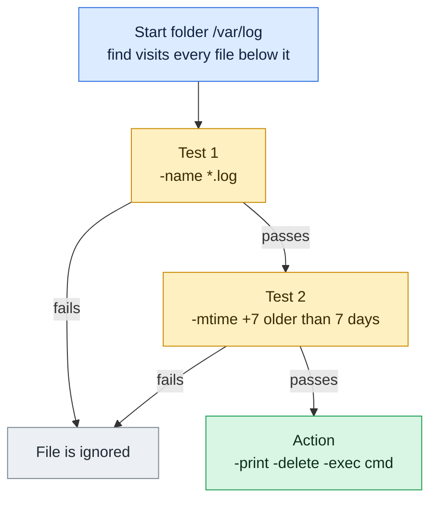

# find

## What is it?
`find` walks a directory tree and prints the files and directories that match conditions you give it: name, type, size, age, owner, permissions and more. It can also run a command on every match or delete them. It searches the live filesystem, so results are always current. `find` is the main tool for cleanup jobs, audits and bulk changes.

## Syntax
```bash
find [STARTING_POINT...] [EXPRESSION]
```
The expression is made of **options** (like `-maxdepth`), **tests** (like `-name`), **operators** (like `-o`) and **actions** (like `-exec`). If you give no starting point, `.` is used. If you give no action, `-print` is used.

## Visual Overview
> `find` walks every file under a folder and tests each one. Only files that pass every test reach the action.



## Options/Flags

### Global options (affect how the tree is walked)
| Flag | Description |
|------|-------------|
| `-maxdepth N` | Go down at most `N` levels. `0` means only the starting points |
| `-mindepth N` | Ignore entries above level `N` |
| `-depth` | Process the contents of a directory before the directory itself |
| `-xdev` / `-mount` | Do not cross into other filesystems |
| `-L` | Follow symbolic links |
| `-P` | Never follow symbolic links (default) |
| `-H` | Follow symbolic links only for the starting points |
| `-regextype TYPE` | Choose the regex flavor for `-regex`, for example `posix-extended` |
| `--version` | Show the version |
| `--help` | Show the help text |

### Tests (choose which entries match)
| Test | Description |
|------|-------------|
| `-name PATTERN` | File name matches the shell pattern (case-sensitive) |
| `-iname PATTERN` | Same as `-name`, ignoring case |
| `-path PATTERN` | The whole path matches the pattern |
| `-ipath PATTERN` | Same as `-path`, ignoring case |
| `-regex REGEX` | The whole path matches the regular expression |
| `-iregex REGEX` | Same as `-regex`, ignoring case |
| `-type T` | Type: `f` file, `d` directory, `l` symlink, `b` block device, `c` character device, `p` named pipe, `s` socket |
| `-size N[cwbkMG]` | Size. `+N` bigger, `-N` smaller, `N` exactly. `c` bytes, `k` KiB, `M` MiB, `G` GiB |
| `-empty` | Empty file or empty directory |
| `-mtime N` | Content modified `N` days ago (`+N` older, `-N` newer) |
| `-atime N` | Last accessed `N` days ago |
| `-ctime N` | Status (permissions, owner) changed `N` days ago |
| `-mmin N` | Content modified `N` minutes ago |
| `-amin N` | Last accessed `N` minutes ago |
| `-cmin N` | Status changed `N` minutes ago |
| `-newer FILE` | Modified more recently than `FILE` |
| `-newermt DATE` | Modified after the given date and time |
| `-perm MODE` | Permissions exactly `MODE` |
| `-perm -MODE` | All of the bits in `MODE` are set |
| `-perm /MODE` | Any of the bits in `MODE` is set |
| `-user NAME` / `-uid N` | Owned by user name or numeric user ID |
| `-group NAME` / `-gid N` | Owned by group name or numeric group ID |
| `-links N` | Has `N` hard links |
| `-inum N` | Has inode number `N` |
| `-samefile FILE` | Is the same file (same inode) as `FILE` |
| `-readable` / `-writable` / `-executable` | Can be read / written / executed by you |
| `-xtype T` | Like `-type`, but checks the target of a symlink |

### Operators
| Operator | Description |
|----------|-------------|
| `-a` / `-and` | Both are true. This is the default between two tests |
| `-o` / `-or` | Either is true |
| `!` / `-not` | Negate the next test |
| `\( ... \)` | Group expressions. The parentheses must be escaped for the shell |

### Actions (what to do with each match)
| Action | Description |
|--------|-------------|
| `-print` | Print the path, one per line (default) |
| `-print0` | Print the path followed by a NUL character, safe for names with spaces |
| `-ls` | Print details like `ls -dils` |
| `-printf FORMAT` | Print using a format, for example `%p` path, `%f` name, `%s` size, `%u` owner, `%m` mode |
| `-fprint FILE` | Write the paths to `FILE` |
| `-exec CMD {} \;` | Run `CMD` once for each match |
| `-exec CMD {} +` | Run `CMD` once with many matches at the end, like `xargs` |
| `-ok CMD {} \;` | Like `-exec`, but asks for confirmation first |
| `-delete` | Delete the match. Turns on `-depth` |
| `-prune` | Do not go into this directory |
| `-quit` | Stop after the first match |

## Usage Examples

Let's say we have this directory `project/` and we run all commands from inside it. Today is `2026-10-12 12:00`.

**Input (directory content)** (`project/`):

| Path | Type | Size | Permissions | Owner:Group | Modified |
|------|------|------|-------------|-------------|----------|
| `.env` | file | 7 B | `600` | deploy:deploy | 2026-10-12 11:58 |
| `.git/` | empty directory | - | `755` | deploy:deploy | 2026-09-01 |
| `empty/` | empty directory | - | `755` | deploy:deploy | 2026-09-01 |
| `link.py` | symlink to `src/main.py` | - | `777` | deploy:deploy | 2026-10-01 |
| `logs/` | directory | - | `755` | deploy:deploy | 2026-10-12 |
| `logs/app.log` | file | 5 MiB | `644` | deploy:deploy | 2026-10-12 11:59 |
| `logs/debug.log` | file | 2 KiB | `644` | root:adm | 2026-10-01 |
| `logs/old.log` | file | 300 B | `644` | deploy:deploy | 2026-08-28 (last read 2026-06-01) |
| `notes.tmp` | file | 0 B | `644` | deploy:deploy | 2026-10-10 |
| `run.sh` | file | 8 B | `755` | deploy:deploy | 2026-10-05 |
| `src/` | directory | - | `755` | deploy:deploy | 2026-10-12 |
| `src/main.py` | file | 12 B | `644` | deploy:deploy | 2026-10-12 11:50 |
| `src/util.py` | file | 4 B | `644` | deploy:deploy | 2026-10-02 |
| `src/util-hl.py` | hard link to `src/util.py` (inode 3145731) | 4 B | `644` | deploy:deploy | 2026-10-02 |

Contents of the small files:

**Input file** (`run.sh`):
```text
echo hi
```
**Input file** (`src/main.py`):
```text
print("hi")
```

> `find` does not sort its results. The order depends on the filesystem. To make this guide easy to read, results with several lines are shown sorted.
>
> For the time based examples, assume that only `logs/old.log` was last read (accessed) long ago on 2026-06-01, only `logs/app.log` is being read right now, and all other files were accessed recently.

### Example 1: List everything (default)
**Command:**
```bash
find
```
**Sample Output:**
```text
.
./.env
./.git
./empty
./link.py
./logs
./logs/app.log
./logs/debug.log
./logs/old.log
./notes.tmp
./run.sh
./src
./src/main.py
./src/util-hl.py
./src/util.py
```

### Example 2: Find by name (`-name`)
**Command:**
```bash
find . -name "*.py"
```
**Sample Output:**
```text
./link.py
./src/main.py
./src/util-hl.py
./src/util.py
```

### Example 3: Find by name, ignoring case (`-iname`)
**Command:**
```bash
find . -iname "*.PY"
```
**Sample Output:**
```text
./link.py
./src/main.py
./src/util-hl.py
./src/util.py
```

### Example 4: Match on the whole path (`-path`)
**Command:**
```bash
find . -path "./logs/*"
```
**Sample Output:**
```text
./logs/app.log
./logs/debug.log
./logs/old.log
```

### Example 5: Match on the whole path, ignoring case (`-ipath`)
**Command:**
```bash
find . -ipath "./LOGS/*"
```
**Sample Output:**
```text
./logs/app.log
./logs/debug.log
./logs/old.log
```

### Example 6: Match a regular expression (`-regex`)
`-regex` must match the **whole** path, so the pattern starts with `.*`.

**Command:**
```bash
find . -regex '.*\.\(py\|sh\)'
```
**Sample Output:**
```text
./link.py
./run.sh
./src/main.py
./src/util-hl.py
./src/util.py
```

### Example 7: Regular expression, ignoring case (`-iregex`)
**Command:**
```bash
find . -iregex '.*\.LOG'
```
**Sample Output:**
```text
./logs/app.log
./logs/debug.log
./logs/old.log
```

### Example 8: Choose the regex flavor (`-regextype`)
With `posix-extended` you write `(a|b)` without backslashes.

**Command:**
```bash
find . -regextype posix-extended -regex '.*\.(py|sh)'
```
**Sample Output:**
```text
./link.py
./run.sh
./src/main.py
./src/util-hl.py
./src/util.py
```

### Example 9: Only files (`-type f`)
**Command:**
```bash
find . -type f
```
**Sample Output:**
```text
./.env
./logs/app.log
./logs/debug.log
./logs/old.log
./notes.tmp
./run.sh
./src/main.py
./src/util-hl.py
./src/util.py
```

### Example 10: Only directories (`-type d`)
**Command:**
```bash
find . -type d
```
**Sample Output:**
```text
.
./.git
./empty
./logs
./src
```

### Example 11: Only symbolic links (`-type l`)
**Command:**
```bash
find . -type l
```
**Sample Output:**
```text
./link.py
```

### Example 12: Limit the depth (`-maxdepth`)
**Command:**
```bash
find . -maxdepth 1
```
**Sample Output:**
```text
.
./.env
./.git
./empty
./link.py
./logs
./notes.tmp
./run.sh
./src
```

### Example 13: Skip the top levels (`-mindepth`)
**Command:**
```bash
find . -mindepth 2 -type f
```
**Sample Output:**
```text
./logs/app.log
./logs/debug.log
./logs/old.log
./src/main.py
./src/util-hl.py
./src/util.py
```

### Example 14: Contents before directories (`-depth`)
**Command:**
```bash
find logs -depth
```
**Sample Output:**
```text
logs/app.log
logs/debug.log
logs/old.log
logs
```

### Example 15: Empty files and directories (`-empty`)
**Command:**
```bash
find . -empty
```
**Sample Output:**
```text
./.git
./empty
./notes.tmp
```

### Example 16: Bigger than a size (`-size +N`)
**Command:**
```bash
find . -type f -size +1M
```
**Sample Output:**
```text
./logs/app.log
```

### Example 17: Smaller than a size (`-size -N`)
`-size -1k` means "uses less than 1 KiB", which in practice is an empty file.

**Command:**
```bash
find . -type f -size -1k
```
**Sample Output:**
```text
./notes.tmp
```

### Example 18: An exact size (`-size N`)
`c` means bytes.

**Command:**
```bash
find . -type f -size 300c
```
**Sample Output:**
```text
./logs/old.log
```

### Example 19: Modified more than N days ago (`-mtime +N`)
**Command:**
```bash
find . -type f -mtime +30
```
**Sample Output:**
```text
./logs/old.log
```

### Example 20: Modified within the last N days (`-mtime -N`)
**Command:**
```bash
find . -type f -mtime -1
```
**Sample Output:**
```text
./.env
./logs/app.log
./src/main.py
```

### Example 21: Accessed long ago (`-atime`)
**Command:**
```bash
find . -type f -atime +90
```
**Sample Output:**
```text
./logs/old.log
```

### Example 22: Status changed long ago (`-ctime`)
`-ctime` looks at the time permissions or ownership last changed, not the content.

**Command:**
```bash
find . -type f -ctime +30
```
**Sample Output:**
```text
./logs/old.log
```

### Example 23: Modified in the last N minutes (`-mmin`)
**Command:**
```bash
find . -type f -mmin -3
```
**Sample Output:**
```text
./.env
./logs/app.log
```

### Example 24: Accessed in the last N minutes (`-amin`)
**Command:**
```bash
find . -type f -amin -5
```
**Sample Output:**
```text
./logs/app.log
```

### Example 25: Status changed in the last N minutes (`-cmin`)
**Command:**
```bash
find . -type f -cmin -5
```
**Sample Output:**
```text
./.env
./logs/app.log
```

### Example 26: Newer than another file (`-newer`)
**Command:**
```bash
find . -type f -newer run.sh
```
**Sample Output:**
```text
./.env
./logs/app.log
./notes.tmp
./src/main.py
```

### Example 27: Newer than a date (`-newermt`)
**Command:**
```bash
find . -type f -newermt "2026-10-11"
```
**Sample Output:**
```text
./.env
./logs/app.log
./src/main.py
```

### Example 28: Exact permissions (`-perm MODE`)
**Command:**
```bash
find . -type f -perm 600
```
**Sample Output:**
```text
./.env
```

### Example 29: All of these bits set (`-perm -MODE`)
Files that are executable by user, group and others (`111`).

**Command:**
```bash
find . -type f -perm -111
```
**Sample Output:**
```text
./run.sh
```

### Example 30: Any of these bits set (`/MODE`)
Files writable by group or others. Nothing matches, so there is no output.

**Command:**
```bash
find . -type f -perm /022
```
**Sample Output:**
```text
```

### Example 31: By owner (`-user` and `-uid`)
**Command:**
```bash
find . -user root
find . -uid 0
```
**Sample Output:**
```text
./logs/debug.log
./logs/debug.log
```

### Example 32: By group (`-group` and `-gid`)
Let's say the group `adm` has the ID `4`.

**Command:**
```bash
find . -group adm
find . -gid 4
```
**Sample Output:**
```text
./logs/debug.log
./logs/debug.log
```

### Example 33: By number of hard links (`-links`)
**Command:**
```bash
find . -type f -links +1
```
**Sample Output:**
```text
./src/util-hl.py
./src/util.py
```

### Example 34: By inode number (`-inum`)
**Command:**
```bash
find . -inum 3145731
```
**Sample Output:**
```text
./src/util-hl.py
./src/util.py
```

### Example 35: Find every name of the same file (`-samefile`)
**Command:**
```bash
find . -samefile src/util.py
```
**Sample Output:**
```text
./src/util-hl.py
./src/util.py
```

### Example 36: What you can run (`-executable`, `-readable`, `-writable`)
**Command:**
```bash
find . -type f -executable
find . -type f -readable -name ".env"
find . -type f -writable -name "notes.tmp"
```
**Sample Output:**
```text
./run.sh
./.env
./notes.tmp
```

### Example 37: Follow symlinks (`-L`, `-P`, `-H`)
By default (`-P`) a symlink is a symlink. With `-L` it is treated as the file it points to.

**Command:**
```bash
find -P . -name "link.py" -type f
```
**Sample Output:**
```text
```
Nothing is printed, because `link.py` is a symlink and not a regular file.

**Command:**
```bash
find -L . -name "link.py" -type f
```
**Sample Output:**
```text
./link.py
```

**Command:**
```bash
find -H link.py -type f
```
**Sample Output:**
```text
link.py
```
`-H` follows the symlink only because `link.py` is given on the command line.

### Example 38: Check the type of the symlink target (`-xtype`)
**Command:**
```bash
find . -xtype f -name "link.py"
```
**Sample Output:**
```text
./link.py
```

### Example 39: Stay on one filesystem (`-xdev` and `-mount`)
Useful when you search `/` and do not want to enter `/proc`, NFS or other mounts.

**Command:**
```bash
find . -xdev -maxdepth 1 -name "run.sh"
find . -mount -maxdepth 1 -name "run.sh"
```
**Sample Output:**
```text
./run.sh
./run.sh
```

### Example 40: Combine tests with OR (`-o`) and groups
**Command:**
```bash
find . -type f \( -name "*.log" -o -name "*.tmp" \)
```
**Sample Output:**
```text
./logs/app.log
./logs/debug.log
./logs/old.log
./notes.tmp
```

### Example 41: Combine tests with AND (`-a` or `-and`)
Two tests next to each other already mean AND. Writing `-a` is the same.

**Command:**
```bash
find . -name "*.log" -a -size +1M
```
**Sample Output:**
```text
./logs/app.log
```

### Example 42: Negate a test (`!` and `-not`)
**Command:**
```bash
find . -type f ! -name "*.py"
find . -type f -not -name "*.py"
```
**Sample Output:**
```text
./.env
./logs/app.log
./logs/debug.log
./logs/old.log
./notes.tmp
./run.sh
./.env
./logs/app.log
./logs/debug.log
./logs/old.log
./notes.tmp
./run.sh
```

### Example 43: Print (`-print`)
This is the default action. It is needed when you mix actions and tests with `-o`.

**Command:**
```bash
find . -maxdepth 1 -name "*.sh" -print
```
**Sample Output:**
```text
./run.sh
```

### Example 44: Print with NUL separators (`-print0`)
Safe for file names with spaces. Pair it with `xargs -0`.

**Command:**
```bash
find . -name "*.log" -print0 | xargs -0 wc -c
```
**Sample Output:**
```text
5242880 ./logs/app.log
   2048 ./logs/debug.log
    300 ./logs/old.log
5245228 total
```

### Example 45: Long listing (`-ls`)
**Command:**
```bash
find . -maxdepth 1 -name "run.sh" -ls
```
**Sample Output:**
```text
3145729      4 -rwxr-xr-x   1 deploy   deploy          8 Oct  5 09:00 ./run.sh
```

### Example 46: Custom output (`-printf`)
**Command:**
```bash
find logs -type f -printf '%f %s bytes owner=%u\n'
```
**Sample Output:**
```text
app.log 5242880 bytes owner=deploy
debug.log 2048 bytes owner=root
old.log 300 bytes owner=deploy
```

### Example 47: Write results to a file (`-fprint`)
**Command:**
```bash
find . -name "*.py" -fprint pyfiles.txt
cat pyfiles.txt
```
**Sample Output:**
```text
./link.py
./src/main.py
./src/util-hl.py
./src/util.py
```

### Example 48: Run a command per file (`-exec ... \;`)
**Command:**
```bash
find logs -name "*.log" -exec wc -c {} \;
```
**Sample Output:**
```text
5242880 logs/app.log
2048 logs/debug.log
300 logs/old.log
```

### Example 49: Run one command for many files (`-exec ... +`)
`ls` runs once with all the files, instead of once per file. This is much faster on big trees.

**Command:**
```bash
find logs -name "*.log" -exec ls -lh {} +
```
**Sample Output:**
```text
-rw-r--r-- 1 deploy deploy 5.0M Oct 12 11:59 logs/app.log
-rw-r--r-- 1 root   adm    2.0K Oct  1 09:00 logs/debug.log
-rw-r--r-- 1 deploy deploy  300 Aug 28 09:00 logs/old.log
```

### Example 50: Ask before running (`-ok`)
**Command:**
```bash
find . -name "*.tmp" -ok rm {} \;
```
**Sample Output:**
```text
< rm ... ./notes.tmp > ? y
```
Answer `y` to run the command or `n` to skip.

### Example 51: Skip a directory (`-prune`)
Search for Python files but do not enter `.git` or `empty`.

**Command:**
```bash
find . \( -path ./.git -o -path ./empty \) -prune -o -type f -name "*.py" -print
```
**Sample Output:**
```text
./src/main.py
./src/util-hl.py
./src/util.py
```

### Example 52: Stop after the first match (`-quit`)
**Command:**
```bash
find . -name "*.py" -print -quit
```
**Sample Output** (the first match found, which depends on the filesystem order):
```text
./src/main.py
```

### Example 53: Delete matches (`-delete`)
This removes `notes.tmp`. Always run the same command with `-print` first to see what would be deleted.

**Command:**
```bash
find . -name "*.tmp" -delete
find . -name "*.tmp"
```
**Sample Output:**
```text
```
Both commands print nothing: the first deletes the file, the second proves nothing is left.

### Example 54: Check the version (`--version`)
**Command:**
```bash
find --version | head -n 1
```
**Sample Output:**
```text
find (GNU findutils) 4.8.0
```

### Example 55: Show the help (`--help`)
**Command:**
```bash
find --help | head -n 1
```
**Sample Output:**
```text
Usage: find [-H] [-L] [-P] [-Olevel] [-D debugopts] [path...] [expression]
```

## Pitfalls / Gotchas
- **Quote your patterns.** `find . -name *.py` lets the shell expand `*.py` before `find` sees it. Always write `-name "*.py"`.
- **Order matters.** Tests and actions are evaluated left to right. `find . -delete -name "*.tmp"` deletes **everything**. Put `-delete` last.
- **Test before you delete.** Run with `-print` first, then replace it with `-delete` or `-exec rm`.
- **`-mtime +7` means "more than 7 full days"**, rounded down. A file 7.5 days old is **not** matched. Use `-mmin` for precision.
- **`-o` has lower priority than the implicit AND.** Group with `\( ... \)`. Without grouping, `-name a -o -name b -print` prints only `b` matches.
- **File names with spaces break pipes.** Use `-print0 | xargs -0`, or `-exec ... {} +`.
- **`-name` only sees the file name, not the path.** `-name "logs/*.log"` never matches. Use `-path`.
- **`-regex` matches the whole path**, not just a part of it.
- **`-delete` implies `-depth`**, so it cannot be mixed with `-prune`.
- **Permission denied errors** go to stderr when you search `/`. Add `2>/dev/null` to hide them.
- **Searching `/` is slow.** Start in the smallest directory possible and use `-xdev`.

## DevOps Use Cases

### Use Case 1: Delete old log files safely
**Situation:** The disk of a server is filling up. Remove `.log` files older than 30 days from `/var/log/myapp`, but check first.

**Input (directory content)** (`/var/log/myapp/`):
```text
app.log         (modified 2026-10-12)
audit-2026-07.log (modified 2026-07-31)
audit-2026-08.log (modified 2026-08-31)
```
**Command:**
```bash
find /var/log/myapp -name "*.log" -mtime +30 -print
find /var/log/myapp -name "*.log" -mtime +30 -delete
```
**Output:**
```text
/var/log/myapp/audit-2026-07.log
/var/log/myapp/audit-2026-08.log
```
The first command lists what will be removed. The second one removes it and prints nothing.

### Use Case 2: Find the biggest files eating the disk
**Situation:** `df` shows 95% usage. Find files bigger than 100 MB and show their size.

**Command:**
```bash
find /var -xdev -type f -size +100M -exec ls -lh {} + 2>/dev/null
```
**Output:**
```text
-rw-r----- 1 root adm 1.2G Oct 12 11:59 /var/log/journal/system.journal
-rw-r--r-- 1 mysql mysql 450M Oct 12 11:00 /var/lib/mysql/ibdata1
```

### Use Case 3: What changed in the last hour? (incident response)
**Situation:** The app broke after a deploy. Find configuration files changed in the last 60 minutes.

**Input (directory content)** (`/etc/myapp/`):
```text
app.conf      (modified 11:30 today)
db.conf       (modified 2026-09-15)
```
**Command:**
```bash
find /etc/myapp -type f -mmin -60
```
**Output:**
```text
/etc/myapp/app.conf
```

### Use Case 4: Search inside many files (find + grep)
**Situation:** Which Kubernetes manifests set `replicas: 5`?

**Input file** (`k8s/web.yaml`):
```text
kind: Deployment
spec:
  replicas: 5
```
**Input file** (`k8s/api.yaml`):
```text
kind: Deployment
spec:
  replicas: 2
```
**Command:**
```bash
find k8s -name "*.yaml" -print0 | xargs -0 grep -l "replicas: 5"
```
**Output:**
```text
k8s/web.yaml
```

### Use Case 5: Fix permissions correctly (files vs directories)
**Situation:** A deploy left everything as `777`. Directories need `755`, files need `644`.

**Input (directory content)** (`site/`): directory `site/` (777) with `site/index.html` (777).

**Command:**
```bash
find site -type d -exec chmod 755 {} +
find site -type f -exec chmod 644 {} +
find site -printf '%m %p\n'
```
**Output:**
```text
755 site
644 site/index.html
```

### Use Case 6: Security audit for dangerous permissions
**Situation:** A hardening checklist asks for all world-writable files and all SUID binaries.

**Command:**
```bash
find /usr /etc -xdev -type f -perm -o+w 2>/dev/null
find /usr -xdev -type f -perm -4000 2>/dev/null
```
**Output:**
```text
/usr/bin/passwd
/usr/bin/sudo
/usr/bin/mount
```
The first command prints nothing on a healthy system. The second lists the SUID programs.

### Use Case 7: Clean build artifacts in a CI job
**Situation:** Before caching a workspace, remove `__pycache__` directories and `.pyc` files.

**Input (directory content)** (`app/`): `app/main.py`, `app/__pycache__/main.cpython-311.pyc`.

**Command:**
```bash
find app -type d -name "__pycache__" -prune -exec rm -rf {} +
find app
```
**Output:**
```text
app
app/main.py
```

### Use Case 8: Archive old logs before deleting them
**Situation:** Compress logs older than 7 days into one archive. `-print0` and `--null` keep odd names safe.

**Input (directory content)** (`/var/log/myapp/`):
```text
old1.log   (modified 2026-09-20)
old2.log   (modified 2026-09-25)
new.log    (modified 2026-10-12)
```
**Command:**
```bash
find /var/log/myapp -name "*.log" -mtime +7 -print0 | tar --null -czf old-logs.tar.gz -T -
tar -tzf old-logs.tar.gz
```
**Output:**
```text
var/log/myapp/old1.log
var/log/myapp/old2.log
```

### Use Case 9: Find broken symbolic links
**Situation:** After removing a release directory, `current` points to nothing. Broken links make tools fail.

**Input (directory content)** (`releases/`): symlink `current -> v2` where `v2` does not exist, and symlink `latest -> v1` where `v1` exists.

**Command:**
```bash
find releases -xtype l
```
**Output:**
```text
releases/current
```

### Use Case 10: Lint every shell script in the repository
**Situation:** A CI step runs `shellcheck` on all `.sh` files, but skips `node_modules` and `.git`.

**Input file** (`scripts/deploy.sh`):
```text
#!/bin/bash
echo $1
```
**Command:**
```bash
find . \( -path ./node_modules -o -path ./.git \) -prune -o -name "*.sh" -type f -exec shellcheck {} +
```
**Output:**
```text
In ./scripts/deploy.sh line 2:
echo $1
     ^-- SC2086 (info): Double quote to prevent globbing and word splitting.
```

### Use Case 11: Remove empty directories after a cleanup
**Situation:** After deleting old files you are left with empty folders.

**Input (directory content)** (`data/`): `data/2026-08/` (empty), `data/2026-09/` (empty), `data/2026-10/report.csv`.

**Command:**
```bash
find data -mindepth 1 -type d -empty -delete
find data
```
**Output:**
```text
data
data/2026-10
data/2026-10/report.csv
```

### Use Case 12: Count files per extension
**Situation:** Get a quick overview of what a repository contains.

**Input (directory content)** (`project/`): same directory as in the Usage Examples.

**Command:**
```bash
find . -type f -name "*.*" | sed 's/.*\.//' | sort | uniq -c
```
**Output:**
```text
      1 env
      3 log
      3 py
      1 sh
      1 tmp
```
The `.env` file counts as extension `env`, and the symlink `link.py` is skipped because of `-type f`.

## Related Commands
- [`ls`](ls.md) - list a single directory
- [`locate`](locate.md) - fast search using a prebuilt database
- [`tree`](tree.md) - show a directory tree
- [`file`](file.md) - find out the type of a file
- [`wc`](../text-processing/wc.md) - count the results
- `xargs` - build command lines from the results
- `grep` - search the content of the files you found
- `chmod` / `chown` - change permissions and owners in bulk with `-exec`
