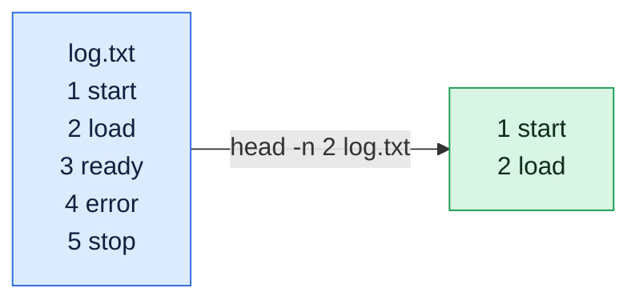

# head

## What is it?
`head` prints the first part of one or more files. By default it shows the first 10 lines. It is used to peek at large files, check CSV headers, preview logs and limit the output of other commands in a pipeline.

## Syntax
```bash
head [OPTIONS] [FILE]...
```

## Visual Overview
> `head` prints only the beginning of the input and stops reading. The default is 10 lines.



## Options/Flags
| Flag | Description |
|------|-------------|
| `-n NUM` / `--lines=NUM` | Print the first `NUM` lines (default is 10) |
| `-n -NUM` | Print everything except the last `NUM` lines |
| `-c NUM` / `--bytes=NUM` | Print the first `NUM` bytes. Accepts suffixes such as `K`, `M`, `G` |
| `-c -NUM` | Print everything except the last `NUM` bytes |
| `-q` / `--quiet` | Never print the `==> file <==` header when reading several files |
| `-v` / `--verbose` | Always print the `==> file <==` header, even for one file |
| `-z` / `--zero-terminated` | Treat lines as ending with a NUL character instead of a newline |
| `--help` | Show the help text |
| `--version` | Show the version |

> With more than one file, `head` prints a `==> file <==` header before each file by default.

## Usage Examples

Let's say we have this file `app.log`:

**Input file** (`app.log`):
```text
2026-10-06 10:00:01 INFO Service started
2026-10-06 10:00:05 WARN Disk usage at 82%
2026-10-06 10:00:09 ERROR Connection refused
2026-10-06 10:00:12 INFO Retry succeeded
2026-10-06 10:00:20 ERROR Timeout calling payment-api
2026-10-06 10:00:31 INFO Request completed
```

Let's say we have this file `config.txt`:

**Input file** (`config.txt`):
```text
host=web01
port=8080
env=prod
```

### Example 1: Default (first 10 lines)
`app.log` has only 6 lines, so the whole file is shown.

**Command:**
```bash
head app.log
```
**Sample Output:**
```text
2026-10-06 10:00:01 INFO Service started
2026-10-06 10:00:05 WARN Disk usage at 82%
2026-10-06 10:00:09 ERROR Connection refused
2026-10-06 10:00:12 INFO Retry succeeded
2026-10-06 10:00:20 ERROR Timeout calling payment-api
2026-10-06 10:00:31 INFO Request completed
```

### Example 2: First N lines (`-n NUM`)
**Command:**
```bash
head -n 2 app.log
```
**Sample Output:**
```text
2026-10-06 10:00:01 INFO Service started
2026-10-06 10:00:05 WARN Disk usage at 82%
```

### Example 3: Everything except the last N lines (`-n -NUM`)
**Command:**
```bash
head -n -4 app.log
```
**Sample Output:**
```text
2026-10-06 10:00:01 INFO Service started
2026-10-06 10:00:05 WARN Disk usage at 82%
```

### Example 4: First N bytes (`-c NUM`)
**Command:**
```bash
head -c 10 app.log
```
**Sample Output:**
```text
2026-10-06
```
No newline is printed because the cut happens in the middle of a line.

### Example 5: Everything except the last N bytes (`-c -NUM`)
The file is 267 bytes long, so removing the last 240 bytes leaves the first 27.

**Command:**
```bash
head -c -240 app.log
```
**Sample Output:**
```text
2026-10-06 10:00:01 INFO Se
```

### Example 6: Several files with headers (default)
**Command:**
```bash
head -n 1 app.log config.txt
```
**Sample Output:**
```text
==> app.log <==
2026-10-06 10:00:01 INFO Service started

==> config.txt <==
host=web01
```

### Example 7: Hide the headers (`-q`)
**Command:**
```bash
head -q -n 1 app.log config.txt
```
**Sample Output:**
```text
2026-10-06 10:00:01 INFO Service started
host=web01
```

### Example 8: Always show the header (`-v`)
**Command:**
```bash
head -v -n 1 config.txt
```
**Sample Output:**
```text
==> config.txt <==
host=web01
```

### Example 9: NUL separated records (`-z`)
**Command:**
```bash
printf 'one\0two\0three\0' | head -z -n 2 | tr '\0' '\n'
```
**Sample Output:**
```text
one
two
```

### Example 10: Check the version (`--version`)
**Command:**
```bash
head --version | head -n 1
```
**Sample Output:**
```text
head (GNU coreutils) 8.32
```

## Pitfalls / Gotchas
- The default is 10 lines, not 1. Use `-n 1` for a single line.
- `head -5` works as a shortcut for `head -n 5` but is obsolete. Prefer `-n 5`.
- `-n -NUM` and `-c -NUM` (negative numbers) only work with GNU `head`. macOS and BSD `head` reject them.
- `-c` counts bytes, not characters. A UTF-8 character can be cut in half.
- When `head` exits early in a pipeline, the writing command may get `SIGPIPE` and stop. This is usually fine and is how `yes | head` ends.
- `head` cannot follow a growing file. Use `tail -f` for that.

## DevOps Use Cases

### Use Case 1: Check the header of a CSV before importing it
**Situation:** Before loading a billing export into a database you want to confirm the column names.

**Input file** (`billing.csv`):
```text
account_id,service,cost_usd,month
1001,ec2,420.50,2026-09
1002,s3,87.10,2026-09
1003,rds,310.00,2026-09
```
**Command:**
```bash
head -n 1 billing.csv
```
**Output:**
```text
account_id,service,cost_usd,month
```

### Use Case 2: Identify the OS of an unknown server or container
**Situation:** You exec into a host and need the distro name fast.

**Input file** (`/etc/os-release`):
```text
PRETTY_NAME="Ubuntu 22.04.4 LTS"
NAME="Ubuntu"
VERSION_ID="22.04"
VERSION="22.04.4 LTS (Jammy Jellyfish)"
ID=ubuntu
```
**Command:**
```bash
head -n 2 /etc/os-release
```
**Output:**
```text
PRETTY_NAME="Ubuntu 22.04.4 LTS"
NAME="Ubuntu"
```

### Use Case 3: Verify a script has the correct shebang
**Situation:** A CI job fails with `exec format error`. Check the first line of the script.

**Input file** (`deploy.sh`):
```text
#!/bin/bash
set -e
echo "deploying"
```
**Command:**
```bash
head -n 1 deploy.sh
```
**Output:**
```text
#!/bin/bash
```

### Use Case 4: Top N results from a sorted report
**Situation:** Find the 3 services with the most errors in a log.

**Input file** (`errors.log`):
```text
payment-api ERROR timeout
auth ERROR denied
payment-api ERROR refused
payment-api ERROR timeout
auth ERROR denied
cart ERROR 500
```
**Command:**
```bash
awk '{print $1}' errors.log | sort | uniq -c | sort -rn | head -n 3
```
**Output:**
```text
      3 payment-api
      2 auth
      1 cart
```

### Use Case 5: Make sure a download is not an HTML error page
**Situation:** A `curl` download of a binary silently saved a 404 page. Look at the first bytes.

**Input file** (`tool.tar.gz`, really an HTML error page):
```text
<html><body>404 Not Found</body></html>
```
**Command:**
```bash
head -c 15 tool.tar.gz
```
**Output:**
```text
<html><body>404
```

### Use Case 6: Limit noisy command output in a pipeline
**Situation:** `kubectl get pods` returns hundreds of pods. You only want the header and the first two.

**Command:**
```bash
kubectl get pods -A | head -n 3
```
**Output:**
```text
NAMESPACE     NAME                       READY   STATUS    RESTARTS   AGE
default       web-6d8f7c9b5-abcde        1/1     Running   0          2d
default       web-6d8f7c9b5-fghij        1/1     Running   0          2d
```

### Use Case 7: Sample a large log to test a parser
**Situation:** Write a small sample from a huge log into a test file.

**Input file** (`app.log`): same file as in the Usage Examples.

**Command:**
```bash
head -n 3 app.log > sample.log
cat sample.log
```
**Output:**
```text
2026-10-06 10:00:01 INFO Service started
2026-10-06 10:00:05 WARN Disk usage at 82%
2026-10-06 10:00:09 ERROR Connection refused
```

### Use Case 8: Drop the last lines of a file safely
**Situation:** A report always ends with a 1-line summary footer that your parser must skip.

**Input file** (`report.txt`):
```text
web01 up
web02 up
web03 down
TOTAL 3
```
**Command:**
```bash
head -n -1 report.txt
```
**Output:**
```text
web01 up
web02 up
web03 down
```

## Try it yourself

Work in a practice folder so nothing real can be damaged: `mkdir -p ~/practice && cd ~/practice`. Try each task first, then open the answer.

**Task 1.** Let's say we have `nums.txt` with the numbers 1 to 20, one per line. Create it with `seq 1 20 > nums.txt`. Print its first 3 lines.

<details>
<summary>Show the answer</summary>

```bash
head -n 3 nums.txt
```
Output:
```
1
2
3
```

</details>

**Task 2.** Print the default number of lines.

<details>
<summary>Show the answer</summary>

```bash
head nums.txt
```
The default is 10 lines, `1` to `10`.

</details>

**Task 3.** Print only the 3rd line using `head` and `tail`.

<details>
<summary>Show the answer</summary>

```bash
head -n 3 nums.txt | tail -n 1
```
Output: `3`.

</details>

## Related Commands
- [`cat`](cat.md) - print a whole file
- [`tail`](tail.md) - show the end of a file
- [`less`](less.md) - page through a long file
- [`wc`](../text-processing/wc.md) - count lines, words and bytes
- `sort` - sort lines

---
<!-- nav -->
[← Previous: `more`](more.md) | [Learning path](../README.md) | [Next: `tail` →](tail.md)
