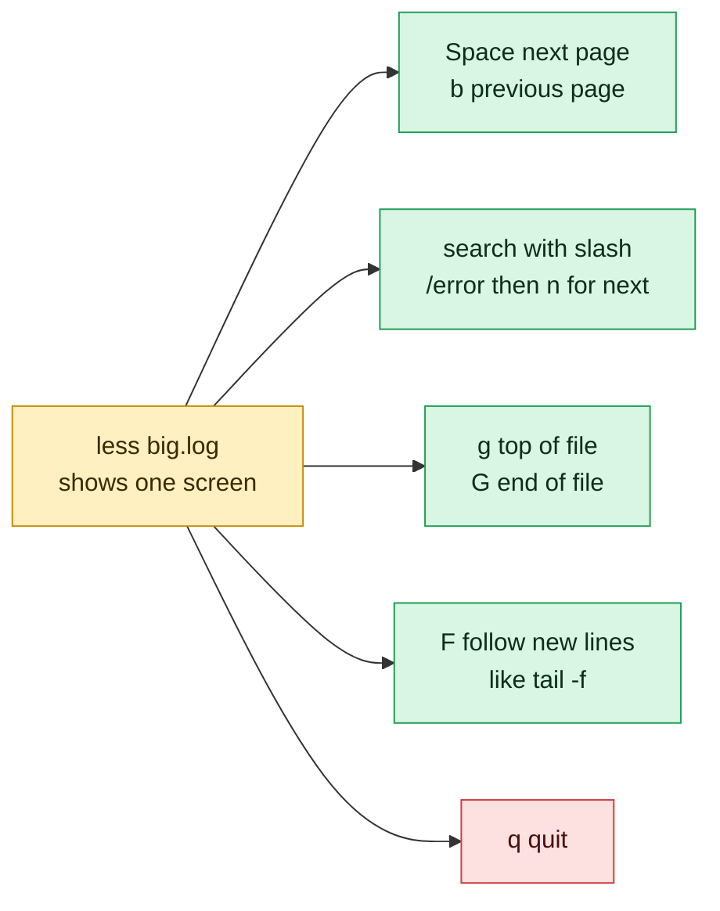

# less

## What is it?
`less` is a pager. It opens a file or command output one screen at a time, lets you scroll up and down, search, jump to any line and follow a growing file. It does not load the whole file into memory, so it opens multi-gigabyte logs instantly. The name is a joke on its older cousin `more`.

## Syntax
```bash
less [OPTIONS] [FILE]...
command | less [OPTIONS]
```

## Visual Overview
> `less` opens a big file one screen at a time without loading it all. These keys work inside it, and `q` always gets you out.



## Options/Flags
| Flag | Description |
|------|-------------|
| `-N` / `--LINE-NUMBERS` | Show a line number in front of each line |
| `-n` / `--line-numbers` | Turn line numbers off (useful if `-N` is set in `LESS`) |
| `-S` / `--chop-long-lines` | Do not wrap long lines. Scroll sideways with the arrow keys |
| `-i` / `--ignore-case` | Case-insensitive search, unless the pattern has an uppercase letter |
| `-I` / `--IGNORE-CASE` | Case-insensitive search, always |
| `-F` / `--quit-if-one-screen` | Exit immediately if the whole input fits on one screen |
| `-X` / `--no-init` | Do not clear the screen on start and exit. The output stays visible |
| `-R` / `--RAW-CONTROL-CHARS` | Show ANSI colors correctly instead of `ESC[31m` |
| `-s` / `--squeeze-blank-lines` | Squeeze several blank lines into one |
| `-M` / `--LONG-PROMPT` | Show a long status line with name, line range and percentage |
| `+F` | Start in follow mode, like `tail -f` |
| `+G` | Start at the end of the file |
| `+/PATTERN` | Start at the first line that matches `PATTERN` |
| `--help` | Show the help text |
| `--version` | Show the version |

### Keys inside `less`
| Key | Action |
|-----|--------|
| `Space` or `f` or `PgDn` | Forward one page |
| `b` or `PgUp` | Back one page |
| `d` / `u` | Forward / back half a page |
| `j` or `Enter` / `k` | Forward / back one line |
| `g` / `G` | Go to the first / last line |
| `50g` | Go to line 50 |
| `/text` | Search forward for `text` |
| `?text` | Search backward for `text` |
| `n` / `N` | Next / previous match |
| `&text` | Show only lines that match `text` (press `&` and Enter to clear) |
| `F` | Follow the file (like `tail -f`). Press `Ctrl+C` to stop following |
| `-N` | Toggle line numbers on or off |
| `-S` | Toggle line wrapping on or off |
| `=` | Show file name, line range and position |
| `:n` / `:p` | Next / previous file when several files were opened |
| `v` | Open the file in your `$EDITOR` |
| `h` | Show the help screen |
| `q` | Quit |

## Usage Examples

Let's say we have this file `app.log`:

**Input file** (`app.log`):
```text
2026-10-06 10:00:01 INFO Service started
2026-10-06 10:00:05 WARN Disk usage at 82%
2026-10-06 10:00:09 ERROR Connection refused
2026-10-06 10:00:12 INFO Retry succeeded
2026-10-06 10:00:20 ERROR Timeout calling payment-api
2026-10-06 10:00:31 INFO Request completed
```

Let's say we have this file `config.txt` (three empty lines between the entries):

**Input file** (`config.txt`):
```text
host=web01


port=8080
```

Let's say we have this file `servers.csv` (the lines are very wide):

**Input file** (`servers.csv`):
```text
name,ip,region,owner,environment,os,cpu,memory,disk,last_patch,status,notes
web01,10.0.0.11,us-east-1,platform,prod,ubuntu-22.04,4,16GB,200GB,2026-09-30,running,primary web
```

### Example 1: Open a file
**Command:**
```bash
less app.log
```
**Sample Output** (a full screen view, press `q` to quit):
```text
2026-10-06 10:00:01 INFO Service started
2026-10-06 10:00:05 WARN Disk usage at 82%
2026-10-06 10:00:09 ERROR Connection refused
2026-10-06 10:00:12 INFO Retry succeeded
2026-10-06 10:00:20 ERROR Timeout calling payment-api
2026-10-06 10:00:31 INFO Request completed
app.log (END)
```

### Example 2: Show line numbers (`-N`)
**Command:**
```bash
less -N app.log
```
**Sample Output:**
```text
      1 2026-10-06 10:00:01 INFO Service started
      2 2026-10-06 10:00:05 WARN Disk usage at 82%
      3 2026-10-06 10:00:09 ERROR Connection refused
      4 2026-10-06 10:00:12 INFO Retry succeeded
      5 2026-10-06 10:00:20 ERROR Timeout calling payment-api
      6 2026-10-06 10:00:31 INFO Request completed
app.log (END)
```

### Example 3: Turn line numbers off (`-n`)
Let's say `LESS="-N"` is set in your shell. `-n` switches numbers back off for one run.

**Command:**
```bash
LESS="-N" less -n app.log
```
**Sample Output:**
```text
2026-10-06 10:00:01 INFO Service started
2026-10-06 10:00:05 WARN Disk usage at 82%
2026-10-06 10:00:09 ERROR Connection refused
2026-10-06 10:00:12 INFO Retry succeeded
2026-10-06 10:00:20 ERROR Timeout calling payment-api
2026-10-06 10:00:31 INFO Request completed
app.log (END)
```

### Example 4: Do not wrap long lines (`-S`)
Without `-S` each wide line is wrapped onto several rows. With `-S` each record is one row and you scroll sideways with the arrow keys.

**Command:**
```bash
less -S servers.csv
```
**Sample Output** (terminal 40 columns wide):
```text
name,ip,region,owner,environment,os,cpu,
web01,10.0.0.11,us-east-1,platform,prod,
servers.csv (END)
```

### Example 5: Case-insensitive search (`-i`)
Type `/error` inside `less`. With `-i` lowercase `error` also finds `ERROR`.

**Command:**
```bash
less -i app.log
```
**Sample Output** (after typing `/error`, the first match is highlighted):
```text
2026-10-06 10:00:01 INFO Service started
2026-10-06 10:00:05 WARN Disk usage at 82%
2026-10-06 10:00:09 ERROR Connection refused
2026-10-06 10:00:12 INFO Retry succeeded
2026-10-06 10:00:20 ERROR Timeout calling payment-api
2026-10-06 10:00:31 INFO Request completed
/error
```

### Example 6: Always case-insensitive search (`-I`)
`-I` ignores case even when the pattern has capital letters, so `/Error` also finds `ERROR`.

**Command:**
```bash
less -I app.log
```
**Sample Output** (after typing `/Error`):
```text
2026-10-06 10:00:01 INFO Service started
2026-10-06 10:00:05 WARN Disk usage at 82%
2026-10-06 10:00:09 ERROR Connection refused
2026-10-06 10:00:12 INFO Retry succeeded
2026-10-06 10:00:20 ERROR Timeout calling payment-api
2026-10-06 10:00:31 INFO Request completed
/Error
```

### Example 7: Quit at once if the file is short (`-F`)
The 6-line file fits on one screen, so `less` prints it and returns to the shell.

**Command:**
```bash
less -F app.log
```
**Sample Output:**
```text
2026-10-06 10:00:01 INFO Service started
2026-10-06 10:00:05 WARN Disk usage at 82%
2026-10-06 10:00:09 ERROR Connection refused
2026-10-06 10:00:12 INFO Retry succeeded
2026-10-06 10:00:20 ERROR Timeout calling payment-api
2026-10-06 10:00:31 INFO Request completed
```

### Example 8: Keep the output on screen after quitting (`-X`)
Combine with `-F` to behave like `cat` for short files and like a pager for long ones. This is the common `less -FRX` setting.

**Command:**
```bash
less -FX app.log
```
**Sample Output:**
```text
2026-10-06 10:00:01 INFO Service started
2026-10-06 10:00:05 WARN Disk usage at 82%
2026-10-06 10:00:09 ERROR Connection refused
2026-10-06 10:00:12 INFO Retry succeeded
2026-10-06 10:00:20 ERROR Timeout calling payment-api
2026-10-06 10:00:31 INFO Request completed
```

### Example 9: Show colors (`-R`)
Let's say `color.log` contains a red `ERROR` word written with ANSI escape codes (shown here as `ESC[31m`):

**Input file** (`color.log`):
```text
ESC[31mERRORESC[0m Disk full
```
**Command:**
```bash
less color.log
less -R color.log
```
**Sample Output:**
```text
ESC[31mERRORESC[0m Disk full
ERROR Disk full
```
The first line is shown by plain `less` (raw codes). The second is shown by `less -R`, with `ERROR` drawn in red.

### Example 10: Squeeze blank lines (`-s`)
**Command:**
```bash
less -s config.txt
```
**Sample Output:**
```text
host=web01

port=8080
config.txt (END)
```

### Example 11: Show a long status line (`-M`)
**Command:**
```bash
less -M app.log
```
**Sample Output** (status line at the bottom):
```text
2026-10-06 10:00:01 INFO Service started
2026-10-06 10:00:05 WARN Disk usage at 82%
2026-10-06 10:00:09 ERROR Connection refused
2026-10-06 10:00:12 INFO Retry succeeded
2026-10-06 10:00:20 ERROR Timeout calling payment-api
2026-10-06 10:00:31 INFO Request completed
app.log lines 1-6/6 byte 267/267 100% (press h for help or q to quit)
```

### Example 12: Start at the end of the file (`+G`)
**Command:**
```bash
less +G app.log
```
**Sample Output** (the last lines are visible first):
```text
2026-10-06 10:00:12 INFO Retry succeeded
2026-10-06 10:00:20 ERROR Timeout calling payment-api
2026-10-06 10:00:31 INFO Request completed
app.log (END)
```

### Example 13: Start at the first match (`+/PATTERN`)
**Command:**
```bash
less +/ERROR app.log
```
**Sample Output** (the screen starts at the first line with `ERROR`):
```text
2026-10-06 10:00:09 ERROR Connection refused
2026-10-06 10:00:12 INFO Retry succeeded
2026-10-06 10:00:20 ERROR Timeout calling payment-api
2026-10-06 10:00:31 INFO Request completed
app.log (END)
```

### Example 14: Follow a file live (`+F`)
Same as `tail -f`. Press `Ctrl+C` to stop following and scroll, then `F` to follow again.

**Command:**
```bash
less +F app.log
```
**Sample Output:**
```text
2026-10-06 10:00:12 INFO Retry succeeded
2026-10-06 10:00:20 ERROR Timeout calling payment-api
2026-10-06 10:00:31 INFO Request completed
Waiting for data... (interrupt to abort)
```

### Example 15: Filter lines while viewing (`&` key)
Open the file and type `&ERROR` then Enter. Only matching lines stay visible.

**Command:**
```bash
less app.log
```
**Sample Output** (after typing `&ERROR`):
```text
2026-10-06 10:00:09 ERROR Connection refused
2026-10-06 10:00:20 ERROR Timeout calling payment-api
&ERROR (END)
```

### Example 16: Search and jump between matches (`/`, `n`, `N`)
Type `/ERROR` to find the first match, `n` for the next and `N` for the previous.

**Command:**
```bash
less app.log
```
**Sample Output** (after `/ERROR` then `n`, the cursor is on the second match):
```text
2026-10-06 10:00:09 ERROR Connection refused
2026-10-06 10:00:12 INFO Retry succeeded
2026-10-06 10:00:20 ERROR Timeout calling payment-api
2026-10-06 10:00:31 INFO Request completed
/ERROR
```

### Example 17: Jump to a line (`50g`) and see the position (`=`)
Type `3g` to jump to line 3, then `=` to see where you are.

**Command:**
```bash
less app.log
```
**Sample Output** (after `3g` and `=`):
```text
2026-10-06 10:00:09 ERROR Connection refused
2026-10-06 10:00:12 INFO Retry succeeded
2026-10-06 10:00:20 ERROR Timeout calling payment-api
2026-10-06 10:00:31 INFO Request completed
app.log lines 3-6/6 100%
```

### Example 18: Open several files and move between them (`:n` and `:p`)
**Command:**
```bash
less app.log config.txt
```
**Sample Output** (after pressing `:n`, the second file is shown):
```text
host=web01


port=8080
config.txt (file 2 of 2) (END) - Next: none
```

### Example 19: Check the version (`--version`)
**Command:**
```bash
less --version | head -n 1
```
**Sample Output:**
```text
less 590 (GNU regular expressions)
```

## Pitfalls / Gotchas
- `less` is interactive. In scripts and CI jobs, where there is no terminal, use `cat`, `head` or `tail` instead. When the output is not a terminal, `less` behaves like `cat`.
- `less` clears the screen when it exits, so the content disappears. Use `-X`, or `-FX`, to keep it visible.
- Raw colored output from `kubectl`, `git` or `ls --color` looks broken unless you pass `-R`.
- `F` and `+F` follow the file descriptor like `tail -f`. After log rotation they keep following the old file.
- `/` uses regular expressions, so characters such as `.` `*` `[` have special meaning. Escape them with `\`.
- `-N` and `-S` can be toggled inside `less` by typing `-N` or `-S` and pressing Enter.
- The environment variable `LESS` sets default options, for example `export LESS="-FRX"`.

## DevOps Use Cases

### Use Case 1: Investigate a huge log without loading it
**Situation:** `app.log` is 5 GB. `cat` would flood the terminal and `vim` would be slow.

**Input file** (`app.log`): same file as in the Usage Examples (imagine millions of lines).

**Command:**
```bash
less +/ERROR app.log
```
**Output** (opens at the first error immediately):
```text
2026-10-06 10:00:09 ERROR Connection refused
2026-10-06 10:00:12 INFO Retry succeeded
app.log (END)
```

### Use Case 2: Read long `kubectl describe` output
**Situation:** `kubectl describe pod` prints hundreds of lines. Page through it and search for `Events`.

**Command:**
```bash
kubectl describe pod web-6d8f7c9b5-abcde | less
```
**Output** (type `/Events` then Enter):
```text
Events:
  Type     Reason     Age   From               Message
  ----     ------     ----  ----               -------
  Normal   Scheduled  3m    default-scheduler  Successfully assigned default/web to node1
```

### Use Case 3: View wide tables without wrapping
**Situation:** `ps aux`, `docker ps` and `kubectl get pods -o wide` are wider than the terminal and wrap into a mess.

**Command:**
```bash
ps aux | less -S
```
**Output** (use the left and right arrow keys to scroll sideways):
```text
USER         PID %CPU %MEM    VSZ   RSS TTY      STAT START   TIME COMMAND
root           1  0.0  0.1 167936 11772 ?        Ss   Oct05   0:03 /sbin/init
www-data     812  0.1  0.5 355012 42004 ?        S    Oct05   1:12 nginx: worker process
```

### Use Case 4: Page colored command output
**Situation:** `git diff` and `ls --color` use colors. Keep them with `-R`.

**Command:**
```bash
ls --color=always -l | less -R
```
**Output:**
```text
total 8
-rw-r--r-- 1 deploy deploy  267 Oct  6 10:00 app.log
drwxr-xr-x 2 deploy deploy 4096 Oct  6 09:55 logs
```

### Use Case 5: Watch a log and then search it, in one tool
**Situation:** You are following a log with `F`, see an error, press `Ctrl+C` to stop, then search backward with `?` to see what happened before.

**Command:**
```bash
less +F app.log
```
**Output** (after `Ctrl+C` and `?ERROR`):
```text
2026-10-06 10:00:20 ERROR Timeout calling payment-api
2026-10-06 10:00:31 INFO Request completed
?ERROR
```

### Use Case 6: Read systemd logs from the end
**Situation:** Start at the newest entries of a service journal.

**Command:**
```bash
journalctl -u nginx | less +G
```
**Output:**
```text
Oct 06 10:00:12 web01 nginx[812]: worker process started
Oct 06 10:00:31 web01 systemd[1]: Reloaded A high performance web server.
(END)
```

### Use Case 7: Make `less` behave well everywhere
**Situation:** Set safe defaults in `~/.bashrc` so `git log`, `man` and `kubectl` output is readable: colors on, quit on one screen, keep output visible, ignore case in search.

**Command:**
```bash
export LESS="-FRXi"
echo "$LESS"
```
**Output:**
```text
-FRXi
```

### Use Case 8: Read a compressed rotated log
**Situation:** `app.log.1.gz` is a rotated, compressed log. `zless` and `zcat | less` page it without unpacking.

**Command:**
```bash
zcat app.log.1.gz | less
```
**Output:**
```text
2026-10-05 23:59:58 ERROR Timeout calling payment-api
2026-10-05 23:59:59 INFO Rotating logs
(END)
```

## Related Commands
- [`more`](more.md) - the older, simpler pager
- [`cat`](cat.md) - print a whole file
- [`head`](head.md) / [`tail`](tail.md) - show the start or end of a file
- `man` - uses `less` to show manual pages
- `journalctl` - systemd logs, pages with `less`
- `vim` / `nano` - edit files

---
<!-- nav -->
[← Previous: `cat`](cat.md) | [Learning path](../README.md) | [Next: `more` →](more.md)
