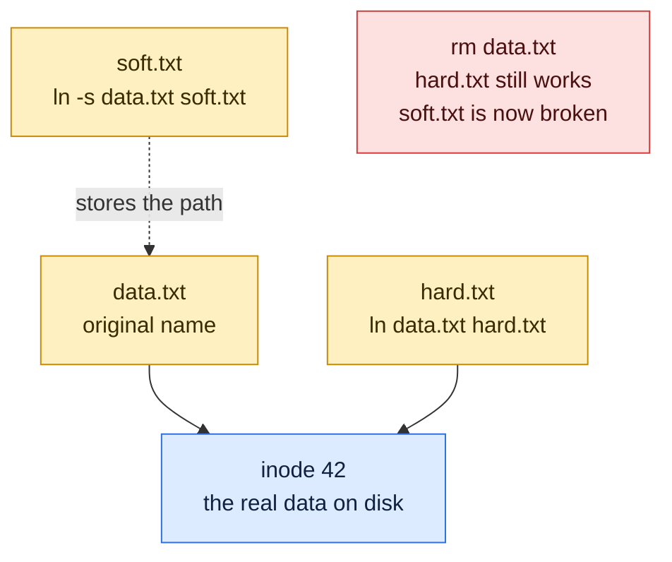

# ln

## What is it?
`ln` (link) creates links between files. A **hard link** is another name for the same data on disk. A **symbolic link** (symlink, soft link) is a small file that holds a path to another file, like a shortcut. Symlinks are used everywhere in DevOps: `nginx` enabled sites, `current` release directories, `java` and `python` version switching.

## Syntax
```bash
ln [OPTIONS] TARGET LINK_NAME
ln [OPTIONS] TARGET                  # link created in the current directory
ln [OPTIONS] TARGET... DIRECTORY     # several links inside a directory
ln [OPTIONS] -t DIRECTORY TARGET...
```
`TARGET` is the existing file. `LINK_NAME` is the new name. Without `-s`, `ln` makes a hard link.

## Visual Overview
> A hard link is another name for the same data. A symbolic link is a small file that stores a path, so it breaks if the target moves.



### Hard link or symbolic link?
| | Hard link | Symbolic link (`-s`) |
|---|-----------|----------------------|
| What it is | Another name for the same inode | A file that contains a path |
| Works across filesystems | No | Yes |
| Can point to a directory | No (normal users) | Yes |
| If the target is deleted | Data stays, the link still works | The link breaks (dangling) |
| If the target is moved | Still works | Breaks |
| Shows in `ls -l` as | A normal file, link count goes up | `l` type with `->` |

## Options/Flags
| Flag | Description |
|------|-------------|
| `-s` / `--symbolic` | Create a symbolic link instead of a hard link |
| `-f` / `--force` | Replace an existing destination file |
| `-i` / `--interactive` | Ask before replacing an existing destination |
| `-n` / `--no-dereference` | If the link name is a symlink to a directory, treat it as a normal file and replace it |
| `-v` / `--verbose` | Print the name of each link created |
| `-r` / `--relative` | With `-s`, store a path relative to the link location |
| `-t DIR` / `--target-directory=DIR` | Create the links inside `DIR` |
| `-T` / `--no-target-directory` | Always treat the link name as a normal file, never as a directory |
| `-b` | Make a backup of each destination that would be replaced |
| `--backup[=CONTROL]` | Like `-b`, with control over the backup style (`numbered`, `simple`, `none`) |
| `-S SUFFIX` / `--suffix=SUFFIX` | Use `SUFFIX` instead of `~` for backups |
| `-L` / `--logical` | When linking a symlink as the target, link to the file it points to |
| `-P` / `--physical` | When linking a symlink as the target, link to the symlink itself (default on Linux) |
| `--help` | Show the help text |
| `--version` | Show the version |

## Usage Examples

Let's say we have this file `data.txt`:

**Input file** (`data.txt`):
```text
hello
```

Let's say we have this file `other.txt`:

**Input file** (`other.txt`):
```text
world
```

Unless an example says otherwise, each example starts with only these files. Let's say we also have a directory `releases/` that contains the directories `v1/` and `v2/`, and a directory `backup/` that is empty. Inode numbers are shown by `ls -i`.

### Example 1: Create a hard link
**Command:**
```bash
ln data.txt hard.txt
ls -li data.txt hard.txt
```
**Sample Output:**
```text
3145800 -rw-r--r-- 2 deploy deploy 6 Oct 12 12:00 data.txt
3145800 -rw-r--r-- 2 deploy deploy 6 Oct 12 12:00 hard.txt
```
Both names have the same inode (`3145800`) and the link count is `2`.

### Example 2: Create a symbolic link (`-s`)
**Command:**
```bash
ln -s data.txt soft.txt
ls -l soft.txt
```
**Sample Output:**
```text
lrwxrwxrwx 1 deploy deploy 8 Oct 12 12:00 soft.txt -> data.txt
```
The size `8` is the length of the text `data.txt`.

### Example 3: Show what is created (`-v`)
**Command:**
```bash
ln -v data.txt hard2.txt
ln -sv data.txt soft2.txt
```
**Sample Output:**
```text
'hard2.txt' => 'data.txt'
'soft2.txt' -> 'data.txt'
```

### Example 4: Replace an existing link (`-f`)
Without `-f`, `ln` refuses to overwrite.

**Command:**
```bash
ln -s other.txt soft.txt
```
**Sample Output:**
```text
ln: failed to create symbolic link 'soft.txt': File exists
```

**Command:**
```bash
ln -sf other.txt soft.txt
ls -l soft.txt
```
**Sample Output:**
```text
lrwxrwxrwx 1 deploy deploy 9 Oct 12 12:01 soft.txt -> other.txt
```

### Example 5: Ask before replacing (`-i`)
**Command:**
```bash
ln -si data.txt soft.txt
```
**Sample Output:**
```text
ln: replace 'soft.txt'? y
```
Type `y` to replace the link or `n` to keep it.

### Example 6: Switch a directory symlink in place (`-n` with `-f`)
Let's say `current` is a symlink to the directory `releases/v1`. We want it to point to `releases/v2`.

**Command (without `-n`):**
```bash
ln -sf releases/v2 current
ls -l current releases/v1
```
**Sample Output:**
```text
lrwxrwxrwx 1 deploy deploy 11 Oct 12 12:02 current -> releases/v1

releases/v1:
total 0
lrwxrwxrwx 1 deploy deploy 11 Oct 12 12:02 v2 -> releases/v2
```
Because `current` is a symlink to a directory, `ln` created a **new link inside `releases/v1`**. That is not what we wanted.

**Command (with `-n`):**
```bash
rm releases/v1/v2
ln -sfn releases/v2 current
ls -l current
```
**Sample Output:**
```text
lrwxrwxrwx 1 deploy deploy 11 Oct 12 12:03 current -> releases/v2
```

### Example 7: Relative symbolic link (`-r`)
Let's say we have `/srv/app/shared/config.yml` and we want a link in `/srv/app/current/`.

**Command:**
```bash
ln -sr /srv/app/shared/config.yml /srv/app/current/config.yml
ls -l /srv/app/current/config.yml
```
**Sample Output:**
```text
lrwxrwxrwx 1 deploy deploy 20 Oct 12 12:04 /srv/app/current/config.yml -> ../shared/config.yml
```
A relative link keeps working if `/srv/app` is moved or mounted somewhere else.

### Example 8: Put links in a directory (`-t`)
**Command:**
```bash
ln -t backup/ data.txt other.txt
ls -li backup
```
**Sample Output:**
```text
total 8
3145800 -rw-r--r-- 2 deploy deploy 6 Oct 12 12:00 data.txt
3145810 -rw-r--r-- 2 deploy deploy 6 Oct 12 12:00 other.txt
```

### Example 9: Treat the link name as a plain file (`-T`)
`backup` is an existing directory. Without `-T`, `ln data.txt backup` would create `backup/data.txt`. With `-T`, `ln` refuses.

**Command:**
```bash
ln -T data.txt backup
```
**Sample Output:**
```text
ln: failed to create hard link 'backup': File exists
```

### Example 10: Keep a backup of the replaced link (`-b`)
**Command:**
```bash
ln -sfb data.txt soft.txt
ls soft.txt*
```
**Sample Output:**
```text
soft.txt  soft.txt~
```
`soft.txt~` is the old link that was replaced.

### Example 11: Choose the backup style (`--backup`)
`numbered` creates `.~1~`, `.~2~` and so on, so older backups are not overwritten.

**Command:**
```bash
ln -sf --backup=numbered other.txt soft.txt
ls soft.txt*
```
**Sample Output:**
```text
soft.txt  soft.txt.~1~  soft.txt~
```

### Example 12: Choose the backup suffix (`-S`)
**Command:**
```bash
ln -sfb -S .bak data.txt soft.txt
ls soft.txt*
```
**Sample Output:**
```text
soft.txt  soft.txt.bak  soft.txt.~1~  soft.txt~
```

### Example 13: Hard link to the symlink itself (`-P`) or to its target (`-L`)
Let's say `soft.txt` is a symlink to `data.txt`.

**Command:**
```bash
ln -P soft.txt hard-of-link
ln -L soft.txt hard-of-target
ls -li soft.txt data.txt hard-of-link hard-of-target
```
**Sample Output:**
```text
3145800 -rw-r--r-- 2 deploy deploy 6 Oct 12 12:00 data.txt
3145801 lrwxrwxrwx 2 deploy deploy 8 Oct 12 12:05 hard-of-link -> data.txt
3145800 -rw-r--r-- 2 deploy deploy 6 Oct 12 12:00 hard-of-target
3145801 lrwxrwxrwx 2 deploy deploy 8 Oct 12 12:05 soft.txt -> data.txt
```
`-P` made a second name for the symlink (same inode `3145801`). `-L` made a second name for `data.txt` (inode `3145800`).

### Example 14: A broken symlink (what happens when the target is deleted)
**Command:**
```bash
ln -s missing.txt dangling.txt
cat dangling.txt
```
**Sample Output:**
```text
cat: dangling.txt: No such file or directory
```
`ln -s` does not check that the target exists. The link is created but is broken.

### Example 15: Check the version (`--version`)
**Command:**
```bash
ln --version | head -n 1
```
**Sample Output:**
```text
ln (GNU coreutils) 8.32
```

### Example 16: Show the help (`--help`)
**Command:**
```bash
ln --help | head -n 1
```
**Sample Output:**
```text
Usage: ln [OPTION]... [-T] TARGET LINK_NAME
```

## Pitfalls / Gotchas
- **The order is `ln -s TARGET LINK_NAME`**, the same order as `cp SOURCE DEST`. A common mistake is to reverse them.
- **A relative symlink target is relative to the link, not to your current directory.** `ln -s data.txt /tmp/x` creates `/tmp/x -> data.txt`, which looks for `/tmp/data.txt`. Use an absolute path or `-r`.
- **`ln -s` does not check that the target exists.** Broken links are silently created.
- **To change a symlink that points to a directory, use `-sfn`.** Without `-n`, the new link is created inside the target directory.
- **Hard links cannot cross filesystems and cannot point to directories.** Use `-s` for those.
- **Editors can break hard links.** Some editors save by writing a new file, which gives the file a new inode and breaks the shared link.
- **Deleting a symlink with `rm link/` (trailing slash)** can fail or act on the target directory. Use `rm link`.
- **`-f` is not atomic.** `ln -sf` removes and recreates the link, so there is a tiny moment where it does not exist. For atomic switches create a temporary link and `mv -T` it over the old one.

## DevOps Use Cases

### Use Case 1: Zero-downtime release switch (`current` symlink)
**Situation:** Each release lives in `releases/<version>`. The web server always serves `current`. Switch to the new version with one command and roll back by pointing back to the old one.

**Input (directory content)** (`/srv/app/`): `releases/v1/`, `releases/v2/`, and `current -> releases/v1`.

**Command:**
```bash
ln -sfn releases/v2 current
ls -l current
```
**Output:**
```text
lrwxrwxrwx 1 deploy deploy 11 Oct 12 12:10 current -> releases/v2
```

### Use Case 2: Atomic symlink switch with no gap
**Situation:** `ln -sf` has a tiny gap. For a truly atomic switch, create a temporary link and rename it over the old one.

**Input (directory content)** (`/srv/app/`): `releases/v2/` and `current -> releases/v1`.

**Command:**
```bash
ln -s releases/v2 current.tmp
mv -T current.tmp current
ls -l current
```
**Output:**
```text
lrwxrwxrwx 1 deploy deploy 11 Oct 12 12:11 current -> releases/v2
```

### Use Case 3: Enable an nginx site
**Situation:** On Debian and Ubuntu, sites are defined in `sites-available` and enabled by a symlink in `sites-enabled`.

**Input file** (`/etc/nginx/sites-available/shop.conf`):
```text
server {
    listen 80;
    server_name shop.example.com;
}
```
**Command:**
```bash
sudo ln -s /etc/nginx/sites-available/shop.conf /etc/nginx/sites-enabled/shop.conf
ls -l /etc/nginx/sites-enabled/
```
**Output:**
```text
total 0
lrwxrwxrwx 1 root root 36 Oct 12 12:12 shop.conf -> /etc/nginx/sites-available/shop.conf
```
To disable the site, remove only the link: `sudo rm /etc/nginx/sites-enabled/shop.conf`.

### Use Case 4: Share a config file between releases
**Situation:** Secrets and configuration live once in `shared/`. Every release links to them, so a new release never holds a copy.

**Input file** (`/srv/app/shared/.env`):
```text
DB_HOST=db.prod.internal
```
**Command:**
```bash
ln -sv /srv/app/shared/.env /srv/app/releases/v2/.env
cat /srv/app/releases/v2/.env
```
**Output:**
```text
'/srv/app/releases/v2/.env' -> '/srv/app/shared/.env'
DB_HOST=db.prod.internal
```

### Use Case 5: Switch the default tool version
**Situation:** Two Java versions are installed. Make `/usr/local/bin/java` point to Java 21.

**Input (directory content)** (`/usr/lib/jvm/`): `java-17/bin/java` and `java-21/bin/java`.

**Command:**
```bash
sudo ln -sfv /usr/lib/jvm/java-21/bin/java /usr/local/bin/java
```
**Output:**
```text
'/usr/local/bin/java' -> '/usr/lib/jvm/java-21/bin/java'
```

### Use Case 6: Keep the latest log under a fixed name
**Situation:** Each run writes `run-2026-10-12.log`. Monitoring always tails `latest.log`.

**Input file** (`run-2026-10-12.log`):
```text
2026-10-12 12:00:00 INFO Job finished
```
**Command:**
```bash
ln -sf run-2026-10-12.log latest.log
tail -n 1 latest.log
```
**Output:**
```text
2026-10-12 12:00:00 INFO Job finished
```

### Use Case 7: Space-saving snapshots with hard links
**Situation:** Daily backups should not store unchanged files again. `cp -al` copies a tree as hard links, so only changed files take new space. `rsync --link-dest` does the same.

**Input file** (`data/report.txt`):
```text
Q3 report
```
**Command:**
```bash
cp -al data snapshot-1
ls -li data/report.txt snapshot-1/report.txt
```
**Output:**
```text
3145900 -rw-r--r-- 2 deploy deploy 10 Oct 12 12:13 data/report.txt
3145900 -rw-r--r-- 2 deploy deploy 10 Oct 12 12:13 snapshot-1/report.txt
```

### Use Case 8: Find and repair broken links after an upgrade
**Situation:** After an upgrade, `/usr/local/bin/tool` points to a removed version. Find it and relink.

**Input (directory content)** (`/usr/local/bin/`): `tool -> /opt/tool-1.0/bin/tool` (the directory `/opt/tool-1.0` was removed), and `/opt/tool-2.0/bin/tool` exists.

**Command:**
```bash
find /usr/local/bin -xtype l
sudo ln -sfv /opt/tool-2.0/bin/tool /usr/local/bin/tool
```
**Output:**
```text
/usr/local/bin/tool
'/usr/local/bin/tool' -> '/opt/tool-2.0/bin/tool'
```

## Related Commands
- [`ls`](ls.md) - `ls -l` shows links, `ls -i` shows inodes
- [`cp`](cp.md) - `cp -s` and `cp -l` create links while copying
- [`mv`](mv.md) - `mv -T` can replace a symlink atomically
- [`rm`](rm.md) - remove a link without touching the target
- [`find`](find.md) - find broken links with `-xtype l`
- [`file`](file.md) - shows `symbolic link to ...`
- `readlink` / `realpath` - show where a link points
- `stat` - show inode and link count
