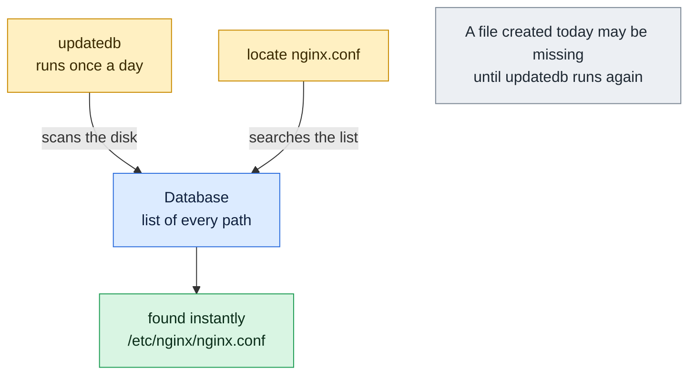

# locate

## What is it?
`locate` finds files by name using a prebuilt database instead of walking the disk. Because it only reads the database, it answers in milliseconds even on huge filesystems. The database is rebuilt by the `updatedb` command, usually once a day by a cron job or systemd timer. This means `locate` can miss files created today and can still show files that were deleted.

## Syntax
```bash
locate [OPTIONS] PATTERN...
sudo updatedb [OPTIONS]
```
`locate` comes from the `mlocate` or `plocate` package. Install it with `sudo apt install mlocate` (Debian, Ubuntu) or `sudo dnf install mlocate` (RHEL, Fedora). The examples below use the `mlocate` flavor.

## Visual Overview
> `locate` does not search the disk. It searches a ready-made list of paths, which makes it instant but possibly out of date.



## Options/Flags

### `locate` options
| Flag | Description |
|------|-------------|
| `PATTERN` | Show every path that **contains** `PATTERN`. Shell wildcards `*` `?` `[]` are allowed |
| `-i` / `--ignore-case` | Ignore upper and lower case |
| `-c` / `--count` | Print only the number of matches |
| `-l N` / `--limit N` | Stop after `N` matches |
| `-b` / `--basename` | Match the pattern against the file name only, not the directory part. Write `\name` for an exact name |
| `-w` / `--wholename` | Match against the whole path (default) |
| `-e` / `--existing` | Print only entries that still exist on disk |
| `-r REGEX` / `--regexp REGEX` | Search with a basic regular expression |
| `--regex` | Treat all patterns as extended regular expressions |
| `-A` / `--all` | Print only paths that match **all** patterns (default is any pattern) |
| `-0` / `--null` | Separate results with NUL instead of newline, for `xargs -0` |
| `-d PATH` / `--database PATH` | Use another database file |
| `-S` / `--statistics` | Show statistics about the database and exit |
| `-q` / `--quiet` | Do not print error messages, for example about a missing database |
| `-V` / `--version` | Show the version |
| `-h` / `--help` | Show the help text |

### `updatedb` options
| Flag | Description |
|------|-------------|
| `-U PATH` / `--database-root PATH` | Scan only below `PATH` instead of the whole system |
| `-o FILE` / `--output FILE` | Write the database to `FILE` |
| `-v` / `--verbose` | Print each path as it is added |

## Usage Examples

Let's say the `locate` database was built a few minutes ago. It contains exactly these paths:

**Input (database content)** (`/var/lib/mlocate/mlocate.db`):
```text
/etc
/etc/hosts
/etc/nginx
/etc/nginx/conf.d
/etc/nginx/conf.d/default.conf
/etc/nginx/nginx.conf
/etc/ssh
/etc/ssh/sshd_config
/home
/home/deploy
/home/deploy/app
/home/deploy/app/Config.yaml
/home/deploy/app/app.log
/home/deploy/app/config.yaml
/tmp
/tmp/deleted-file.txt
/usr
/usr/bin
/usr/bin/python3
/var
/var/log
/var/log/nginx
/var/log/nginx/access.log
/var/log/nginx/error.log
/var/log/syslog
```
After the database was built, the file `/tmp/deleted-file.txt` was removed from the disk.

### Example 1: Basic search
Any path that contains the text `nginx` matches, including directories.

**Command:**
```bash
locate nginx
```
**Sample Output:**
```text
/etc/nginx
/etc/nginx/conf.d
/etc/nginx/conf.d/default.conf
/etc/nginx/nginx.conf
/var/log/nginx
/var/log/nginx/access.log
/var/log/nginx/error.log
```

### Example 2: Ignore case (`-i`)
**Command:**
```bash
locate -i config.yaml
```
**Sample Output:**
```text
/home/deploy/app/Config.yaml
/home/deploy/app/config.yaml
```

### Example 3: Count matches (`-c`)
**Command:**
```bash
locate -c nginx
```
**Sample Output:**
```text
7
```

### Example 4: Limit the results (`-l`)
**Command:**
```bash
locate -l 2 nginx
```
**Sample Output:**
```text
/etc/nginx
/etc/nginx/conf.d
```

### Example 5: Match the file name only (`-b`)
Only the last part of the path is compared, so `/etc/nginx/conf.d` and `/var/log/nginx/access.log` no longer match.

**Command:**
```bash
locate -b nginx
```
**Sample Output:**
```text
/etc/nginx
/etc/nginx/nginx.conf
/var/log/nginx
```

### Example 6: Exact file name with `-b` and a backslash
A backslash in front of the name means "exactly this name".

**Command:**
```bash
locate -b '\nginx'
```
**Sample Output:**
```text
/etc/nginx
/var/log/nginx
```

### Example 7: Match the whole path with wildcards (`-w`)
**Command:**
```bash
locate -w '*/nginx/*.log'
```
**Sample Output:**
```text
/var/log/nginx/access.log
/var/log/nginx/error.log
```

### Example 8: Hide deleted files (`-e`)
Without `-e`, the removed file is still reported because it is still in the database.

**Command:**
```bash
locate deleted-file
locate -e deleted-file
```
**Sample Output:**
```text
/tmp/deleted-file.txt
```
The first command prints the stale entry. The second command prints nothing.

### Example 9: Basic regular expression (`-r`)
**Command:**
```bash
locate -r 'nginx\.conf$'
```
**Sample Output:**
```text
/etc/nginx/nginx.conf
```

### Example 10: Extended regular expression (`--regex`)
**Command:**
```bash
locate --regex 'nginx/.*\.(conf|log)$'
```
**Sample Output:**
```text
/etc/nginx/conf.d/default.conf
/etc/nginx/nginx.conf
/var/log/nginx/access.log
/var/log/nginx/error.log
```

### Example 11: Match all patterns (`-A`)
Paths must contain both `nginx` and `log`.

**Command:**
```bash
locate -A nginx log
```
**Sample Output:**
```text
/var/log/nginx
/var/log/nginx/access.log
/var/log/nginx/error.log
```

### Example 12: Several patterns (default is OR)
**Command:**
```bash
locate sshd_config hosts
```
**Sample Output:**
```text
/etc/hosts
/etc/ssh/sshd_config
```

### Example 13: NUL separated output (`-0`)
Safe for file names that contain spaces or newlines.

**Command:**
```bash
locate -0 nginx.conf | xargs -0 ls -l
```
**Sample Output:**
```text
-rw-r--r-- 1 root root 1490 Oct  1 09:00 /etc/nginx/nginx.conf
```

### Example 14: Use another database (`-d`)
First build a small database for `/etc` only with `updatedb` (see the `-U` and `-o` examples below), then search it.

**Command:**
```bash
locate -d /tmp/etc.db hosts
```
**Sample Output:**
```text
/etc/hosts
```

### Example 15: Show database statistics (`-S`)
**Command:**
```bash
locate -S
```
**Sample Output:**
```text
Database /var/lib/mlocate/mlocate.db:
	13 directories
	12 files
	301 bytes in file names
	1,024 bytes used to store database
```

### Example 16: Quiet mode (`-q`)
A missing database normally causes an error message. `-q` hides it.

**Command:**
```bash
locate -d /nonexistent.db hosts
locate -q -d /nonexistent.db hosts
```
**Sample Output:**
```text
locate: can not stat () `/nonexistent.db': No such file or directory
```
The first command prints the error. The second prints nothing.

### Example 17: Check the version (`-V`)
**Command:**
```bash
locate -V | head -n 1
```
**Sample Output:**
```text
mlocate 0.26
```

### Example 18: Show the help (`-h`)
**Command:**
```bash
locate -h | head -n 1
```
**Sample Output:**
```text
Usage: locate [OPTION]... [PATTERN]...
```

### Example 19: Refresh the database with `updatedb`
Run this after you create new files, so that `locate` can see them. It prints nothing when it succeeds.

**Command:**
```bash
sudo updatedb
```
**Sample Output:**
```text
```

### Example 20: Scan only one directory (`updatedb -U`) and write elsewhere (`-o`)
Build a small database for `/etc` and save it in `/tmp/etc.db`. This is the file used in Example 14.

**Command:**
```bash
updatedb -U /etc -o /tmp/etc.db
```
**Sample Output:**
```text
```

### Example 21: See what `updatedb` adds (`-v`)
**Command:**
```bash
updatedb -v -U /etc -o /tmp/etc.db
```
**Sample Output:**
```text
/etc
/etc/hosts
/etc/nginx
/etc/nginx/conf.d
/etc/nginx/conf.d/default.conf
/etc/nginx/nginx.conf
/etc/ssh
/etc/ssh/sshd_config
```

## Pitfalls / Gotchas
- **The database can be old.** A file you created five minutes ago is not found until `updatedb` runs. Run `sudo updatedb` first, or use `find`.
- **Deleted files still show up** until the next `updatedb`. Use `-e` to hide them.
- **`locate` matches substrings of the whole path.** `locate log` returns thousands of results. Use `-b` and `\name` to be exact.
- **Users only see what they may read.** `mlocate` and `plocate` hide files in directories that the current user cannot access.
- **Some paths are never indexed.** `/tmp`, `/proc`, network filesystems and `/var/spool` are often excluded by `/etc/updatedb.conf` (`PRUNEPATHS`, `PRUNEFS`). If a file is missing, check that file.
- **Wildcards need quotes.** Write `locate '*.pem'` so that the shell does not expand the `*` first.
- **`mlocate` and `plocate` differ a little.** Options such as `-q` and the layout of `-S` are specific to `mlocate`.
- **Containers rarely have it.** Minimal images do not include `locate`. Use `find` there.
- **`locate` can only search by name and path.** It cannot filter by size, age or owner. Use `find` for that.

## DevOps Use Cases

### Use Case 1: Quickly find where a service keeps its configuration
**Situation:** A new server. You need the `sshd` config, but you do not know the path.

**Input (database content)**: same database as in the Usage Examples.

**Command:**
```bash
locate -b '\sshd_config'
```
**Output:**
```text
/etc/ssh/sshd_config
```

### Use Case 2: Find leaked private keys (security audit)
**Situation:** A security review asks whether any `.pem` private keys are stored on the host.

**Input (database content)** (excerpt):
```text
/etc/ssl/private/server.pem
/home/deploy/.ssh/id_rsa.pem
/home/deploy/app/config.yaml
```
**Command:**
```bash
locate '*.pem'
```
**Output:**
```text
/etc/ssl/private/server.pem
/home/deploy/.ssh/id_rsa.pem
```

### Use Case 3: Find all Terraform state files
**Situation:** State files hold secrets. Locate every `terraform.tfstate` on a build server.

**Input (database content)** (excerpt):
```text
/home/ci/infra/dev/terraform.tfstate
/home/ci/infra/prod/terraform.tfstate
/home/ci/infra/prod/terraform.tfstate.backup
```
**Command:**
```bash
locate -b '\terraform.tfstate'
```
**Output:**
```text
/home/ci/infra/dev/terraform.tfstate
/home/ci/infra/prod/terraform.tfstate
```

### Use Case 4: Count log files without touching the disk
**Situation:** A health report counts nginx log files on a busy server where `find /` would be slow.

**Input (database content)**: same database as in the Usage Examples.

**Command:**
```bash
locate -c -r '/var/log/nginx/.*\.log$'
```
**Output:**
```text
2
```

### Use Case 5: Search results as input for another command
**Situation:** Show the size of every nginx log file.

**Input (database content)**: same database as in the Usage Examples.

**Command:**
```bash
locate -0 -w '*/nginx/*.log' | xargs -0 ls -lh
```
**Output:**
```text
-rw-r----- 1 www-data adm 12M Oct 12 11:59 /var/log/nginx/access.log
-rw-r----- 1 www-data adm 85K Oct 12 11:58 /var/log/nginx/error.log
```

### Use Case 6: Make sure the index is fresh in a provisioning script
**Situation:** An Ansible or shell script installs software, refreshes the database and then looks for the installed binary.

**Command:**
```bash
sudo updatedb && locate -l 1 -b '\python3'
```
**Output:**
```text
/usr/bin/python3
```

## Related Commands
- [`find`](find.md) - search the live filesystem with many conditions
- [`ls`](ls.md) - list a directory
- [`tree`](tree.md) - show a directory tree
- [`file`](file.md) - find out the type of a file
- `which` / `whereis` - find the location of a command
- `xargs` - use the results as arguments
