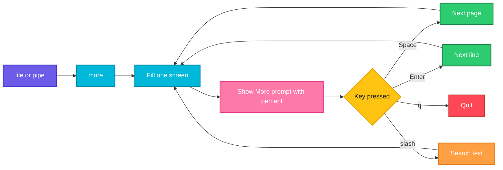

# more

## What is it?
`more` is a simple pager. It shows a file one screen at a time and waits for a key before showing the next screen. It is the older and smaller sibling of `less`. It is available on every Unix system, including minimal containers and rescue shells, where `less` may be missing.

## Syntax
```bash
more [OPTIONS] [FILE]...
command | more [OPTIONS]
```

## Visual Overview
> `more` fills the screen, prints a `--More--` prompt with the percentage read so far and waits for a key.



## Options/Flags
| Flag | Description |
|------|-------------|
| `-NUM` / `-n NUM` / `--lines NUM` | Show `NUM` lines per screen instead of the full terminal height |
| `+NUM` | Start at line number `NUM` |
| `+/PATTERN` | Start two lines before the first line that matches `PATTERN` |
| `-d` / `--silent` | Show a helpful prompt (`Press space to continue, 'q' to quit`) and do not beep on a wrong key |
| `-s` / `--squeeze` | Squeeze several blank lines into one |
| `-c` / `--clean-print` | Do not scroll. Paint each screen from the top and clear the line ends |
| `-p` / `--print-over` | Do not scroll. Clear the whole screen, then paint the next page |
| `-l` / `--no-pause` | Do not pause after a form feed (`^L`) |
| `-f` / `--logical` | Count logical lines instead of screen lines, so long lines are not counted as several |
| `-u` / `--plain` | Do not show underlining. Ignored on modern systems |
| `-V` / `--version` | Show the version |
| `-h` / `--help` | Show the help text |

### Keys inside `more`
| Key | Action |
|-----|--------|
| `Space` | Next page |
| `Enter` | Next line |
| `d` | Scroll half a page |
| `b` | Go back one page (files only, not pipes) |
| `/text` | Search forward for `text` |
| `n` | Repeat the last search |
| `=` | Show the current line number |
| `v` | Open the file in your editor at this position |
| `:f` | Show file name and line number |
| `.` | Repeat the last command |
| `h` | Show the help screen |
| `q` | Quit |

## Usage Examples

Let's say we have this file `app.log`:

**Input file** (`app.log`):
```text
2026-10-06 10:00:01 INFO Service started
2026-10-06 10:00:05 WARN Disk usage at 82%
2026-10-06 10:00:09 ERROR Connection refused
2026-10-06 10:00:12 INFO Retry succeeded
2026-10-06 10:00:20 ERROR Timeout calling payment-api
2026-10-06 10:00:31 INFO Request completed
```

Let's say we have this file `config.txt` (three empty lines between the entries):

**Input file** (`config.txt`):
```text
host=web01


port=8080
```

### Example 1: Open a short file
The file fits on one screen, so `more` prints it and exits, like `cat`.

**Command:**
```bash
more app.log
```
**Sample Output:**
```text
2026-10-06 10:00:01 INFO Service started
2026-10-06 10:00:05 WARN Disk usage at 82%
2026-10-06 10:00:09 ERROR Connection refused
2026-10-06 10:00:12 INFO Retry succeeded
2026-10-06 10:00:20 ERROR Timeout calling payment-api
2026-10-06 10:00:31 INFO Request completed
```

### Example 2: Set the lines per screen (`-NUM`)
Show 3 lines per screen. Press `Space` for the next 3 lines.

**Command:**
```bash
more -3 app.log
```
**Sample Output:**
```text
2026-10-06 10:00:01 INFO Service started
2026-10-06 10:00:05 WARN Disk usage at 82%
2026-10-06 10:00:09 ERROR Connection refused
--More--(50%)
```

### Example 3: Set the lines per screen with a named option (`-n NUM`)
**Command:**
```bash
more -n 2 app.log
```
**Sample Output:**
```text
2026-10-06 10:00:01 INFO Service started
2026-10-06 10:00:05 WARN Disk usage at 82%
--More--(33%)
```

### Example 4: Start at a line (`+NUM`)
**Command:**
```bash
more +4 app.log
```
**Sample Output:**
```text
2026-10-06 10:00:12 INFO Retry succeeded
2026-10-06 10:00:20 ERROR Timeout calling payment-api
2026-10-06 10:00:31 INFO Request completed
```

### Example 5: Start at the first match (`+/PATTERN`)
The screen starts shortly before the first line that matches.

**Command:**
```bash
more +/ERROR app.log
```
**Sample Output:**
```text
...skipping
2026-10-06 10:00:05 WARN Disk usage at 82%
2026-10-06 10:00:09 ERROR Connection refused
2026-10-06 10:00:12 INFO Retry succeeded
2026-10-06 10:00:20 ERROR Timeout calling payment-api
2026-10-06 10:00:31 INFO Request completed
```

### Example 6: Friendly prompt (`-d`)
**Command:**
```bash
more -d -3 app.log
```
**Sample Output:**
```text
2026-10-06 10:00:01 INFO Service started
2026-10-06 10:00:05 WARN Disk usage at 82%
2026-10-06 10:00:09 ERROR Connection refused
--More--(50%)[Press space to continue, 'q' to quit.]
```

### Example 7: Squeeze blank lines (`-s`)
**Command:**
```bash
more -s config.txt
```
**Sample Output:**
```text
host=web01

port=8080
```

### Example 8: Clean print (`-c`)
Each screen is painted from the top instead of scrolling. The text is the same, only the way it is drawn changes.

**Command:**
```bash
more -c -3 app.log
```
**Sample Output:**
```text
2026-10-06 10:00:01 INFO Service started
2026-10-06 10:00:05 WARN Disk usage at 82%
2026-10-06 10:00:09 ERROR Connection refused
--More--(50%)
```

### Example 9: Clear the screen before each page (`-p`)
**Command:**
```bash
more -p -3 app.log
```
**Sample Output:**
```text
2026-10-06 10:00:01 INFO Service started
2026-10-06 10:00:05 WARN Disk usage at 82%
2026-10-06 10:00:09 ERROR Connection refused
--More--(50%)
```
After you press `Space`, the screen is cleared and the next 3 lines are drawn.

### Example 10: Do not pause on form feed (`-l`)
Let's say `report.txt` contains a form feed character (`^L`) between two pages. `-l` stops `more` from pausing there.

**Input file** (`report.txt`):
```text
Page 1 summary
^L
Page 2 summary
```
**Command:**
```bash
more -l report.txt
```
**Sample Output:**
```text
Page 1 summary

Page 2 summary
```

### Example 11: Count logical lines (`-f`)
A very long line wraps onto several rows. `-f` counts it as one line when deciding when to pause.

**Command:**
```bash
more -f -3 app.log
```
**Sample Output:**
```text
2026-10-06 10:00:01 INFO Service started
2026-10-06 10:00:05 WARN Disk usage at 82%
2026-10-06 10:00:09 ERROR Connection refused
--More--(50%)
```

### Example 12: Ignore underlining (`-u`)
This only matters for files with backspace based underlining, such as old man pages. The visible text is the same.

**Command:**
```bash
more -u app.log
```
**Sample Output:**
```text
2026-10-06 10:00:01 INFO Service started
2026-10-06 10:00:05 WARN Disk usage at 82%
2026-10-06 10:00:09 ERROR Connection refused
2026-10-06 10:00:12 INFO Retry succeeded
2026-10-06 10:00:20 ERROR Timeout calling payment-api
2026-10-06 10:00:31 INFO Request completed
```

### Example 13: Page command output through a pipe
**Command:**
```bash
cat app.log | more -2
```
**Sample Output:**
```text
2026-10-06 10:00:01 INFO Service started
2026-10-06 10:00:05 WARN Disk usage at 82%
--More--(33%)
```

### Example 14: Check the version (`-V`)
**Command:**
```bash
more -V
```
**Sample Output:**
```text
more from util-linux 2.37.2
```

### Example 15: Show the help text (`-h`)
**Command:**
```bash
more -h | head -n 3
```
**Sample Output:**
```text

Usage:
 more [options] <file>...
```

## Pitfalls / Gotchas
- `more` is limited. Going backward with `b` works only for files, not for piped input, and many versions cannot search backward at all. Use `less` when you have it.
- If the whole file fits on one screen, `more` exits at once. Use `-NUM` to test paging with small files.
- If standard output is not a terminal (for example `more file > out.txt`), `more` acts like `cat`.
- On very old systems `more` exits when it reaches the end of the file. `less` stays open until you press `q`.
- Options differ slightly between BSD, macOS and util-linux versions. On some systems `more` is a link to `less`.
- Some minimal container images ship `more` but not `less`.

## DevOps Use Cases

### Use Case 1: Read a file in a minimal container or rescue shell
**Situation:** In a stripped Alpine or BusyBox container `less` is not installed, but `more` is.

**Input file** (`/etc/os-release`):
```text
NAME="Alpine Linux"
ID=alpine
VERSION_ID=3.19.1
PRETTY_NAME="Alpine Linux v3.19"
```
**Command:**
```bash
more -2 /etc/os-release
```
**Output:**
```text
NAME="Alpine Linux"
ID=alpine
--More--(50%)
```

### Use Case 2: Page through a long command output
**Situation:** `dmesg` or `docker images` produce more than one screen.

**Command:**
```bash
docker images | more -3
```
**Output:**
```text
REPOSITORY   TAG       IMAGE ID       CREATED        SIZE
nginx        latest    a6bd71f48f68   2 weeks ago    187MB
node         20        5f8a7c0b1d3e   3 weeks ago    1.1GB
--More--(40%)
```

### Use Case 3: Jump straight to the error in a log
**Situation:** Open a log at the first `ERROR` instead of scrolling from the top.

**Input file** (`app.log`): same file as in the Usage Examples.

**Command:**
```bash
more +/ERROR app.log
```
**Output:**
```text
...skipping
2026-10-06 10:00:05 WARN Disk usage at 82%
2026-10-06 10:00:09 ERROR Connection refused
2026-10-06 10:00:12 INFO Retry succeeded
2026-10-06 10:00:20 ERROR Timeout calling payment-api
2026-10-06 10:00:31 INFO Request completed
```

### Use Case 4: Read the manual or help of a tool page by page
**Situation:** A tool prints a long help text. Page it.

**Command:**
```bash
kubectl --help | more -3
```
**Output:**
```text
kubectl controls the Kubernetes cluster manager.

 Find more information at: https://kubernetes.io/docs/reference/kubectl/
--More--(8%)
```

### Use Case 5: Set `more` as the pager for tools that call a pager
**Situation:** `git`, `man` and `systemctl` read the `PAGER` variable. Point it at `more` on a host where `less` is not available.

**Command:**
```bash
export PAGER=more
echo "$PAGER"
```
**Output:**
```text
more
```

### Use Case 6: Skip to the interesting part of a long config
**Situation:** A config file is long and the `[database]` section starts on line 120.

**Command:**
```bash
more +120 /etc/myapp/app.conf
```
**Output:**
```text
[database]
host=db.prod.internal
port=5432
```

### Use Case 7: Clean up blank-line-heavy reports
**Situation:** A generated report has many blank lines. Squeeze them while reading.

**Input file** (`config.txt`): same file as in the Usage Examples.

**Command:**
```bash
more -s config.txt
```
**Output:**
```text
host=web01

port=8080
```

## Related Commands
- [`less`](less.md) - the more powerful pager
- [`cat`](cat.md) - print a whole file
- [`head`](head.md) / [`tail`](tail.md) - show the start or end of a file
- `man` - manual pages, shown with a pager
- `most` - another pager
