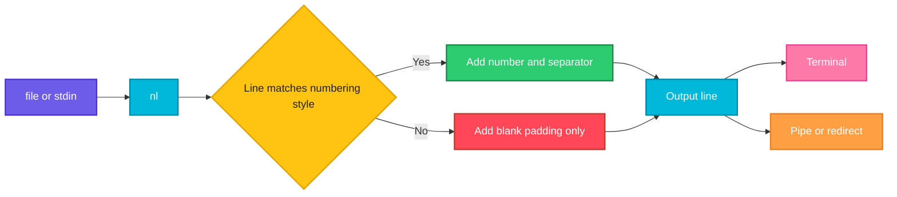

# nl

## What is it?
`nl` (number lines) prints a file with line numbers added. Unlike `cat -n`, it can skip blank lines, number only lines that match a pattern, change the number format and width, and restart numbering in header, body and footer sections.

## Syntax
```bash
nl [OPTIONS] [FILE]...
```

## Visual Overview
> `nl` reads each line, decides if it should be numbered, then writes the number, a separator and the line.



## Options/Flags
| Flag | Description |
|------|-------------|
| `-b STYLE` / `--body-numbering=STYLE` | Numbering style for body lines: `a` all lines, `t` only non-empty lines (default), `n` no lines, `pREGEX` only lines matching the regex |
| `-h STYLE` / `--header-numbering=STYLE` | Numbering style for header lines (default `n`) |
| `-f STYLE` / `--footer-numbering=STYLE` | Numbering style for footer lines (default `n`) |
| `-n FORMAT` / `--number-format=FORMAT` | Number format: `ln` left aligned, `rn` right aligned (default), `rz` right aligned with leading zeros |
| `-w NUM` / `--number-width=NUM` | Width of the number column (default 6) |
| `-s STRING` / `--number-separator=STRING` | String placed between the number and the line (default is a TAB) |
| `-v NUM` / `--starting-line-number=NUM` | First line number (default 1) |
| `-i NUM` / `--line-increment=NUM` | Step between line numbers (default 1) |
| `-l NUM` / `--join-blank-lines=NUM` | Count `NUM` consecutive blank lines as one. Only matters with `-b a` |
| `-d CC` / `--section-delimiter=CC` | Two characters used to mark sections (default `\:`) |
| `-p` / `--no-renumber` | Do not restart numbering at the start of each page (section group) |
| `--help` | Show the help text |
| `--version` | Show the version |

> Section markers are lines made only of the delimiter: three times (`\:\:\:`) starts a header, two times (`\:\:`) starts a body and one time (`\:`) starts a footer. `nl` prints these marker lines as blank lines.

## Usage Examples

Let's say we have this file `names.txt`:

**Input file** (`names.txt`):
```text
alpha
beta
gamma
```

Let's say we have this file `config.txt` (two empty lines between the entries):

**Input file** (`config.txt`):
```text
host=web01


port=8080
```

Let's say we have this file `app.log`:

**Input file** (`app.log`):
```text
2026-10-06 10:00:01 INFO Service started
2026-10-06 10:00:05 WARN Disk usage at 82%
2026-10-06 10:00:09 ERROR Connection refused
2026-10-06 10:00:12 INFO Retry succeeded
2026-10-06 10:00:20 ERROR Timeout calling payment-api
2026-10-06 10:00:31 INFO Request completed
```

Let's say we have this file `pages.txt` (it has header, body and footer section markers):

**Input file** (`pages.txt`):
```text
\:\:\:
Header
\:\:
Body1
Body2
\:
Footer
```

Let's say we have this file `custom.txt` (it uses `@@` as the section delimiter):

**Input file** (`custom.txt`):
```text
@@@@@@
Head
@@@@
Body
@@
Foot
```

### Example 1: Default (number non-empty lines)
Empty lines are not numbered.

**Command:**
```bash
nl config.txt
```
**Sample Output:**
```text
     1	host=web01


     2	port=8080
```

### Example 2: Number all lines (`-b a`)
**Command:**
```bash
nl -b a config.txt
```
**Sample Output:**
```text
     1	host=web01
     2	
     3	
     4	port=8080
```

### Example 3: Number no lines (`-b n`)
**Command:**
```bash
nl -b n names.txt
```
**Sample Output:**
```text
       alpha
       beta
       gamma
```

### Example 4: Number only lines matching a regex (`-b pREGEX`)
**Command:**
```bash
nl -b 'pERROR' app.log
```
**Sample Output:**
```text
       2026-10-06 10:00:01 INFO Service started
       2026-10-06 10:00:05 WARN Disk usage at 82%
     1	2026-10-06 10:00:09 ERROR Connection refused
       2026-10-06 10:00:12 INFO Retry succeeded
     2	2026-10-06 10:00:20 ERROR Timeout calling payment-api
       2026-10-06 10:00:31 INFO Request completed
```

### Example 5: Number the header (`-h`)
Header lines are not numbered by default. `-h a` numbers them.

**Command:**
```bash
nl -h a pages.txt
```
**Sample Output:**
```text

     1	Header

     1	Body1
     2	Body2

       Footer
```

### Example 6: Number the footer (`-f`)
**Command:**
```bash
nl -f a pages.txt
```
**Sample Output:**
```text

       Header

     1	Body1
     2	Body2

     1	Footer
```

### Example 7: Left aligned numbers (`-n ln`)
**Command:**
```bash
nl -n ln names.txt
```
**Sample Output:**
```text
1     	alpha
2     	beta
3     	gamma
```

### Example 8: Right aligned numbers (`-n rn`)
This is the default format. It is shown here to be explicit.

**Command:**
```bash
nl -n rn names.txt
```
**Sample Output:**
```text
     1	alpha
     2	beta
     3	gamma
```

### Example 9: Numbers with leading zeros (`-n rz`) and width (`-w`)
**Command:**
```bash
nl -n rz -w 4 names.txt
```
**Sample Output:**
```text
0001	alpha
0002	beta
0003	gamma
```

### Example 10: Custom separator (`-s`)
**Command:**
```bash
nl -w 3 -s ': ' names.txt
```
**Sample Output:**
```text
  1: alpha
  2: beta
  3: gamma
```

### Example 11: Start number and step (`-v` and `-i`)
Start at 10 and add 5 for each line.

**Command:**
```bash
nl -v 10 -i 5 names.txt
```
**Sample Output:**
```text
    10	alpha
    15	beta
    20	gamma
```

### Example 12: Join blank lines (`-l`)
With `-b a`, every blank line is numbered. `-l 2` counts two blank lines in a row as one, so only the second one gets a number.

**Command:**
```bash
nl -b a -l 2 config.txt
```
**Sample Output:**
```text
     1	host=web01
       
     2	
     3	port=8080
```

### Example 13: Custom section delimiter (`-d`)
**Command:**
```bash
nl -d '@@' -h a custom.txt
```
**Sample Output:**
```text

     1	Head

     1	Body

       Foot
```

### Example 14: Keep numbering across sections (`-p`)
Without `-p`, numbering restarts for every page (see Example 5, where `Body1` starts at 1 again). With `-p`, it continues.

**Command:**
```bash
nl -p -h a pages.txt
```
**Sample Output:**
```text

     1	Header

     2	Body1
     3	Body2

       Footer
```

### Example 15: Check the version (`--version`)
**Command:**
```bash
nl --version | head -n 1
```
**Sample Output:**
```text
nl (GNU coreutils) 8.32
```

## Pitfalls / Gotchas
- By default `nl` skips empty lines (`-b t`). Use `-b a` if you want every line numbered, like `cat -n`.
- The default separator is a TAB, not spaces. Use `-s ' '` if you need spaces.
- A line that is exactly `\:` or `\:\:` or `\:\:\:` is treated as a section marker and printed as a blank line. This can surprise you with files that contain such text.
- `-l` only has an effect when the body style is `-b a`.
- `-b p` takes a basic regular expression, so `+` and `|` need a backslash.
- `nl` pads the unnumbered lines with spaces. The padding is invisible but is still in the output.

## DevOps Use Cases

### Use Case 1: Find the line that a shell error points to
**Situation:** `bash deploy.sh` reports `syntax error near line 4`. Print the script with line numbers.

**Input file** (`deploy.sh`):
```text
#!/bin/bash
set -e
APP=web
if [ "$APP" = "web" ]
  echo "deploying"
fi
```
**Command:**
```bash
nl -b a -w 2 -s ': ' deploy.sh
```
**Output:**
```text
 1: #!/bin/bash
 2: set -e
 3: APP=web
 4: if [ "$APP" = "web" ]
 5:   echo "deploying"
 6: fi
```

### Use Case 2: Number only the ERROR lines to count them
**Situation:** You need a numbered list of errors, ready to paste into a ticket.

**Input file** (`app.log`): same file as in the Usage Examples.

**Command:**
```bash
grep ERROR app.log | nl
```
**Output:**
```text
     1	2026-10-06 10:00:09 ERROR Connection refused
     2	2026-10-06 10:00:20 ERROR Timeout calling payment-api
```

### Use Case 3: Show the position of each server in an inventory
**Situation:** Pick a server by number from a list.

**Input file** (`servers.txt`):
```text
web01
web02
db01
```
**Command:**
```bash
nl -w 1 -s ') ' servers.txt
```
**Output:**
```text
1) web01
2) web02
3) db01
```

### Use Case 4: Create sequential IDs with a prefix
**Situation:** Generate zero padded IDs such as `0001` for a list of hostnames before importing them.

**Input file** (`servers.txt`): same file as in Use Case 3.

**Command:**
```bash
nl -n rz -w 4 -s ',' servers.txt
```
**Output:**
```text
0001,web01
0002,web02
0003,db01
```

### Use Case 5: Pick one line by its number
**Situation:** Number a file, then pull out line 2 with `sed` or `awk`.

**Input file** (`servers.txt`): same file as in Use Case 3.

**Command:**
```bash
nl -s ' ' servers.txt | awk '$1 == 2 {print $2}'
```
**Output:**
```text
web02
```

### Use Case 6: Number a config file with gaps for easy review
**Situation:** Review comments are given as "line 10, line 20". Number in steps of 10 so you can add lines between them later.

**Input file** (`nginx.conf`):
```text
server {
    listen 80;
    server_name example.com;
}
```
**Command:**
```bash
nl -b a -v 10 -i 10 -w 3 -s '  ' nginx.conf
```
**Output:**
```text
 10  server {
 20      listen 80;
 30      server_name example.com;
 40  }
```

### Use Case 7: Number the lines of a script for a code review attachment
**Situation:** A reviewer asks for the Dockerfile with line numbers.

**Input file** (`Dockerfile`):
```text
FROM node:20-alpine
WORKDIR /app
COPY . .
CMD ["node", "server.js"]
```
**Command:**
```bash
nl -b a -n ln -w 2 -s ' | ' Dockerfile
```
**Output:**
```text
1  | FROM node:20-alpine
2  | WORKDIR /app
3  | COPY . .
4  | CMD ["node", "server.js"]
```

## Related Commands
- [`cat`](cat.md) - `cat -n` also numbers lines, but with fewer options
- [`head`](head.md) / [`tail`](tail.md) - show part of a file
- [`wc`](wc.md) - count lines
- [`tac`](tac.md) - reverse the order of lines
- `grep -n` - search and show line numbers
- `sed -n 'Np'` - print line number N
