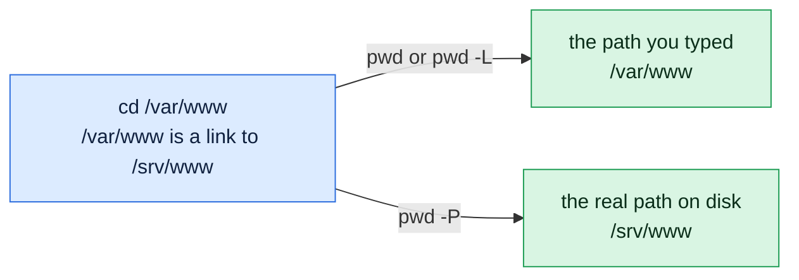

# pwd

## What is it?
`pwd` (print working directory) prints the absolute path of the directory you are currently in.

## Syntax
```bash
pwd [-L | -P]
```

## Visual Overview
> If you entered a folder through a symbolic link, `pwd` can show the path you typed or the real path on disk. Here `/var/www` is a link to `/srv/www`.



## Options/Flags
| Flag | Description |
|------|-------------|
| `-L` | Logical path: keep symbolic links as you navigated them (default) |
| `-P` | Physical path: resolve all symbolic links |

## Usage Examples

### Example 1: Print the current directory
**Command:**
```bash
cd /var/log
pwd
```
**Sample Output:**
```text
/var/log
```

### Example 2: Logical path with a symlink (`-L`)
Let's say we have a symbolic link `/home/devops/current` that points to `/opt/releases/v2`. This is the link as `ls -l` shows it:

**Input file** (`/home/devops/current`):
```text
lrwxrwxrwx 1 devops devops 15 Oct  6 10:00 /home/devops/current -> /opt/releases/v2
```

**Command:**
```bash
cd /home/devops/current
pwd -L
```
**Sample Output:**
```text
/home/devops/current
```

### Example 3: Physical path with a symlink (`-P`)
Using the same symlink `/home/devops/current` shown in Example 2.

**Command:**
```bash
cd /home/devops/current
pwd -P
```
**Sample Output:**
```text
/opt/releases/v2
```

## Pitfalls / Gotchas
- Plain `pwd` in bash is `-L`. Use `pwd -P` when you need the real location behind a symlink.
- `/bin/pwd` (external program) defaults to physical behavior on some systems, while the shell built-in defaults to logical.
- The `$PWD` variable holds the same value as `pwd -L`.

## Related Commands
- [`cd`](cd.md) - change directory
- [`ls`](ls.md) - list directory contents
- `readlink -f` - resolve any path to its real location
