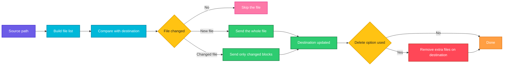

# rsync

## What is it?
`rsync` (remote sync) copies and synchronizes files and directories, locally or between machines over SSH. Its main strength is that it only transfers the **differences**: files that are already identical on both sides are skipped, and for changed files only the changed blocks are sent. It can preserve permissions, owners and timestamps, delete files that disappeared from the source, resume broken transfers and exclude files by pattern. This makes it the standard tool for deployments, backups and mirroring.

## Syntax
```bash
rsync [OPTIONS] SOURCE... DESTINATION
rsync [OPTIONS] SOURCE [USER@]HOST:DESTINATION      # push to a remote host
rsync [OPTIONS] [USER@]HOST:SOURCE DESTINATION      # pull from a remote host
```
`rsync` must be installed on both machines for remote transfers. Install it with `sudo apt install rsync` (Debian, Ubuntu) or `sudo dnf install rsync` (RHEL, Fedora).

### The trailing slash rule
| Command | Result |
|---------|--------|
| `rsync -a src/ dest/` | Copies the **contents** of `src` into `dest` (`dest/app.py`) |
| `rsync -a src dest/` | Copies the **directory** `src` into `dest` (`dest/src/app.py`) |

A slash at the end of the **source** changes the result. A slash at the end of the destination does not.

## Visual Overview
> `rsync` builds a list of files, compares each one with the destination using size and modification time, and sends only the missing or changed data.



## Options/Flags

### Basic and output
| Flag | Description |
|------|-------------|
| `-a` / `--archive` | Archive mode. Same as `-rlptgoD`: recursive, keep symlinks, permissions, times, group, owner and devices |
| `-r` / `--recursive` | Go into directories |
| `-l` / `--links` | Copy symlinks as symlinks |
| `-t` / `--times` | Keep modification times |
| `-p` / `--perms` | Keep permissions |
| `-o` / `--owner` | Keep the owner (needs root) |
| `-g` / `--group` | Keep the group |
| `-D` | Keep device and special files (needs root). Same as `--devices --specials` |
| `-v` / `--verbose` | Show the files that are transferred |
| `-q` / `--quiet` | Show nothing except errors |
| `-h` / `--human-readable` | Print numbers in a readable form (`1.18K`) |
| `-i` / `--itemize-changes` | Show a code that explains why each file is transferred |
| `--stats` | Print detailed transfer statistics |
| `--list-only` | List the files instead of copying them |
| `--version` | Show the version |
| `--help` | Show the help text |

### Safety and speed
| Flag | Description |
|------|-------------|
| `-n` / `--dry-run` | Show what would happen without changing anything |
| `-z` / `--compress` | Compress data during the transfer |
| `-P` | Same as `--partial --progress` |
| `--progress` | Show progress for each file |
| `--partial` | Keep partly transferred files, so a restart can resume |
| `--inplace` | Update the destination file directly instead of building a temporary copy |
| `--bwlimit=RATE` | Limit the bandwidth, in KiB per second |
| `-e COMMAND` / `--rsh=COMMAND` | Choose the remote shell, for example `ssh -p 2222` |

### Deciding what to copy
| Flag | Description |
|------|-------------|
| `-u` / `--update` | Skip files that are newer on the destination |
| `-c` / `--checksum` | Compare files by checksum instead of size and time |
| `--size-only` | Compare files by size only |
| `--ignore-existing` | Skip files that already exist on the destination |
| `--existing` | Only update files that already exist on the destination |
| `--max-size=SIZE` | Skip files larger than `SIZE` |
| `--min-size=SIZE` | Skip files smaller than `SIZE` |
| `--exclude=PATTERN` | Skip files that match the pattern |
| `--include=PATTERN` | Do not skip files that match the pattern |
| `--exclude-from=FILE` | Read the exclude patterns from `FILE` |
| `-m` / `--prune-empty-dirs` | Do not create directories that end up empty |
| `-R` / `--relative` | Keep the full source path under the destination |

### Deleting, backups and moving
| Flag | Description |
|------|-------------|
| `--delete` | Delete files on the destination that no longer exist on the source |
| `--delete-excluded` | Also delete files on the destination that are excluded |
| `-b` / `--backup` | Keep a backup copy of each file that is replaced or deleted (adds `~`) |
| `--suffix=SUFFIX` | Use `SUFFIX` instead of `~` for backups |
| `--backup-dir=DIR` | Put the backups in `DIR` |
| `--remove-source-files` | Delete each source file after it is transferred |
| `--link-dest=DIR` | Hard link unchanged files to the ones in `DIR`, for space saving snapshots |

> Other flags not covered with examples here: `-H` (keep hard links), `-A` (ACLs), `-X` (extended attributes), `-S` (sparse files), `-x` (stay on one filesystem), `-L` (follow symlinks), `--chmod`, `--chown`, `--numeric-ids`, `--timeout`, `--log-file`, `--files-from`, `--delete-before`, `--delete-after`, `--partial-dir`, `--rsync-path`. See `man rsync`.

## Usage Examples

Let's say we have this directory `src/`. The sizes are real byte counts and today is `2026-10-12 12:00`. All files were last modified on `2026-10-01 09:00`.

**Input file** (`src/app.py`):
```text
print("v1")
```
**Input file** (`src/config.yml`):
```text
port: 8080
```
**Input file** (`src/cache.tmp`):
```text
x
```
**Input file** (`src/logs/app.log`):
```text
started
```

Unless an example says otherwise, `dest/` is an existing, **empty** directory. The byte counts and speeds in the `sent ... received ...` lines are only examples. They change from run to run.

### Example 1: Copy a directory (`-a` and `-v`)
`-a` copies everything and keeps the metadata. `-v` lists the transferred files.

**Command:**
```bash
rsync -av src/ dest/
```
**Sample Output:**
```text
sending incremental file list
./
app.py
cache.tmp
config.yml
logs/
logs/app.log

sent 456 bytes  received 133 bytes  1,178.00 bytes/sec
total size is 33  speedup is 0.06
```

### Example 2: Run it again (only differences are sent)
Nothing changed, so no file is listed and almost nothing is sent.

**Command:**
```bash
rsync -av src/ dest/
```
**Sample Output:**
```text
sending incremental file list

sent 143 bytes  received 12 bytes  310.00 bytes/sec
total size is 33  speedup is 0.21
```

### Example 3: Copy the directory itself (no trailing slash)
Without the slash after `src`, the directory name is created inside `dest/`.

**Command:**
```bash
rsync -av src dest/
```
**Sample Output:**
```text
sending incremental file list
src/
src/app.py
src/cache.tmp
src/config.yml
src/logs/
src/logs/app.log

sent 477 bytes  received 133 bytes  1,220.00 bytes/sec
total size is 33  speedup is 0.05
```

### Example 4: Copy a single file
**Command:**
```bash
rsync -v src/app.py dest/
```
**Sample Output:**
```text
app.py

sent 114 bytes  received 35 bytes  298.00 bytes/sec
total size is 12  speedup is 0.08
```

### Example 5: Be quiet (`-q`)
**Command:**
```bash
rsync -aq src/ dest/
```
**Sample Output:**
```text
```
Nothing is printed. Errors would still be shown.

### Example 6: Recursive only (`-r`)
`-r` copies the directories and files, but the modification times are not kept. The files get the time of the copy.

**Command:**
```bash
rsync -r src/ dest/
ls -l dest/app.py
```
**Sample Output:**
```text
-rw-r--r-- 1 deploy deploy 12 Oct 12 12:00 dest/app.py
```

### Example 7: Keep the modification times (`-t`)
**Command:**
```bash
rsync -rt src/ dest/
ls -l dest/app.py
```
**Sample Output:**
```text
-rw-r--r-- 1 deploy deploy 12 Oct  1 09:00 dest/app.py
```
The time is the time of the source file (`Oct  1 09:00`). This is what lets `rsync` skip unchanged files later.

### Example 8: Copy symbolic links as links (`-l`)
Let's say we have a directory `links/` with the file `real.txt` and a symbolic link `alias -> real.txt`.

**Input file** (`links/real.txt`):
```text
data
```
**Command:**
```bash
rsync -rv links/ dest/
rsync -rlv links/ dest/
ls -l dest
```
**Sample Output:**
```text
sending incremental file list
./
real.txt
skipping non-regular file "alias"

sent 130 bytes  received 39 bytes  338.00 bytes/sec
total size is 5  speedup is 0.03

sending incremental file list
alias -> real.txt

sent 115 bytes  received 35 bytes  300.00 bytes/sec
total size is 5  speedup is 0.03

total 4
lrwxrwxrwx 1 deploy deploy 8 Oct 12 12:00 alias -> real.txt
-rw-r--r-- 1 deploy deploy 5 Oct 12 12:00 real.txt
```
Without `-l`, the symlink is skipped. With `-l`, it is copied as a link.

### Example 9: Archive mode spelled out (`-p`, `-o`, `-g`, `-D`)
`-a` is a short form of `-rlptgoD`. The result is the same as in Example 1. Keeping the owner (`-o`), the group (`-g`) and devices (`-D`) only works fully when you run as root.

**Command:**
```bash
rsync -rlptgoDv src/ dest/
```
**Sample Output:**
```text
sending incremental file list
./
app.py
cache.tmp
config.yml
logs/
logs/app.log

sent 456 bytes  received 133 bytes  1,178.00 bytes/sec
total size is 33  speedup is 0.06
```

### Example 10: Compress during transfer (`-z`)
Useful over slow networks. Text compresses well.

**Command:**
```bash
rsync -avz src/ dest/
```
**Sample Output:**
```text
sending incremental file list
./
app.py
cache.tmp
config.yml
logs/
logs/app.log

sent 331 bytes  received 133 bytes  928.00 bytes/sec
total size is 33  speedup is 0.07
```

### Example 11: Human readable numbers (`-h`)
**Command:**
```bash
rsync -avh src/ dest/
```
**Sample Output:**
```text
sending incremental file list
./
app.py
cache.tmp
config.yml
logs/
logs/app.log

sent 456 bytes  received 133 bytes  1.18K bytes/sec
total size is 33  speedup is 0.06
```

### Example 12: Dry run (`-n`)
Shows what would be copied. Nothing is changed. The end of the summary says `(DRY RUN)`.

**Command:**
```bash
rsync -avn src/ dest/
```
**Sample Output:**
```text
sending incremental file list
./
app.py
cache.tmp
config.yml
logs/
logs/app.log

sent 117 bytes  received 22 bytes  278.00 bytes/sec
total size is 33  speedup is 0.24 (DRY RUN)
```

### Example 13: Progress for each file (`--progress`)
**Command:**
```bash
rsync -a --progress src/ dest/
```
**Sample Output:**
```text
sending incremental file list
app.py
             12 100%    0.00kB/s    0:00:00 (xfr#1, to-chk=4/6)
cache.tmp
              2 100%    0.00kB/s    0:00:00 (xfr#2, to-chk=3/6)
config.yml
             11 100%    0.00kB/s    0:00:00 (xfr#3, to-chk=2/6)
logs/app.log
              8 100%    0.00kB/s    0:00:00 (xfr#4, to-chk=0/6)
```

### Example 14: Keep partial files to resume later (`--partial`)
Let's say you copy a big file and the connection drops (`Ctrl+C` or network failure). With `--partial`, the part that was already sent is kept, so the next run continues from there instead of starting again.

**Command:**
```bash
rsync -av --partial db-backup.sql.gz deploy@web01:/backups/
```
**Sample Output** (first run, interrupted):
```text
sending incremental file list
db-backup.sql.gz
^Crsync error: received SIGINT, SIGTERM, or SIGHUP (code 20) at rsync.c(713) [sender=3.2.3]
```
**Sample Output** (second run, the same command, resumes and finishes):
```text
sending incremental file list
db-backup.sql.gz

sent 24.31M bytes  received 35 bytes  9.72M bytes/sec
total size is 52.43M  speedup is 2.16
```

### Example 15: Progress and resume together (`-P`)
`-P` is the same as `--partial --progress`. It is the flag most people use for big files.

**Command:**
```bash
rsync -aP db-backup.sql.gz deploy@web01:/backups/
```
**Sample Output:**
```text
sending incremental file list
db-backup.sql.gz
     52,428,800 100%   85.20MB/s    0:00:00 (xfr#1, to-chk=0/1)
```

### Example 16: Do not overwrite newer files (`-u`)
Let's say `dest/` is already in sync, then: `src/app.py` was changed to `print("v2")` and `dest/config.yml` was edited later than the source. `-u` keeps the newer `dest/config.yml` and only updates `app.py`.

**Input file** (`src/app.py`, changed):
```text
print("v2")
```
**Command:**
```bash
rsync -avu src/ dest/
```
**Sample Output:**
```text
sending incremental file list
app.py

sent 139 bytes  received 35 bytes  348.00 bytes/sec
total size is 33  speedup is 0.19
```

### Example 17: Compare by checksum (`-c`)
Let's say `dest/` is in sync, then `dest/app.py` gets silently corrupted: the content changes but the size and time stay the same. Normal `rsync` does not notice. `-c` reads and compares the content, so it fixes the file. It is slower because every file is read.

**Command:**
```bash
rsync -avc src/ dest/
```
**Sample Output:**
```text
sending incremental file list
app.py

sent 139 bytes  received 35 bytes  348.00 bytes/sec
total size is 33  speedup is 0.19
```

### Example 18: Compare by size only (`--size-only`)
Let's say `src/config.yml` was changed from `port: 8080` to `port: 9090`. The size is still 11 bytes, so `--size-only` thinks nothing changed.

**Command:**
```bash
rsync -av --size-only src/ dest/
```
**Sample Output:**
```text
sending incremental file list

sent 143 bytes  received 12 bytes  310.00 bytes/sec
total size is 33  speedup is 0.21
```

### Example 19: Delete extra files on the destination (`--delete`)
Let's say `dest/` is in sync but also holds `old.txt`, which does not exist in `src/`. `--delete` makes `dest/` an exact mirror.

**Command:**
```bash
rsync -av --delete src/ dest/
```
**Sample Output:**
```text
sending incremental file list
deleting old.txt

sent 143 bytes  received 12 bytes  310.00 bytes/sec
total size is 33  speedup is 0.21
```

### Example 20: Exclude files (`--exclude`)
**Command:**
```bash
rsync -av --exclude='*.tmp' src/ dest/
```
**Sample Output:**
```text
sending incremental file list
./
app.py
config.yml
logs/
logs/app.log

sent 399 bytes  received 111 bytes  1,020.00 bytes/sec
total size is 31  speedup is 0.06
```
`cache.tmp` was skipped. To exclude a directory write `--exclude='logs/'`.

### Example 21: Include only some files (`--include`)
Rules are checked in order, so put `--include` before the `--exclude='*'` that skips everything else.

**Command:**
```bash
rsync -av --include='*.py' --exclude='*' src/ dest/
```
**Sample Output:**
```text
sending incremental file list
app.py

sent 114 bytes  received 35 bytes  298.00 bytes/sec
total size is 12  speedup is 0.08
```

### Example 22: Read the exclude rules from a file (`--exclude-from`)
Let's say we have this file `exclude.txt`:

**Input file** (`exclude.txt`):
```text
*.tmp
logs/
```
**Command:**
```bash
rsync -av --exclude-from=exclude.txt src/ dest/
```
**Sample Output:**
```text
sending incremental file list
./
app.py
config.yml

sent 289 bytes  received 85 bytes  748.00 bytes/sec
total size is 23  speedup is 0.06
```

### Example 23: Delete the files that are excluded (`--delete-excluded`)
Let's say `dest/` holds `cache.tmp` from an earlier run. `--delete` alone does not remove excluded files. `--delete-excluded` does.

**Command:**
```bash
rsync -av --exclude='*.tmp' --delete-excluded src/ dest/
```
**Sample Output:**
```text
sending incremental file list
deleting cache.tmp

sent 133 bytes  received 12 bytes  290.00 bytes/sec
total size is 31  speedup is 0.21
```

### Example 24: Never overwrite existing files (`--ignore-existing`)
Let's say `dest/` already has its own `app.py` with different content. It is left alone.

**Command:**
```bash
rsync -av --ignore-existing src/ dest/
```
**Sample Output:**
```text
sending incremental file list
./
cache.tmp
config.yml
logs/
logs/app.log

sent 399 bytes  received 111 bytes  1,020.00 bytes/sec
total size is 33  speedup is 0.06
```

### Example 25: Only update files that already exist (`--existing`)
Let's say `dest/` contains only `app.py`, with old content. Nothing new is created.

**Command:**
```bash
rsync -av --existing src/ dest/
```
**Sample Output:**
```text
sending incremental file list
app.py

sent 114 bytes  received 35 bytes  298.00 bytes/sec
total size is 33  speedup is 0.22
```

### Example 26: Skip big files (`--max-size`)
Only copy files of 10 bytes or less.

**Command:**
```bash
rsync -av --max-size=10 src/ dest/
```
**Sample Output:**
```text
sending incremental file list
./
cache.tmp
logs/
logs/app.log

sent 301 bytes  received 91 bytes  784.00 bytes/sec
total size is 33  speedup is 0.08
```

### Example 27: Skip small files (`--min-size`)
Only copy files of 10 bytes or more.

**Command:**
```bash
rsync -av --min-size=10 src/ dest/
```
**Sample Output:**
```text
sending incremental file list
./
app.py
config.yml

sent 290 bytes  received 85 bytes  750.00 bytes/sec
total size is 33  speedup is 0.09
```

### Example 28: Do not create empty directories (`-m`)
Copy only `.py` files and skip directories that would end up empty. `logs/` has no `.py` file, so it is not created.

**Command:**
```bash
rsync -avm --include='*/' --include='*.py' --exclude='*' src/ dest/
```
**Sample Output:**
```text
sending incremental file list
./
app.py

sent 130 bytes  received 35 bytes  330.00 bytes/sec
total size is 12  speedup is 0.07
```

### Example 29: Keep the path (`-R`)
`-R` (relative) recreates the source path below the destination.

**Command:**
```bash
rsync -avR src/logs/app.log dest/
```
**Sample Output:**
```text
sending incremental file list
src/
src/logs/
src/logs/app.log

sent 156 bytes  received 54 bytes  420.00 bytes/sec
total size is 8  speedup is 0.04
```
The file is now `dest/src/logs/app.log`.

### Example 30: Sync to a remote host over SSH (`-e`)
`-e` chooses the remote shell. Here SSH runs on port 2222.

**Command:**
```bash
rsync -avz -e "ssh -p 2222" src/ deploy@web01:/var/www/app/
```
**Sample Output:**
```text
sending incremental file list
./
app.py
cache.tmp
config.yml
logs/
logs/app.log

sent 412 bytes  received 118 bytes  353.33 bytes/sec
total size is 33  speedup is 0.06
```

### Example 31: Limit the bandwidth (`--bwlimit`)
The value is in KiB per second. This keeps a big sync from using the whole line.

**Command:**
```bash
rsync -av --bwlimit=100 src/ dest/
```
**Sample Output:**
```text
sending incremental file list
./
app.py
cache.tmp
config.yml
logs/
logs/app.log

sent 456 bytes  received 133 bytes  392.67 bytes/sec
total size is 33  speedup is 0.06
```

### Example 32: Update the file in place (`--inplace`)
Let's say `src/app.py` changed. By default `rsync` writes a temporary file and renames it. `--inplace` writes into the existing file. This saves disk space for huge files but the file is not atomic while it is written.

**Command:**
```bash
rsync -av --inplace src/ dest/
```
**Sample Output:**
```text
sending incremental file list
app.py

sent 139 bytes  received 35 bytes  348.00 bytes/sec
total size is 33  speedup is 0.19
```

### Example 33: Keep a backup of replaced files (`-b`)
Let's say `src/app.py` changed and `dest/` is in sync with the old version.

**Command:**
```bash
rsync -avb src/ dest/
ls dest
```
**Sample Output:**
```text
sending incremental file list
app.py

sent 139 bytes  received 35 bytes  348.00 bytes/sec
total size is 33  speedup is 0.19
app.py  app.py~  cache.tmp  config.yml  logs
```

### Example 34: Choose the backup suffix (`--suffix`)
**Command:**
```bash
rsync -avb --suffix=.bak src/ dest/
ls dest
```
**Sample Output:**
```text
sending incremental file list
app.py

sent 139 bytes  received 35 bytes  348.00 bytes/sec
total size is 33  speedup is 0.19
app.py  app.py.bak  cache.tmp  config.yml  logs
```

### Example 35: Collect the backups in one directory (`--backup-dir`)
The path is relative to the destination directory, unless it is absolute.

**Command:**
```bash
rsync -av --backup --backup-dir=/tmp/rsync-backup src/ dest/
ls /tmp/rsync-backup
```
**Sample Output:**
```text
sending incremental file list
app.py

sent 139 bytes  received 35 bytes  348.00 bytes/sec
total size is 33  speedup is 0.19
app.py
```

### Example 36: Move files instead of copy (`--remove-source-files`)
Each source file is deleted after it is copied. The empty directories stay.

**Command:**
```bash
rsync -av --remove-source-files src/ dest/
find src
```
**Sample Output:**
```text
sending incremental file list
./
app.py
cache.tmp
config.yml
logs/
logs/app.log

sent 456 bytes  received 133 bytes  1,178.00 bytes/sec
total size is 33  speedup is 0.06
src
src/logs
```

### Example 37: See why each file is copied (`-i`)
`-i` prints a code in front of each name.

**Command:**
```bash
rsync -avi src/ dest/
```
**Sample Output:**
```text
sending incremental file list
.d..t...... ./
>f+++++++++ app.py
>f+++++++++ cache.tmp
>f+++++++++ config.yml
cd+++++++++ logs/
>f+++++++++ logs/app.log

sent 465 bytes  received 133 bytes  1,196.00 bytes/sec
total size is 33  speedup is 0.06
```
How to read the code:
- First letter: `>` file sent to the destination, `c` local change or creation (such as a directory), `.` no update, `*deleting` file deleted.
- Second letter: `f` file, `d` directory, `L` symlink.
- Next letters: `c` checksum differs, `s` size differs, `t` time differs, `p` permissions differ, `o` owner differs, `g` group differs.
- `+++++++++` means the item is new on the destination.

### Example 38: Detailed statistics (`--stats`)
**Command:**
```bash
rsync -a --stats src/ dest/
```
**Sample Output:**
```text
Number of files: 6 (reg: 4, dir: 2)
Number of created files: 5 (reg: 4, dir: 1)
Number of deleted files: 0
Number of regular files transferred: 4
Total file size: 33 bytes
Total transferred file size: 33 bytes
Literal data: 33 bytes
Matched data: 0 bytes
File list size: 0
File list generation time: 0.001 seconds
File list transfer time: 0.000 seconds
Total bytes sent: 456
Total bytes received: 133

sent 456 bytes  received 133 bytes  1,178.00 bytes/sec
total size is 33  speedup is 0.06
```

### Example 39: List files without copying (`--list-only`)
**Command:**
```bash
rsync --list-only src/
```
**Sample Output:**
```text
drwxr-xr-x          4,096 2026/10/12 11:59:00 .
-rw-r--r--             12 2026/10/01 09:00:00 app.py
-rw-r--r--              2 2026/10/01 09:00:00 cache.tmp
-rw-r--r--             11 2026/10/01 09:00:00 config.yml
drwxr-xr-x          4,096 2026/10/12 11:59:00 logs
```

### Example 40: Space saving snapshots (`--link-dest`)
Let's say `/backups/2026-10-11/` is yesterday's snapshot. Unchanged files in the new snapshot become hard links to yesterday's files, so they use no extra disk space.

**Command:**
```bash
rsync -a --link-dest=/backups/2026-10-11 src/ /backups/2026-10-12/
ls -li /backups/2026-10-11/config.yml /backups/2026-10-12/config.yml
```
**Sample Output:**
```text
3145810 -rw-r--r-- 2 deploy deploy 11 Oct  1 09:00 /backups/2026-10-11/config.yml
3145810 -rw-r--r-- 2 deploy deploy 11 Oct  1 09:00 /backups/2026-10-12/config.yml
```
Both paths have the same inode (`3145810`), so the data is stored once.

### Example 41: Check the version (`--version`)
**Command:**
```bash
rsync --version | head -n 1
```
**Sample Output:**
```text
rsync  version 3.2.3  protocol version 31
```

### Example 42: Show the help (`--help`)
**Command:**
```bash
rsync --help | head -n 1
```
**Sample Output:**
```text
rsync  version 3.2.3  protocol version 31
```

## Pitfalls / Gotchas
- **The trailing slash on the source matters.** `src/` copies the contents, `src` copies the folder. Many accidents come from this. Check with `-n` first.
- **`--delete` is destructive.** A wrong source (an empty or unmounted directory) makes `rsync` delete everything on the destination. Always run with `-n` first, and consider `--max-delete=100` as a safety net.
- **Always try `-n` (dry run) first** for a new command, especially with `--delete` and `--remove-source-files`.
- **Rules are checked in order.** `--include` must come before the `--exclude` that would hide the file.
- **Exclude patterns are relative to the transfer root.** With `src/` as the source, `--exclude='logs/'` matches `src/logs/`, not any `logs` anywhere on the system.
- **`-a` does not keep hard links, ACLs or extended attributes.** For a full backup use `-aHAX`.
- **Owner and group are only kept when you run as root.** Use `sudo rsync` (and `--rsync-path="sudo rsync"` for the remote side) if you need them.
- **`-z` does not help for already compressed data** such as `.zip`, `.gz`, `.jpg` and videos. It only wastes CPU. It is also pointless on a fast local network.
- **Without `-t` (or `-a`) every run copies everything**, because the times differ, so `rsync` thinks all files changed.
- **Clocks matter.** If the two machines have very different clocks, the `-u` and quick check results can be wrong. Keep time in sync with NTP.
- **Spaces in remote paths** need extra quoting: `rsync -a "host:/path/with space/" dest/`.
- **`rsync` needs to be installed on both sides.** `rsync: command not found` from the remote side means it is missing there.
- **Copying to `dest` while files change on the source** can produce a mix of old and new data. For databases, take a snapshot or dump first.

## DevOps Use Cases

### Use Case 1: Deploy a website to a server
**Situation:** Publish the built site from CI to a web server. Do not upload the `.git` folder, delete files that were removed from the site, and compress the transfer.

**Input (directory content)** (`build/`): `index.html`, `assets/app.js`, `.git/` (many files). On the server, `/var/www/site/` has `index.html` and an old file `old-page.html`.

**Command:**
```bash
rsync -avz --delete --exclude='.git' build/ deploy@web01:/var/www/site/
```
**Output:**
```text
sending incremental file list
./
index.html
assets/
assets/app.js
deleting old-page.html

sent 1,204 bytes  received 62 bytes  844.00 bytes/sec
total size is 48,390  speedup is 38.22
```

### Use Case 2: Nightly incremental backup with snapshots
**Situation:** Every night, keep a full-looking snapshot of `/srv/data`. Unchanged files are hard links to the previous snapshot, so 30 snapshots take little more space than one.

**Input (directory content)** (`/backups/`): `2026-10-11/` (yesterday's snapshot). `/srv/data/` holds `db.dump` (changed) and `README.txt` (unchanged).

**Command:**
```bash
TODAY=$(date +%F)
rsync -a --delete --link-dest=/backups/2026-10-11 /srv/data/ /backups/$TODAY/
du -sh /backups/*
```
**Output:**
```text
512M	/backups/2026-10-11
18M	/backups/2026-10-12
```
The new snapshot only adds the changed file. `du` counts the hard-linked files only once.

### Use Case 3: Off-site backup with a bandwidth limit (cron job)
**Situation:** Copy backups to a remote server at night, without using the whole office link.

**Command:**
```bash
rsync -az --partial --bwlimit=2000 -e "ssh -i ~/.ssh/backup_key" /backups/ backup@offsite:/data/backups/
echo "exit code: $?"
```
**Output:**
```text
exit code: 0
```
Add the line to `crontab -e` as `0 2 * * * /usr/local/bin/offsite-sync.sh`. Always check the exit code (`0` is success).

### Use Case 4: Detect configuration drift between two servers (dry run in CI)
**Situation:** `web01` and `web02` must have identical `/etc/nginx`. A scheduled check reports any difference without changing anything.

**Input file** (`/etc/nginx/nginx.conf` on web01): `worker_processes 4;`

**Input file** (`/etc/nginx/nginx.conf` on web02): `worker_processes 2;`

**Command:**
```bash
rsync -rcni --delete /etc/nginx/ web02:/etc/nginx/
```
**Output:**
```text
.d..t...... ./
>fcst...... nginx.conf
```
Any output line means the servers differ. No output means they match. The flag `-n` guarantees that nothing is changed.

### Use Case 5: Resume a huge database dump transfer
**Situation:** A 40 GB dump is copied over a flaky VPN. If the connection drops, you want to continue, not restart.

**Input file** (`db-2026-10-12.sql.gz`): a 40 GB archive.

**Command:**
```bash
until rsync -aP --timeout=60 db-2026-10-12.sql.gz deploy@dbhost:/restore/; do
  echo "Connection lost, retrying in 10 seconds"
  sleep 10
done
```
**Output:**
```text
sending incremental file list
db-2026-10-12.sql.gz
 12,884,901,888  30%   45.10MB/s    0:11:05
rsync: connection unexpectedly closed (23 bytes received so far) [sender]
Connection lost, retrying in 10 seconds
sending incremental file list
db-2026-10-12.sql.gz
 42,949,672,960 100%   44.80MB/s    0:15:12 (xfr#1, to-chk=0/1)
```

### Use Case 6: Archive processed log files to another server
**Situation:** Move finished logs to the archive server and free the local disk. `--remove-source-files` deletes each local file only after it has been transferred safely.

**Input (directory content)** (`/var/log/myapp/done/`): `2026-10-10.log`, `2026-10-11.log`.

**Command:**
```bash
rsync -av --remove-source-files /var/log/myapp/done/ archive@logs01:/archive/myapp/
ls /var/log/myapp/done/
```
**Output:**
```text
sending incremental file list
./
2026-10-10.log
2026-10-11.log

sent 1,320 bytes  received 54 bytes  916.00 bytes/sec
total size is 1,024  speedup is 0.75
```
The final `ls` prints nothing because the directory is now empty.

### Use Case 7: Collect logs from several servers
**Situation:** Pull the application log from each web server into one folder for analysis.

**Input (servers)**: `web01` and `web02`, each with `/var/log/myapp/app.log`.

**Command:**
```bash
for host in web01 web02; do
  mkdir -p logs/$host
  rsync -az $host:/var/log/myapp/ logs/$host/
done
ls logs
```
**Output:**
```text
web01  web02
```

### Use Case 8: Clone or migrate a full system or data volume
**Situation:** Move `/var/lib/docker/volumes` to a new disk and keep everything: permissions, owners, hard links, ACLs and extended attributes.

**Command:**
```bash
sudo rsync -aHAXS --numeric-ids --info=progress2 /var/lib/docker/volumes/ /mnt/newdisk/volumes/
```
**Output:**
```text
  3,221,225,472 100%  120.45MB/s    0:00:25 (xfr#1842, to-chk=0/2310)
```
`--numeric-ids` keeps the user and group numbers as they are, which is important when the user names differ between systems.

### Use Case 9: Delete a directory with millions of files quickly
**Situation:** `rm -rf` on a huge tree is slow. Syncing an empty directory over it with `--delete` is often faster.

**Input (directory content)** (`/data/cache/`): millions of small files. `/tmp/empty/` is an empty directory.

**Command:**
```bash
mkdir -p /tmp/empty
rsync -a --delete /tmp/empty/ /data/cache/
ls /data/cache
```
**Output:**
```text
```
The directory `/data/cache/` still exists but is now empty.

### Use Case 10: Upload build artifacts in a Jenkins or GitLab pipeline
**Situation:** Send only the files that changed to the artifact server and skip dependency folders.

**Input (directory content)** (`workspace/`): `app.jar`, `config/prod.yml`, `node_modules/` (huge), `.git/`.

**Command:**
```bash
rsync -avz --exclude='node_modules' --exclude='.git' workspace/ ci@artifacts01:/srv/artifacts/myapp/latest/
```
**Output:**
```text
sending incremental file list
./
app.jar
config/
config/prod.yml

sent 18,442 bytes  received 71 bytes  12,342.00 bytes/sec
total size is 51,200  speedup is 2.77
```

### Use Case 11: Edit files on the remote side with `sudo`
**Situation:** The destination folder belongs to root, and you log in as a normal user. Run `rsync` on the remote side with `sudo`.

**Input file** (`nginx.conf`):
```text
worker_processes 4;
```
**Command:**
```bash
rsync -av --rsync-path="sudo rsync" nginx.conf deploy@web01:/etc/nginx/nginx.conf
```
**Output:**
```text
nginx.conf

sent 160 bytes  received 35 bytes  390.00 bytes/sec
total size is 20  speedup is 0.10
```

## Related Commands
- [`cp`](cp.md) - simple local copy
- [`mv`](mv.md) - move or rename files
- [`rm`](rm.md) - delete files
- [`ln`](ln.md) - hard links, the base of `--link-dest` snapshots
- [`find`](find.md) - find the files you want to sync
- [`scp`](../networking/scp.md) - copy files over SSH
- `ssh` - the transport used for remote transfers
- `tar` - archive a directory into a single file
- `cron` - schedule backups and syncs
