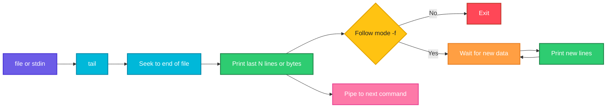

# tail

## What is it?
`tail` prints the last part of one or more files. By default it shows the last 10 lines. With `-f` it keeps the file open and prints new lines as they are written, which makes it the standard tool for watching logs live.

## Syntax
```bash
tail [OPTIONS] [FILE]...
```

## Visual Overview
> `tail` jumps to the end of the file, prints the last N lines or bytes and, with `-f`, keeps waiting for new data.



## Options/Flags
| Flag | Description |
|------|-------------|
| `-n NUM` / `--lines=NUM` | Print the last `NUM` lines (default is 10) |
| `-n +NUM` | Print starting from line `NUM` to the end |
| `-c NUM` / `--bytes=NUM` | Print the last `NUM` bytes |
| `-c +NUM` | Print starting from byte `NUM` to the end |
| `-f` / `--follow` | Keep the file open and print new data as it is appended |
| `-F` | Same as `--follow=name --retry`. Keeps working when the file is rotated or recreated |
| `--retry` | Keep trying to open a file that is missing or inaccessible |
| `--pid=PID` | With `-f`, stop following when process `PID` exits |
| `-s SEC` / `--sleep-interval=SEC` | With `-f`, check for new data every `SEC` seconds (default 1) |
| `-q` / `--quiet` | Never print the `==> file <==` header for several files |
| `-v` / `--verbose` | Always print the `==> file <==` header |
| `-z` / `--zero-terminated` | Treat lines as ending with a NUL character |
| `--help` | Show the help text |
| `--version` | Show the version |

## Usage Examples

Let's say we have this file `app.log`:

**Input file** (`app.log`):
```text
2026-10-06 10:00:01 INFO Service started
2026-10-06 10:00:05 WARN Disk usage at 82%
2026-10-06 10:00:09 ERROR Connection refused
2026-10-06 10:00:12 INFO Retry succeeded
2026-10-06 10:00:20 ERROR Timeout calling payment-api
2026-10-06 10:00:31 INFO Request completed
```

Let's say we have this file `names.txt`:

**Input file** (`names.txt`):
```text
alpha
beta
gamma
```

Let's say we have this file `hello.txt`:

**Input file** (`hello.txt`):
```text
Hello World
```

### Example 1: Default (last 10 lines)
`app.log` has 6 lines, so the whole file is shown.

**Command:**
```bash
tail app.log
```
**Sample Output:**
```text
2026-10-06 10:00:01 INFO Service started
2026-10-06 10:00:05 WARN Disk usage at 82%
2026-10-06 10:00:09 ERROR Connection refused
2026-10-06 10:00:12 INFO Retry succeeded
2026-10-06 10:00:20 ERROR Timeout calling payment-api
2026-10-06 10:00:31 INFO Request completed
```

### Example 2: Last N lines (`-n NUM`)
**Command:**
```bash
tail -n 2 app.log
```
**Sample Output:**
```text
2026-10-06 10:00:20 ERROR Timeout calling payment-api
2026-10-06 10:00:31 INFO Request completed
```

### Example 3: Start from line N (`-n +NUM`)
**Command:**
```bash
tail -n +5 app.log
```
**Sample Output:**
```text
2026-10-06 10:00:20 ERROR Timeout calling payment-api
2026-10-06 10:00:31 INFO Request completed
```

### Example 4: Last N bytes (`-c NUM`)
**Command:**
```bash
tail -c 20 app.log
```
**Sample Output:**
```text
O Request completed
```

### Example 5: Start from byte N (`-c +NUM`)
Byte 6 is the first newline, so byte 7 is the start of `beta`.

**Command:**
```bash
tail -c +7 names.txt
```
**Sample Output:**
```text
beta
gamma
```

### Example 6: Several files with headers (default)
**Command:**
```bash
tail -n 1 names.txt hello.txt
```
**Sample Output:**
```text
==> names.txt <==
gamma

==> hello.txt <==
Hello World
```

### Example 7: Hide the headers (`-q`)
**Command:**
```bash
tail -q -n 1 names.txt hello.txt
```
**Sample Output:**
```text
gamma
Hello World
```

### Example 8: Always show the header (`-v`)
**Command:**
```bash
tail -v -n 1 names.txt
```
**Sample Output:**
```text
==> names.txt <==
gamma
```

### Example 9: Follow a file live (`-f`)
Run this in one terminal, then append a line to `app.log` from another terminal with `echo "2026-10-06 10:00:40 INFO Cache warmed" >> app.log`.

**Command:**
```bash
tail -n 2 -f app.log
```
**Sample Output** (keeps running until you press `Ctrl+C`):
```text
2026-10-06 10:00:20 ERROR Timeout calling payment-api
2026-10-06 10:00:31 INFO Request completed
2026-10-06 10:00:40 INFO Cache warmed
```

### Example 10: Follow across log rotation (`-F`)
When `logrotate` renames `app.log` and creates a new one, `-F` reopens the new file by name. Plain `-f` would keep watching the old, renamed file.

**Command:**
```bash
tail -n 1 -F app.log
```
**Sample Output** (keeps running until you press `Ctrl+C`):
```text
2026-10-06 10:00:31 INFO Request completed
tail: 'app.log' has been replaced;  following new file
2026-10-07 00:00:02 INFO Service restarted
```

### Example 11: Wait for a file that does not exist yet (`--retry`)
**Command:**
```bash
tail --retry -f missing.log
```
**Sample Output** (keeps running until the file appears or you press `Ctrl+C`):
```text
tail: cannot open 'missing.log' for reading: No such file or directory
tail: 'missing.log' has appeared;  following new file
2026-10-06 11:00:00 INFO First line
```

### Example 12: Stop following when a process exits (`--pid=PID`)
Let's say the application runs with PID `4321`. `tail` exits by itself when that process ends.

**Command:**
```bash
tail -n 1 -f --pid=4321 app.log
```
**Sample Output** (returns to the prompt when PID 4321 exits):
```text
2026-10-06 10:00:31 INFO Request completed
```

### Example 13: Change the check interval (`-s SEC`)
Check for new data every 5 seconds instead of every second. This lowers load when watching many files.

**Command:**
```bash
tail -n 1 -f -s 5 app.log
```
**Sample Output** (keeps running until you press `Ctrl+C`):
```text
2026-10-06 10:00:31 INFO Request completed
```

### Example 14: NUL separated records (`-z`)
**Command:**
```bash
printf 'one\0two\0three\0' | tail -z -n 2 | tr '\0' '\n'
```
**Sample Output:**
```text
two
three
```

### Example 15: Check the version (`--version`)
**Command:**
```bash
tail --version | head -n 1
```
**Sample Output:**
```text
tail (GNU coreutils) 8.32
```

## Pitfalls / Gotchas
- `-f` follows the file descriptor. After log rotation it keeps reading the old renamed file. Use `-F` for rotated logs.
- `tail -n +5` means "from line 5 to the end", while `tail -n 5` means "last 5 lines". The `+` makes a big difference.
- `-f` never exits on its own. In scripts and CI jobs use `timeout 30 tail -f file` or `--pid`.
- `tail -f` on a network filesystem (NFS) can miss updates. Use `-s` or a different tool.
- `tail -n 0 -f file` shows only new lines and nothing from the existing content.
- `tail -c` counts bytes, so it can cut a multi-byte UTF-8 character in half.
- Some systems also accept `-r` (reverse) on BSD or macOS `tail`. GNU `tail` does not. Use `tac` instead.

## DevOps Use Cases

### Use Case 1: Watch an application log live during a deployment
**Situation:** After a release you want to see errors the moment they happen.

**Input file** (`app.log`): same file as in the Usage Examples.

**Command:**
```bash
tail -n 3 -f app.log
```
**Output** (keeps streaming):
```text
2026-10-06 10:00:12 INFO Retry succeeded
2026-10-06 10:00:20 ERROR Timeout calling payment-api
2026-10-06 10:00:31 INFO Request completed
```

### Use Case 2: Show only ERROR lines as they arrive
**Situation:** The log is noisy. Filter the live stream with `grep`. `--line-buffered` makes `grep` print immediately.

**Input file** (`app.log`): same file as in the Usage Examples.

**Command:**
```bash
tail -f app.log | grep --line-buffered ERROR
```
**Output** (keeps streaming):
```text
2026-10-06 10:00:09 ERROR Connection refused
2026-10-06 10:00:20 ERROR Timeout calling payment-api
```

### Use Case 3: Follow nginx logs across rotation
**Situation:** `logrotate` rotates the access log every night. Use `-F` so your terminal keeps working.

**Command:**
```bash
sudo tail -F /var/log/nginx/access.log
```
**Output** (keeps streaming):
```text
10.0.0.5 - - [06/Oct/2026:10:01:02 +0000] "GET /health HTTP/1.1" 200 2
10.0.0.9 - - [06/Oct/2026:10:01:03 +0000] "GET /api/orders HTTP/1.1" 500 87
```

### Use Case 4: Follow two logs in one terminal
**Situation:** Watch the application log and the error log together. `tail` prints a header each time the source changes.

**Input file** (`app.log`): same file as in the Usage Examples.

**Input file** (`error.log`):
```text
2026-10-06 10:00:09 ERROR Connection refused
```
**Command:**
```bash
tail -n 1 -f app.log error.log
```
**Output** (keeps streaming):
```text
==> app.log <==
2026-10-06 10:00:31 INFO Request completed

==> error.log <==
2026-10-06 10:00:09 ERROR Connection refused
```

### Use Case 5: Skip the header row of a CSV
**Situation:** Feed a CSV to a script without its header line.

**Input file** (`billing.csv`):
```text
account_id,service,cost_usd
1001,ec2,420.50
1002,s3,87.10
```
**Command:**
```bash
tail -n +2 billing.csv
```
**Output:**
```text
1001,ec2,420.50
1002,s3,87.10
```

### Use Case 6: Wait in a pipeline until the app is ready
**Situation:** A CI step starts a server in the background and must block until the log says it is ready.

**Command:**
```bash
tail -f server.log | grep -m 1 "Server ready"
```
**Output:**
```text
2026-10-06 10:02:11 INFO Server ready on port 8080
```
`grep -m 1` stops after the first match, and the pipeline ends.

### Use Case 7: Read the last events of a crashed service
**Situation:** A systemd service failed. Check the end of its log file for the cause.

**Input file** (`/var/log/myapp/error.log`):
```text
2026-10-06 09:59:58 INFO Loading config
2026-10-06 10:00:00 ERROR Cannot bind to port 8080
2026-10-06 10:00:00 FATAL Exiting
```
**Command:**
```bash
tail -n 2 /var/log/myapp/error.log
```
**Output:**
```text
2026-10-06 10:00:00 ERROR Cannot bind to port 8080
2026-10-06 10:00:00 FATAL Exiting
```

### Use Case 8: Follow a container log
**Situation:** `docker logs` and `kubectl logs` have their own `-f` and `--tail` flags that work like `tail`.

**Command:**
```bash
kubectl logs -f --tail=2 deploy/web
```
**Output** (keeps streaming):
```text
2026-10-06 10:00:20 ERROR Timeout calling payment-api
2026-10-06 10:00:31 INFO Request completed
```

### Use Case 9: Stop watching when the job finishes
**Situation:** A backup script writes a log. Follow it only while the script runs. Let's say the script has PID `5100`.

**Command:**
```bash
tail -f --pid=5100 backup.log
```
**Output** (returns to the prompt when the backup process exits):
```text
2026-10-06 02:00:01 Backup started
2026-10-06 02:14:30 Backup finished
```

## Related Commands
- [`cat`](cat.md) - print a whole file
- [`head`](head.md) - show the start of a file
- [`less`](less.md) - page through a file, press `F` to follow
- [`tac`](tac.md) - print lines in reverse order
- `grep` - search text
- `journalctl` - follow systemd logs with `-f`
