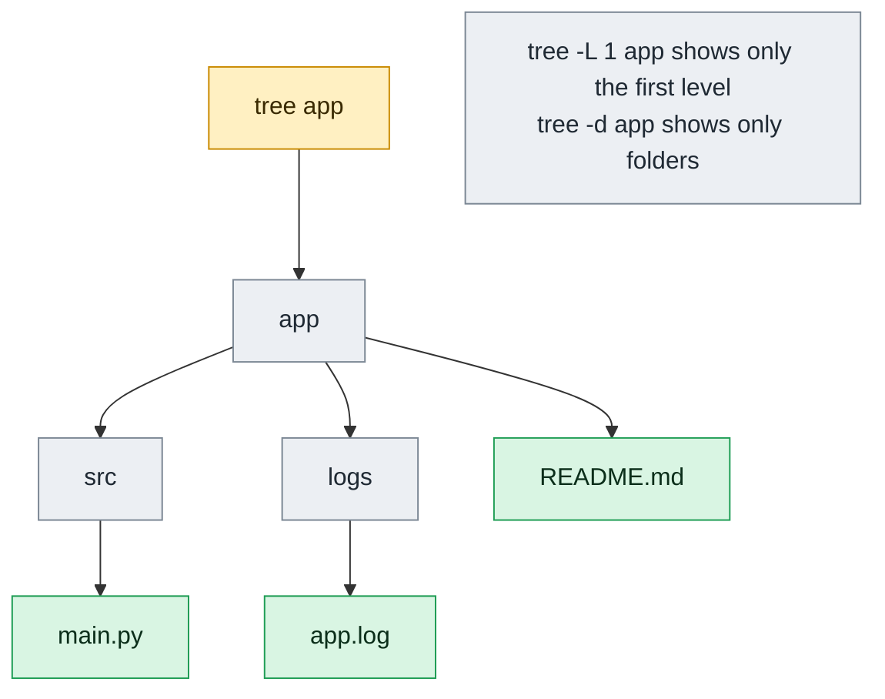

# tree

## What is it?
`tree` prints a directory and everything below it as an indented tree with lines. It gives you the whole structure of a project in one view, which is much easier to read than a recursive `ls -R`. It is often used to document a project layout, check build output and review a configuration directory. At the end it prints a count of directories and files.

## Syntax
```bash
tree [OPTIONS] [DIRECTORY...]
```
If no directory is given, `tree` starts in the current directory (`.`). It is not always installed: `sudo apt install tree` (Debian, Ubuntu), `sudo dnf install tree` (RHEL, Fedora), `brew install tree` (macOS).

## Visual Overview
> `tree` prints a folder and everything below it as an indented picture. Each nesting level is one more folder deeper.



## Options/Flags

### What to list
| Flag | Description |
|------|-------------|
| `-a` | Show hidden files (names starting with `.`) |
| `-d` | List directories only |
| `-L N` | Go down at most `N` levels |
| `-P PATTERN` | Show only files that match the pattern (use `\|` for several) |
| `-I PATTERN` | Do not show entries that match the pattern |
| `--prune` | Remove empty directories from the output (useful with `-P`) |
| `--ignore-case` | Ignore case when matching with `-P` and `-I` |
| `--filelimit N` | Do not open directories that have more than `N` entries |

### What to print for each entry
| Flag | Description |
|------|-------------|
| `-f` | Print the full path of each entry |
| `-i` | Do not print the indentation lines. Combine with `-f` for a flat list |
| `-s` | Print the size in bytes |
| `-h` | Print the size in human readable form (`K`, `M`, `G`) |
| `-D` | Print the last modification date |
| `-p` | Print the file type and permissions |
| `-u` | Print the owner |
| `-g` | Print the group |
| `-F` | Add `/` after directories, `*` after executables, `@` after links |

### Sorting
| Flag | Description |
|------|-------------|
| `-t` | Sort by modification time, newest first |
| `-r` | Reverse the sort order |
| `--dirsfirst` | List directories before files |

### Output format
| Flag | Description |
|------|-------------|
| `--noreport` | Do not print the final count of directories and files |
| `-C` | Always use colors, even in a pipe |
| `-n` | Never use colors |
| `-o FILE` | Write the output to `FILE` |
| `-J` | Print the tree as JSON |
| `--version` | Show the version |
| `--help` | Show the help text |

> Less common flags that are not covered here: `-x` (stay on one filesystem), `-l` (follow symbolic links), `-N` (print non-printable characters as they are), `-q` (print `?` instead of them), `-v` (natural sort of version numbers), `--inodes`, `--device`, `--du`, `-H` (HTML output), `-T` (HTML title), `--charset`, `--fromfile`, `--timefmt`. See `man tree`.

## Usage Examples

Let's say we have this directory `myapp/` and we run all commands from inside it. The sorting in the examples is the one you get with `LC_ALL=C` (plain alphabetical order, with upper case before lower case and dot files first). Today is `2026-10-12 12:00`.

**Input (directory content)** (`myapp/`):

| Path | Type | Size | Permissions | Owner:Group | Modified |
|------|------|------|-------------|-------------|----------|
| `.env` | file | 22 B | `-rw-------` | deploy:deploy | Oct 12 11:58 |
| `.gitignore` | file | 10 B | `-rw-r--r--` | deploy:deploy | Sep  1 09:00 |
| `docker-compose.yml` | file | 150 B | `-rw-r--r--` | deploy:deploy | Oct  3 09:00 |
| `logs/` | directory | 4096 B | `drwxr-xr-x` | root:adm | Oct 12 11:59 |
| `logs/app.log` | file | 5120 B | `-rw-r--r--` | root:adm | Oct 12 11:59 |
| `readme.md` | file | 1200 B | `-rw-r--r--` | deploy:deploy | Oct  5 09:00 |
| `src/` | directory | 4096 B | `drwxr-xr-x` | deploy:deploy | Oct 12 11:50 |
| `src/main.py` | file | 400 B | `-rw-r--r--` | deploy:deploy | Oct 12 11:50 |
| `src/utils.py` | file | 250 B | `-rw-r--r--` | deploy:deploy | Oct  2 09:00 |
| `tests/` | directory | 4096 B | `drwxr-xr-x` | deploy:deploy | Oct 10 09:00 |
| `tests/test_main.py` | file | 300 B | `-rw-r--r--` | deploy:deploy | Oct 10 09:00 |

The directory `myapp/` itself is `drwxr-xr-x`, owned by `deploy:deploy`, 4096 bytes and modified on Oct 12 11:59.

### Example 1: Show the whole tree
Hidden files are not shown by default.

**Command:**
```bash
tree
```
**Sample Output:**
```text
.
├── docker-compose.yml
├── logs
│   └── app.log
├── readme.md
├── src
│   ├── main.py
│   └── utils.py
└── tests
    └── test_main.py

3 directories, 6 files
```

### Example 2: Show hidden files (`-a`)
**Command:**
```bash
tree -a
```
**Sample Output:**
```text
.
├── .env
├── .gitignore
├── docker-compose.yml
├── logs
│   └── app.log
├── readme.md
├── src
│   ├── main.py
│   └── utils.py
└── tests
    └── test_main.py

3 directories, 8 files
```

### Example 3: Directories only (`-d`)
**Command:**
```bash
tree -d
```
**Sample Output:**
```text
.
├── logs
├── src
└── tests

3 directories
```

### Example 4: Limit the depth (`-L`)
**Command:**
```bash
tree -L 1
```
**Sample Output:**
```text
.
├── docker-compose.yml
├── logs
├── readme.md
├── src
└── tests

3 directories, 2 files
```

### Example 5: Show only some files (`-P`)
Directories stay in the output even if they hold no match.

**Command:**
```bash
tree -P "*.py"
```
**Sample Output:**
```text
.
├── logs
├── src
│   ├── main.py
│   └── utils.py
└── tests
    └── test_main.py

3 directories, 3 files
```

### Example 6: Remove empty directories (`--prune`)
`logs` has no `.py` file, so it disappears.

**Command:**
```bash
tree -P "*.py" --prune
```
**Sample Output:**
```text
.
├── src
│   ├── main.py
│   └── utils.py
└── tests
    └── test_main.py

2 directories, 3 files
```

### Example 7: Hide some entries (`-I`)
Use `|` to give several patterns.

**Command:**
```bash
tree -I "logs|tests"
```
**Sample Output:**
```text
.
├── docker-compose.yml
├── readme.md
└── src
    ├── main.py
    └── utils.py

1 directory, 4 files
```

### Example 8: Ignore case in patterns (`--ignore-case`)
`-P "*.PY"` does not match `main.py` unless the case is ignored.

**Command:**
```bash
tree -P "*.PY" --ignore-case --prune
```
**Sample Output:**
```text
.
├── src
│   ├── main.py
│   └── utils.py
└── tests
    └── test_main.py

2 directories, 3 files
```

### Example 9: Skip big directories (`--filelimit`)
`src` has 2 entries, which is more than the limit of 1, so `tree` does not open it.

**Command:**
```bash
tree --filelimit 1
```
**Sample Output:**
```text
.
├── docker-compose.yml
├── logs
│   └── app.log
├── readme.md
├── src [2 entries exceeds filelimit, not opening dir]
└── tests
    └── test_main.py

3 directories, 4 files
```

### Example 10: Full path of each entry (`-f`)
**Command:**
```bash
tree -f -L 2 src
```
**Sample Output:**
```text
src
├── src/main.py
└── src/utils.py

0 directories, 2 files
```

### Example 11: Flat list without lines (`-i` with `-f`)
Good for scripts and for pasting into other tools.

**Command:**
```bash
tree -if
```
**Sample Output:**
```text
.
./docker-compose.yml
./logs
./logs/app.log
./readme.md
./src
./src/main.py
./src/utils.py
./tests
./tests/test_main.py

3 directories, 6 files
```

### Example 12: Sizes in bytes (`-s`)
**Command:**
```bash
tree -s
```
**Sample Output:**
```text
[       4096]  .
├── [        150]  docker-compose.yml
├── [       4096]  logs
│   └── [       5120]  app.log
├── [       1200]  readme.md
├── [       4096]  src
│   ├── [        400]  main.py
│   └── [        250]  utils.py
└── [       4096]  tests
    └── [        300]  test_main.py

3 directories, 6 files
```

### Example 13: Human readable sizes (`-h`)
**Command:**
```bash
tree -h
```
**Sample Output:**
```text
[4.0K]  .
├── [ 150]  docker-compose.yml
├── [4.0K]  logs
│   └── [5.0K]  app.log
├── [1.2K]  readme.md
├── [4.0K]  src
│   ├── [ 400]  main.py
│   └── [ 250]  utils.py
└── [4.0K]  tests
    └── [ 300]  test_main.py

3 directories, 6 files
```

### Example 14: Modification dates (`-D`)
**Command:**
```bash
tree -D -L 1
```
**Sample Output:**
```text
[Oct 12 11:59]  .
├── [Oct  3 09:00]  docker-compose.yml
├── [Oct 12 11:59]  logs
├── [Oct  5 09:00]  readme.md
├── [Oct 12 11:50]  src
└── [Oct 10 09:00]  tests

3 directories, 2 files
```

### Example 15: Permissions (`-p`)
**Command:**
```bash
tree -p -L 1
```
**Sample Output:**
```text
[drwxr-xr-x]  .
├── [-rw-r--r--]  docker-compose.yml
├── [drwxr-xr-x]  logs
├── [-rw-r--r--]  readme.md
├── [drwxr-xr-x]  src
└── [drwxr-xr-x]  tests

3 directories, 2 files
```

### Example 16: Owners (`-u`)
**Command:**
```bash
tree -u -L 1
```
**Sample Output:**
```text
[deploy]  .
├── [deploy]  docker-compose.yml
├── [root  ]  logs
├── [deploy]  readme.md
├── [deploy]  src
└── [deploy]  tests

3 directories, 2 files
```

### Example 17: Groups (`-g`)
**Command:**
```bash
tree -g -L 1
```
**Sample Output:**
```text
[deploy]  .
├── [deploy]  docker-compose.yml
├── [adm   ]  logs
├── [deploy]  readme.md
├── [deploy]  src
└── [deploy]  tests

3 directories, 2 files
```

### Example 18: Add type marks (`-F`)
**Command:**
```bash
tree -F -L 1
```
**Sample Output:**
```text
.
├── docker-compose.yml
├── logs/
├── readme.md
├── src/
└── tests/

3 directories, 2 files
```

### Example 19: Newest first (`-t`)
**Command:**
```bash
tree -t
```
**Sample Output:**
```text
.
├── logs
│   └── app.log
├── src
│   ├── main.py
│   └── utils.py
├── tests
│   └── test_main.py
├── readme.md
└── docker-compose.yml

3 directories, 6 files
```

### Example 20: Reverse order (`-r`)
**Command:**
```bash
tree -r
```
**Sample Output:**
```text
.
├── tests
│   └── test_main.py
├── src
│   ├── utils.py
│   └── main.py
├── readme.md
├── logs
│   └── app.log
└── docker-compose.yml

3 directories, 6 files
```

### Example 21: Directories first (`--dirsfirst`)
**Command:**
```bash
tree --dirsfirst
```
**Sample Output:**
```text
.
├── logs
│   └── app.log
├── src
│   ├── main.py
│   └── utils.py
├── tests
│   └── test_main.py
├── docker-compose.yml
└── readme.md

3 directories, 6 files
```

### Example 22: No summary line (`--noreport`)
**Command:**
```bash
tree -L 1 --noreport
```
**Sample Output:**
```text
.
├── docker-compose.yml
├── logs
├── readme.md
├── src
└── tests
```

### Example 23: Turn colors off or on (`-n` and `-C`)
`tree` uses colors only on a terminal. `-C` forces them even in a pipe and `-n` always turns them off. The text is the same, only the escape codes differ.

**Command:**
```bash
tree -n -L 1
```
**Sample Output:**
```text
.
├── docker-compose.yml
├── logs
├── readme.md
├── src
└── tests

3 directories, 2 files
```

**Command:**
```bash
tree -C -L 1 | cat -v | head -n 3
```
**Sample Output:**
```text
^[[01;34m.^[[0m
├── docker-compose.yml
├── ^[[01;34mlogs^[[0m
```
The `^[[01;34m` part is the escape code that makes directory names blue.

### Example 24: Save the output to a file (`-o`)
**Command:**
```bash
tree -L 1 -o structure.txt
cat structure.txt
```
**Sample Output:**
```text
.
├── docker-compose.yml
├── logs
├── readme.md
├── src
└── tests

3 directories, 2 files
```

### Example 25: JSON output (`-J`)
**Command:**
```bash
tree -J logs
```
**Sample Output:**
```text
[
  {"type":"directory","name":"logs","contents":[
    {"type":"file","name":"app.log"}
  ]},
  {"type":"report","directories":0,"files":1}
]
```

### Example 26: Check the version (`--version`)
**Command:**
```bash
tree --version
```
**Sample Output:**
```text
tree v2.0.2 (c) 1996 - 2022 by Steve Baker, Thomas Moore, Francesc Rocher, Florian Sesser, Kyosuke Tokoro
```

### Example 27: Show the help (`--help`)
**Command:**
```bash
tree --help | head -n 1
```
**Sample Output:**
```text
usage: tree [-acdfghilnpqrstuvxACDFJQNSUX] [-L level [-R]] [-H  baseHREF] [-T title]
```

## Pitfalls / Gotchas
- **`tree` is not installed by default** on most minimal servers and containers. Install it, or use `find` or `ls -R`.
- **Hidden files are skipped.** Use `-a`. Remember that `-a` also shows `.git`, which can be very long. Use `-I '.git'` to hide it.
- **A large tree floods the terminal.** Start with `-L 2`. Add `-I 'node_modules|.git|__pycache__|venv'` for software projects.
- **`-P` only filters files, not directories.** Add `--prune` to remove directories that end up empty.
- **`-I` and `-P` take a pattern, not a regex.** Use `*`, `?` and `[...]`, and `|` to join several.
- **The sort order depends on your locale.** With `en_US.UTF-8` upper and lower case are mixed and leading dots are ignored. Use `LC_ALL=C tree` for plain alphabetical order.
- **`tree` follows no symbolic links by default**, so loops cannot happen. `-l` follows them and `tree` detects loops.
- **Colors in pipes:** when you pipe or redirect the output, the colors are gone. Use `-C` if you want them.
- **The summary line counts only what was printed.** With `-L`, `-I` or `--filelimit`, the totals are lower than the real numbers.

## DevOps Use Cases

### Use Case 1: Document the project structure in the README
**Situation:** Add a short, clean layout to the project docs, without noise from the VCS and dependency folders.

**Input (directory content)** (`myapp/`): same directory as in the Usage Examples, plus a `.git/` folder.

**Command:**
```bash
tree -L 2 -I ".git|node_modules|__pycache__" --noreport > structure.txt
cat structure.txt
```
**Output:**
```text
.
├── docker-compose.yml
├── logs
│   └── app.log
├── readme.md
├── src
│   ├── main.py
│   └── utils.py
└── tests
    └── test_main.py
```

### Use Case 2: Check the build output of a CI job
**Situation:** After `npm run build`, make sure the expected artifacts exist in `dist/` before uploading them.

**Input (directory content)** (`dist/`): `dist/index.html`, `dist/assets/app.js`, `dist/assets/app.css`.

**Command:**
```bash
tree -h dist
```
**Output:**
```text
[4.0K]  dist
├── [4.0K]  assets
│   ├── [ 12K]  app.css
│   └── [180K]  app.js
└── [ 512]  index.html

1 directory, 3 files
```

### Use Case 3: Audit permissions of a configuration directory
**Situation:** A security review asks who owns the files in `/etc/ssl/private` and whether they are locked down.

**Input (directory content)** (`/etc/ssl/private/`): `server.key` (`-rw-r-----`, root:ssl-cert) and `server.pem` (`-rw-r--r--`, root:root).

**Command:**
```bash
sudo tree -pug /etc/ssl/private
```
**Output:**
```text
[drwx--x---  root     ssl-cert]  /etc/ssl/private
├── [-rw-r-----  root     ssl-cert]  server.key
└── [-rw-r--r--  root     root    ]  server.pem

0 directories, 2 files
```

### Use Case 4: Review a Terraform module layout
**Situation:** Check that every module has the standard files `main.tf`, `variables.tf` and `outputs.tf`.

**Input (directory content)** (`infra/`): `infra/main.tf`, and a module `infra/modules/network/` with `main.tf`, `variables.tf` and `outputs.tf`.

**Command:**
```bash
tree infra
```
**Output:**
```text
infra
├── main.tf
└── modules
    └── network
        ├── main.tf
        ├── outputs.tf
        └── variables.tf

2 directories, 4 files
```

### Use Case 5: List only the directories of an Ansible role
**Situation:** See the layout of an Ansible role without reading every file.

**Input (directory content)** (`roles/nginx/`): directories `tasks/`, `handlers/`, `templates/` and `defaults/`, each with one or more files.

**Command:**
```bash
tree -d roles/nginx
```
**Output:**
```text
roles/nginx
├── defaults
├── handlers
├── tasks
└── templates

4 directories
```

### Use Case 6: Feed the structure to another tool as JSON
**Situation:** A script needs the list of files in a directory, as JSON.

**Input (directory content)** (`logs/`): `logs/app.log`.

**Command:**
```bash
tree -J logs | jq -r '.[0].contents[].name'
```
**Output:**
```text
app.log
```

### Use Case 7: Find where the Docker image gets its size
**Situation:** An image is too large. See what is in the build context with human readable sizes.

**Input (directory content)** (`myapp/`): same directory as in the Usage Examples.

**Command:**
```bash
tree -h -L 1 --dirsfirst
```
**Output:**
```text
[4.0K]  .
├── [4.0K]  logs
├── [4.0K]  src
├── [4.0K]  tests
├── [ 150]  docker-compose.yml
└── [1.2K]  readme.md

3 directories, 2 files
```

### Use Case 8: Check that tests mirror the source files
**Situation:** Show only Python files, so you can compare `src/` with `tests/` at a glance.

**Input (directory content)** (`myapp/`): same directory as in the Usage Examples.

**Command:**
```bash
tree -P "*.py" --prune -I "__pycache__"
```
**Output:**
```text
.
├── src
│   ├── main.py
│   └── utils.py
└── tests
    └── test_main.py

2 directories, 3 files
```

### Use Case 9: Check a Helm chart before packaging
**Situation:** Verify that the chart has `Chart.yaml`, `values.yaml` and templates.

**Input (directory content)** (`mychart/`): `Chart.yaml`, `values.yaml`, and `templates/deployment.yaml`, `templates/service.yaml`.

**Command:**
```bash
tree mychart
```
**Output:**
```text
mychart
├── Chart.yaml
├── templates
│   ├── deployment.yaml
│   └── service.yaml
└── values.yaml

1 directory, 4 files
```

## Related Commands
- [`ls`](ls.md) - list a single directory (`ls -R` lists recursively)
- [`find`](find.md) - search for files with conditions
- [`locate`](locate.md) - fast search by name
- [`pwd`](pwd.md) - print the current directory
- [`cd`](cd.md) - change directory
- `du` - disk usage of directories
- `jq` - process the JSON output of `tree -J`

---
<!-- nav -->
[← Previous: `cd`](cd.md) | [Learning path](../README.md) | [Next: `mkdir` →](mkdir.md)
