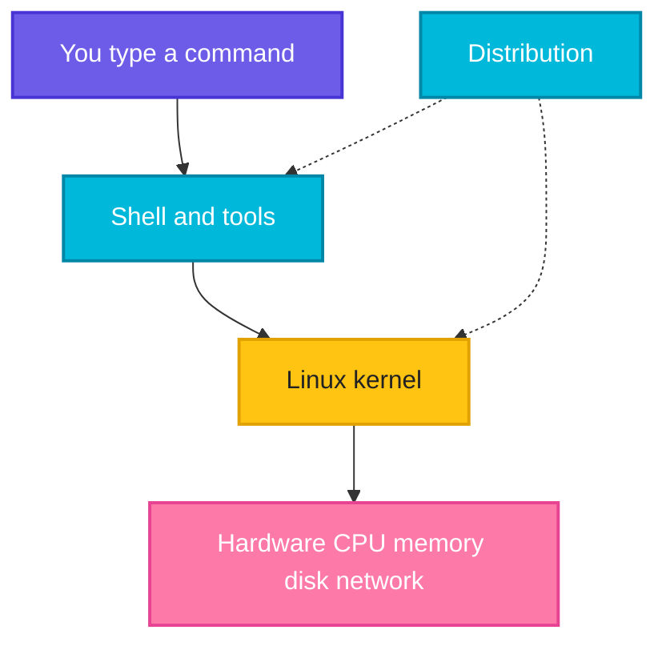

# What is Linux

## What is it?
Linux is a free, open source **kernel**: the core program that talks to the hardware (CPU, memory, disk, network) and shares it between running programs. A **Linux distribution** (distro) bundles that kernel with a package manager, system tools, a shell and default settings, so you get a complete operating system. Most servers, cloud machines, containers and CI runners in DevOps run Linux.

## Syntax
Linux has no single command. These commands tell you which Linux you are on:

```bash
uname [-s | -r | -m]
cat /etc/os-release
```

## Visual Overview
> Your commands go to the shell, the shell asks the kernel, and the kernel controls the hardware. A distro is the kernel plus everything around it.



## Options/Flags
Key terms and the common distro families:

| Term | Meaning |
|------|---------|
| Kernel | The core of the OS, it manages hardware and processes |
| Distribution | Kernel plus package manager, tools and defaults |
| Open source | The source code is public, anyone can read, change and share it |
| Debian family | Debian, Ubuntu. Package manager: `apt`. Package format: `.deb` |
| Red Hat family | RHEL, Rocky, AlmaLinux, CentOS, Fedora. Package manager: `dnf` or `yum`. Format: `.rpm` |
| Alpine | Very small distro, popular for Docker images. Package manager: `apk` |
| LTS | Long Term Support release, receives updates for years, best for servers |

| Command | Description |
|---------|-------------|
| `uname -s` | Print the kernel name |
| `uname -m` | Print the CPU architecture |
| `uname -r` | Print the kernel release |
| `cat /etc/os-release` | Print the distro name and version |

## Usage Examples

### Example 1: Check the kernel name (`uname -s`)
**Command:**
```bash
uname -s
```
**Sample Output:**
```text
Linux
```

### Example 2: Check the CPU architecture (`uname -m`)
**Command:**
```bash
uname -m
```
**Sample Output:**
```text
x86_64
```

### Example 3: Check the kernel release (`uname -r`)
**Command:**
```bash
uname -r
```
**Sample Output:**
```text
6.18.54.1-microsoft-standard-WSL2
```
The release string differs on every machine. This one comes from Ubuntu running on WSL2.

### Example 4: Find out which distro you are on
Let's say we have this file `/etc/os-release`:

**Input file** (`/etc/os-release`):
```text
PRETTY_NAME="Ubuntu 22.04.5 LTS"
NAME="Ubuntu"
VERSION_ID="22.04"
VERSION="22.04.5 LTS (Jammy Jellyfish)"
VERSION_CODENAME=jammy
ID=ubuntu
ID_LIKE=debian
HOME_URL="https://www.ubuntu.com/"
SUPPORT_URL="https://help.ubuntu.com/"
BUG_REPORT_URL="https://bugs.launchpad.net/ubuntu/"
PRIVACY_POLICY_URL="https://www.ubuntu.com/legal/terms-and-policies/privacy-policy"
UBUNTU_CODENAME=jammy
```

**Command:**
```bash
cat /etc/os-release
```
**Sample Output:**
```text
PRETTY_NAME="Ubuntu 22.04.5 LTS"
NAME="Ubuntu"
VERSION_ID="22.04"
VERSION="22.04.5 LTS (Jammy Jellyfish)"
VERSION_CODENAME=jammy
ID=ubuntu
ID_LIKE=debian
HOME_URL="https://www.ubuntu.com/"
SUPPORT_URL="https://help.ubuntu.com/"
BUG_REPORT_URL="https://bugs.launchpad.net/ubuntu/"
PRIVACY_POLICY_URL="https://www.ubuntu.com/legal/terms-and-policies/privacy-policy"
UBUNTU_CODENAME=jammy
```
`ID_LIKE=debian` tells you this distro belongs to the Debian family, so use `apt`.

### Example 5: Read only the distro name
Using the same `/etc/os-release` file shown in Example 4.

**Command:**
```bash
grep '^PRETTY_NAME' /etc/os-release
```
**Sample Output:**
```text
PRETTY_NAME="Ubuntu 22.04.5 LTS"
```

## Sample Output
A quick summary of a machine, using only the commands above:

```bash
uname -s; uname -m; grep '^ID=' /etc/os-release
```
```text
Linux
x86_64
ID=ubuntu
```

## Pitfalls / Gotchas
- "Linux" is the kernel, not the whole system. Ubuntu and Rocky are different distros on the same kernel, with different package managers and file layouts.
- Commands from a Debian tutorial (`apt`) will not work on a Red Hat machine (`dnf`). Check `/etc/os-release` first.
- macOS and Windows are not Linux. macOS is Unix like and its commands differ in small ways. On Windows use WSL to get real Linux.
- Do not use a non LTS release for a production server, support ends after a few months.

## DevOps Use Cases

### Use Case 1: Pick the right package manager in a script
**Situation:** One install script must run on Ubuntu and on Rocky servers.

Let's say we have this file `/etc/os-release` on the server:

**Input file** (`/etc/os-release`):
```text
NAME="Ubuntu"
ID=ubuntu
ID_LIKE=debian
```

**Command:**
```bash
. /etc/os-release
case "$ID $ID_LIKE" in
  *debian*) echo "use apt" ;;
  *rhel*|*fedora*) echo "use dnf" ;;
  *) echo "unknown distro" ;;
esac
```
**Sample Output:**
```text
use apt
```

### Use Case 2: Record the kernel and architecture in a build log
**Situation:** A CI job fails only on some runners, so you log which machine ran it.

**Command:**
```bash
echo "runner: $(uname -s) $(uname -m)"
```
**Sample Output:**
```text
runner: Linux x86_64
```

## Related Commands
- [`uname`](../system-info/uname.md) - kernel and system information
- [`hostnamectl`](../system-info/hostnamectl.md) - OS and host details on systemd machines
- [`apt`](../package-management/apt.md) / [`dnf`](../package-management/dnf.md) / [`apk`](../package-management/apk.md) - the package manager of each distro family
- [Installing Linux](02-installing-linux.md) - the next page
