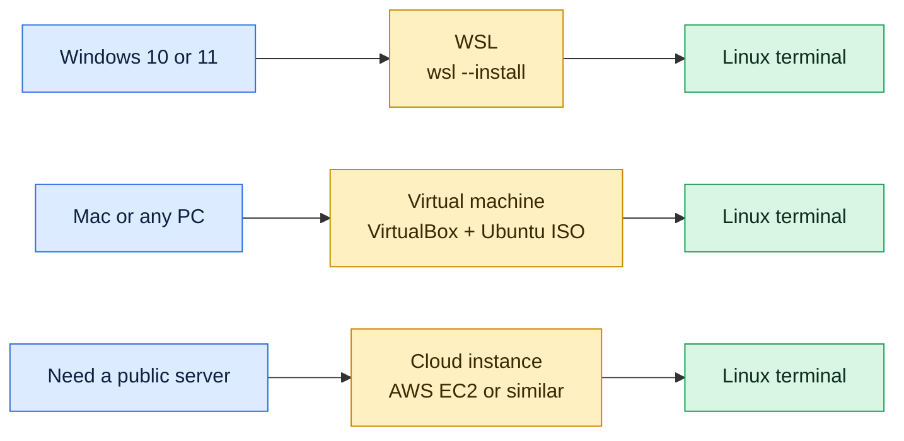

# Installing Linux

## What is it?
To learn Linux you need a Linux machine to practice on. You do not have to replace your current operating system. There are three common ways to get one: **WSL** on Windows, a **virtual machine** on any computer, or a **cloud instance** you rent by the hour.

## Syntax
```bash
wsl --install -d <distro>      # Windows, run in PowerShell
wsl -l -v                      # list installed distros
```

## Visual Overview
> Pick the row that matches the computer you have. All three end in the same place: a Linux terminal where you can practise.



## Options/Flags
| Option | Best for | Cost | Notes |
|--------|----------|------|-------|
| WSL 2 | Windows users | Free | Fastest way to start, runs inside Windows |
| Virtual machine (VirtualBox, VMware) | Any computer, full desktop practice | Free | Needs 2 CPU cores, 4 GB RAM and 25 GB disk |
| Cloud instance (AWS EC2, Azure, GCP) | Real servers, DevOps practice | Free tier or pay per hour | Needs a credit card, remember to stop it |
| Dual boot | Daily use | Free | Risky, resize disk partitions carefully |
| Docker container | Quick throwaway tests | Free | No systemd by default, not a full server |

Which distro to pick: **Ubuntu 22.04 LTS** for beginners, because most tutorials and this documentation use it. Learn **Rocky Linux** or **AlmaLinux** later for the Red Hat family.

## Usage Examples

### Example 1: Install Ubuntu on Windows with WSL
Run this in PowerShell as Administrator, then restart when asked:

**Command:**
```powershell
wsl --install -d Ubuntu
```
After the restart Ubuntu opens and asks you to create a username and password. That password is your `sudo` password. The installer prints progress messages that differ between Windows versions, so no output is shown here.

### Example 2: List the installed distros
**Command:**
```powershell
wsl -l -v
```
**Sample Output:**
```text
  NAME              STATE           VERSION
* Ubuntu            Stopped         2
  docker-desktop    Stopped         2
```
`VERSION 2` means WSL 2. The `*` marks the default distro.

### Example 3: Open the Ubuntu terminal
**Command:**
```powershell
wsl -d Ubuntu
```
Your prompt changes to the Linux shell, for example `devops@pc:~$`. Type `exit` to return to Windows.

### Example 4: Confirm the install worked
Run this inside the Linux terminal:

**Command:**
```bash
lsb_release -a
```
**Sample Output:**
```text
No LSB modules are available.
Distributor ID:	Ubuntu
Description:	Ubuntu 22.04.5 LTS
Release:	22.04
Codename:	jammy
```
The `No LSB modules are available.` line is normal and can be ignored.

### Example 5: Check you are on Linux and not Windows
**Command:**
```bash
uname -s
```
**Sample Output:**
```text
Linux
```

## Sample Output
After a successful install, these checks work in your new terminal:

```bash
uname -s; uname -m; grep '^ID=' /etc/os-release
```
```text
Linux
x86_64
ID=ubuntu
```

## Pitfalls / Gotchas
- WSL needs virtualization turned on in the BIOS. If `wsl --install` fails, enable "Virtualization Technology" and try again.
- Choose a password you remember. Typing it shows nothing on screen, no dots and no stars, this is normal.
- A cloud instance keeps charging while it runs. Stop or terminate it when you finish practicing.
- On a cloud instance never open all ports to the world. Allow only SSH (port 22) from your own IP.
- Keep files you care about inside the Linux home directory (`~`) when using WSL. Access through `/mnt/c` is slower and permissions behave differently.
- A Docker container is good for quick tests, but it is not a full operating system, so commands like `systemctl` may not work in it.

## Try it yourself

Work in a practice folder so nothing real can be damaged: `mkdir -p ~/practice && cd ~/practice`. Try each task first, then open the answer.

**Task 1.** Prove that your Linux terminal works by printing a word.

<details>
<summary>Show the answer</summary>

```bash
echo hello
```
Output: `hello`.

</details>

**Task 2.** Windows only: in PowerShell, list your WSL distributions and which WSL version each uses.

<details>
<summary>Show the answer</summary>

```powershell
wsl -l -v
```

</details>

**Task 3.** On Ubuntu or Debian, refresh the list of available packages.

<details>
<summary>Show the answer</summary>

```bash
sudo apt update
```
It downloads the package lists and does not install anything.

</details>

## Related Commands
- [What is Linux](01-what-is-linux.md) - the previous page
- [`uname`](../system-info/uname.md) - confirm the kernel name
- [`ssh`](../networking/ssh.md) - connect to a cloud instance
- [Terminal, shell and bash](03-terminal-shell-bash.md) - the next page

---
<!-- nav -->
[← Previous: What is Linux](01-what-is-linux.md) | [Learning path](../README.md) | [Next: Terminal, Shell and Bash →](03-terminal-shell-bash.md)
