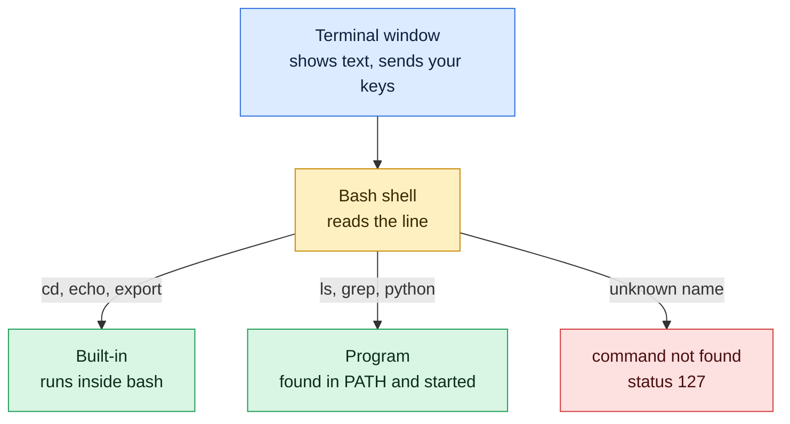

# Terminal, Shell and Bash

## What is it?
These three words are often mixed up:

- **Terminal**: the window where you type and see text. It only shows text.
- **Shell**: the program inside the terminal that reads your command, runs it and prints the result.
- **Bash**: the most common shell on Linux. Others are `zsh`, `sh`, `dash` and `fish`.

## Syntax
Every command follows the same shape:

```bash
command [options] [arguments]
```

The prompt, shown before you type, usually looks like this:

```text
devops@server01:~/projects$
```

## Visual Overview
> The terminal is only a window. The shell inside it (bash) reads what you type and decides what to run.



## Options/Flags
**Parts of the prompt** `devops@server01:~/projects$`:

| Part | Meaning |
|------|---------|
| `devops` | The user you are logged in as |
| `server01` | The hostname of the machine |
| `~/projects` | The current directory, `~` means your home directory |
| `$` | Normal user. A root user sees `#` instead |

**Parts of a command** `ls -l /var/log`:

| Part | Name | Meaning |
|------|------|---------|
| `ls` | command | What to run |
| `-l` | option (flag) | Changes how it behaves |
| `/var/log` | argument | What to run it on |

**Useful commands for this page:**

| Command | Description |
|---------|-------------|
| `echo $SHELL` | Print your login shell |
| `type <name>` | Show if a name is a built-in, an alias or a program |
| `type -t <name>` | Print only the kind: builtin, file, alias, keyword |
| `echo $?` | Print the exit code of the last command |

## Usage Examples

### Example 1: Find your shell (`echo $SHELL`)
**Command:**
```bash
echo $SHELL
```
**Sample Output:**
```text
/bin/bash
```

### Example 2: Built-in or program (`type`)
**Command:**
```bash
type cd
```
**Sample Output:**
```text
cd is a shell builtin
```
`cd` must be a built-in. A separate program could not change the directory of your shell.

### Example 3: Only the kind (`type -t`)
**Command:**
```bash
type -t cd
type -t cat
```
**Sample Output:**
```text
builtin
file
```
`file` means a program stored on disk.

### Example 4: Command with option and argument
Let's say we have this file `a.txt`:

**Input file** (`a.txt`):
```text
one
two
```

**Command:**
```bash
ls -l a.txt
```
**Sample Output:**
```text
-rw-r--r-- 1 devops devops 8 Oct 14 01:19 a.txt
```
`ls` is the command, `-l` is the option and `a.txt` is the argument. The size is 8 bytes: 4 for `one` plus its newline and 4 for `two` plus its newline.

### Example 5: A command that does not exist (`echo $?`)
**Command:**
```bash
bash -c 'lss'
echo $?
```
**Sample Output:**
```text
bash: line 1: lss: command not found
127
```
Exit code `0` means success. Any other number means an error, and `127` means command not found.

### Example 6: Which shell is running (`$0`)
**Command:**
```bash
bash -c 'echo $0'
```
**Sample Output:**
```text
bash
```

## Sample Output
Putting it together, a short session:

```bash
echo hello
type echo
```
```text
hello
echo is a shell builtin
```

## Pitfalls / Gotchas
- Linux is **case sensitive**. `LS` and `ls` are different, and `File.txt` and `file.txt` are different files.
- Do not paste the `$` from a tutorial. It is the prompt, not part of the command.
- Spaces separate words. `cd my folder` gives two arguments. Write `cd "my folder"` or `cd my\ folder`.
- Press **Tab** to finish names and **Up arrow** to repeat earlier commands, it saves typing and typos.
- Press **Ctrl+C** to stop a running command. Typing `exit` or pressing **Ctrl+D** closes the shell.
- A terminal does not mean bash. If you run `zsh`, some bash features work differently.

## DevOps Use Cases

### Use Case 1: Fail a script when a step fails
**Situation:** A deploy script must stop at the first error instead of continuing.

Let's say we have this file `deploy.sh`:

**Input file** (`deploy.sh`):
```bash
#!/bin/bash
echo "step 1: build"
false
echo "step 2: deploy"
```

**Command:**
```bash
bash deploy.sh
echo "exit code: $?"
```
**Sample Output:**
```text
step 1: build
step 2: deploy
exit code: 0
```
The script kept going after `false` failed and reported success, which is dangerous in a pipeline.

### Use Case 2: Stop at the first error with `set -e`
**Situation:** The same script, now fixed so a failed step stops the deploy.

Let's say we have this file `deploy-safe.sh`:

**Input file** (`deploy-safe.sh`):
```bash
#!/bin/bash
set -e
echo "step 1: build"
false
echo "step 2: deploy"
```

**Command:**
```bash
bash deploy-safe.sh
echo "exit code: $?"
```
**Sample Output:**
```text
step 1: build
exit code: 1
```
The pipeline sees exit code `1` and marks the job as failed.

## Try it yourself

Work in a practice folder so nothing real can be damaged: `mkdir -p ~/practice && cd ~/practice`. Try each task first, then open the answer.

**Task 1.** Which shell are you using?

<details>
<summary>Show the answer</summary>

```bash
echo $SHELL
```
Typically `/bin/bash`.

</details>

**Task 2.** Is `cd` a program on disk, or built into bash? What about `ls`?

<details>
<summary>Show the answer</summary>

```bash
type cd
type ls
```
`cd` is a shell builtin. `ls` is a program (or an alias for one), so `type` shows its path.

</details>

**Task 3.** Run a command that does not exist, then read its exit status.

<details>
<summary>Show the answer</summary>

```bash
nosuchcommand
echo $?
```
bash prints `command not found`, and the status is `127`.

</details>

## Related Commands
- [Installing Linux](02-installing-linux.md) - the previous page
- [`echo`](../shell-basics/echo.md) - print text and variables
- [`type`](../shell-basics/type.md) - how the shell sees a name
- [`history`](../shell-basics/history.md) - repeat earlier commands
- [`man`](../shell-basics/man.md) - read the manual of any command
- [Filesystem hierarchy](04-filesystem-hierarchy.md) - the next page

---
<!-- nav -->
[← Previous: Installing Linux](02-installing-linux.md) | [Learning path](../README.md) | [Next: Filesystem Hierarchy →](04-filesystem-hierarchy.md)
