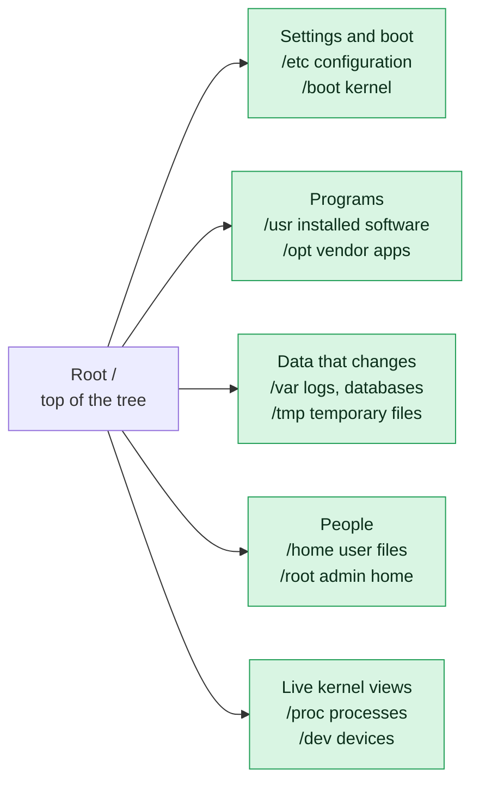

# Filesystem Hierarchy

## What is it?
When you open a Linux server for the first time, you see a lot of directories: `etc`, `var`, `usr`, `proc`... and no hint about what each one is for. The **filesystem hierarchy** is the agreed layout that answers this. Every Linux distribution (Ubuntu, Debian, RHEL, Amazon Linux, Alpine...) follows almost the same map, defined by a standard called the **FHS (Filesystem Hierarchy Standard)**.

Key ideas for a beginner:

- **Everything starts at `/`.** Linux has one single tree. The top of it is called **root** and is written as `/`. There are no drive letters like `C:` or `D:`.
- **Other disks plug into the tree.** A second disk, a USB drive or a network share is *mounted* on a directory inside the tree (for example `/mnt/backup`). You walk into it like any other folder.
- **Every directory has one job.** Settings go in one place, logs in another, programs in another. Once you learn the jobs, you know where to look on any server you have never seen before.
- **Everything is a file.** Even hardware (`/dev/sda`), running processes (`/proc/1234`) and kernel settings (`/proc/sys`) are shown as files you can `ls` and `cat`.

**Why a DevOps engineer must know this:**

| Situation | Where you must look |
|-----------|---------------------|
| An application will not start | Its config in `/etc`, its logs in `/var/log` |
| The disk is 100% full | `/var/log`, `/var/lib`, `/var/cache`, `/tmp` |
| You must deploy an app by hand | `/opt`, `/srv`, `/usr/local` |
| A service needs to start on boot | `/etc/systemd/system` |
| You need CPU and memory numbers without any tool | `/proc` |
| A Docker or Kubernetes volume is mounted | `/var/lib/docker`, `/var/lib/kubelet`, `/mnt` |
| You are doing a security audit | `/etc/passwd`, `/etc/ssh`, `/var/log/auth.log` |
| A backup must contain the right data | `/etc` + `/home` + `/var/lib` + `/opt` |

If you do not know the layout, you waste time searching with `find` while the production server is down.

## Syntax
There is no single command for this topic. You explore the tree with a few simple commands:

```bash
ls /                  # list the top level directories
ls /etc               # list what is inside /etc
cd /var/log           # go into a directory
ls -ld /etc /tmp      # show details of the directory itself
df -h /               # show which disk is mounted where
```

## Visual Overview
> Linux has one single tree that starts at `/`. There are no drive letters. These are the folders you will use most, grouped by purpose.



## Directory Reference
Each directory below is explained the same way: **what it is**, **why it exists**, **what you find inside**, and **why a DevOps engineer cares**.

---

### `/` (root, the top of the tree)
- **What it is:** The very first directory. Every other file and directory on the system is somewhere below it.
- **Why it exists:** Linux needs one starting point so every file has exactly one full address, called its *absolute path* (for example `/var/log/syslog`).
- **What is inside:** Only the top level directories described on this page. You should almost never create your own files directly in `/`.
- **DevOps view:** The disk that holds `/` is the one that must never fill up. When `/` is 100% full, services crash, logins fail and even `apt` stops working. Production servers often put `/var`, `/home` or `/data` on separate disks so one runaway log cannot kill the whole machine.
- **Do not confuse:** `/` (the top of everything) is not `/root` (the home folder of the administrator user).

---

### `/etc` (system configuration)
- **What it is:** The home of **configuration files** for the system and for installed software. The name comes from old Unix ("et cetera"); today read it as "Editable Text Config".
- **Why it exists:** Keeping all settings in one place makes them easy to find, edit, back up and track in Git. Configuration is separate from programs, so you can upgrade a program without losing your settings.
- **What is inside (mostly plain text files):**
  - `/etc/passwd`, `/etc/shadow`, `/etc/group` - user accounts, password hashes and groups
  - `/etc/ssh/sshd_config` - SSH server settings
  - `/etc/hosts` - fixed name-to-IP mappings; `/etc/resolv.conf` - DNS servers
  - `/etc/fstab` - which disks are mounted at boot
  - `/etc/hostname` - the name of the machine
  - `/etc/os-release` - which distribution and version this is
  - `/etc/systemd/system/` - your custom service definitions
  - `/etc/cron.d/`, `/etc/crontab` - scheduled jobs
  - `/etc/nginx/`, `/etc/apache2/`, `/etc/mysql/` - one folder per installed application
  - `/etc/sudoers` - who may use `sudo`
  - `/etc/apt/` (Debian/Ubuntu) or `/etc/yum.repos.d/` (RHEL) - package sources
- **DevOps view:** `/etc` is the most important directory for configuration management. Tools like Ansible, Puppet and Chef mostly work by writing files into `/etc`. When a service misbehaves, the first question is "what does its config in `/etc` say?" Always back up a file (`cp nginx.conf nginx.conf.bak`) before editing it, and never put secrets in a world-readable file there.
- **Rule of thumb:** If you want to **change how something behaves**, you edit a file in `/etc`.

---

### `/var` (variable data)
- **What it is:** "Variable" data, meaning files that **keep changing while the system runs**.
- **Why it exists:** Programs in `/usr` should stay the same until you upgrade. Anything that grows or changes (logs, queues, databases, caches) is kept in `/var` so it can be put on its own disk, monitored and cleaned separately.
- **What is inside:**
  - `/var/log` - **log files**: `syslog` or `messages` (general system), `auth.log` or `secure` (logins), `dmesg` (kernel), and one folder per application such as `nginx/` or `apt/`
  - `/var/lib` - **state data** of programs: databases (`/var/lib/mysql`, `/var/lib/postgresql`), Docker images and volumes (`/var/lib/docker`), Kubernetes data (`/var/lib/kubelet`), package manager data
  - `/var/cache` - data that can be rebuilt if deleted (downloaded packages, for example)
  - `/var/spool` - queues of work waiting to be done: print jobs, outgoing mail, cron jobs per user (`/var/spool/cron`)
  - `/var/tmp` - temporary files that **survive a reboot** (unlike `/tmp`)
  - `/var/www` - default place for website files on many web servers
  - `/var/run` - old name for `/run`, usually a link to it
  - `/var/mail` - local user mailboxes
- **DevOps view:** `/var` is where servers **run out of disk space**. A full `/var/log` from a chatty application, a growing `/var/lib/docker`, or an old database dump are the top three reasons for "no space left on device". Know it, monitor it and set up log rotation (`logrotate`) for it. When investigating any incident, you will spend most of your time inside `/var/log`.

---

### `/usr` (installed programs and libraries)
- **What it is:** The biggest directory in the system. Despite the name, it is **not** for user files. Read it as "Unix System Resources": the place where installed software lives.
- **Why it exists:** It separates the **operating system software** (shared, mostly read-only) from machine-specific settings (`/etc`) and changing data (`/var`). That means `/usr` can be mounted read-only, shared between machines, or replaced entirely during an upgrade.
- **What is inside:**
  - `/usr/bin` - almost every command you run: `ls`, `cp`, `grep`, `python3`, `git`, `curl`
  - `/usr/sbin` - administration commands: `useradd`, `fdisk`, `iptables`, `sshd`
  - `/usr/lib`, `/usr/lib64` - shared libraries (`.so` files, similar to Windows `.dll`) that programs need to run
  - `/usr/include` - header files used to compile C/C++ programs
  - `/usr/share` - read-only data that does not depend on the CPU: documentation, man pages (`/usr/share/man`), timezone data, icons
  - `/usr/src` - source code, for example kernel headers
  - `/usr/local` - software **you** install by hand (see below)
  - `/usr/libexec` - helper programs that other programs call, not meant to be run by you
- **`/usr/local`:** Package managers (`apt`, `dnf`) never touch it. Programs you compile yourself or copy in manually belong in `/usr/local/bin`, so a system upgrade will not overwrite them. Many tools like `docker-compose` or `kubectl` are installed there.
- **DevOps view:** When a command misbehaves, `which <command>` tells you which copy in `/usr/bin` or `/usr/local/bin` is actually running. Two versions of the same tool in different folders is a classic cause of "it works on my machine". Never edit files here; package updates will overwrite your change.

---

### `/bin`, `/sbin`, `/lib`, `/lib64` (the "merged usr" links)
- **What they are:** Historically, `/bin` held essential commands, `/sbin` held essential admin commands, and `/lib` held the libraries they needed. These were small and kept on the boot disk so the system could start even if `/usr` (on another disk) was not mounted yet.
- **Why it changed:** Disks are large now, and splitting `/usr` is rare. Modern distributions (Ubuntu 20.04+, Debian 12+, RHEL 7+, Fedora) merged them: `/bin` is now just a **symbolic link** to `/usr/bin`, `/sbin` to `/usr/sbin`, `/lib` to `/usr/lib`.
- **What is inside:** The same files as their `/usr/...` targets, because they are the same directory under two names.
- **DevOps view:** Old scripts say `#!/bin/bash` and still work because of these links. You will see `/bin/bash` and `/usr/bin/bash` used for the same program. In minimal container images like Alpine, the layout can differ a little, so use `ls -l /bin` to check.

---

### `/home` (user home directories)
- **What it is:** One sub-directory per normal user: `/home/alice`, `/home/devops`.
- **Why it exists:** Users need a private place for their files and personal settings that does not mix with the system. Because it is separate, you can reinstall or upgrade the operating system and keep `/home` untouched.
- **What is inside:** Documents, scripts, downloaded files and **hidden settings files** (names starting with a dot): `.bashrc` (shell settings), `.ssh/` (SSH keys and `authorized_keys`), `.gitconfig`, `.aws/` and `.kube/config` (cloud and Kubernetes credentials).
- **DevOps view:** `~` is a shortcut for your own home directory. The `.ssh` folder is a prime target for attackers, so its permissions must be strict (`700`). Service accounts that run applications often have a home like `/var/lib/appname` or no home at all. On shared build servers, `/home` is a common place for disks to fill up with old CI workspaces.

---

### `/root` (home of the administrator)
- **What it is:** The personal home directory of the **root user**, the all-powerful administrator account.
- **Why it exists:** Root's home is kept outside `/home` so the administrator can still log in and repair the system even if `/home` is on a separate disk that failed to mount.
- **What is inside:** Root's own `.bashrc`, `.ssh/`, scripts and sometimes leftover installer files.
- **DevOps view:** Permissions are `drwx------`, so only root can enter. Normal users get "Permission denied". Avoid doing day-to-day work as root; use your own account and `sudo`.
- **Do not confuse:** `/` is the top of the tree, `/root` is just one folder inside it.

---

### `/tmp` (temporary files)
- **What it is:** A scratch area where **any user or program** can create short-lived files.
- **Why it exists:** Programs often need a place to put temporary results (downloads being unpacked, lock files, sockets) without choosing a permanent location.
- **What is inside:** Random temporary files and folders created by running programs and your own scripts.
- **How it behaves:** It is cleaned on reboot (and sometimes by a timer on a running system). It has the **sticky bit** (the `t` at the end of `drwxrwxrwt`), meaning everyone can create files there but only the owner can delete their own files. Often it is stored in RAM (`tmpfs`) on some distributions.
- **DevOps view:** Never store anything important in `/tmp`. For scripts, create temp files safely with `mktemp` instead of guessing a name. Because it is world-writable, attackers like to drop tools there, so security teams watch it. CI jobs that forget to clean `/tmp` slowly fill disks.

---

### `/dev` (devices)
- **What it is:** Files that represent **hardware and virtual devices**.
- **Why it exists:** Linux treats everything as a file. To read a disk or talk to a terminal, a program just opens a file in `/dev`, using the same functions it uses for normal files.
- **What is inside:**
  - `/dev/sda`, `/dev/sdb`, `/dev/nvme0n1` - whole disks; `/dev/sda1` - the first partition of `sda`
  - `/dev/tty*`, `/dev/pts/*` - terminals
  - `/dev/null` - the **black hole**: everything written to it is discarded
  - `/dev/zero` - an endless stream of zero bytes
  - `/dev/random`, `/dev/urandom` - random data
  - `/dev/loop*` - disk image files treated as disks
- **DevOps view:** `command > /dev/null 2>&1` silences a noisy command in scripts and cron jobs. When you attach a cloud volume (EBS, Azure disk), it appears here as a new device such as `/dev/xvdf` or `/dev/nvme1n1`, and you must format and mount it. `lsblk` is the friendly way to view these. The `dd` command writes to `/dev/...` directly, so a typo can destroy a disk; double-check the target.

---

### `/proc` (process and kernel information)
- **What it is:** A **virtual** filesystem. Nothing in it is stored on disk; the kernel generates the content live when you read it.
- **Why it exists:** It is the easiest way for tools and humans to ask the kernel "what is happening right now?" without special programs.
- **What is inside:**
  - A numbered folder for each running process: `/proc/1234/` holds that process's command line (`cmdline`), open files (`fd/`), environment (`environ`), memory use (`status`)
  - `/proc/cpuinfo` - details of every CPU core
  - `/proc/meminfo` - memory totals and usage
  - `/proc/loadavg` - load average
  - `/proc/uptime` - seconds since boot
  - `/proc/mounts` - everything currently mounted
  - `/proc/sys/` - kernel settings you can change on the fly (for example `/proc/sys/net/ipv4/ip_forward`)
- **DevOps view:** Commands like `ps`, `top`, `free` and `uptime` just read files in `/proc`. In a minimal container where those tools are missing, you can still check memory with `cat /proc/meminfo`. To see why a process behaves strangely, look at `/proc/<PID>/`. Settings changed through `/proc/sys` or `sysctl` are lost on reboot unless you also put them in `/etc/sysctl.conf` or `/etc/sysctl.d/`.

---

### `/sys` (hardware and driver view)
- **What it is:** Another **virtual** filesystem generated by the kernel, organized around hardware, drivers and kernel subsystems.
- **Why it exists:** `/proc` grew messy over time with mixed information. `/sys` is the cleaner, structured way to see and tune devices.
- **What is inside:** `/sys/class/net/` (network cards), `/sys/block/` (disks), `/sys/devices/` (the hardware tree), `/sys/fs/cgroup/` (resource limits used by containers).
- **DevOps view:** Container runtimes and Kubernetes use **cgroups** (under `/sys/fs/cgroup`) to limit the CPU and memory of a container. Reading these files shows the limits a container really has. You can also check a disk's type, for example `cat /sys/block/sda/queue/rotational` (1 = spinning disk, 0 = SSD).

---

### `/run` (runtime data since boot)
- **What it is:** A small in-memory filesystem (`tmpfs`) for data that programs need **only while the system is running**.
- **Why it exists:** Programs need a fast, always-writable place early in boot for PID files, sockets and lock files, before normal disks are ready. Because it lives in RAM, it starts empty on every boot.
- **What is inside:** PID files (`/run/nginx.pid`, which hold the process ID of a running service), Unix sockets (`/run/docker.sock`), lock files, and per-user folders such as `/run/user/1000`.
- **DevOps view:** `/run/docker.sock` is how the Docker client talks to the Docker daemon; access to this file is effectively root access, so protect it. If a service says "address already in use" or "pid file exists" after a crash, a stale file in `/run` is often the reason. `/var/run` is normally a link to `/run`.

---

### `/boot` (kernel and boot loader)
- **What it is:** Everything the machine needs to **start up**.
- **Why it exists:** At power-on, the firmware can only read a simple, small partition. Keeping the boot files in their own place lets the system load the kernel before any complex setup (encryption, LVM, RAID) is ready.
- **What is inside:** The Linux kernel (`vmlinuz-5.15.0-...`), the initial RAM disk (`initrd.img-...`) and the boot loader files (`grub/`).
- **DevOps view:** Every kernel update adds new files here. On Ubuntu servers with a small `/boot` partition, old kernels pile up and `/boot` fills; `apt autoremove` cleans them. A full `/boot` makes upgrades fail. Never delete files here by hand unless you know which kernel you are running (`uname -r`). In cloud and WSL environments, `/boot` can be empty because the kernel is supplied from outside.

---

### `/opt` (optional, self-contained software)
- **What it is:** A home for **add-on software that ships as one bundle**, usually from a vendor and not from your distribution's package manager.
- **Why it exists:** Some products (Google Chrome, Splunk, Oracle tools, in-house apps) include their own binaries, libraries and config in one tree. Putting each in `/opt/<name>` keeps it from mixing into `/usr`.
- **What is inside:** One folder per product, for example `/opt/myapp-v1.0/`, `/opt/google/chrome/`.
- **DevOps view:** A classic manual deployment pattern is `/opt/myapp-v1.0`, `/opt/myapp-v2.0` and a symbolic link `/opt/current` pointing to the active version. To roll back, you only switch the link. Remember that software in `/opt` is not tracked by `apt` or `dnf`, so you must patch and remove it yourself.

---

### `/srv` (data served by this machine)
- **What it is:** The place for data that this server **offers to others** over a network service.
- **Why it exists:** It gives you a standard, predictable location that is not mixed with system files, so web, FTP or file-share data can be put on its own disk easily.
- **What is inside:** Often empty on a fresh system. You may create `/srv/www`, `/srv/ftp`, `/srv/nfs`, `/srv/git`.
- **DevOps view:** Many distributions still default to `/var/www` for websites, so `/srv` is a convention rather than a rule. Pick one location per server, document it and keep it consistent across your fleet.

---

### `/mnt` and `/media` (mount points)
- **What they are:** Empty folders meant for attaching extra storage into the tree.
- **Why they exist:** A disk is useless until it is *mounted* on a directory. These two give you standard places to do it:
  - `/mnt` - for **temporary manual mounts** by the administrator (`mount /dev/sdb1 /mnt`)
  - `/media` - for **removable media** (USB sticks, DVDs) that a desktop mounts automatically
- **What is inside:** Nothing, until something is mounted. After mounting, you see the files of that disk here.
- **DevOps view:** Cloud volumes, NFS shares and backup disks are often mounted under `/mnt/data` or `/data`. A permanent mount is added to `/etc/fstab`. If the mount fails and a script writes into the empty folder anyway, the data silently lands on the root disk and fills it. In WSL, your Windows drives show up as `/mnt/c`, `/mnt/d`.

---

### `/lost+found`
- **What it is:** A special folder created on `ext4` filesystems, usually empty.
- **Why it exists:** If the system crashes and `fsck` (the filesystem repair tool) finds file pieces that no longer belong to any directory, it places them here.
- **DevOps view:** If it contains files after a crash, they are recovery leftovers worth checking. Do not delete the folder itself.

---

### `/snap` (Ubuntu only)
- **What it is:** Where Ubuntu mounts **snap packages**, self-contained applications with their own libraries.
- **Why it exists:** Snaps run isolated from the rest of the system and update themselves.
- **DevOps view:** Each installed snap keeps old versions, which can use space. Not present on RHEL or Debian.

---

## Quick Cheat Sheet
| I want to... | Go to |
|--------------|-------|
| Change a setting | `/etc` |
| Read why something failed | `/var/log` |
| Find where a command is installed | `/usr/bin`, `/usr/local/bin` |
| Find database or Docker data | `/var/lib` |
| Check CPU and memory without tools | `/proc/cpuinfo`, `/proc/meminfo` |
| Store scratch data for a script | `/tmp` (use `mktemp`) |
| Install a vendor application | `/opt` |
| Attach a new disk | `/mnt` (and `/etc/fstab` for permanent) |
| See my own files and SSH keys | `~` which is `/home/<you>` |
| Throw output away | `/dev/null` |

**Disk based or virtual?**

| On a real disk | Created by the kernel in memory |
|----------------|---------------------------------|
| `/etc`, `/var`, `/usr`, `/home`, `/root`, `/opt`, `/srv`, `/boot` | `/proc`, `/sys`, `/dev`, `/run`, (often) `/tmp` |

**Windows comparison:**

| Windows | Linux |
|---------|-------|
| `C:\` | `/` |
| `C:\Windows\System32` | `/usr/bin`, `/usr/lib` |
| `C:\Program Files` | `/usr`, `/opt` |
| `C:\Users\Alice` | `/home/alice` |
| Registry and settings | `/etc` |
| `C:\Windows\Temp` | `/tmp` |
| `D:\` | mounted at `/mnt/d` or `/data` |
| Event Viewer | `/var/log` |

## Usage Examples
The outputs below were taken from an Ubuntu 22.04 system. Yours may differ slightly in names and dates.

### Example 1: See the top level
**Command:**
```bash
ls /
```
**Sample Output:**
```text
bin   dev  home  lib32  libx32      media  opt   root  sbin  srv  tmp  var
boot  etc  lib   lib64  lost+found  mnt    proc  run   snap  sys  usr
```
Every name here is explained in the Directory Reference above.

### Example 2: Look at the directories themselves
**Command:**
```bash
ls -ld /bin /boot /etc /home /proc /root /tmp /usr /var
```
**Sample Output:**
```text
lrwxrwxrwx   1 root root    7 May  2  2023 /bin -> usr/bin
drwxr-xr-x   2 root root 4096 Apr 18  2022 /boot
drwxr-xr-x  91 root root 4096 Oct 20 00:06 /etc
drwxr-xr-x   3 root root 4096 Aug 18  2023 /home
dr-xr-xr-x 349 root root    0 Oct 20 00:06 /proc
drwx------   7 root root 4096 Oct  3 11:28 /root
drwxrwxrwt   8 root root 4096 Oct 20 00:06 /tmp
drwxr-xr-x  14 root root 4096 May  2  2023 /usr
drwxr-xr-x  14 root root 4096 May 31  2025 /var
```
How to read this:
- `/bin -> usr/bin` starts with `l`: it is a link, the "merged usr" layout.
- `/root` is `drwx------`: only root can enter.
- `/tmp` ends with `t` (`drwxrwxrwt`): sticky bit, everyone can write but only owners delete their own files.
- `/proc` has size `0`: it is not stored on disk.

### Example 3: Peek into `/etc`
**Command:**
```bash
ls /etc | head -8
```
**Sample Output:**
```text
PackageKit
X11
adduser.conf
alternatives
apache2
apparmor
apparmor.d
apport
```
Each application keeps its settings here, either as a single `.conf` file or as a folder.

### Example 4: Read a configuration file (`/etc/passwd`)
Let's say we have this file `/etc/passwd` (first 3 lines):

**Input file** (`/etc/passwd`):
```text
root:x:0:0:root:/root:/bin/bash
daemon:x:1:1:daemon:/usr/sbin:/usr/sbin/nologin
bin:x:2:2:bin:/bin:/usr/sbin/nologin
```

**Command:**
```bash
head -3 /etc/passwd | cut -d: -f1,6,7
```
**Sample Output:**
```text
root:/root:/bin/bash
daemon:/usr/sbin:/usr/sbin/nologin
bin:/bin:/usr/sbin/nologin
```
Fields 1, 6 and 7 are the user name, the home directory and the login shell. The user `root` has the home `/root`, as explained above. System accounts like `daemon` use `nologin`, so nobody can log in as them.

### Example 5: Look inside `/var`
**Command:**
```bash
ls /var
```
**Sample Output:**
```text
backups  cache  crash  lib  local  lock  log  mail  opt  run  snap  spool  tmp  www
```
`log` (logs), `lib` (program state), `cache` (rebuildable data) and `spool` (queues) are the four you will use most.

### Example 6: Look inside `/usr`
**Command:**
```bash
ls /usr
```
**Sample Output:**
```text
bin  games  include  lib  lib32  lib64  libexec  libx32  local  sbin  share  src
```
`bin` and `sbin` hold the commands, `lib` the libraries, `local` your own installs and `share` documentation and data.

### Example 7: Find where a command lives
**Command:**
```bash
which ls
```
**Sample Output:**
```text
/usr/bin/ls
```
Even though people say `/bin/ls`, the real file is in `/usr/bin` because `/bin` is a link to it.

### Example 8: Read live system data from `/proc`
Let's say `/proc/meminfo` contains these lines (among many others; the kernel creates them on the fly):

**Input file** (`/proc/meminfo`, excerpt):
```text
MemTotal:        7792552 kB
MemAvailable:    6182360 kB
```

**Command:**
```bash
grep -E "MemTotal|MemAvailable" /proc/meminfo
```
**Sample Output:**
```text
MemTotal:        7792552 kB
MemAvailable:    6182360 kB
```
This is the same source the `free` command uses. The numbers change every time because the file is generated at the moment you read it.

### Example 9: The black hole device (`/dev/null`)
**Command:**
```bash
ls -l /dev/null
echo "this text vanishes" > /dev/null
echo $?
```
**Sample Output:**
```text
crw-rw-rw- 1 root root 1, 3 Oct 20 00:06 /dev/null
0
```
The leading `c` means a character device. The exit code `0` shows the write succeeded; the text was simply discarded.

### Example 10: See what is installed in `/opt`
**Command:**
```bash
ls /opt
```
**Sample Output:**
```text
containerd  current  myapp-v1.0  myapp-v2.0  myapp-v3.0
```
Here is the versioned-deployment pattern: several versions side by side, and `current` is a link to the active one.

### Example 11: Protected places (`/root`, `/etc`)
Run as a normal user:

**Command:**
```bash
ls /root
touch /etc/test.conf
```
**Sample Output:**
```text
ls: cannot open directory '/root': Permission denied
touch: cannot touch '/etc/test.conf': Permission denied
```
A normal user cannot read `/root` or create files in `/etc`. Use `sudo` only when you really need to.

### Example 12: Which disk is behind a directory
**Command:**
```bash
df -h /
```
**Sample Output:**
```text
Filesystem      Size  Used Avail Use% Mounted on
/dev/sdd       1007G   16G  940G   2% /
```
The device `/dev/sdd` is mounted at `/`. On a server with separate disks, you would see more lines, one for each of `/var`, `/home`, `/data` and so on.

## Sample Output
A quick tour of the three places you will visit most as a DevOps engineer:

```bash
ls -d /etc /var/log /home
```
```text
/etc  /home  /var/log
```

## Pitfalls / Gotchas
- `/` is the top of the whole tree. `/root` is only the home of the root user. Do not confuse them.
- Never run `rm -rf /` or `rm -rf /*`. It deletes the entire system. Be extra careful with `rm -rf $DIR/` when `$DIR` might be empty; it becomes `rm -rf /`.
- Do not keep anything important in `/tmp` or `/run`. They are cleared on reboot.
- `/proc`, `/sys` and `/dev` look like normal folders but are generated by the kernel. They use no disk space, so do not try to back them up or search them with `find /` unless you mean to.
- Edit settings in `/etc`, not in `/usr`. Package updates overwrite `/usr`.
- A full `/var` or `/` is the number one cause of mysterious crashes. Check `df -h` first.
- Anything installed manually into `/opt` or `/usr/local` is invisible to `apt` and `dnf`, so it never gets security updates automatically.
- Directory contents vary by distribution. Ubuntu uses `/var/log/auth.log`, RHEL uses `/var/log/secure`. Ubuntu has `/snap`, RHEL does not. Always check with `ls`.
- Linux is case sensitive: `/Etc` does not exist, only `/etc`.

## DevOps Use Cases

### Use Case 1: Find what is filling the disk under `/var`
**Situation:** An alert says the disk is 95% full and you suspect `/var`. You must find the biggest sub-directory quickly.

**Command:**
```bash
du -xh --max-depth=1 /var 2>/dev/null | sort -rh | head -5
```
**Sample Output:**
```text
3.1G	/var
2.1G	/var/lib
829M	/var/log
212M	/var/cache
1.9M	/var/www
```
`/var/lib` is the biggest here (Docker and databases usually). The next step is to run the same command on `/var/lib` and go one level deeper. `-x` stays on one filesystem so mounted disks are not counted.

### Use Case 2: Disk has free space but writes still fail (inodes)
**Situation:** `df -h` shows free space but programs say "No space left on device". An application that creates millions of tiny files in `/tmp` or `/var/spool` can use up all the **inodes** (the slots that each file needs).

**Command:**
```bash
df -i /
```
**Sample Output:**
```text
Filesystem       Inodes  IUsed    IFree IUse% Mounted on
/dev/sdd       67108864 198439 66910425    1% /
```
Only 1% of inodes are used here, so this server is healthy. If `IUse%` showed 100%, you would look for a folder with a huge number of small files, usually in `/var` or `/tmp`.

### Use Case 3: Find the attacker IPs in the SSH log
**Situation:** You suspect someone is guessing passwords. Logins are written to `/var/log/auth.log` on Ubuntu (`/var/log/secure` on RHEL).

Let's say we have this file `/var/log/auth.log`:

**Input file** (`/var/log/auth.log`):
```text
Oct 20 10:01:11 web01 sshd[1021]: Failed password for root from 203.0.113.9 port 51234 ssh2
Oct 20 10:01:14 web01 sshd[1021]: Failed password for root from 203.0.113.9 port 51236 ssh2
Oct 20 10:02:03 web01 sshd[1030]: Accepted publickey for devops from 198.51.100.4 port 40022 ssh2
Oct 20 10:02:41 web01 sshd[1042]: Failed password for admin from 192.0.2.77 port 33310 ssh2
Oct 20 10:03:02 web01 sshd[1050]: Failed password for root from 203.0.113.9 port 51240 ssh2
```

**Command:**
```bash
grep "Failed password" /var/log/auth.log | awk '{print $11}' | sort | uniq -c | sort -rn
```
**Sample Output:**
```text
      3 203.0.113.9
      1 192.0.2.77
```
Field 11 of each line is the source IP. The address `203.0.113.9` failed three times and is a candidate for blocking with a firewall rule or `fail2ban`.

### Use Case 4: Check which disk a directory really lives on
**Situation:** An application writes to `/var/log`. You need to know whether that is on its own volume or on the root disk, to decide where to add space.

**Command:**
```bash
findmnt -T /var/log
```
**Sample Output:**
```text
TARGET SOURCE   FSTYPE OPTIONS
/      /dev/sdd ext4   rw,relatime,discard,errors=remount-ro,data=ordered
```
The target is `/`, so `/var/log` shares the root disk. On a well-designed server you would see a separate mount point such as `/var/log` with its own device.

### Use Case 5: Check memory in a container without `free`
**Situation:** You exec into a minimal container image that has no `free`, `top` or `htop`, but you must know how much memory the host reports.

**Command:**
```bash
cat /proc/1/comm
grep -E "MemTotal|MemAvailable" /proc/meminfo
```
**Sample Output:**
```text
systemd
MemTotal:        7792552 kB
MemAvailable:    6182360 kB
```
`/proc/1/comm` tells you which program is process 1 (`systemd` on a normal host, your application inside a container). `/proc/meminfo` gives memory without installing any tools. Note that inside a container, `/proc/meminfo` may show the host's memory; the real container limit is in `/sys/fs/cgroup`.

### Use Case 6: Where your service definitions live (`/etc` versus `/usr/lib`)
**Situation:** You must add or override a systemd service. Packages install their units in `/usr/lib/systemd/system` (do not edit), while your own units and overrides go in `/etc/systemd/system`, which takes priority.

**Command:**
```bash
ls /usr/lib/systemd/system | head -3
ls /etc/systemd/system | head -3
```
**Sample Output:**
```text
apparmor.service
apport-autoreport.path
apport-autoreport.service
cloud-config.target.wants
cloud-final.service.wants
cloud-init.target.wants
```
The first three lines are units shipped by packages. The last three are local settings from the administrator. This is the same idea as "program in `/usr`, configuration in `/etc`".

### Use Case 7: Silence a noisy cron job with `/dev/null`
**Situation:** A cron job runs a health check every 10 minutes and emails you the output each time. You want to keep only the failures.

Let's say we have this file `/etc/cron.d/healthcheck`:

**Input file** (`/etc/cron.d/healthcheck`):
```text
*/10 * * * * root /usr/local/bin/check.sh > /dev/null 2>&1 || echo "healthcheck failed" >> /var/log/healthcheck.log
```

**Command:**
```bash
cat /etc/cron.d/healthcheck
```
**Sample Output:**
```text
*/10 * * * * root /usr/local/bin/check.sh > /dev/null 2>&1 || echo "healthcheck failed" >> /var/log/healthcheck.log
```
This one line uses five directories: the job lives in `/etc/cron.d`, the script in `/usr/local/bin`, normal output goes to `/dev/null`, and failures are appended to a file in `/var/log`.
