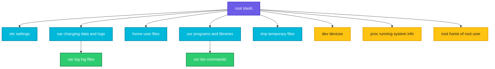

# Filesystem Hierarchy

## What is it?
Linux stores everything in one tree of directories that starts at `/` (called **root**). There are no drive letters like `C:` or `D:`. Other disks and devices are attached (mounted) somewhere inside this tree. The layout is standard, so once you learn it you know where to look on any Linux server: configuration in `/etc`, logs in `/var/log`, user files in `/home`.

## Syntax
```bash
ls [OPTIONS] /
ls -ld /etc /var /home
```

## Visual Overview
> Everything hangs below `/`. The top level directories each have one job.



## Options/Flags
| Directory | What it holds | Example |
|-----------|---------------|---------|
| `/` | The top of the tree, called root | |
| `/etc` | System and application configuration files | `/etc/ssh/ssh_config` |
| `/var` | Data that changes: logs, caches, mail, spool | `/var/log` |
| `/home` | One directory per normal user | `/home/devops` |
| `/root` | Home directory of the root user | |
| `/usr` | Installed programs, libraries and shared files | `/usr/bin/ls` |
| `/bin`, `/sbin`, `/lib` | Links to `/usr/bin`, `/usr/sbin`, `/usr/lib` on modern distros | |
| `/tmp` | Temporary files, anyone can write, often cleared on reboot | |
| `/dev` | Device files such as disks and `/dev/null` | `/dev/null` |
| `/proc` | Live view of processes and the kernel, not stored on disk | `/proc/1` |
| `/sys` | Kernel and hardware settings, not stored on disk | |
| `/boot` | Kernel and boot loader files | |
| `/mnt`, `/media` | Places to mount extra disks and USB drives | |
| `/opt` | Optional third party software | |
| `/srv` | Data served by this machine, for example websites | |

## Usage Examples

### Example 1: Look at the top level directories (`ls -ld`)
**Command:**
```bash
ls -ld /bin /dev /etc /home /proc /root /tmp /usr /var
```
**Sample Output:**
```text
lrwxrwxrwx   1 root root    7 May  2  2023 /bin -> usr/bin
drwxr-xr-x  15 root root 3840 Oct 14 01:18 /dev
drwxr-xr-x  91 root root 4096 Oct 14 01:19 /etc
drwxr-xr-x   3 root root 4096 Aug 18  2023 /home
dr-xr-xr-x 354 root root    0 Oct 14 01:18 /proc
drwx------   7 root root 4096 Oct  3 11:28 /root
drwxrwxrwt   9 root root 4096 Oct 14 01:19 /tmp
drwxr-xr-x  14 root root 4096 May  2  2023 /usr
drwxr-xr-x  14 root root 4096 May 31  2025 /var
```
Notice `/bin -> usr/bin`: on modern distros `/bin` is just a link to `/usr/bin`. `/root` is `drwx------`, only root can enter it. `/tmp` ends in `t` (sticky bit), so everyone can write but only the owner can delete their own files.

### Example 2: See what is inside `/var`
**Command:**
```bash
ls /var
```
**Sample Output:**
```text
backups
cache
crash
lib
local
lock
log
mail
opt
run
snap
spool
tmp
www
```
Logs are in `log`, package caches in `cache`, and website files may live in `www`.

### Example 3: See what is inside `/usr`
**Command:**
```bash
ls /usr
```
**Sample Output:**
```text
bin
games
include
lib
lib32
lib64
libexec
libx32
local
sbin
share
src
```
Programs you install by hand usually go to `local`.

### Example 4: Where a command really lives (`which`)
**Command:**
```bash
which ls
```
**Sample Output:**
```text
/usr/bin/ls
```

### Example 5: A configuration directory (`/etc`)
**Command:**
```bash
ls /etc/ssh
```
**Sample Output:**
```text
ssh_config
ssh_config.d
```
SSH client settings live under `/etc/ssh`, and the server settings (`sshd_config`) appear there too once `openssh-server` is installed. Your own data and settings live under `/home`.

### Example 6: The "black hole" device (`/dev/null`)
**Command:**
```bash
ls -l /dev/null
echo hi > /dev/null
echo $?
```
**Sample Output:**
```text
crw-rw-rw- 1 root root 1, 3 Oct 14 01:18 /dev/null
0
```
The leading `c` means a character device. Anything written to `/dev/null` is thrown away, which is useful to hide output you do not need.

### Example 7: Permission limits (`/root`, `/etc`)
**Command:**
```bash
ls -l /root
touch /etc/x
```
**Sample Output:**
```text
ls: cannot open directory '/root': Permission denied
touch: cannot touch '/etc/x': Permission denied
```
A normal user cannot read `/root` or create files in `/etc`. Use `sudo` when you really need to.

## Sample Output
A quick tour of the three directories you will visit most:

```bash
ls -d /etc /var/log /home
```
```text
/etc
/home
/var/log
```

## Pitfalls / Gotchas
- The path `/` is the root of the whole tree. `/root` is only the home of the root user. Do not confuse them.
- Never run `rm -rf /` or `rm -rf /*`. It deletes the whole system.
- Files in `/tmp` can vanish after a reboot. Do not keep anything important there.
- `/proc` and `/sys` look like folders but are generated by the kernel. They use no disk space.
- Edit settings in `/etc`, not in `/usr`. Package updates replace files in `/usr`.
- Directory names vary a little between distros, for example Red Hat systems keep web files in `/var/www` or `/usr/share/nginx`, so check the package docs.

## DevOps Use Cases

### Use Case 1: Find the biggest log files
**Situation:** The `/var` disk is almost full and you must find what grows.

Let's say we have this directory `/var/log/app` with two log files:

**Input file** (`/var/log/app/access.log`):
```text
GET /index 200
GET /login 200
GET /admin 403
```
**Input file** (`/var/log/app/error.log`):
```text
disk full
```

**Command:**
```bash
du -b /var/log/app/* | sort -n -r
```
**Sample Output:**
```text
45	/var/log/app/access.log
10	/var/log/app/error.log
```
`du -b` prints bytes. `access.log` is the biggest, so rotate or compress that one first.

## Related Commands
- [Terminal, shell and bash](03-terminal-shell-bash.md) - the previous page
- [Paths](05-paths.md) - the next page
- [`ls`](../file-management/ls.md) - list directories
- [`cd`](../file-management/cd.md) - move around the tree
- [`df`](../system-info/df.md) - free space per mounted filesystem
- [`du`](../system-info/du.md) - disk use per directory
- [`mount`](../system-info/mount.md) - attach a disk into the tree
