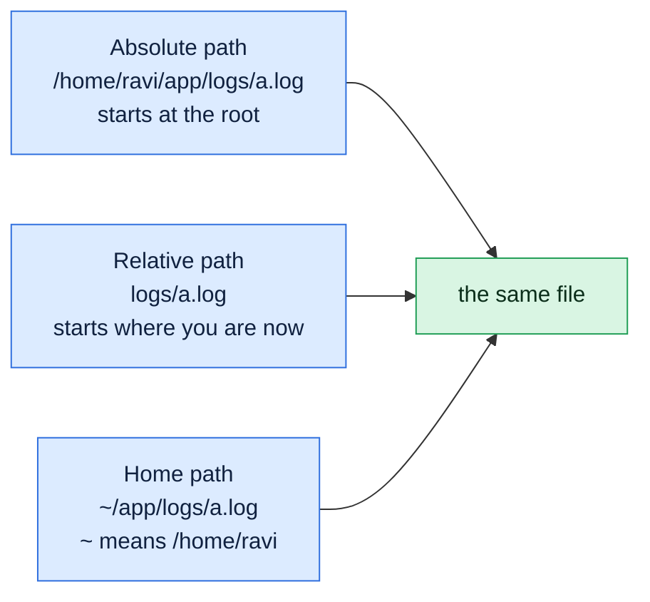

# Paths

## What is it?
A **path** is the address of a file or directory. An **absolute path** starts at `/` and works from anywhere. A **relative path** does not start with `/` and is read from your current directory.

## Syntax
```bash
/absolute/path/to/file
relative/path/to/file
./file      # in the current directory
../file     # in the parent directory
~/file      # in your home directory
```

## Visual Overview
> Three different ways to write a path can point to the same file. Here you are in `/home/ravi/app` and the file is `/home/ravi/app/logs/a.log`.



## Options/Flags
| Symbol | Meaning |
|--------|---------|
| `/` | Root of the tree, and the separator between names |
| `.` | The current directory |
| `..` | The parent directory (one level up) |
| `~` | Your home directory, for example `/home/devops` |
| `-` | With `cd`, the previous directory |
| `.name` | A name starting with a dot is a hidden file |

**Hidden files.** A file or directory whose name **starts with a dot** is called hidden. It is only a naming convention: tools such as `ls`, `*` and file managers skip these names by default so that settings do not clutter your view. Hidden does **not** mean secret or protected, anyone with permission can read them.

| Command or pattern | What it does |
|--------------------|--------------|
| `ls -a` | Show all entries, including `.` and `..` |
| `ls -A` | Show hidden entries but not `.` and `..` |
| `ls -d .*` | List hidden names (also matches `.` and `..`) |
| `.[!.]*` | Safe pattern for hidden names, it skips `.` and `..` |
| `find . -name '.*'` | Find hidden files and directories below here |
| `tree -a` | Show hidden entries in the tree |
| `cp -r src/. dest/` | Copy everything in a folder, hidden files included |
| `mv name .name` | Hide a file by renaming it |

| Common hidden file | Purpose |
|--------------------|---------|
| `~/.bashrc` | Settings for every interactive bash shell |
| `~/.bash_profile`, `~/.profile` | Settings for login shells |
| `~/.bash_history` | Your command history |
| `~/.ssh/` | SSH keys and `known_hosts`, must be mode `700` |
| `~/.config/` | Per user settings of many programs |
| `~/.cache/` | Cached data, safe to delete |
| `~/.gitconfig` | Your Git name, email and options |
| `.git/` | The Git repository data of a project |
| `.gitignore` | Files that Git must not track |
| `.env` | Environment variables of a project, often secrets |
| `~/.vimrc` | Vim settings |

Used in the examples below. Let's say we have this layout under `/tmp/lab`:

```text
/tmp/lab
└── projects
    ├── app
    │   ├── .env
    │   ├── VERSION
    │   └── src
    │       └── main.py
    └── docs
        └── readme.txt
```

**Input file** (`/tmp/lab/projects/app/VERSION`):
```text
v1.0
```
**Input file** (`/tmp/lab/projects/app/src/main.py`):
```text
print("hello")
```
**Input file** (`/tmp/lab/projects/docs/readme.txt`):
```text
Setup guide
```
**Input file** (`/tmp/lab/projects/app/.env`):
```text
secret=1
```

## Usage Examples

### Example 1: Absolute path (works from anywhere)
**Command:**
```bash
cd /tmp/lab/projects/app
pwd
cat /tmp/lab/projects/app/VERSION
```
**Sample Output:**
```text
/tmp/lab/projects/app
v1.0
```

### Example 2: Relative path (depends on where you are)
Using the same layout. You are now in `/tmp/lab/projects/app`.

**Command:**
```bash
cat VERSION
cat src/main.py
```
**Sample Output:**
```text
v1.0
print("hello")
```

### Example 3: Current directory (`./`)
**Command:**
```bash
cat ./VERSION
```
**Sample Output:**
```text
v1.0
```
`./VERSION` and `VERSION` are the same file. The `./` form matters when you run a script, for example `./deploy.sh`.

### Example 4: Parent directory (`..`)
**Command:**
```bash
cat ../docs/readme.txt
```
**Sample Output:**
```text
Setup guide
```
`..` goes up from `app` to `projects`, then down into `docs`.

### Example 5: Go up several levels
**Command:**
```bash
cd src
pwd
cd ..
pwd
cd ../..
pwd
```
**Sample Output:**
```text
/tmp/lab/projects/app/src
/tmp/lab/projects/app
/tmp/lab
```

### Example 6: Home directory (`~`)
**Command:**
```bash
cd ~
pwd
```
**Sample Output:**
```text
/home/devops
```
Plain `cd` with no argument does the same thing.

### Example 7: Go back to the previous directory (`cd -`)
**Command:**
```bash
cd /tmp/lab/projects/app/src
cd ~
cd -
```
**Sample Output:**
```text
/tmp/lab/projects/app/src
```
`cd -` prints the directory it jumps back to.

### Example 8: Hidden files (leading dot)
**Command:**
```bash
cd /tmp/lab/projects/app
ls
echo
ls -a
echo
cat .env
```
**Sample Output:**
```text
VERSION
src

.
..
.env
VERSION
src

secret=1
```
Plain `ls` hides `.env`. `ls -a` shows it, together with `.` and `..`.

### Example 9: A wrong path (exit code)
**Command:**
```bash
cd /tmp/lab
cat nofile
echo $?
```
**Sample Output:**
```text
cat: nofile: No such file or directory
1
```

### Example 10: Hidden but not `.` and `..` (`ls -A`)
For the next examples let's say we have a project folder `proj` with these files:

**Input file** (`proj/.env`):
```text
secret=1
```
**Input file** (`proj/.gitignore`):
```text
node_modules
*.log
```
**Input file** (`proj/VERSION`):
```text
v1
```
**Input file** (`proj/.config/app/app.conf`):
```text
x=1
```
**Input file** (`proj/.git/HEAD`):
```text
ref
```

**Command:**
```bash
cd proj
ls
echo "---"
ls -A
```
**Sample Output:**
```text
VERSION
---
.config
.env
.git
.gitignore
VERSION
```
Plain `ls` shows one name, `ls -A` shows all five. Most people use `-A` because `.` and `..` are noise.

### Example 11: Long listing with hidden entries (`ls -la`)
Using the `proj` folder from Example 10.

**Command:**
```bash
ls -la | awk '{print $1,$9}'
```
**Sample Output:**
```text
total
drwxr-xr-x .
drwxr-xr-x ..
drwxr-xr-x .config
-rw-r--r-- .env
drwxr-xr-x .git
-rw-r--r-- .gitignore
-rw-r--r-- VERSION
```
`tail -n +2` skips the `total` line. `.` is this directory and `..` is its parent, every directory has both.

### Example 12: The `.*` pattern matches `.` and `..`
Using the `proj` folder from Example 10.

**Command:**
```bash
echo .*
```
**Sample Output:**
```text
. .. .config .env .git .gitignore
```
`.` and `..` are in the list. A command like `rm -r .*` would also reach `..`, the parent folder. Modern `rm` refuses, but other tools may not. Use `.[!.]*` instead.

### Example 13: A safe pattern for hidden names (`.[!.]*`)
Using the `proj` folder from Example 10.

**Command:**
```bash
echo .[!.]*
```
**Sample Output:**
```text
.config .env .git .gitignore
```

### Example 14: `rm *` does not delete hidden files
Let's say we have an empty folder `t` and we create `a`, `b` and the hidden file `.c`:

**Command:**
```bash
cd t
touch a b .c
rm *
ls -A
rm -r .[!.]*
ls -A | wc -l
```
**Sample Output:**
```text
.c
0
```
After `rm *` only `.c` is left. The second command removes it and the folder is empty.

### Example 15: Find hidden files (`find`)
Using the `proj` folder from Example 10 .

**Command:**
```bash
find . -name '.*' -not -name .
echo "--- files only"
find . -type f -name '.*'
```
**Sample Output:**
```text
./.config
./.env
./.git
./.gitignore
--- files only
./.env
./.gitignore
```
`find` lists only names that start with a dot. `.config/app/app.conf` is inside a hidden folder, but its own name does not start with a dot, so it is not listed.

### Example 16: Copy a folder with its hidden files
Using the `proj` folder from Example 10 , and two empty folders `c1` and `c2`.

**Command:**
```bash
cp -r proj/* c1/
ls -A c1
echo "---"
cp -r proj/. c2/
ls -A c2
```
**Sample Output:**
```text
VERSION
---
.config
.env
.git
.gitignore
VERSION
```
`proj/*` does not match hidden names, so only `VERSION` was copied. `proj/.` means "the folder itself", so everything comes along. This is the correct way to copy a project or a home directory.

### Example 17: Search includes hidden files (`grep -r`)
Using the `proj` folder from Example 10.

**Command:**
```bash
grep -r secret .
grep -rl secret --exclude-dir=.git .
```
**Sample Output:**
```text
./.env:secret=1
./.env
```
`grep -r` does look inside hidden files. This is how secret scanners find leaked passwords in `.env` files.

### Example 18: Typical hidden files in a home directory
Let's say a fresh home folder `home` holds these entries:

**Input file** (listing of `home`, `ls -A | sort`):
```text
.bash_history
.bash_profile
.bashrc
.cache
.config
.gitconfig
.profile
.ssh
.vimrc
```

**Command:**
```bash
ls -ld home/.ssh | awk '{print $1,$9}'
```
**Sample Output:**
```text
drwx------ home/.ssh
```
`.ssh` is mode `700` (`drwx------`). SSH refuses to use keys when this folder or the key files are readable by others.

### Example 19: Hide a file by renaming (`mv`)
Using the `proj` folder from Example 10.

**Command:**
```bash
cp VERSION hide-me.txt
mv hide-me.txt .hide-me.txt
ls
ls -A | head -4
```
**Sample Output:**
```text
VERSION
.config
.env
.git
.hide-me.txt
```
The file is still there, only the name changed. This is not security: `ls -A` or `cat .hide-me.txt` still works.

### Example 20: Show hidden entries as a tree (`tree -a`)
Using the `proj` folder from Example 10 (with the file from Example 19).

**Command:**
```bash
tree -a -I .git
```
**Sample Output:**
```text
.
├── .config
│   └── app
│       └── app.conf
├── .env
├── .gitignore
├── .hide-me.txt
└── VERSION

2 directories, 5 files
```
`-I .git` leaves out the Git folder, which is large and rarely interesting.

## Sample Output
Three different paths to the same file, all printing the same line:

```bash
cd /tmp/lab/projects/app/src
cat /tmp/lab/projects/app/VERSION
cat ../VERSION
cat ../../app/VERSION
```
```text
v1.0
v1.0
v1.0
```

## Pitfalls / Gotchas
- A relative path depends on where you are. A script that works in one directory can fail in another. Use `pwd` to check.
- Use absolute paths in cron jobs, systemd units and CI scripts, because their working directory is not what you expect.
- Names with spaces need quotes: `cd "my folder"`.
- `~` is expanded by the shell. Inside single quotes `'~'` stays a literal tilde.
- `cat VERSION` finds the file in the current directory only. A bare command name like `ls` is searched in `PATH`, not in the current directory, which is why scripts need `./`.
- A path ending with `/` means a directory, `/tmp/lab/` and `/tmp/lab` reach the same place, but a trailing slash on a symbolic link behaves differently in some commands.
- Hidden files start with `.` and are not deleted by `rm *`, because `*` does not match them.
- Hidden is not secret. `cat .env` works for anyone who has read permission. Protect secrets with permissions (`chmod 600`), not with a dot.
- `rm -r .*` and `chmod -R .*` are dangerous, the pattern matches `..`, the parent folder. Use `.[!.]*`.
- `cp -r proj/* dest/` and `mv proj/* dest/` leave hidden files behind. Use `proj/.` for a full copy.
- `tar` and `zip` of `folder/` include hidden files, but `tar czf x.tgz folder/*` does not.
- A folder that looks empty may not be. `ls` printing nothing and `rmdir` failing with "Directory not empty" usually means a hidden file. Check with `ls -A`.
- A hidden file name does not change its content or permissions, it only changes how tools list it.

## DevOps Use Cases

### Use Case 1: Make a script run from any directory
**Situation:** A backup script reads its config next to itself, but a cron job starts it from `/`.

Let's say we have this file `/tmp/lab/backup.sh`:

**Input file** (`/tmp/lab/backup.sh`):
```bash
#!/bin/bash
DIR="$(cd "$(dirname "$0")" && pwd)"
cat "$DIR/projects/app/VERSION"
```

**Command:**
```bash
cd /
bash /tmp/lab/backup.sh
```
**Sample Output:**
```text
v1.0
```
`dirname "$0"` finds the folder of the script, so the path works no matter where the script is started.

### Use Case 2: Back up a project with its settings
**Situation:** A deploy script copies a project folder, and the `.env` file must go along.

Using the `proj` folder from Example 10.

**Command:**
```bash
cp -r proj/. backup/
ls -A backup
```
**Sample Output:**
```text
.config
.env
.git
.gitignore
VERSION
```

### Use Case 3: Find secrets that were committed by mistake
**Situation:** A security review must find every `.env` file in a repository.

Using the `proj` folder from Example 10.

**Command:**
```bash
find . -name '.env'
grep -rl secret --exclude-dir=.git .
```
**Sample Output:**
```text
./.env
./.env
```
Add `.env` to `.gitignore` and rotate any secret that was committed.

### Use Case 4: Check that the SSH folder is private
**Situation:** `ssh` refuses a key with a "bad permissions" error.

Using the `home` folder from Example 18.

**Command:**
```bash
stat -c '%n %a' home/.ssh
```
**Sample Output:**
```text
home/.ssh 700
```
`700` is correct. Fix a wrong value with `chmod 700 ~/.ssh` and `chmod 600 ~/.ssh/id_rsa`.

## Try it yourself

Work in a practice folder so nothing real can be damaged: `mkdir -p ~/practice && cd ~/practice`. Try each task first, then open the answer.

**Task 1.** Show where you are, then go to `/var/log` using the absolute path.

<details>
<summary>Show the answer</summary>

```bash
pwd
cd /var/log
pwd
```
The last line prints `/var/log`.

</details>

**Task 2.** From `/var/log`, go up one level using a relative path.

<details>
<summary>Show the answer</summary>

```bash
cd ..
pwd
```
Output: `/var`.

</details>

**Task 3.** Return to your home folder in three different ways.

<details>
<summary>Show the answer</summary>

```bash
cd
cd ~
cd $HOME
```
After each one `pwd` prints your home, for example `/home/ravi`.

</details>

## Related Commands
- [Filesystem hierarchy](04-filesystem-hierarchy.md) - the previous page
- [`pwd`](../file-management/pwd.md) - print the current directory
- [`cd`](../file-management/cd.md) - change directory
- [`ls`](../file-management/ls.md) - list files, `-a` and `-A` show hidden files
- [`find`](../file-management/find.md) - search by name, including hidden names
- [`tree`](../file-management/tree.md) - `-a` shows hidden entries
- [`cp`](../file-management/cp.md) / [`rm`](../file-management/rm.md) - remember that `*` skips hidden files
- [Wildcards and globbing](06-wildcards-globbing.md) - why `*` skips hidden names
- `realpath` - turn a relative path into an absolute one
- `basename` / `dirname` - split a path into the file name and the directory

---
<!-- nav -->
[← Previous: Filesystem Hierarchy](04-filesystem-hierarchy.md) | [Learning path](../README.md) | [Next: Wildcards and Globbing →](06-wildcards-globbing.md)
