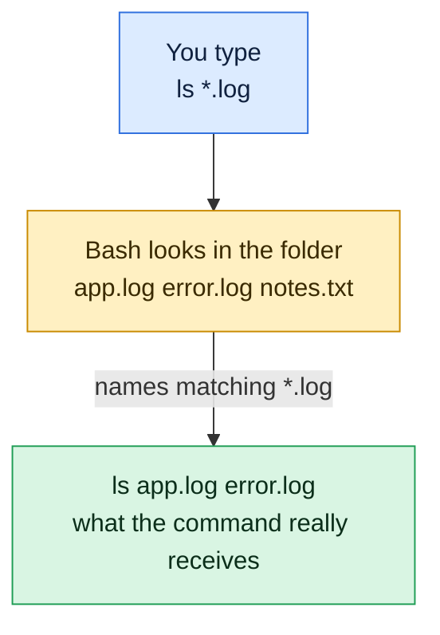

# Wildcards and Globbing

## What is it?
A **wildcard** is a special character that stands for other characters in a file name. **Globbing** is the shell expanding a pattern such as `*.log` into the list of matching names **before** the command runs. The command itself never sees the `*`, it receives the finished list, for example `app.log error.log`.

## Syntax
```bash
command pattern
ls *.log
ls a?.txt
ls [ab]1.txt
ls {app,error}.log
```

## Visual Overview
> The shell, not the command, expands wildcards. `ls` never sees the star. It only receives the list of names bash already found.



## Options/Flags
| Pattern | Matches | Example |
|---------|---------|---------|
| `*` | Any number of characters, including none | `*.log` |
| `?` | Exactly one character | `a?.txt` |
| `[abc]` | One character from the set | `[ab]1.txt` |
| `[a-z]` | One character from the range | `[a-c]*.txt` |
| `[!abc]` | One character **not** in the set | `[!a]*.txt` |
| `{x,y}` | Brace expansion, builds several words (not a real wildcard) | `{app,error}.log` |
| `~` | Your home directory | `~/logs` |

A leading dot is not matched by `*` or `?`, so hidden files are skipped unless you write the dot yourself, for example `.*`.

For all examples let's say we have these files in the current directory (all empty) and one empty directory `logs`:

**Input file** (listing of the directory, from `ls -a`):
```text
.
..
.hidden
a1.txt
a10.txt
a2.txt
app.log
app.txt
b1.txt
error.log
logs
notes.md
```

## Usage Examples

### Example 1: Everything that ends in `.log` (`*`)
**Command:**
```bash
ls *.log
```
**Sample Output:**
```text
app.log
error.log
```

### Example 2: Exactly one character (`?`)
**Command:**
```bash
ls a?.txt
```
**Sample Output:**
```text
a1.txt
a2.txt
```
`a10.txt` is not listed, it has two characters between `a` and `.txt`.

### Example 3: Any length (`*`)
**Command:**
```bash
ls a*.txt
```
**Sample Output:**
```text
a1.txt
a10.txt
a2.txt
app.txt
```

### Example 4: A set of characters (`[ab]`)
**Command:**
```bash
ls [ab]1.txt
```
**Sample Output:**
```text
a1.txt
b1.txt
```

### Example 5: A range (`[a-b]`)
**Command:**
```bash
ls [a-b]1.txt
```
**Sample Output:**
```text
a1.txt
b1.txt
```

### Example 6: Not in the set (`[!a]`)
**Command:**
```bash
ls [!a]*.txt
```
**Sample Output:**
```text
b1.txt
```
Only `b1.txt` starts with something other than `a`.

### Example 7: Brace expansion (`{ }`)
**Command:**
```bash
ls {app,error}.log
echo file{1,2,3}.txt
```
**Sample Output:**
```text
app.log
error.log
file1.txt file2.txt file3.txt
```
Braces do not look at the disk. `echo` prints names even when the files do not exist.

### Example 8: Nested braces build a directory tree
**Command:**
```bash
mkdir -p dir/{a,b}/{x,y}
find dir -type d | sort
```
**Sample Output:**
```text
dir
dir/a
dir/a/x
dir/a/y
dir/b
dir/b/x
dir/b/y
```

### Example 9: Hidden files are not matched
**Command:**
```bash
ls -a | head -5
ls *hidden
```
**Sample Output:**
```text
.
..
.hidden
a1.txt
a10.txt
ls: cannot access '*hidden': No such file or directory
```
Write the dot to match a hidden file, for example `ls .hid*`.

### Example 10: A pattern that matches nothing
**Command:**
```bash
echo *.nomatch
```
**Sample Output:**
```text
*.nomatch
```
When nothing matches, bash passes the pattern through unchanged. A command like `ls *.nomatch` then complains that the file `*.nomatch` does not exist.

### Example 11: Home directory (`~`)
**Command:**
```bash
echo ~
```
**Sample Output:**
```text
/home/devops
```

### Example 12: Expansion of `*` shows the list the command receives
**Command:**
```bash
echo *.md *.log
```
**Sample Output:**
```text
notes.md app.log error.log
```

## Sample Output
See the exact words the command receives:

```bash
echo a?.txt
```
```text
a1.txt a2.txt
```

## Pitfalls / Gotchas
- Wildcards are expanded by the **shell**, not by `ls`, `rm` or `cp`. That is why `rm *.log` deletes the matched names without asking `rm` to search.
- `*` does not match `/`, so `*.log` does not look inside sub directories. Use `find . -name '*.log'` or `**` after `shopt -s globstar`.
- `*` does not match hidden files, so `rm *` leaves `.hidden` behind.
- Wildcards are not regular expressions. In a glob `*` means "anything", in a regex `.*` does.
- Always run `echo rm *.log` or `ls *.log` first to preview what a pattern matches. A typo like `rm * .log` (with a space) deletes everything.
- Quote the pattern when you want the program to see it, for example `find . -name '*.log'`. Without quotes the shell expands it first.
- Too many matches can fail with `Argument list too long`. Use `find ... -exec` or `xargs` instead.

## DevOps Use Cases

### Use Case 1: Count log files for a service
**Situation:** Check how many rotated logs exist before cleaning up.

**Command:**
```bash
ls *.log | wc -l
```
**Sample Output:**
```text
2
```

### Use Case 2: Back up a file with brace expansion
**Situation:** Make a copy of a config before editing it.

**Command:**
```bash
cp app.log{,.bak}
ls app.log*
```
**Sample Output:**
```text
app.log
app.log.bak
```
`app.log{,.bak}` expands to `app.log app.log.bak`.

### Use Case 3: Run a step on every log file
**Situation:** A script must process each log in a folder.

**Command:**
```bash
for f in *.log; do echo "processing $f"; done
```
**Sample Output:**
```text
processing app.log
processing error.log
```

## Try it yourself

Work in a practice folder so nothing real can be damaged: `mkdir -p ~/practice && cd ~/practice`. Try each task first, then open the answer.

**Task 1.** Let's say we have these four files in your practice folder. Create them:
```bash
touch a.log b.log c.txt notes.md
```
List only the files that end in `.log`.

<details>
<summary>Show the answer</summary>

```bash
ls *.log
```
Output:
```
a.log  b.log
```

</details>

**Task 2.** With the same files, list the files with a one-letter name and the extension `.txt`.

<details>
<summary>Show the answer</summary>

```bash
ls ?.txt
```
Output:
```
c.txt
```

</details>

**Task 3.** With the same files, list `a.log` and `b.log` using a character set.

<details>
<summary>Show the answer</summary>

```bash
ls [ab].log
```
Output:
```
a.log  b.log
```

</details>

## Related Commands
- [Quoting](07-quoting.md) - stop the shell from expanding a pattern
- [Paths](05-paths.md) - the previous topic
- [`ls`](../file-management/ls.md) - list files
- [`find`](../file-management/find.md) - search by name without shell limits
- [`rm`](../file-management/rm.md) - always preview a pattern before using it here
- [`xargs`](../text-processing/xargs.md) - handle very long file lists
- [`echo`](../shell-basics/echo.md) - preview what a pattern expands to

---
<!-- nav -->
[← Previous: Paths](05-paths.md) | [Learning path](../README.md) | [Next: Quoting →](07-quoting.md)
