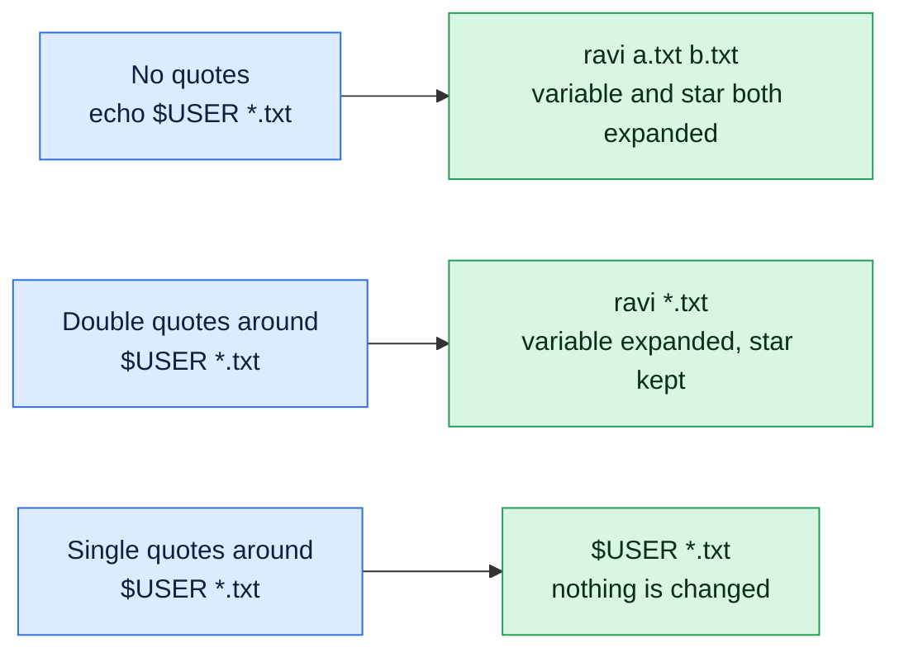

# Quoting

## What is it?
**Quoting** tells the shell which characters to treat as plain text and which to interpret. Without quotes the shell splits a line at spaces, expands `$variables`, `*` patterns and `$(commands)`. Quotes switch some or all of that off.

## Syntax
```bash
'single quotes'   # everything is literal
"double quotes"   # literal, except $variable, $(command) and backslash
\character        # backslash escapes one character
```

## Visual Overview
> Quotes decide what bash is allowed to change before the command runs. The same text gives three different results.



## Options/Flags
| Form | Spaces kept | `$VAR` and `$(cmd)` expanded | `*` expanded |
|------|-------------|------------------------------|--------------|
| No quotes | No, splits into words | Yes | Yes |
| `"double"` | Yes | Yes | No |
| `'single'` | Yes | No | No |
| `\x` | Only that one character is literal | | |

## Usage Examples

### Example 1: Variables with each quote type
**Command:**
```bash
NAME=devops
echo $NAME
echo "$NAME"
echo '$NAME'
```
**Sample Output:**
```text
devops
devops
$NAME
```
Single quotes print the text `$NAME` unchanged.

### Example 2: Extra spaces are lost without quotes
**Command:**
```bash
echo a   b
echo "a   b"
```
**Sample Output:**
```text
a b
a   b
```
Without quotes, `echo` receives two words and prints them with one space.

### Example 3: Escape one character with a backslash
**Command:**
```bash
echo "cost is \$5"
```
**Sample Output:**
```text
cost is $5
```

### Example 4: A single quote inside a string
**Command:**
```bash
echo 'it'"'"'s'
```
**Sample Output:**
```text
it's
```
You cannot put a `'` inside single quotes. Close the quote, add `"'"`, and reopen it.

### Example 5: Command substitution
**Command:**
```bash
echo "$(echo hi)" '$(echo hi)'
```
**Sample Output:**
```text
hi $(echo hi)
```

### Example 6: Wildcards stay literal in quotes
**Command:**
```bash
echo \* "*"
```
**Sample Output:**
```text
* *
```

### Example 7: A file name with a space
**Command:**
```bash
touch "my file.txt"
ls my*
rm my file.txt
```
**Sample Output:**
```text
my file.txt
rm: cannot remove 'my': No such file or directory
rm: cannot remove 'file.txt': No such file or directory
```
Without quotes `rm` got two arguments, `my` and `file.txt`. Use `rm "my file.txt"`.

## Sample Output
The same text, three ways:

```bash
echo $HOME "$HOME" '$HOME'
```
```text
/home/devops /home/devops $HOME
```

## Pitfalls / Gotchas
- Use **double quotes around variables** in scripts: `"$FILE"`. A value with a space breaks otherwise.
- Use **single quotes** for patterns passed to programs: `grep 'a.*b' file`, `find . -name '*.log'`, and for `awk` programs.
- `!` triggers history expansion in an interactive shell inside double quotes. Use single quotes or `set +H`.
- Mismatched quotes make the shell wait with a `>` prompt. Press **Ctrl+C** to cancel.
- Curly quotes copied from a web page or document (`“ ”`) are not quotes. Use straight quotes `" '`.

## DevOps Use Cases

### Use Case 1: The classic unquoted variable bug
**Situation:** A deploy script receives a file name with a space.

**Command:**
```bash
FILE="my file.txt"
touch "$FILE"
ls $FILE
ls "$FILE"
```
**Sample Output:**
```text
ls: cannot access 'my': No such file or directory
ls: cannot access 'file.txt': No such file or directory
my file.txt
```
An unquoted `rm -rf $DIR/$NAME` with an empty or spaced value can delete the wrong path. Always write `rm -rf "$DIR/$NAME"`.

### Use Case 2: Pass a pattern to `find` without the shell expanding it
**Situation:** Find logs in sub directories.

Let's say we have these files:

**Input file** (listing):
```text
./app.log
./sub/old.log
```

**Command:**
```bash
find . -name '*.log' | sort
```
**Sample Output:**
```text
./app.log
./sub/old.log
```
Without the quotes, bash expands `*.log` in the current directory first and `find` sees only `app.log`.

## Related Commands
- [Wildcards and globbing](06-wildcards-globbing.md) - the previous topic
- [Redirection and pipes](08-redirection-and-pipes.md) - the next topic
- [`echo`](../shell-basics/echo.md) - see what the shell passes
- [`printf`](../text-processing/printf.md) - safer formatted output
- [`grep`](../text-processing/grep.md) - quote your patterns
- [`find`](../file-management/find.md) - quote `-name` patterns
