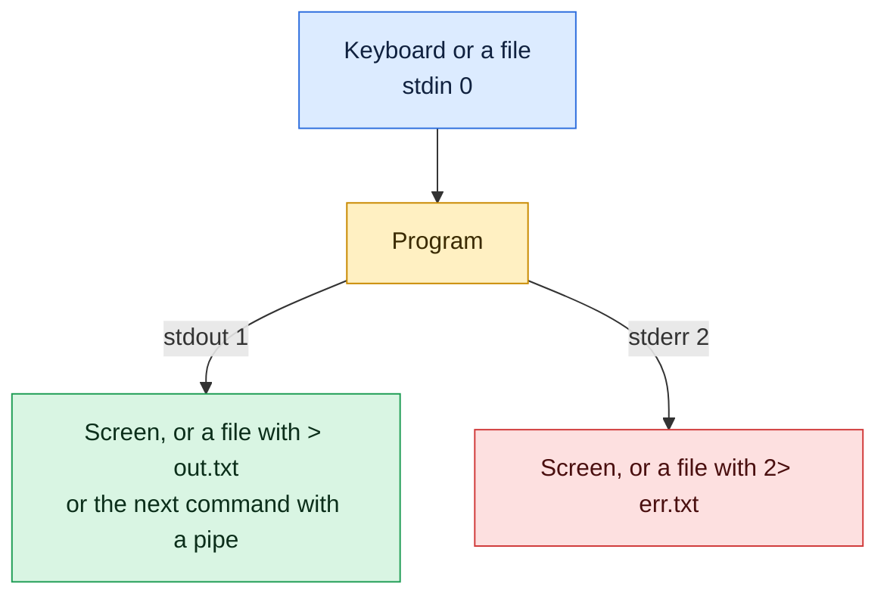

# Redirection and Pipes

## What is it?
Every Linux program has three standard streams: **standard input** (`stdin`, where it reads), **standard output** (`stdout`, where it prints results) and **standard error** (`stderr`, where it prints errors). By default all three are connected to your terminal. **Redirection** sends a stream to or from a file. A **pipe** (`|`) connects the output of one command to the input of the next.

## Syntax
```bash
command > file        # stdout to file, overwrite
command >> file       # stdout to file, append
command 2> file       # stderr to file
command &> file       # stdout and stderr to file
command < file        # read stdin from file
command1 | command2   # stdout of command1 becomes stdin of command2
```

## Visual Overview
> Every program has three streams: input, output and errors. Redirection sends a stream to a file. A pipe sends output straight into the next program.



## Options/Flags
| Operator | Meaning |
|----------|---------|
| `>` | Send stdout to a file, **replace** the file |
| `>>` | Send stdout to a file, **append** to it |
| `<` | Read stdin from a file |
| `2>` | Send stderr (file descriptor 2) to a file |
| `2>&1` | Send stderr to the same place as stdout |
| `&>` | Send both stdout and stderr to a file (bash) |
| `\|` | Pipe stdout to the next command |
| `<<EOF` | Here document: feed several lines as stdin |
| `/dev/null` | A file that discards everything written to it |

| File descriptor | Name | Default |
|-----------------|------|---------|
| `0` | stdin | keyboard |
| `1` | stdout | terminal |
| `2` | stderr | terminal |

**File descriptors in detail.** A **file descriptor** (fd) is a small number a process gets from the kernel when it opens a file, a pipe, a socket or a device. Every later `read` or `write` uses that number instead of the file name. Each process starts with `0`, `1` and `2` already open. The next file it opens gets the lowest free number, usually `3`. Redirection works by changing what an fd points to **before** the program starts.

| Syntax | Meaning |
|--------|---------|
| `n> file` | Send fd `n` to a file, replace it (`>` is short for `1>`) |
| `n>> file` | Append fd `n` to a file |
| `n< file` | Open a file for reading on fd `n` (`<` is short for `0<`) |
| `n>&m` | Make fd `n` point to the same place as fd `m` (`2>&1`) |
| `>&2` | Send this command's stdout to stderr (short for `1>&2`) |
| `exec n> file` | Open `file` on fd `n` for the rest of the shell or script |
| `exec n< file` | Open `file` for reading on fd `n` |
| `exec n>&-` | Close fd `n` |
| `<(cmd)` | Process substitution: run `cmd` and use its output like a file name |
| `/proc/PID/fd/` | Folder listing the fds of a process, one link per fd |
| `ulimit -n` | Maximum number of open fds per process |

## Usage Examples

### Example 1: Overwrite a file (`>`)
**Command:**
```bash
printf 'one\ntwo\n' > a.txt
cat a.txt
```
**Sample Output:**
```text
one
two
```

### Example 2: Append to a file (`>>`)
Let's say we have this file `a.txt`:

**Input file** (`a.txt`):
```text
one
two
```

**Command:**
```bash
echo three >> a.txt
cat a.txt
```
**Sample Output:**
```text
one
two
three
```

### Example 3: Send errors to a file (`2>`)
**Command:**
```bash
ls nofile 2> err.txt
cat err.txt
```
**Sample Output:**
```text
ls: cannot access 'nofile': No such file or directory
```
The terminal shows nothing for the first command, the error went into `err.txt`.

### Example 4: Split output and errors
Using the `a.txt` file from Example 2.

**Command:**
```bash
ls nofile a.txt > out.txt 2> err2.txt
cat out.txt
cat err2.txt
```
**Sample Output:**
```text
a.txt
ls: cannot access 'nofile': No such file or directory
```

### Example 5: Both streams into one file (`&>` and `2>&1`)
**Command:**
```bash
ls nofile a.txt &> all.txt
cat all.txt
(echo out; ls nofile) > both.txt 2>&1
cat both.txt
```
**Sample Output:**
```text
ls: cannot access 'nofile': No such file or directory
a.txt
out
ls: cannot access 'nofile': No such file or directory
```
Order matters. `> file 2>&1` is correct. `2>&1 > file` sends errors to the terminal.

### Example 6: Throw errors away (`/dev/null`)
**Command:**
```bash
ls nofile 2>/dev/null
echo rc=$?
```
**Sample Output:**
```text
rc=2
```
Nothing is printed, but the exit code `2` still shows that `ls` failed.

### Example 7: Read input from a file (`<`)
Using the `a.txt` file from Example 2 (it now has three lines: `one`, `two`, `three`).

**Command:**
```bash
sort < a.txt
wc -l < a.txt
```
**Sample Output:**
```text
one
three
two
3
```

### Example 8: A simple pipe (`|`)
**Command:**
```bash
cat a.txt | wc -l
```
**Sample Output:**
```text
3
```

### Example 9: A pipeline with three commands
**Command:**
```bash
cat a.txt | grep t | sort -r
```
**Sample Output:**
```text
two
three
```
`grep t` keeps `two` and `three`, and `sort -r` reverses them.

### Example 10: Save and show at the same time (`tee`)
**Command:**
```bash
echo hi | tee t.txt
cat t.txt
```
**Sample Output:**
```text
hi
hi
```
The first `hi` comes from `tee` printing to the screen, the second from `cat` reading the file.

### Example 11: Protect a file from overwriting (`noclobber`)
**Command:**
```bash
set -o noclobber
echo x > a.txt
set +o noclobber
wc -l < a.txt
```
**Sample Output:**
```text
bash: a.txt: cannot overwrite existing file
3
```

### Example 12: Here document (`<<`)
**Command:**
```bash
cat <<'EOF'
heredoc line
EOF
```
**Sample Output:**
```text
heredoc line
```

### Example 13: Open your own file descriptor (`exec 3>`)
**Command:**
```bash
bash -c 'exec 3> out3.txt; echo "to fd 3" >&3; echo "to stdout"; exec 3>&-; cat out3.txt'
```
**Sample Output:**
```text
to stdout
to fd 3
```
`exec 3> out3.txt` opens the file on fd `3`. `>&3` sends one line there, the other goes to the terminal. `exec 3>&-` closes fd `3`, and the final `cat` prints the file.

### Example 14: Read a file line by line through an fd (`exec 4<`)
Let's say we have this file `in.txt`:

**Input file** (`in.txt`):
```text
l1
l2
```

**Command:**
```bash
bash -c 'exec 4< in.txt; read a <&4; read b <&4; echo "$a $b"; exec 4<&-'
```
**Sample Output:**
```text
l1 l2
```
Both `read` commands use fd `4`, which remembers its position, so the second `read` gets the second line. With `read b < in.txt` you would get `l1` twice, because each `<` opens the file again.

### Example 15: Write to standard error on purpose (`>&2`)
**Command:**
```bash
bash -c 'echo "to stderr" >&2' 2> err.txt
cat err.txt
```
**Sample Output:**
```text
to stderr
```
The text never reached the terminal, it was written to fd `2` and captured by `2> err.txt`. Scripts print messages and warnings to stderr so that stdout stays clean for data.

### Example 16: Order of redirections matters
**Command:**
```bash
ls nofile > a1.txt 2>&1
cat a1.txt
echo "[second form]"
ls nofile 2>&1 > a2.txt
echo "[a2.txt]"
cat a2.txt
```
**Sample Output:**
```text
ls: cannot access 'nofile': No such file or directory
[second form]
ls: cannot access 'nofile': No such file or directory
[a2.txt]
```
Redirections are read left to right. In the first form `> a1.txt` points fd `1` to the file, then `2>&1` copies that, so the error lands in `a1.txt`. In the second form `2>&1` copies the **terminal** first, then `> a2.txt` moves only fd `1`. The error still prints on screen and `a2.txt` stays empty.

### Example 17: A pipe carries only stdout
**Command:**
```bash
ls nofile 2>&1 | wc -l
ls nofile | wc -l
```
**Sample Output:**
```text
1
ls: cannot access 'nofile': No such file or directory
0
```
In the second command the error goes to the terminal (fd `2`) and `wc` counts `0` lines of stdout.

### Example 18: See the descriptors of a running process (`/proc/PID/fd`)
**Command:**
```bash
sleep 30 > sleep.out 2>&1 &
P=$!
ls -l /proc/$P/fd | awk 'NR>1{print $9,$10,$11}'
kill $P
```
**Sample Output:**
```text
0 -> /dev/null
1 -> /tmp/gap1/sleep.out
2 -> /tmp/gap1/sleep.out
```
A background job gets `/dev/null` as stdin, and both stdout and stderr point to the file. The shell's redirections are visible here.

### Example 19: Which fds does a process hold (`lsof -p`)
Using the `in.txt` file from Example 14.

**Command:**
```bash
sleep 30 < in.txt &
P=$!
lsof -p $P | awk 'NR==1 || $4 ~ /^0/'
kill $P
```
**Sample Output:**
```text
COMMAND  PID   USER   FD   TYPE DEVICE SIZE/OFF  NODE NAME
sleep   1866 devops    0r   REG   8,48        6 92554 /tmp/gap1/in.txt
```
`0r` means fd `0`, opened for reading. The PID, device and inode numbers differ on every run.

### Example 20: Descriptors you open stay open
**Command:**
```bash
sleep 30 3> x 4> y &
P=$!
ls /proc/$P/fd | wc -l
ls -l /proc/$P/fd | awk 'NR>1 && $9>=3 {print $9,$10,$11}'
kill $P
```
**Sample Output:**
```text
5
3 -> /tmp/gap2/x
4 -> /tmp/gap2/y
```
Five fds are open: `0`, `1`, `2` and the two new ones.

### Example 21: The limit on open files (`ulimit -n`)
**Command:**
```bash
ulimit -Sn
ulimit -Hn
bash -c 'ulimit -n 4; exec 3>a 4>b'
echo rc=$?
```
**Sample Output:**
```text
10240
1048576
bash: line 1: b: Too many open files
rc=1
```
The soft limit is `10240` and the hard limit `1048576`. With a limit of 4, fds `0` to `3` fit and opening fd `4` fails.

### Example 22: Use a command's output as a file (`<(...)`)
Let's say we have these files:

**Input file** (`f1`):
```text
b
a
```
**Input file** (`f2`):
```text
a
b
```

**Command:**
```bash
diff <(sort f1) f2
echo rc=$?
```
**Sample Output:**
```text
rc=0
```
`<(sort f1)` runs `sort`, and the shell gives `diff` a name like `/dev/fd/63` that reads that output. No difference was found, so `diff` printed nothing and exited with `0`.

### Example 23: `-` means stdin
**Command:**
```bash
echo data | cat -
```
**Sample Output:**
```text
data
```
Many tools accept `-` as the name of fd `0`, which lets them sit in the middle of a pipeline.

## Sample Output
A pipeline that counts log levels. Let's say we have this file `app.log`:

**Input file** (`app.log`):
```text
2026-10-14 INFO start
2026-10-14 ERROR disk full
2026-10-14 INFO retry
2026-10-14 ERROR disk full
2026-10-14 WARN slow
```

**Command:**
```bash
awk '{print $2}' app.log | sort | uniq -c | sort -rn
```
```text
      2 INFO
      2 ERROR
      1 WARN
```

## Pitfalls / Gotchas
- `>` **destroys** the old content at once, even if the command then fails. `sort a.txt > a.txt` leaves an empty file.
- `cmd > file 2>&1` is correct, `cmd 2>&1 > file` is not. The shell reads redirections from left to right.
- `sudo echo x > /etc/file` fails because the redirection runs as **your** user. Use `echo x | sudo tee /etc/file`.
- A pipe only carries stdout. Errors still go to the terminal unless you add `2>&1` or `|&`.
- `cat file | grep x` works, but `grep x file` is shorter and faster. Avoid a useless `cat`.
- The pipe's exit code is that of the **last** command. Use `set -o pipefail` in scripts so an early failure is not hidden.
- `/dev/null` hides errors you may need. Do not use it on commands you are debugging.
- `exec 3> file` stays open until you close it with `exec 3>&-`. A script that opens files and never closes them can run out of fds ("Too many open files").
- Do not pick fds `0`, `1` or `2` for your own files. Use `3` to `9` in the shell.
- Each `< file` opens the file again from the start. An fd opened with `exec` keeps its position.
- Child processes **inherit** open fds. A long running child can keep a log file open after you rotated or deleted it, and the disk space is not freed. See `lsof +L1` for deleted but open files.
- fd numbers belong to one process. Number `3` in one program is not the same file as `3` in another.

## DevOps Use Cases

### Use Case 1: Count and list errors from a log
**Situation:** Find out how many errors an application logged and keep them for a ticket.

Using the `app.log` file shown above.

**Command:**
```bash
grep ERROR app.log
grep -c ERROR app.log
grep ERROR app.log >> errors.log 2>&1
wc -l < errors.log
```
**Sample Output:**
```text
2026-10-14 ERROR disk full
2026-10-14 ERROR disk full
2
2
```

### Use Case 2: Keep stdout and stderr of a job in separate files
**Situation:** A build step prints progress to stdout and warnings to stderr. CI should store them separately.

Let's say we have this file `gen.sh`:

**Input file** (`gen.sh`):
```bash
#!/bin/bash
echo "building"
echo "warning: cache empty" >&2
```

**Command:**
```bash
./gen.sh > out.log 2> err.log
cat out.log
cat err.log
```
**Sample Output:**
```text
building
warning: cache empty
```

### Use Case 3: Write a cron job's output to a log file
**Situation:** A scheduled job should append everything, output and errors, to one log.

**Command:**
```bash
ls /nonexistent >> job.log 2>&1
cat job.log
```
**Sample Output:**
```text
ls: cannot access '/nonexistent': No such file or directory
```
In a crontab this is the usual `>> /var/log/job.log 2>&1` ending.

### Use Case 4: Save a result and keep processing it
**Situation:** Store the error lines in a file and also count them in one command.

Using the `app.log` file shown above.

**Command:**
```bash
grep ERROR app.log | tee errors2.log | wc -l
cat errors2.log
```
**Sample Output:**
```text
2
2026-10-14 ERROR disk full
2026-10-14 ERROR disk full
```

### Use Case 5: Send progress to a log fd and keep stdout clean
**Situation:** A deploy script prints data that other tools read from stdout, but it must also write a progress log.

Let's say we have this file `fdlog.sh`:

**Input file** (`fdlog.sh`):
```bash
#!/bin/bash
exec 3> run.log
echo "start" >&3
echo "working"
echo "done" >&3
exec 3>&-
```

**Command:**
```bash
./fdlog.sh
cat run.log
```
**Sample Output:**
```text
working
start
done
```
`working` is the real output on stdout, `start` and `done` went to the log through fd `3`.

### Use Case 6: Count the files a process holds open
**Situation:** An application fails with "Too many open files" and you must see how close it is to the limit.

**Command:**
```bash
sleep 30 3> x 4> y &
P=$!
echo "open fds: $(ls /proc/$P/fd | wc -l)"
echo "limit: $(ulimit -n)"
kill $P
```
**Sample Output:**
```text
open fds: 5
limit: 10240
```
Replace `$P` with the PID of the failing service. If the count is close to the limit, raise `LimitNOFILE` in the systemd unit or find the code that leaks fds.

## Related Commands
- [Quoting](07-quoting.md) - the previous topic
- [Links and inodes](09-links-and-inodes.md) - the next topic
- [`tee`](../text-processing/tee.md) - write to a file and pass the data on
- [`cat`](../file-management/cat.md) - print files
- [`grep`](../text-processing/grep.md) - filter lines in a pipeline
- [`sort`](../text-processing/sort.md) / [`uniq`](../text-processing/uniq.md) - order and count
- [`xargs`](../text-processing/xargs.md) - turn piped lines into arguments
- [`awk`](../text-processing/awk.md) - pick columns from piped text
- [`lsof`](../process-management/lsof.md) - list the file descriptors a process holds
- [`ulimit`](../process-management/ulimit.md) - limit open files per process
- [System calls](../os-internals/03-system-calls.md) - `open`, `read`, `write` and `close` use these numbers
