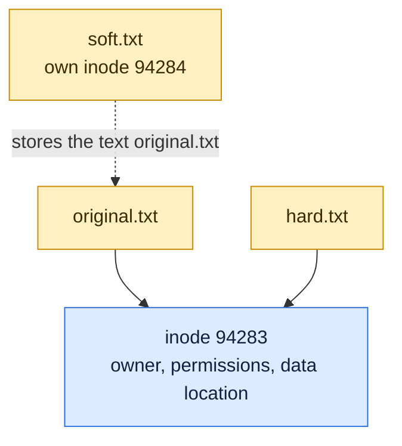

# Links and Inodes

## What is it?
An **inode** is a small record on disk that stores everything about a file except its name: size, owner, permissions, timestamps and where the data blocks are. A directory is just a table that maps **names** to inode numbers. A **link** is another name for a file. A **hard link** is a second name pointing to the **same inode**. A **symbolic (soft) link** is a tiny file that stores a **path** to another name.

## Syntax
```bash
ln TARGET LINK_NAME        # hard link
ln -s TARGET LINK_NAME     # symbolic link
ls -i                      # show inode numbers
stat FILE                  # show inode, link count, size
readlink LINK              # show where a symlink points
```

## Visual Overview
> A file name is only a label that points to an inode. A hard link is a second label for the same inode. A symbolic link is a tiny file that stores a path.



## Options/Flags
| Command or option | Description |
|-------------------|-------------|
| `ln a b` | Create hard link `b` to file `a` |
| `ln -s a b` | Create symbolic link `b` pointing to `a` |
| `ln -sf a b` | Replace an existing link `b` |
| `ln -sfn a b` | Replace a link that points to a directory, without descending into it |
| `ls -i` | Show inode numbers |
| `ls -l` | Show link count and `->` for symlinks |
| `stat -c '%n inode=%i links=%h'` | Print name, inode and hard link count |
| `readlink -f` | Resolve a link to the final absolute path |
| `df -i` | Show how many inodes a file system has used |

| Hard link | Symbolic link |
|-----------|---------------|
| Same inode as the target | Own inode |
| Survives if the original name is deleted | Breaks (dangling) if the target is removed |
| Cannot link a directory | Can link a directory |
| Same file system only | Can cross file systems |

## Usage Examples

### Example 1: Create both kinds of links
Let's say we have this file `original.txt`:

**Input file** (`original.txt`):
```text
hello
```

**Command:**
```bash
ln original.txt hard.txt
ln -s original.txt soft.txt
ls -li
```
**Sample Output:**
```text
total 8
94283 -rw-r--r-- 2 devops devops  6 Oct 14 01:31 hard.txt
94283 -rw-r--r-- 2 devops devops  6 Oct 14 01:31 original.txt
94284 lrwxrwxrwx 1 devops devops 12 Oct 14 01:31 soft.txt -> original.txt
```
`hard.txt` and `original.txt` share inode `94283` and show link count `2`. `soft.txt` has its own inode and an arrow to the path.

### Example 2: Inspect the inode and link count (`stat`)
Using the three files from Example 1.

**Command:**
```bash
stat -c '%n inode=%i links=%h' original.txt hard.txt soft.txt
```
**Sample Output:**
```text
original.txt inode=94283 links=2
hard.txt inode=94283 links=2
soft.txt inode=94284 links=1
```

### Example 3: A change through one name shows in the other
**Command:**
```bash
echo more >> hard.txt
cat original.txt
```
**Sample Output:**
```text
hello
more
```
Both names are the same file, so there is only one copy of the data.

### Example 4: Delete the original name
**Command:**
```bash
rm original.txt
cat hard.txt
cat soft.txt
echo rc=$?
```
**Sample Output:**
```text
hello
more
cat: soft.txt: No such file or directory
rc=1
```
The data survives because the hard link still points to it. The symlink is now **dangling**, its target path no longer exists.

### Example 5: See where a symlink points (`readlink`)
**Command:**
```bash
ls -l soft.txt
readlink soft.txt
```
**Sample Output:**
```text
lrwxrwxrwx 1 devops devops 12 Oct 14 01:31 soft.txt -> original.txt
original.txt
```

### Example 6: Link a directory
**Command:**
```bash
mkdir d
ln -s d dlink
ls -ld dlink
ln d dh
```
**Sample Output:**
```text
lrwxrwxrwx 1 devops devops 1 Oct 14 01:31 dlink -> d
ln: d: hard link not allowed for directory
```
Only symbolic links to directories are allowed.

### Example 7: Check how many inodes are used (`df -i`)
**Command:**
```bash
df -i /
```
**Sample Output:**
```text
Filesystem       Inodes  IUsed    IFree IUse% Mounted on
/dev/sdd       67108864 196321 66912543    1% /
```
A disk can be "full" because it ran out of inodes (too many tiny files), even when `df -h` shows free space.

## Sample Output
Spot links in a directory listing: the first character of `ls -l` is `l` for a symlink and the link count is the number after the permissions.

```bash
ls -ld /bin
```
```text
lrwxrwxrwx 1 root root 7 May  2  2023 /bin -> usr/bin
```

## Pitfalls / Gotchas
- A relative symlink target is read from the folder **of the link**, not from your current directory. `ln -s ../shared/conf conf` inside `app/` points to `shared/conf` next to `app`.
- Deleting a symlink with `rm link` removes only the link. `rm link/` or `rm -r link/` with a trailing slash may reach into the target on some systems, avoid it.
- Hard links cannot cross file systems and cannot point to directories.
- Copy tools differ. `cp` follows symlinks by default for files you name, `cp -a` and `rsync -a` keep them as links.
- If a file has link count 2, deleting one name does not free disk space. Space is freed when the last name and all open handles are gone.
- Compare files with `stat` or `ls -i`: the same inode number means the same file.

## DevOps Use Cases

### Use Case 1: Switch a release with a symlink
**Situation:** An app runs from `current`. To release a new version you point `current` to the new folder, and rolling back is the same command.

Let's say we have these files:

**Input file** (`releases/v1/VERSION`):
```text
v1
```
**Input file** (`releases/v2/VERSION`):
```text
v2
```

**Command:**
```bash
ln -sfn releases/v1 current
ls -l current
cat current/VERSION
ln -sfn releases/v2 current
ls -l current
cat current/VERSION
readlink -f current
```
**Sample Output:**
```text
lrwxrwxrwx 1 devops devops 11 Oct 14 01:32 current -> releases/v1
v1
lrwxrwxrwx 1 devops devops 11 Oct 14 01:32 current -> releases/v2
v2
/tmp/app/releases/v2
```
Tools like Capistrano and many deploy scripts use this pattern. `-n` is important, without it the link is created inside the old target.

### Use Case 2: Find broken symlinks
**Situation:** After cleanup, find links that point nowhere.

Using the `soft.txt` link from Example 4, which is now dangling.

**Command:**
```bash
find . -xtype l
```
**Sample Output:**
```text
./soft.txt
```

## Related Commands
- [Redirection and pipes](08-redirection-and-pipes.md) - the previous topic
- [The permission model](10-permission-model.md) - the next topic
- [`ln`](../file-management/ln.md) - create links
- [`ls`](../file-management/ls.md) - `-i` and `-l` show inodes and links
- `stat` - see file details such as the inode and link count
- [`find`](../file-management/find.md) - `-type l`, `-xtype l`, `-inum`
- [`df`](../system-info/df.md) - `-i` shows inode use
- [`rsync`](../file-management/rsync.md) - keep links when copying
