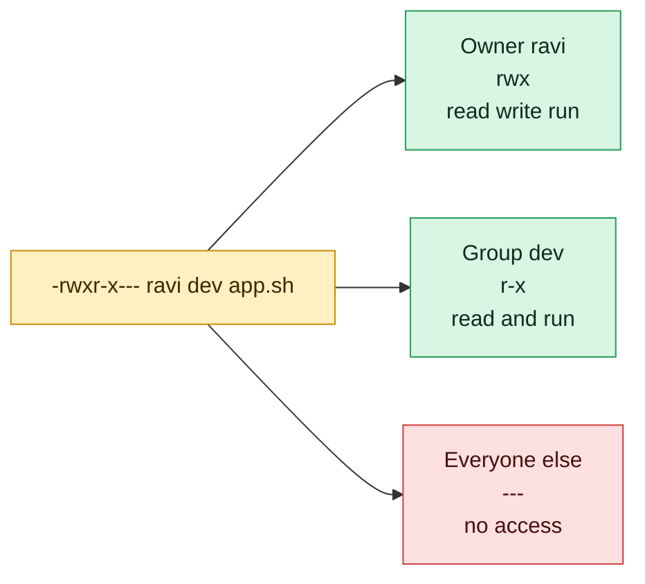

# The Permission Model

## What is it?
Every file and directory has an **owner**, a **group** and a set of **permission bits**. The bits say what three classes of people may do: the **user** (owner, `u`), the **group** (`g`) and **others** (`o`). Each class can have **read** (`r`), **write** (`w`) and **execute** (`x`). The kernel checks these bits on every access. The `root` user (UID 0) bypasses them.

## Syntax
```bash
ls -l FILE
chmod MODE FILE          # change permissions
chown USER:GROUP FILE    # change owner and group
```

Reading `ls -l` output:

```text
-rw-r----- 1 devops devops 0 Oct 14 01:31 f.sh
│└┬┘└┬┘└┬┘   └──┬─┘ └──┬─┘
│ │  │  │       │      └─ group
│ │  │  │       └──────── owner
│ │  │  └──────────────── others: ---
│ │  └─────────────────── group:  r--
│ └────────────────────── user:   rw-
└──────────────────────── type: - file, d directory, l link
```

## Visual Overview
> Linux checks only one group of three letters: owner if you own the file, otherwise group if you are in it, otherwise others. Root skips the check.



## Options/Flags
| Bit | On a file | On a directory | Number |
|-----|-----------|----------------|--------|
| `r` | Read the content | List the names inside | 4 |
| `w` | Change the content | Create, rename and delete names inside | 2 |
| `x` | Run it as a program | Enter it (`cd`) and reach files inside | 1 |

Add the numbers for each class. `rw-` = 4+2 = 6, `r-x` = 5, `rwx` = 7.

| Mode | Symbolic | Typical use |
|------|----------|-------------|
| `644` | `rw-r--r--` | Normal file |
| `755` | `rwxr-xr-x` | Script, program, normal directory |
| `600` | `rw-------` | Private file such as an SSH key |
| `640` | `rw-r-----` | Config readable by a group |
| `700` | `rwx------` | Private directory |
| `777` | `rwxrwxrwx` | Everyone can do everything, avoid |

| Symbolic form | Meaning |
|---------------|---------|
| `u+x` | Add execute for the owner |
| `g-w` | Remove write from the group |
| `o=r` | Set others to read only |
| `a+r` | Add read for all |
| `u=rwx,go=rx` | Set exactly |
| `X` | Execute only for directories (and files that already have it) |

**Special bits:**

| Bit | Number | Effect |
|-----|--------|--------|
| SUID | 4000 | The program runs as the file's owner, shown as `s` in the user `x` place |
| SGID | 2000 | Runs as the file's group, or new files in a directory inherit the group |
| Sticky | 1000 | In a shared directory only the file's owner can delete it, shown as `t` |

## Usage Examples

### Example 1: Read the permissions (`ls -l`, `stat`)
**Command:**
```bash
touch f.sh
ls -l f.sh
chmod 640 f.sh
ls -l f.sh
stat -c '%a %A %U:%G' f.sh
```
**Sample Output:**
```text
-rw-r--r-- 1 devops devops 0 Oct 14 01:31 f.sh
-rw-r----- 1 devops devops 0 Oct 14 01:31 f.sh
640 -rw-r----- devops:devops
```
A new file starts as `644` because of the default `umask 022`.

### Example 2: Numeric mode (`chmod 755`)
**Command:**
```bash
chmod 755 f.sh
ls -l f.sh
```
**Sample Output:**
```text
-rwxr-xr-x 1 devops devops 0 Oct 14 01:31 f.sh
```

### Example 3: Symbolic mode (`chmod u-x,go-rx`)
**Command:**
```bash
chmod u-x,go-rx f.sh
ls -l f.sh
```
**Sample Output:**
```text
-rw------- 1 devops devops 0 Oct 14 01:31 f.sh
```

### Example 4: Run a script, execute bit needed
Let's say we have this file `run.sh`:

**Input file** (`run.sh`):
```bash
#!/bin/bash
echo ran
```

**Command:**
```bash
./run.sh
chmod +x run.sh
./run.sh
```
**Sample Output:**
```text
bash: line 3: ./run.sh: Permission denied
ran
```

### Example 5: Directory permissions
**Command:**
```bash
mkdir pd
ls -ld pd
chmod 000 pd
ls pd
chmod 755 pd
```
**Sample Output:**
```text
drwxr-xr-x 2 devops devops 4096 Oct 14 01:31 pd
ls: cannot open directory 'pd': Permission denied
```
Without `r` on a directory you cannot list it. Without `x` you cannot enter it or open files inside it.

### Example 6: Who am I, and the default mask
**Command:**
```bash
id
umask
```
**Sample Output:**
```text
uid=1000(devops) gid=1000(devops) groups=1000(devops),27(sudo)
0022
```
`umask 0022` removes write from group and others for new files, so files get `644` and directories `755`. Your `groups=` list will differ.

### Example 7: Special bits in the wild
**Command:**
```bash
ls -l /usr/bin/passwd
ls -ld /tmp
stat -c '%a' /tmp
```
**Sample Output:**
```text
-rwsr-xr-x 1 root root 59976 Feb  6  2024 /usr/bin/passwd
drwxrwxrwt 10 root root 4096 Oct 14 01:31 /tmp
1777
```
`s` in `passwd` means SUID: a normal user can change their own password because the program runs as root. `t` on `/tmp` is the sticky bit.

### Example 8: A file you may not read
**Command:**
```bash
ls -l /etc/passwd /etc/shadow
cat /etc/shadow
```
**Sample Output:**
```text
-rw-r--r-- 1 root root   1534 Sep 30 23:14 /etc/passwd
-rw-r----- 1 root shadow  889 Sep 30 23:14 /etc/shadow
cat: /etc/shadow: Permission denied
```
Password hashes are in `/etc/shadow`, readable only by root and the `shadow` group.

## Sample Output
Reading `drwxr-x---`:

```text
d  rwx  r-x  ---
│   │    │    └─ others: nothing
│   │    └────── group: read and enter
│   └─────────── owner: everything
└─────────────── directory
```

## Pitfalls / Gotchas
- `chmod 777` is almost never the right fix. Find which user needs access and use the group instead.
- To delete a file you need write permission on its **directory**, not on the file.
- To open `/a/b/c` you need `x` on `/a` and `/a/b`.
- `chmod -R 755 dir` makes every plain file executable. Use `chmod -R u=rwX,go=rX dir`.
- SSH refuses a private key that others can read. Use `chmod 600`.
- The execute bit on a script is not enough if the file system is mounted `noexec`.
- Permissions are checked against the **owner and group stored in the inode** (see [Links and inodes](09-links-and-inodes.md)), not against the name.
- `sudo` runs a command as root. Use it for the one command that needs it, not for a whole shell session.

## DevOps Use Cases

### Use Case 1: Lock down an SSH private key
**Situation:** `ssh` refuses the key with "UNPROTECTED PRIVATE KEY FILE".

**Command:**
```bash
touch id_rsa
chmod 777 id_rsa
ls -l id_rsa
chmod 600 id_rsa
ls -l id_rsa
```
**Sample Output:**
```text
-rwxrwxrwx 1 devops devops 0 Oct 14 01:32 id_rsa
-rw------- 1 devops devops 0 Oct 14 01:32 id_rsa
```

### Use Case 2: Audit for world writable files
**Situation:** A security scan asks for files that anyone can modify.

Let's say we have these files in the current directory: `a.sh` (mode `644`) and `b.txt` (mode `646`, others can write).

**Command:**
```bash
find . -maxdepth 1 -type f -perm -o+w
```
**Sample Output:**
```text
./b.txt
```

### Use Case 3: Give a group write access to a tree, safely
**Situation:** A shared folder must be writable by the team, but files must not all become executable.

Let's say we have a directory `tree` with `tree/f1` and `tree/sub/f2`.

**Command:**
```bash
chmod -R g+w tree
ls -l tree
chmod -R u=rwX,go=rX tree
ls -l tree
```
**Sample Output:**
```text
total 4
-rw-rw-r-- 1 devops devops    0 Oct 14 01:32 f1
drwxrwxr-x 2 devops devops 4096 Oct 14 01:32 sub
total 4
-rw-r--r-- 1 devops devops    0 Oct 14 01:32 f1
drwxr-xr-x 2 devops devops 4096 Oct 14 01:32 sub
```
The capital `X` gives execute only to directories, so `f1` stays `644`.

## Try it yourself

Work in a practice folder so nothing real can be damaged: `mkdir -p ~/practice && cd ~/practice`. Try each task first, then open the answer.

**Task 1.** Read this line from `ls -l`:
```
-rwxr-x---  1 ravi dev  520 Jan 5 10:00 app.sh
```
What can the owner `ravi` do with `app.sh`?

<details>
<summary>Show the answer</summary>

The owner part is `rwx`: read, write and run.

</details>

**Task 2.** What can `amit`, who is in the group `dev`, do?

<details>
<summary>Show the answer</summary>

The group part is `r-x`: read and run, but not change the file.

</details>

**Task 3.** What can a user who is not `ravi` and not in `dev` do?

<details>
<summary>Show the answer</summary>

The others part is `---`: nothing. Only root can still open it.

</details>

## Related Commands
- [Links and inodes](09-links-and-inodes.md) - the previous topic
- [Shortcuts and tab completion](11-shortcuts-and-tab-completion.md) - the next topic
- [`chmod`](../permissions/chmod.md) - change permissions
- [`chown`](../permissions/chown.md) / [`chgrp`](../permissions/chgrp.md) - change owner and group
- [`umask`](../permissions/umask.md) - default permissions for new files
- [`id`](../user-management/id.md) / [`groups`](../user-management/groups.md) - who you are
- [`sudo`](../user-management/sudo.md) - run a command as root
- [`ls`](../file-management/ls.md) - show permissions with `-l`

---
<!-- nav -->
[← Previous: Links and Inodes](09-links-and-inodes.md) | [Learning path](../README.md) | [Next: Shortcuts and Tab Completion →](11-shortcuts-and-tab-completion.md)
