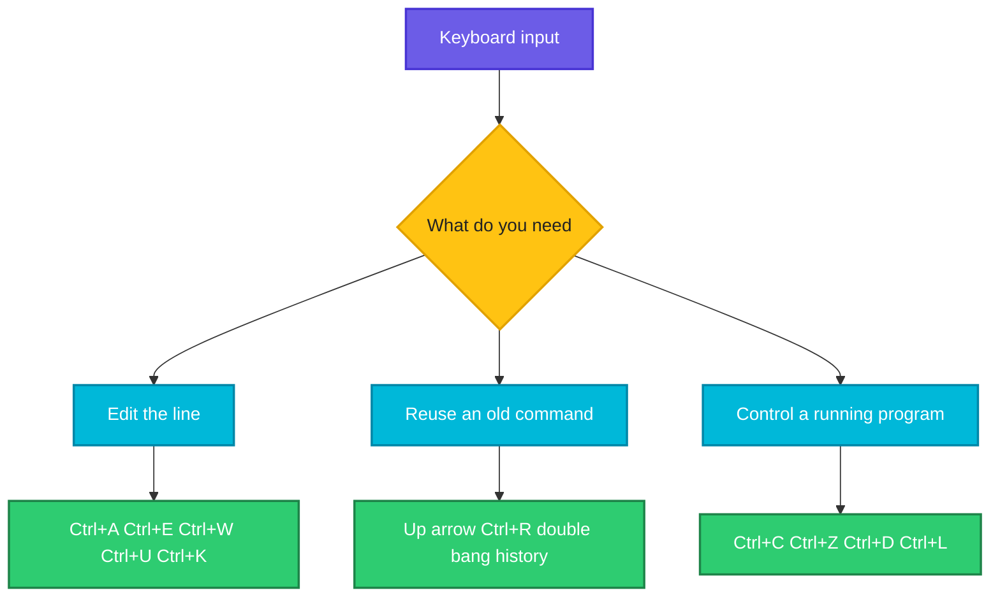

# Shortcuts and Tab Completion

## What is it?
The Bash shell reads your line with a library called **readline**. It gives you keyboard shortcuts for editing the line, searching and repeating earlier commands, and **tab completion** that finishes command names, file names and options. Learning ten of them makes you several times faster and avoids typos.

## Syntax
```text
Tab            complete the word
Tab Tab        list all possible completions
Ctrl+R         search the history
!!             repeat the last command
```

## Visual Overview
> Shortcuts either edit the line you are typing, recall an old line, or control the running program.



## Options/Flags
**Editing the line**

| Shortcut | Action |
|----------|--------|
| `Ctrl+A` / `Home` | Jump to the start of the line |
| `Ctrl+E` / `End` | Jump to the end of the line |
| `Alt+B` / `Alt+F` | Move back or forward one word |
| `Ctrl+W` | Delete the word before the cursor |
| `Ctrl+U` | Delete from the cursor to the start of the line |
| `Ctrl+K` | Delete from the cursor to the end of the line |
| `Ctrl+Y` | Paste what you just deleted |
| `Ctrl+L` | Clear the screen (same as `clear`) |

**History**

| Shortcut | Action |
|----------|--------|
| `Up` / `Down` | Move through earlier commands |
| `Ctrl+R` | Search the history as you type, press again for the next match |
| `!!` | The whole previous command |
| `!$` | The last argument of the previous command |
| `!^` | The first argument of the previous command |
| `!n` | Run history entry number `n` |
| `sudo !!` | Repeat the last command with `sudo` |

**Controlling programs**

| Shortcut | Action |
|----------|--------|
| `Ctrl+C` | Stop (interrupt) the running program |
| `Ctrl+Z` | Suspend the program, resume with `fg` or `bg` |
| `Ctrl+D` | End of input, on an empty line it closes the shell |
| `Ctrl+S` / `Ctrl+Q` | Pause and resume terminal output |

**Tab completion**

| Press | Result |
|-------|--------|
| `Tab` once | Completes if there is only one match |
| `Tab` twice | Shows all matches |
| Works on | Commands, file and directory names, variables, and options of many tools (needs the `bash-completion` package) |

## Usage Examples

### Example 1: Repeat the last command (`!!`)
The following session was typed in an interactive bash shell:

**Command:**
```bash
echo hello world
!!
```
**Sample Output:**
```text
hello world
echo hello world
hello world
```
Bash prints the command it expanded, then runs it.

### Example 2: Reuse the last argument (`!$`)
**Command:**
```bash
echo one two three
echo !$
```
**Sample Output:**
```text
one two three
echo three
three
```

### Example 3: Reuse the first argument (`!^`)
**Command:**
```bash
echo one two three
echo !^
```
**Sample Output:**
```text
one two three
echo one
one
```
The first argument after the command name is `one`.

### Example 4: Tab completion on a file name
Let's say we have these files in the current directory:

**Input file** (listing):
```text
application-server.log
archive.tar.gz
```

**Command:**
```text
cat app<Tab>
```
**Sample Output:**
```text
cat application-server.log
```
Bash completes the only match. If both names started with `app`, pressing `Tab` twice would list them.

### Example 5: Search the history (`Ctrl+R`)
**Command:**
```text
(reverse-i-search)`tar': tar -czf backup.tar.gz /var/www
```
Type part of an old command and the match appears. Press `Enter` to run it, or `Right arrow` to edit it first.

### Example 6: Fix a typo in the last command
Let's say we have these files in the current directory:

**Input file** (listing):
```text
a1.txt
notes.md
```

**Command:**
```bash
lss
^lss^ls^
```
**Sample Output:**
```text
Command 'lss' not found, but there are 15 similar ones.
ls
a1.txt
notes.md
```
`^lss^ls^` replaces the first `lss` in the previous command with `ls`, prints the new command and runs it. The "not found" message is from Ubuntu and differs on other distros.

### Example 7: Stop a running command (`Ctrl+C`)
**Command:**
```bash
sleep 60
```
**Sample Output (after pressing Ctrl+C):**
```text
^C
```
The prompt returns at once.

### Example 8: Suspend and resume (`Ctrl+Z`)
**Command:**
```bash
sleep 60
```
**Sample Output (after pressing Ctrl+Z, then typing `bg`):**
```text
^Z
[1]+  Stopped                 sleep 60
[1]+ sleep 60 &
```
`bg` continues it in the background, `fg` brings it back to the front. See [`jobs`](../process-management/jobs.md).

## Sample Output
A typical productive line:

```text
$ sudo !!
```
After a `Permission denied` error this reruns the same command as root. Bash shows the full command before it runs.

## Pitfalls / Gotchas
- `Ctrl+C` stops the program, it does not close the terminal. `Ctrl+D` on an empty line **does** close the shell, or an SSH session.
- `Ctrl+Z` only **suspends** a program, it is still alive. Use `jobs` to see it and `kill %1` to end it.
- If your terminal looks frozen, you may have pressed `Ctrl+S`. Press `Ctrl+Q`.
- `!!` and `sudo !!` run immediately. Check what they expand to, especially after `rm`.
- History expansion (`!`) works in an interactive shell, not in scripts.
- On macOS `Alt` shortcuts need the Option key set as Meta in the terminal settings.
- Commands with a leading space are not saved in history if `HISTCONTROL=ignorespace` is set. This is useful for commands with secrets, but do not rely on it.

## DevOps Use Cases

### Use Case 1: Rerun a failed command with sudo
**Situation:** You forgot `sudo` and the command failed.

**Command:**
```bash
cat /etc/shadow
sudo !!
```
**Sample Output:**
```text
cat: /etc/shadow: Permission denied
sudo cat /etc/shadow
```
The second line is what bash prints before running it. The hashes follow after `sudo` asks for your password.

### Use Case 2: Find a long command you ran last week
**Situation:** You need the exact `kubectl` or `docker` command from earlier.

**Command:**
Let's say your history holds these entries (shown by `history`):

**Input file** (`~/.bash_history`):
```text
cd /srv/app
docker ps
docker logs web
ls
```

**Command:**
```bash
history | grep docker
```
**Sample Output:**
```text
    2  docker ps
    3  docker logs web
```
Press `Ctrl+R` and type `docker` for the same search interactively. The numbers are history positions and differ per session.

## Related Commands
- [The permission model](10-permission-model.md) - the previous topic
- [`history`](../shell-basics/history.md) - list and search earlier commands
- [`clear`](../shell-basics/clear.md) - clear the screen
- [`alias`](../shell-basics/alias.md) - give a long command a short name
- [`jobs`](../process-management/jobs.md) / [`bg`](../process-management/bg.md) / [`fg`](../process-management/fg.md) - what `Ctrl+Z` creates
- [`man`](../shell-basics/man.md) - read the manual
