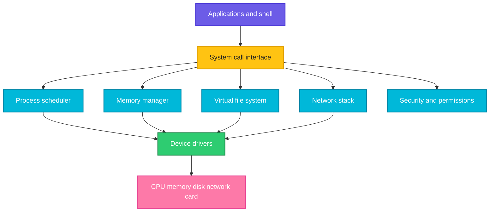

# The Kernel and Its Responsibilities

## What is it?
The **kernel** is the core program of the operating system. It is loaded at boot, stays in memory the whole time, and is the only software that talks directly to the hardware. Every other program, including the shell, asks the kernel for what it needs: CPU time, memory, files, network access. Think of the kernel as a manager that shares one machine fairly and safely between many programs.

## Syntax
```bash
uname -r              # kernel release
cat /proc/version     # kernel build details
ls /proc              # live view of what the kernel is doing
```

## Visual Overview
> Programs sit above the kernel. The kernel has several parts, each with one job, and sits above the hardware.



## Options/Flags
**Main responsibilities of the kernel**

| Duty | What the kernel does | Where you see it |
|------|----------------------|------------------|
| Process management | Creates and ends processes, **schedules** which one uses the CPU and for how long | `ps`, `top`, `nice` |
| Memory management | Gives each process its own **virtual memory**, maps it to RAM, moves unused pages to swap, stops one process reading another's memory | `free`, `/proc/meminfo` |
| File system management | Provides one file tree on top of many file system types (ext4, xfs, tmpfs, NFS), handles caching and permissions | `ls`, `df`, `mount`, `/proc/filesystems` |
| Device management | **Drivers** talk to disks, network cards, keyboards, GPUs. Devices appear as files | `/dev`, `lsblk`, `lsmod` |
| Networking | Implements TCP/IP, sockets, routing, firewall rules | `ip`, `ss`, `iptables` |
| Security | Checks user IDs, file permissions, capabilities, namespaces and cgroups | `chmod`, `id`, containers |
| System calls | The controlled doorway programs use to ask for kernel services | `strace` |
| Interrupt and error handling | Reacts to hardware events and CPU errors | `dmesg`, `/proc/interrupts` |
| Inter process communication | Pipes, signals, sockets and shared memory so processes can talk | `kill`, pipes |
| Power and time | Clocks, timers, sleep and shutdown | `date`, `uptime` |

**Kernel types (for reference)**

| Type | Idea | Example |
|------|------|---------|
| Monolithic | All services run inside one big kernel program | Linux |
| Microkernel | Only the basics are in the kernel, services run outside | Minix, QNX |
| Hybrid | A mix of both | Windows NT, macOS |

Linux is monolithic but modular: drivers can be loaded and removed at run time, see [Kernel modules](06-kernel-support-and-modules.md).

## Usage Examples

### Example 1: Which kernel is running (`uname -r`)
**Command:**
```bash
uname -r
```
**Sample Output:**
```text
6.18.54.1-microsoft-standard-WSL2
```
The number is `major.minor.patch`. Your value will differ.

### Example 2: The kernel build string (`/proc/version`)
Let's say the kernel exposes this file `/proc/version` (it is created by the kernel, not stored on disk):

**Input file** (`/proc/version`, first 80 characters):
```text
Linux version 6.18.54.1-microsoft-standard-WSL2 (root@9b80f41eb17c) (gcc (GCC) 1
```

**Command:**
```bash
cut -c1-80 /proc/version
```
**Sample Output:**
```text
Linux version 6.18.54.1-microsoft-standard-WSL2 (root@9b80f41eb17c) (gcc (GCC) 1
```

### Example 3: CPU management, how many CPUs the scheduler uses
**Command:**
```bash
nproc
grep -c ^processor /proc/cpuinfo
```
**Sample Output:**
```text
16
16
```

### Example 4: Memory management (`/proc/meminfo`)
**Command:**
```bash
head -n 3 /proc/meminfo
```
**Sample Output:**
```text
MemTotal:        7792544 kB
MemFree:         3479624 kB
MemAvailable:    6208128 kB
```
`MemAvailable` is what programs can really use, including cache the kernel can give back.

### Example 5: File system management (`/proc/filesystems`)
**Command:**
```bash
head -n 8 /proc/filesystems
```
**Sample Output:**
```text
nodev	sysfs
nodev	tmpfs
nodev	proc
nodev	cgroup
nodev	cgroup2
nodev	cpuset
nodev	devtmpfs
nodev	binfmt_misc
```
These are the file system types the running kernel supports. `nodev` means they do not need a block device.

### Example 6: Device management, devices are files
**Command:**
```bash
ls -l /dev/null /dev/zero
```
**Sample Output:**
```text
crw-rw-rw- 1 root root 1, 3 Oct 14 01:30 /dev/null
crw-rw-rw- 1 root root 1, 5 Oct 14 01:30 /dev/zero
```
The `c` means a character device. The numbers `1, 3` are the driver (major) and device (minor) numbers the kernel uses.

### Example 7: Security, the kernel enforces permissions
**Command:**
```bash
cat /proc/1/mem
echo x > /dev/mem
```
**Sample Output:**
```text
cat: /proc/1/mem: Permission denied
bash: /dev/mem: Permission denied
```
A normal user may not read another process's memory or write to physical memory. The kernel checks every request.

### Example 8: Kernel messages (`dmesg`)
**Command:**
```bash
dmesg | head -n 1
```
**Sample Output:**
```text
[    0.000000] Linux version 6.18.54.1-microsoft-standard-WSL2 (root@9b80f41eb17c) (gcc (GCC) 13.2.0, GNU ld (GNU Binutils) 2.41) #1 SMP PREEMPT_DYNAMIC Tue Oct  6 19:13:07 UTC 2026
```
The kernel keeps a ring buffer of its own messages, with a timestamp in seconds since boot. On many distros normal users must use `sudo dmesg`.

## Sample Output
The same machine seen from the kernel's point of view:

```bash
uname -r; nproc; head -n 1 /proc/meminfo
```
```text
6.18.54.1-microsoft-standard-WSL2
16
MemTotal:        7792544 kB
```

## Pitfalls / Gotchas
- "Kernel" and "operating system" are not the same. Ubuntu is the kernel plus tools, see [What is Linux](../fundamentals/01-what-is-linux.md).
- Files in `/proc` and `/sys` are not on disk. The kernel creates their content when you read them.
- Updating the kernel package does not change the running kernel until you reboot. Compare `uname -r` with the installed version.
- A bug in a kernel driver can crash the whole machine (a **kernel panic**). A bug in a normal program only crashes that program, see [User mode and kernel mode](02-user-mode-and-kernel-mode.md).
- Inside a container the kernel is **shared with the host**. `uname -r` in a container shows the host's kernel.
- Free memory is not "wasted". Linux uses spare RAM for cache, so low `MemFree` is normal. Look at `MemAvailable`.

## DevOps Use Cases

### Use Case 1: Record the kernel in a bug report or CI log
**Situation:** A bug appears only on some servers, and you suspect the kernel version.

**Command:**
```bash
echo "kernel=$(uname -r) cpus=$(nproc)"
```
**Sample Output:**
```text
kernel=6.18.54.1-microsoft-standard-WSL2 cpus=16
```

### Use Case 2: Check that the kernel supports a file system before mounting it
**Situation:** Mounting an XFS or NFS volume fails and you need to know if the kernel knows the type.

**Command:**
```bash
grep -w -c tmpfs /proc/filesystems
grep -w -c nosuchfs /proc/filesystems
```
**Sample Output:**
```text
1
0
```
`1` means the type is supported. `0` means you need the module or a different kernel.

## Related Commands
- [User mode and kernel mode](02-user-mode-and-kernel-mode.md) - the next page
- [`uname`](../system-info/uname.md) - kernel name, release and architecture
- [`dmesg`](../system-info/dmesg.md) - kernel message buffer
- [`free`](../system-info/free.md) - memory use
- [`lscpu`](../system-info/lscpu.md) / [`nproc`](../system-info/nproc.md) - CPU details
- [`mount`](../system-info/mount.md) - attach file systems
- [`ps`](../process-management/ps.md) - processes the kernel manages
