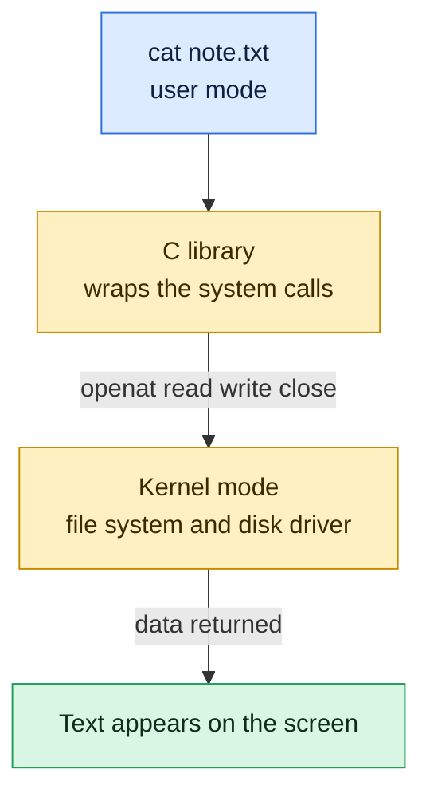

# System Calls

## What is it?
A **system call** (syscall) is the controlled doorway between a user mode program and the kernel. A program cannot read a disk, open a network connection or create a process by itself. It must ask the kernel by making a system call such as `open`, `read`, `write`, `fork` or `execve`. The kernel checks the request, does the work in kernel mode and returns a result.

Programs rarely call the kernel by hand. They call a function in the C library (`glibc`), for example `printf()` or `fopen()`, and the library makes the system call for them.

## Syntax
```bash
strace [OPTIONS] COMMAND            # run a command and print its system calls
strace -p PID                       # attach to a running process (needs permission)
strace -c COMMAND                   # count calls and time per call
strace -e trace=openat,read COMMAND # only some calls
```

## Visual Overview
> A command like `cat` does not read the disk itself. It calls small kernel functions called system calls. `strace` shows them.



## Options/Flags
**Common system calls**

| Group | System call | What it does |
|-------|-------------|--------------|
| Files | `openat` | Open a file, returns a **file descriptor** (a small number) |
| Files | `read` / `write` | Read or write bytes through a file descriptor |
| Files | `close` | Release a file descriptor |
| Files | `newfstatat` / `stat` | Get size, owner and permissions |
| Processes | `fork` / `clone` | Create a new process or thread |
| Processes | `execve` | Replace the current program with another |
| Processes | `wait4` | Wait for a child to finish |
| Processes | `exit_group` | End the process |
| Memory | `mmap` / `munmap` | Map memory or files into the process |
| Memory | `brk` | Grow the heap |
| Network | `socket`, `connect`, `bind`, `listen`, `accept` | Create and use network sockets |
| Info | `getpid`, `getuid`, `uname` | Ask for process, user or system information |
| Signals | `kill`, `rt_sigaction` | Send and handle signals |

Linux x86_64 has about 360 system calls (see Example 8).

**`strace` options**

| Option | Description |
|--------|-------------|
| `-e trace=NAME,NAME` | Show only the listed calls |
| `-c` | Summary table of calls, errors and time |
| `-o FILE` | Write the trace to a file |
| `-f` | Follow child processes and threads |
| `-T` | Show the time spent in each call |
| `-p PID` | Attach to a running process |

**Reading a trace line**

```text
openat(AT_FDCWD, "note.txt", O_RDONLY)  = 3
└─ call  └─ arguments                      └─ return value
```
A return value of `-1` followed by an error name such as `ENOENT` means the call failed.

## Usage Examples

### Example 1: Watch `cat` read a file
Let's say we have this file `note.txt`:

**Input file** (`note.txt`):
```text
hello kernel
```

**Command:**
```bash
strace -o trace.txt -e trace=openat,read,write,close cat note.txt
grep -A6 'note.txt' trace.txt
```
**Sample Output:**
```text
hello kernel
openat(AT_FDCWD, "note.txt", O_RDONLY)  = 3
read(3, "hello kernel\n", 131072)       = 13
write(1, "hello kernel\n", 13)          = 13
read(3, "", 131072)                     = 0
close(3)                                = 0
close(1)                                = 0
close(2)                                = 0
```
The first line is the output of `cat` itself. Then you see the story: `openat` returns file descriptor `3`, `read` returns 13 bytes, `write` sends them to descriptor `1` (standard output), a second `read` returns `0` which means end of file, and the descriptors are closed.

### Example 2: A failing system call
**Command:**
```bash
strace -e trace=openat -o t3.txt cat missing.txt 2>/dev/null
grep missing t3.txt
```
**Sample Output:**
```text
openat(AT_FDCWD, "missing.txt", O_RDONLY) = -1 ENOENT (No such file or directory)
```
The error message printed by `cat` comes from this return value. `strace` is the fastest way to see which file a program could not find.

### Example 3: Count the calls (`-c`)
Using the `note.txt` file from Example 1.

**Command:**
```bash
strace -c -o sum.txt cat note.txt > /dev/null
head -6 sum.txt
```
**Sample Output:**
```text
% time     seconds  usecs/call     calls    errors syscall
------ ----------- ----------- --------- --------- ----------------
 25.52    0.002328          75        31        13 openat
 18.45    0.001683          76        22           mmap
 12.33    0.001125          56        20           close
 11.58    0.001056          55        19           newfstatat
```
Even a tiny `cat` makes over a hundred system calls, mostly to load libraries. The `errors` column counts failed calls (some are normal, for example searching library paths).

### Example 4: Library function versus system call
**Command:**
```bash
strace -e trace=write sh -c 'echo a; echo b' 2>&1 > /dev/null | head -3
```
**Sample Output:**
```text
write(1, "a\n", 2)                      = 2
write(1, "b\n", 2)                      = 2
+++ exited with 0 +++
```
Each `echo` is one `write` system call.

### Example 5: Make a system call from C
Let's say we have this file `sc.c`:

**Input file** (`sc.c`):
```c
#include <unistd.h>
int main(void){ write(1, "hi from write\n", 14); return 0; }
```

**Command:**
```bash
gcc -o sc sc.c
strace -e trace=write ./sc
```
**Sample Output:**
```text
write(1, "hi from write\n", 14hi from write
)         = 14
+++ exited with 0 +++
```
`write` here is the thin library wrapper around the real system call. The program output `hi from write` is mixed into the trace line because both go to the terminal.

### Example 6: Process creation with `fork` and `execve` (`-f`)
**Command:**
```bash
strace -f -e trace=execve,clone,wait4 -o t2.txt bash -c 'ls /tmp/os2 >/dev/null'
cut -c1-110 t2.txt | head -5
```
**Sample Output:**
```text
4007  execve("/usr/bin/bash", ["bash", "-c", "ls /tmp/os2 >/dev/null"], 0x7fffc4ad1578 /* 23 vars */) = 0
4007  clone(child_stack=NULL, flags=CLONE_CHILD_CLEARTID|CLONE_CHILD_SETTID|SIGCHLD, child_tidptr=0x7cfa128c3a
4007  wait4(-1,  <unfinished ...>
4042  execve("/usr/bin/ls", ["ls", "/tmp/os2"], 0x5705fe690ad0 /* 23 vars */) = 0
4042  +++ exited with 0 +++
```
This is how every command starts. The shell (PID 4007) calls `clone` to create a child (PID 4042), the child calls `execve` to become `ls`, and the parent waits with `wait4`. More in [Processes](04-processes.md).

### Example 7: Time per call (`-T`)
Using the `note.txt` file from Example 1.

**Command:**
```bash
strace -T -e trace=openat -o t4.txt cat note.txt > /dev/null
grep note.txt t4.txt
```
**Sample Output:**
```text
openat(AT_FDCWD, "note.txt", O_RDONLY)  = 3 <0.000179>
```
The number in angle brackets is the time spent inside the call, in seconds.

### Example 8: How many system calls exist
**Command:**
```bash
grep -c '#define __NR_' /usr/include/x86_64-linux-gnu/asm/unistd_64.h
```
**Sample Output:**
```text
360
```
The header lists every system call number for this architecture. The count grows slowly with each kernel version.

### Example 9: Asking the kernel for information
**Command:**
```bash
strace -e trace=getpid python3 -c 'import os;os.getpid()' 2>&1 | grep getpid
```
**Sample Output:**
```text
getpid()                                = 2539
```
The PID number differs on every run.

## Sample Output
The shortest useful trace, one call:

```bash
strace -e trace=write echo hi
```
```text
write(1, "hi\n", 3hi
)                     = 3
+++ exited with 0 +++
```

## Pitfalls / Gotchas
- `strace` slows a program a lot. Do not leave it attached to a busy production service.
- Attaching with `strace -p` needs the same user or root. In containers and on hardened systems it can fail with `Operation not permitted` because of `ptrace_scope` or seccomp.
- Traces can show passwords, tokens and file contents in the arguments. Do not paste a full trace into a ticket without checking it.
- Newer systems use `openat` instead of `open`, and `clone` instead of `fork`. The meaning is the same.
- An error return (`-1 ENOENT`) is not always a bug. Programs often try several paths until one works.
- A system call is not a shell command. `ls` and `cat` are programs, `open` and `read` are system calls.
- The cost of many small calls is high, see [User mode and kernel mode](02-user-mode-and-kernel-mode.md).

## DevOps Use Cases

### Use Case 1: Find which file a program cannot open
**Situation:** A service fails at start with a vague error.

**Command:**
```bash
strace -e trace=openat -o t3.txt cat missing.txt 2>/dev/null
grep ENOENT t3.txt | grep missing
```
**Sample Output:**
```text
openat(AT_FDCWD, "missing.txt", O_RDONLY) = -1 ENOENT (No such file or directory)
```
In real use replace `cat missing.txt` with the failing command and look for `ENOENT` (not found) or `EACCES` (permission denied) next to the config or certificate path.

### Use Case 2: Find which command is the slow one inside a script
**Situation:** A script is slow and you want to see where the time goes.

**Command:**
```bash
strace -c -o sum.txt cat note.txt > /dev/null
tail -2 sum.txt | cut -c1-72
```
**Sample Output:**
```text
------ ----------- ----------- --------- --------- ----------------
100.00    0.008269          66       124        22 total
```
Use `strace -c -f ./script.sh` and look at the top row of the table. Many `read` or `write` calls with tiny sizes mean the program needs buffering.

### Use Case 3: See what a process spawns
**Situation:** A start script launches helpers and you want to know which binaries it runs.

**Command:**
```bash
strace -f -e trace=execve -o t5.txt bash -c 'ls /tmp > /dev/null; date > /dev/null'
grep -o 'execve("[^"]*"' t5.txt
```
**Sample Output:**
```text
execve("/usr/bin/bash"
execve("/usr/bin/ls"
execve("/usr/bin/date"
```

## Related Commands
- [User mode and kernel mode](02-user-mode-and-kernel-mode.md) - the previous page
- [Processes](04-processes.md) - the next page
- [`strace`](../process-management/strace.md) - trace system calls
- [`ps`](../process-management/ps.md) - see the processes that make the calls
- [`lsof`](../process-management/lsof.md) - list the file descriptors a process holds
- [`kill`](../process-management/kill.md) - the `kill` system call from the shell
- [`dmesg`](../system-info/dmesg.md) - kernel side messages

---
<!-- nav -->
[← Previous: User Mode and Kernel Mode](02-user-mode-and-kernel-mode.md) | [Learning path](../README.md) | [Next: Processes →](04-processes.md)
