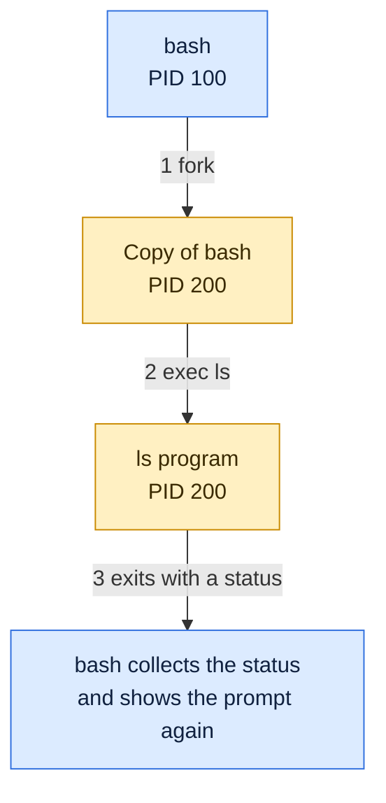

# Processes

## What is it?
A **program** is a file on disk. A **process** is a program that is **running**: the program code loaded into memory, plus its own memory, open files, environment variables, current directory and a unique number called the **PID** (process ID). Run `ls` twice at the same time and you get two processes of one program. The kernel keeps a record for every process and decides which one uses the CPU.

## Syntax
```bash
ps [OPTIONS]                  # list processes
ps -o pid,ppid,stat,comm -p PID
pstree -p [PID]               # show the process tree
ls /proc/PID                  # what the kernel knows about a process
```

## Visual Overview
> Every command you run is a new process, created by copying the parent with `fork` and then replacing the copy with the new program using `exec`.



## Options/Flags
**What a process has**

| Item | Meaning |
|------|---------|
| PID | Unique process number |
| PPID | PID of the parent process |
| UID and GID | The user and group the process runs as |
| State | What it is doing now (see below) |
| Memory | Its own virtual address space: code, heap, stack |
| File descriptors | Open files, sockets and pipes. `0` stdin, `1` stdout, `2` stderr |
| Working directory and environment | Inherited from the parent |
| Exit code | A number returned when it ends. `0` means success |

**Process states** (the `STAT` column of `ps`)

| Code | State | Meaning |
|------|-------|---------|
| `R` | Running | Using a CPU or waiting in the run queue |
| `S` | Sleeping | Waiting for an event, such as input. Most processes are here |
| `D` | Uninterruptible sleep | Waiting for disk or network I/O, cannot be killed until it returns |
| `T` | Stopped | Paused by `Ctrl+Z` or `SIGSTOP` |
| `Z` | Zombie | Finished, but the parent has not read its exit code yet |
| `I` | Idle kernel thread | Kernel worker doing nothing |

Extra letters: `s` session leader, `+` foreground process, `l` multi threaded, `<` high priority, `N` low priority.

**Key system calls**

| Call | Role |
|------|------|
| `fork` / `clone` | Create a child process |
| `execve` | Replace the program inside a process |
| `wait4` | Parent waits for a child and reads its exit code |
| `exit_group` | End the process |

| Special case | Meaning |
|--------------|---------|
| PID 1 | The first process (`systemd` or `init`), parent of all others, adopts orphans |
| Zombie | Dead process whose entry stays until the parent calls `wait` |
| Orphan | A child whose parent died first, it is adopted by PID 1 (or a subreaper) |
| Daemon | A background process that has no terminal, for example `sshd`, `nginx` |

## Usage Examples

### Example 1: The first process
**Command:**
```bash
ps -p 1 -o pid,ppid,comm
```
**Sample Output:**
```text
    PID    PPID COMMAND
      1       0 systemd
```
PID 1 has parent `0`, the kernel itself. Every other process descends from it.

### Example 2: Your shell and its child
**Command:**
```bash
bash -c 'echo my=$$ parent=$PPID'
```
**Sample Output:**
```text
my=4312 parent=4298
```
`$$` is the PID of the running shell and `$PPID` is its parent. The numbers differ each time.

### Example 3: State of your shell
**Command:**
```bash
ps -o pid,ppid,stat,comm -p $$
```
**Sample Output:**
```text
    PID    PPID STAT COMMAND
   4298    4297 Ss+  bash
```
`S` sleeping (waiting for you to type), `s` session leader, `+` foreground.

### Example 4: A background child (`&`, `$!`)
**Command:**
```bash
sleep 30 &
echo child=$!
ps -o pid,ppid,stat,comm --ppid $$
```
**Sample Output:**
```text
child=4314
    PID    PPID STAT COMMAND
   4314    4298 S+   sleep
   4315    4298 R+   ps
```
Both `sleep` and `ps` are children of the shell (PPID `4298`). `ps` is `R` because it is running right now. Clean up with `kill %1`.

### Example 5: Stop and continue a process
**Command:**
```bash
sleep 30 &
P=$!
sleep 0.3
ps -o stat,comm -p $P
kill -STOP $P
sleep 0.2
ps -o stat,comm -p $P
kill -CONT $P
sleep 0.2
ps -o stat,comm -p $P
kill $P
```
**Sample Output:**
```text
STAT COMMAND
S+   sleep
STAT COMMAND
T+   sleep
STAT COMMAND
S+   sleep
```
`S` sleeping, `T` stopped by `SIGSTOP`, then `S` again after `SIGCONT`. The final `kill` ends it.

### Example 6: Fork and exit code
Let's say we have this file `f.py`:

**Input file** (`f.py`):
```python
import os, time
print("parent pid", os.getpid() > 0)
pid = os.fork()
if pid == 0:
    print("child: ppid matches parent:", os.getppid() == os.getppid())
    os._exit(7)
_, st = os.waitpid(pid, 0)
print("child exit code", os.WEXITSTATUS(st))
```

**Command:**
```bash
python3 f.py
```
**Sample Output:**
```text
parent pid True
child exit code 7
```
`fork` returned `0` inside the child, so it exited with code `7`. The parent called `waitpid` and read that code.

### Example 7: A zombie
Let's say we have this file `z.py`, a parent that does not wait for its child:

**Input file** (`z.py`):
```python
import os, time, subprocess
pid = os.fork()
if pid == 0:
    os._exit(0)
time.sleep(1)
print(subprocess.run(["ps","-o","pid,ppid,stat,comm","-p",str(pid)],capture_output=True,text=True).stdout, end="")
os.waitpid(pid,0)
```

**Command:**
```bash
python3 z.py
```
**Sample Output:**
```text
    PID    PPID STAT COMMAND
   4319    4318 Z+   python3 <defunct>
```
The child already ended, but it stays as `Z` (zombie, `<defunct>`) until the parent calls `waitpid`.

### Example 8: The process tree (`pstree`)
**Command:**
```bash
pstree -p $$
```
**Sample Output:**
```text
bash(1215)---pstree(1758)
```
The shell is the parent, `pstree` is its child. On a busy system you see the full tree down from `systemd(1)`.

### Example 9: What the kernel knows (`/proc/PID`)
**Command:**
```bash
grep -E '^(Name|State|Pid|PPid|Threads|Uid)' /proc/self/status
```
**Sample Output:**
```text
Name:	grep
State:	R (running)
Pid:	4316
PPid:	4298
Uid:	1000	1000	1000	1000
Threads:	1
```
`/proc/self` always points to the process that reads it, here `grep`.

### Example 10: Files inside `/proc/PID`
**Command:**
```bash
ls -l /proc/self/exe /proc/self/cwd
```
**Sample Output:**
```text
lrwxrwxrwx 1 devops devops 0 Oct 14 01:31 /proc/self/cwd -> /tmp/os1
lrwxrwxrwx 1 devops devops 0 Oct 14 01:31 /proc/self/exe -> /usr/bin/ls
```
`exe` is the program file and `cwd` is the working directory of the process.

### Example 11: Does a process exist (`kill -0`)
**Command:**
```bash
kill -0 $$ && echo alive
kill -0 999999
```
**Sample Output:**
```text
alive
bash: line 18: kill: (999999) - No such process
```
Signal `0` sends nothing, it only checks that the process exists and you may signal it.

### Example 12: Exit codes
**Command:**
```bash
bash -c 'exit 3'
echo $?
```
**Sample Output:**
```text
3
```

### Example 13: Limits (`pid_max`, `ulimit -u`)
**Command:**
```bash
cat /proc/sys/kernel/pid_max
ulimit -u
```
**Sample Output:**
```text
4194304
30401
```
The first is the highest PID the kernel hands out, the second is how many processes your user may run.

## Sample Output
The whole life of a command in one view, `ls` started from bash:

```text
bash(4007)  --clone-->  child(4042)  --execve("/usr/bin/ls")-->  ls runs  -->  exit(0)
bash        <--wait4-- (collects exit code 0)
```
See the real trace in [System calls](03-system-calls.md), Example 6.

## Pitfalls / Gotchas
- A process is not a program. One program can have many processes, and a process can replace its program with `exec`.
- Zombies use almost no memory but each one takes a PID. A few are harmless. Thousands mean a buggy parent. You cannot `kill` a zombie, fix or restart its **parent**.
- A process in state `D` cannot be killed, not even with `kill -9`. It is stuck in the kernel waiting for storage or network. Fix the I/O problem.
- `kill` sends a **signal**. `SIGTERM` (15, default) asks politely, `SIGKILL` (9) cannot be caught and gives no chance to clean up.
- PIDs are reused after a process ends. Do not store a PID in a file and kill it later without checking it is still your process.
- In a container, your main process is PID 1 inside it and must handle signals and reap children, otherwise `docker stop` is slow and zombies pile up.
- Changes to the environment in a child process do not affect the parent. `cd` in a script does not change your shell's directory.
- A background job started with `&` still dies when the terminal closes, unless you use `nohup`, `disown` or a service.

## DevOps Use Cases

### Use Case 1: Find the processes using the most CPU or memory
**Situation:** A server is slow and you need the top consumers.

**Command:**
```bash
ps -eo pid,ppid,stat,comm --sort=-%cpu | head -4
```
**Sample Output:**
```text
    PID    PPID STAT COMMAND
    192       1 Ssl  snapfuse
    753     326 R    python3.10
   1425     885 Ssl  containerd
```
Add `%mem` to the `-o` list to find memory hogs. The rows differ on every machine.

### Use Case 2: Count processes by state
**Situation:** Are there too many blocked (`D`) or zombie (`Z`) processes?

**Command:**
```bash
ps -eo stat --no-headers | cut -c1 | sort | uniq -c | sort -rn | head -3
```
**Sample Output:**
```text
    107 S
      3 R
```
No `D` or `Z` lines means there are none. A growing `Z` count points to a parent that never waits.

### Use Case 3: Check that a service process is alive in a script
**Situation:** A health check must fail if the daemon died.

**Command:**
```bash
kill -0 $$ && echo alive
kill -0 999999 2>/dev/null || echo "process not found"
```
**Sample Output:**
```text
alive
process not found
```

### Use Case 4: See why a container stop is slow
**Situation:** `docker stop` waits 10 seconds before killing the container.

The usual reason is that PID 1 inside the container ignores `SIGTERM`. Check which process is PID 1 and whether it forwards signals:

**Command:**
```bash
ps -p 1 -o pid,ppid,comm
```
**Sample Output (on a normal host):**
```text
    PID    PPID COMMAND
      1       0 systemd
```
Run the same command inside a container and it shows your application (or `tini`) instead of `systemd`. Use `docker run --init` to add a small init that reaps zombies and forwards signals.

## Related Commands
- [System calls](03-system-calls.md) - the previous page
- [Threads](05-threads.md) - the next page
- [`ps`](../process-management/ps.md) - list processes
- [`top`](../process-management/top.md) - live view
- [`kill`](../process-management/kill.md) / [`pkill`](../process-management/pkill.md) - send signals
- [`pgrep`](../process-management/pgrep.md) - find a PID by name
- [`jobs`](../process-management/jobs.md) / [`bg`](../process-management/bg.md) / [`fg`](../process-management/fg.md) - shell jobs
- [`nohup`](../process-management/nohup.md) - keep a process after logout
- [`nice`](../process-management/nice.md) / [`renice`](../process-management/renice.md) - change priority
- [`strace`](../process-management/strace.md) - see the system calls of a process

---
<!-- nav -->
[← Previous: System Calls](03-system-calls.md) | [Learning path](../README.md) | [Next: Threads: Software and Hardware →](05-threads.md)
