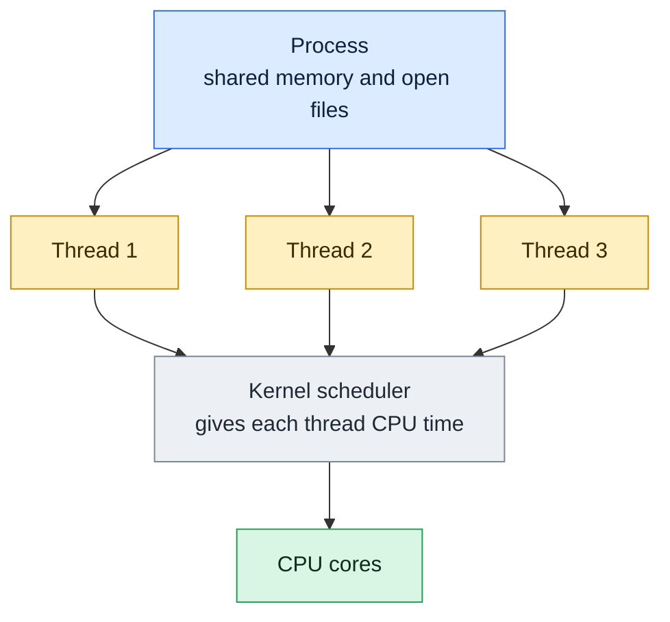

# Threads: Software and Hardware

## What is it?
The word **thread** means two different things, and mixing them is the most common confusion:

- A **software thread** is a path of execution **inside a process**. A process starts with one thread and can create more. All threads of a process **share the same memory and open files**, but each has its own stack and CPU registers. The kernel schedules threads, not whole processes.
- A **hardware thread** is a **logical CPU** that the operating system sees. A physical **core** can present two hardware threads (called **SMT**, or **Hyper-Threading** on Intel), so one core with two hardware threads shows up as two CPUs in Linux.

Software threads are what your program creates. Hardware threads are what the CPU offers to run them.

## Syntax
```bash
ps -o pid,nlwp,comm -p PID     # number of threads (NLWP) of a process
ps -L -o pid,lwp,comm -p PID   # one line per thread
nproc                          # number of hardware threads (logical CPUs)
lscpu                          # sockets, cores per socket, threads per core
```

## Visual Overview
> A process owns the memory. Its threads share that memory but each thread runs its own code, and the kernel spreads the threads over the CPU cores.



## Options/Flags
**Process or thread**

| | Process | Thread |
|---|---------|--------|
| Memory | Own private memory | Shared with the other threads of the process |
| Created with | `fork` | `clone` with sharing flags (`pthread_create`) |
| Creation cost | Higher | Lower |
| Communication | Pipes, sockets, shared memory | Directly through shared variables, with locks |
| If one crashes | Others are not affected | The whole process usually dies |
| PID | Own PID | Same PID, own thread ID (TID, shown as `LWP`) |
| Linux kernel view | A task | Also a task, it makes no big difference |

**Software thread terms**

| Term | Meaning |
|------|---------|
| `NLWP` | Number of light weight processes (threads) in `ps` |
| `LWP` / `TID` | Thread ID, the first thread has TID equal to the PID |
| Race condition | Two threads change shared data at the same time and corrupt it |
| Lock (mutex) | Lets only one thread use shared data at a time |
| Deadlock | Threads wait for each other forever |
| Context switch | The kernel stops one thread and runs another on the same CPU |

**Hardware terms**

| Term | Meaning |
|------|---------|
| Socket | A physical CPU chip in the motherboard |
| Core | An independent processing unit inside the chip |
| Hardware thread (logical CPU) | What the OS schedules onto. 2 per core with SMT |
| Logical CPUs | `sockets x cores per socket x threads per core` |
| SMT / Hyper-Threading | Two threads share one core's execution units, they are not twice as fast, usually 10 to 30 percent more throughput |

**Useful commands**

| Command | Description |
|---------|-------------|
| `nproc` | Logical CPUs available to this process |
| `nproc --all` | All logical CPUs |
| `lscpu` | Sockets, cores, threads per core |
| `lscpu -e` | One line per logical CPU with its core |
| `ps -L` / `ps -eLf` | Show threads |
| `top -H` | Show threads in top |
| `taskset -cp PID` | Show or set which CPUs a process may use |

## Usage Examples

### Example 1: How many hardware threads (`nproc`)
**Command:**
```bash
nproc
nproc --all
```
**Sample Output:**
```text
16
16
```
`nproc` respects limits such as `taskset` or a container CPU limit, `--all` does not.

### Example 2: Cores and threads per core (`lscpu`)
**Command:**
```bash
lscpu | grep -E '^(CPU\(s\)|Thread|Core|Socket|Model name)'
```
**Sample Output:**
```text
CPU(s):                                  16
Model name:                              AMD Ryzen 7 5825U with Radeon Graphics
Thread(s) per core:                      2
Core(s) per socket:                      8
Socket(s):                               1
```
`1 socket x 8 cores x 2 threads per core = 16` logical CPUs. This machine has **8 physical cores and 16 hardware threads**.

### Example 3: Which hardware threads share a core (`lscpu -e`)
**Command:**
```bash
lscpu -e | head -5
```
**Sample Output:**
```text
CPU NODE SOCKET CORE L1d:L1i:L2:L3 ONLINE
  0    0      0    0 0:0:0:0          yes
  1    0      0    0 0:0:0:0          yes
  2    0      0    1 1:1:1:0          yes
  3    0      0    1 1:1:1:0          yes
```
CPU 0 and CPU 1 both sit on `CORE 0`, CPU 2 and 3 on `CORE 1`. They are siblings.

### Example 4: Read the sibling list from the kernel
**Command:**
```bash
cat /sys/devices/system/cpu/cpu0/topology/thread_siblings_list
cat /sys/devices/system/cpu/cpu2/topology/thread_siblings_list
cat /sys/devices/system/cpu/online
```
**Sample Output:**
```text
0-1
2-3
0-15
```

### Example 5: Cores and siblings in `/proc/cpuinfo`
**Command:**
```bash
grep -m1 siblings /proc/cpuinfo
grep -m1 'cpu cores' /proc/cpuinfo
```
**Sample Output:**
```text
siblings	: 16
cpu cores	: 8
```
`siblings` counts hardware threads per socket and `cpu cores` counts physical cores.

### Example 6: Software threads of a process
Let's say we have this file `th.py`, a program that starts three extra threads:

**Input file** (`th.py`):
```python
import threading, os, time, subprocess
def work(): time.sleep(2)
ts=[threading.Thread(target=work) for _ in range(3)]
[t.start() for t in ts]
pid=os.getpid()
print(subprocess.run(["ps","-o","pid,nlwp,comm","-p",str(pid)],capture_output=True,text=True).stdout,end="")
print(subprocess.run(["ps","-L","-o","pid,lwp,comm","-p",str(pid)],capture_output=True,text=True).stdout,end="")
print(open("/proc/%d/status"%pid).read().split("Threads:")[1].split("\n")[0].strip())
[t.join() for t in ts]
```

**Command:**
```bash
python3 th.py
```
**Sample Output:**
```text
    PID NLWP COMMAND
   4349    4 python3
    PID     LWP COMMAND
   4349    4349 python3
   4349    4350 python3
   4349    4351 python3
   4349    4352 python3
4
```
One process (`PID 4349`) has four threads: the main thread (`LWP 4349`, same as the PID) and three more. `NLWP` and `Threads:` both say `4`.

### Example 7: Threads share memory, processes do not
Let's say we have this file `mem.py`:

**Input file** (`mem.py`):
```python
import threading, os
x=[0]
def inc(): x[0]+=1
t=threading.Thread(target=inc); t.start(); t.join(); print("thread sees", x[0])
x=[0]
pid=os.fork()
if pid==0:
    x[0]+=1; os._exit(0)
os.waitpid(pid,0); print("process sees", x[0])
```

**Command:**
```bash
python3 mem.py
```
**Sample Output:**
```text
thread sees 1
process sees 0
```
The thread changed the shared list, so the main thread sees `1`. The forked child changed **its own copy**, so the parent still sees `0`.

### Example 8: Threads of a normal process
**Command:**
```bash
ps -o pid,nlwp,comm -p 1
```
**Sample Output:**
```text
    PID NLWP COMMAND
      1    1 systemd
```
A single threaded process has `NLWP` equal to `1`. Servers such as `java`, `mysqld` or `nginx` workers can have dozens or hundreds.

### Example 9: Which CPUs a process may use (`taskset`)
**Command:**
```bash
taskset -cp $$
```
**Sample Output:**
```text
pid 4187's current affinity list: 0-15
```
The shell may run on any of the 16 hardware threads. `taskset -c 0,1 command` would pin a command to CPUs 0 and 1.

## Sample Output
One line that summarises the CPU of a server:

```bash
lscpu | grep -E '^(Thread|Core|Socket)'
```
```text
Thread(s) per core:                      2
Core(s) per socket:                      8
Socket(s):                               1
```

## Pitfalls / Gotchas
- 16 hardware threads is **not** 16 cores. With SMT, two threads on one core compete for the same execution units. Count physical cores for heavy numeric work.
- Using more threads than hardware threads gives no speed up for CPU bound work, it only adds context switches.
- Python has a **Global Interpreter Lock (GIL)**. Python threads do not run Python code on several CPUs at once. Use processes (`multiprocessing`) for CPU bound work, threads for waiting on I/O.
- Threads share memory, so unprotected shared variables cause **race conditions**. Use locks or message passing.
- A crash (segmentation fault) in one thread kills the whole process, unlike separate processes.
- In containers `nproc` can show the host's CPU count while a CPU limit (cgroup quota) allows less. Some runtimes size their thread pools from `nproc` and end up throttled.
- Cloud "vCPU" usually means **one hardware thread**, not one physical core.
- `top` shows processes by default. Press `H` or use `top -H` to see threads.
- Do not confuse `fork` and threads. `fork` copies the process (new PID), a thread shares it (same PID).

## DevOps Use Cases

### Use Case 1: Size a worker pool from the machine
**Situation:** A deployment script sets `workers` for an app server from the CPU count.

**Command:**
```bash
echo "workers=$(nproc)"
```
**Sample Output:**
```text
workers=16
```
A common rule is `2 x cores + 1` for I/O heavy apps and `cores` for CPU heavy apps. Check `lscpu` to know whether `nproc` counts hardware threads.

### Use Case 2: Find a process that leaked threads
**Situation:** A service slowly becomes unresponsive and you suspect thread leaks.

**Command:**
```bash
ps -eo nlwp,pid,comm --sort=-nlwp | head -3
```
**Sample Output:**
```text
NLWP     PID COMMAND
  17     393 dockerd
  16     329 snapd
```
Run it again after a few minutes. A thread count that only grows points to a leak. The values differ on every machine. The limit per user is `ulimit -u`, see [`ulimit`](../process-management/ulimit.md).

### Use Case 3: Pin a noisy batch job to a few CPUs
**Situation:** A nightly job should not use all CPUs of a shared server.

**Command:**
```bash
taskset -c 0,1 sh -c 'taskset -cp $$'
```
**Sample Output:**
```text
pid 1580's current affinity list: 0,1
```

### Use Case 4: Check if SMT is on, for capacity planning
**Situation:** You must know whether the vCPUs on a node are cores or hyper threads.

**Command:**
```bash
lscpu | grep 'Thread(s) per core'
```
**Sample Output:**
```text
Thread(s) per core:                      2
```
`2` means SMT is on and every core presents two logical CPUs. `1` means SMT is off or the CPU does not support it.

## Related Commands
- [Processes](04-processes.md) - the previous page
- [Kernel modules and hardware support](06-kernel-support-and-modules.md) - the next page
- [`lscpu`](../system-info/lscpu.md) - CPU layout
- [`nproc`](../system-info/nproc.md) - logical CPU count
- [`ps`](../process-management/ps.md) - `-L` shows threads
- [`top`](../process-management/top.md) - `-H` shows threads
- [`mpstat`](../system-info/mpstat.md) - load per CPU
- [`ulimit`](../process-management/ulimit.md) - limits on processes and threads
