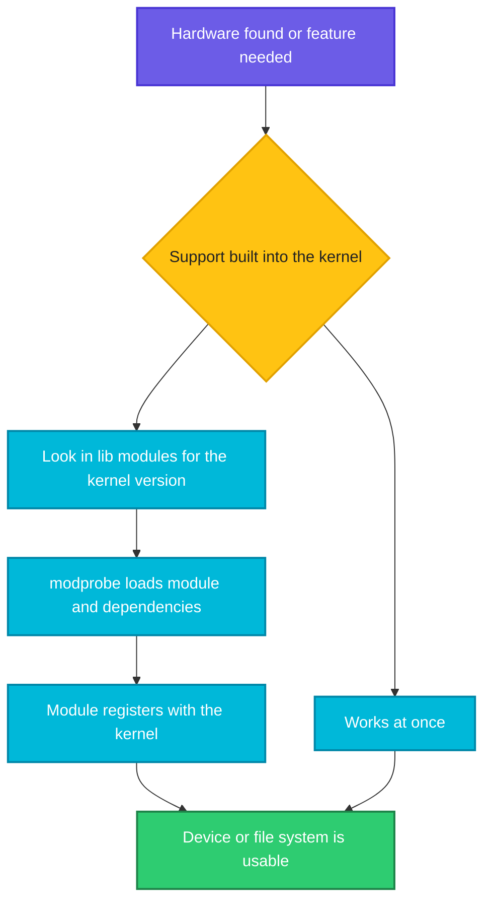

# Kernel Support, Drivers and Modules

## What is it?
"Support" in Linux usually means one of two things:

1. **Hardware and feature support**: can this kernel talk to my disk, network card or file system? That support comes from **drivers** and features built into the kernel or loaded as **kernel modules**.
2. **Kernel version support**: how long will this kernel version get security fixes? That is the **LTS** (long term support) question.

A **kernel module** is a piece of kernel code (a `.ko` file) that can be loaded into the running kernel and removed again, without a reboot. Modules are how Linux supports thousands of devices without making the kernel huge. A module runs in **kernel mode**, so a bad one can crash the system, see [User mode and kernel mode](02-user-mode-and-kernel-mode.md).

## Syntax
```bash
lsmod                       # list loaded modules
modinfo MODULE              # details about a module
sudo modprobe MODULE        # load a module and its dependencies
sudo modprobe -r MODULE     # unload a module
uname -r                    # the running kernel version
```

## Visual Overview
> When hardware appears or a feature is needed, the kernel (or `udev`) loads the matching module from `/lib/modules`. The module registers itself with the kernel and then serves that device or feature.



## Options/Flags
**How a feature is built into Linux**

| Choice | Meaning | Example |
|--------|---------|---------|
| Built in (`y`) | Part of the kernel image, always present | Core scheduler, memory manager |
| Module (`m`) | A `.ko` file loaded on demand | `btrfs`, `xt_nat`, many drivers |
| Not built (`n`) | Not available in this kernel | A driver for hardware you do not have |

**Module commands**

| Command | Description |
|---------|-------------|
| `lsmod` | List loaded modules, size and who uses them |
| `modinfo NAME` | Show file, description, license and dependencies |
| `modprobe NAME` | Load a module and everything it depends on |
| `modprobe -r NAME` | Unload a module (fails if it is in use) |
| `modprobe -n -v NAME` | Dry run, print what would be done |
| `insmod FILE.ko` | Load one `.ko` file without resolving dependencies |
| `rmmod NAME` | Unload a module |
| `depmod` | Rebuild the dependency list in `/lib/modules/<version>/` |

**Where things live**

| Path | Content |
|------|---------|
| `/lib/modules/<kernel-version>/` | The module files for each installed kernel |
| `/proc/modules` | Raw list of loaded modules (what `lsmod` reads) |
| `/sys/module/<name>/` | Run time details and parameters of one module |
| `/etc/modprobe.d/*.conf` | Options, aliases and blacklists |
| `/etc/modules-load.d/*.conf` | Modules to load at boot |
| `/proc/devices` | Device numbers registered by drivers |
| `/proc/sys/kernel/tainted` | `0` clean, non zero if the kernel is marked tainted |

**Kernel version support**

| Term | Meaning |
|------|---------|
| Version `6.18.54` | `major.minor.patch`, the patch number is a bug and security fix release |
| Mainline / stable | The newest kernel, supported for a few months |
| LTS | A kernel chosen for several years of fixes, used by enterprise distros |
| Distro kernel | The kernel the distro ships, with its own patches, for example `5.15.0-91-generic` |
| Out of tree module | A module not shipped with the kernel, for example a GPU or storage vendor driver. It must be rebuilt for each new kernel (DKMS automates this) |

## Usage Examples

### Example 1: List the loaded modules (`lsmod`)
**Command:**
```bash
lsmod | head -4
lsmod | wc -l
```
**Sample Output:**
```text
Module                  Size  Used by
ipt_REJECT             12288  9
nf_reject_ipv4         12288  1 ipt_REJECT
btrfs                1716224  0
40
```
Columns are the module name, its size in bytes, and a use count followed by the modules that use it. `nf_reject_ipv4` is used by `ipt_REJECT`, so it cannot be removed first. The last line shows this kernel has 39 modules loaded (40 lines minus the header).

### Example 2: Raw list from the kernel (`/proc/modules`)
**Command:**
```bash
head -1 /proc/modules
```
**Sample Output:**
```text
ipt_REJECT 12288 9 - Live 0x0000000000000000
```
`lsmod` only formats this file. The address is hidden (all zeros) for normal users.

### Example 3: Details about a module (`modinfo`)
**Command:**
```bash
modinfo -F description btrfs
modinfo -F license btrfs
modinfo -F depends btrfs
modinfo -F filename btrfs
```
**Sample Output:**
```text
B-Tree File System (BTRFS)
GPL
xor,raid6_pq
/lib/modules/6.18.54.1-microsoft-standard-WSL2/kernel/fs/btrfs/btrfs.ko
```
`btrfs` needs `xor` and `raid6_pq`, and `modprobe` loads them first.

### Example 4: Where module files are kept
**Command:**
```bash
uname -r
ls /lib/modules | grep "$(uname -r)"
```
**Sample Output:**
```text
6.18.54.1-microsoft-standard-WSL2
6.18.54.1-microsoft-standard-WSL2
```
Modules are stored per kernel version. A module built for one kernel version does not load into another.

### Example 5: Is a module loaded (`lsmod | grep`)
**Command:**
```bash
lsmod | grep -E '^(btrfs|xt_nat) '
```
**Sample Output:**
```text
btrfs                1716224  0
xt_nat                 12288  22
```
`xt_nat` is used 22 times, `btrfs` is loaded but unused.

### Example 6: Load a module that is already loaded (`modprobe`)
**Command:**
```bash
modprobe xt_nat
echo rc=$?
```
**Sample Output:**
```text
rc=0
```
Nothing is printed on success, and loading a module twice is harmless. Loading a new module needs root.

### Example 7: Dry run (`modprobe -n -v`)
**Command:**
```bash
modprobe -n -v ipt_REJECT
echo rc=$?
```
**Sample Output:**
```text
rc=0
```
The module is already loaded, so there is nothing to do. For an unloaded module `-n -v` prints the `insmod` lines it would run.

### Example 8: A module that does not exist
**Command:**
```bash
modprobe nosuchmod
echo rc=$?
insmod /nonexist.ko
echo rc=$?
```
**Sample Output:**
```text
modprobe: FATAL: Module nosuchmod not found in directory /lib/modules/6.18.54.1-microsoft-standard-WSL2
rc=1
insmod: ERROR: could not load module /nonexist.ko: No such file or directory
rc=1
```
The first message often means the kernel was updated but not rebooted, or the module package is missing.

### Example 9: Run time details in `/sys/module`
**Command:**
```bash
ls /sys/module | wc -l
ls /sys/module/btrfs | head -5
cat /sys/module/btrfs/refcnt
```
**Sample Output:**
```text
142
coresize
holders
initsize
initstate
notes
0
```
`/sys/module` also lists features built into the kernel (142 entries versus 39 loaded modules). `refcnt` is the use count, `holders` lists modules that depend on this one.

### Example 10: Drivers register devices (`/proc/devices`)
**Command:**
```bash
head -5 /proc/devices
```
**Sample Output:**
```text
Character devices:
  1 mem
  4 /dev/vc/0
  4 tty
  4 ttyS
```
Each number is a driver (major number). It matches the `1, 3` you see in `ls -l /dev/null`.

### Example 11: Boot time blacklist files
**Command:**
```bash
ls /etc/modprobe.d | head -3
```
**Sample Output:**
```text
blacklist-ath_pci.conf
blacklist-firewire.conf
blacklist-framebuffer.conf
```
A line `blacklist NAME` in these files stops a module from loading automatically.

### Example 12: Is the kernel tainted
**Command:**
```bash
cat /proc/sys/kernel/tainted
```
**Sample Output:**
```text
0
```
`0` means clean. A non zero number means the kernel loaded a proprietary or unsigned module, or hit an error, and some bug reports will be refused.

### Example 13: Hardware that the kernel found (`lspci`)
**Command:**
```bash
lspci | head -2
```
**Sample Output:**
```text
5582:00:00.0 SCSI storage controller: Red Hat, Inc. Virtio console (rev 01)
5a78:00:00.0 3D controller: Microsoft Corporation Device 008e
```
Each line is a PCI device. A driver (built in or a module) must match it. On real hardware you see network cards, disk controllers and GPUs here. These are virtual devices because the sample was taken on WSL.

## Sample Output
Is a feature supported by this kernel:

```bash
grep -w -c tmpfs /proc/filesystems
```
```text
1
```

## Pitfalls / Gotchas
- Loading, unloading and building modules needs root. A module runs in kernel mode and is not sandboxed. Never load modules from an unknown source.
- `modprobe -r` fails with "Module is in use" while another module or program uses it. Check the `Used by` column of `lsmod`.
- After a kernel update, new modules exist only for the new kernel. Reboot, or modules for the old running kernel may be gone and `modprobe` fails.
- Out of tree drivers (GPU, vendor storage) break after a kernel update unless **DKMS** rebuilds them. Check after upgrades.
- Secure Boot can refuse unsigned modules.
- In a **container** you cannot load modules. The container uses the host kernel, so ask the host to load them.
- `insmod` does not load dependencies, use `modprobe`.
- Names in `lsmod` use underscores, files use hyphens (`nf_conntrack` and `nf-conntrack`). `modprobe` accepts both.
- Do not edit files inside `/lib/modules`. Put settings in `/etc/modprobe.d/`.
- A longer support life does not mean a newer kernel. Use an LTS kernel for servers, a newer kernel only when you need new hardware.

## DevOps Use Cases

### Use Case 1: Kubernetes and Docker prerequisites
**Situation:** A Kubernetes node needs the `overlay` and `br_netfilter` modules, and they must load at every boot.

Let's say we have this file `/etc/modules-load.d/k8s.conf`:

**Input file** (`/etc/modules-load.d/k8s.conf`):
```text
overlay
br_netfilter
```

**Command:**
```bash
for m in xt_nat ipt_REJECT overlay br_netfilter; do
  grep -q "^$m " /proc/modules && echo "$m loaded" || echo "$m missing"
done
```
**Sample Output:**
```text
xt_nat loaded
ipt_REJECT loaded
overlay missing
br_netfilter loaded
```
For every `missing` module run `sudo modprobe NAME` once. The file in `/etc/modules-load.d/` makes the boot load them. Names that are built into the kernel (not modules) also show as missing here, so check `/sys/module/NAME` too.

### Use Case 2: Check that a file system is supported before mounting
**Situation:** Mounting an XFS or NFS volume fails and you must know whether the kernel supports it.

**Command:**
```bash
grep -w -c tmpfs /proc/filesystems
grep -w -c nosuchfs /proc/filesystems
```
**Sample Output:**
```text
1
0
```
`0` means the type is not loaded. Try `modprobe xfs`, or install the package that provides it.

### Use Case 3: Find which modules a firewall rule needs
**Situation:** Firewall rules using NAT or conntrack fail on a minimal image.

**Command:**
```bash
lsmod | grep -E '^(xt_nat|ipt_REJECT)'
```
**Sample Output:**
```text
ipt_REJECT             12288  9
xt_nat                 12288  22
```
If a line is missing, load it with `modprobe` and add it to `/etc/modules-load.d/`.

### Use Case 4: Record kernel and modules in an incident ticket
**Situation:** A bug only appears after an upgrade and the vendor asks for kernel details.

**Command:**
```bash
echo "kernel=$(uname -r) modules=$(($(lsmod | wc -l) - 1)) tainted=$(cat /proc/sys/kernel/tainted)"
```
**Sample Output:**
```text
kernel=6.18.54.1-microsoft-standard-WSL2 modules=39 tainted=0
```

## Related Commands
- [Threads](05-threads.md) - the previous page
- [The kernel and its responsibilities](01-kernel-and-responsibilities.md) - back to the first page
- [`lsmod`](../system-info/lsmod.md) - list loaded modules
- [`modinfo`](../system-info/modinfo.md) - module details
- [`modprobe`](../system-info/modprobe.md) - load and unload modules
- [`dmesg`](../system-info/dmesg.md) - kernel messages when a driver loads
- [`uname`](../system-info/uname.md) - kernel version
- [`lsblk`](../system-info/lsblk.md) - block devices that drivers expose
