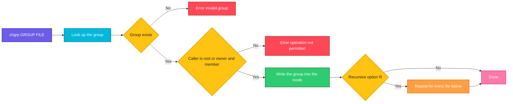

# chgrp

## What is it?
`chgrp` (change group) changes the **group** that owns files and directories. A group is a list of users who share access to files. With the right group on a file and the right group permissions (`chmod g+rw`), a whole team can work with the same file, and nobody else can. `chgrp` does the same as `chown :GROUP`, but it only touches the group, so it cannot change the owner by mistake. A normal user may change the group of their own files to any group that they are a **member** of. `root` may use any group.

## Syntax
```bash
chgrp [OPTIONS] GROUP FILE...
chgrp [OPTIONS] --reference=RFILE FILE...
```
`GROUP` is a group name or a numeric group ID (GID). `FILE` is a file, a directory or a link.

### Who may do what
| Action | Normal user | `root` |
|--------|-------------|--------|
| Change the group of **own** file to a group that he is a **member** of | Yes | Yes |
| Change the group of own file to a group that he is **not** a member of | No | Yes |
| Change the group of a file of **another** user | No | Yes |

To see your groups run `id` or `groups`. The group changes (new membership) apply after a new login, or in a shell started with `newgrp GROUP` or `sg GROUP -c 'command'`.

## Visual Overview
> `chgrp` looks up the group, checks that you may use it, and writes the new group into the inode of each file. The owner and the permission bits stay as they are.



## Options/Flags
| Flag | Description |
|------|-------------|
| `-R` / `--recursive` | Change the files and the directories below a directory, too |
| `-v` / `--verbose` | Print a line for every file that is processed |
| `-c` / `--changes` | Like `-v`, but only for the files that really change |
| `-f` / `--silent` / `--quiet` | Hide most error messages |
| `-h` / `--no-dereference` | Change a symbolic link itself, not the file it points to |
| `--dereference` | Change the file that a symbolic link points to (the default) |
| `--reference=RFILE` | Use the group of the file `RFILE` |
| `-H` | With `-R`, follow a symbolic link that is given on the command line |
| `-L` | With `-R`, follow **all** symbolic links to directories |
| `-P` | With `-R`, do not follow any symbolic links (the default) |
| `--preserve-root` | Refuse to run recursively on `/` |
| `--no-preserve-root` | Do not treat `/` in a special way (the default) |
| `--help` | Show the help text |
| `--version` | Show the version |

## Usage Examples

Let's say we have the server `web01`. We are logged in as the user `deploy` (UID `1001`). The user `deploy` has the primary group `deploy` and is also a member of the groups `www-data` (GID `33`) and `devs` (GID `1002`). `deploy` is **not** a member of the group `root`. We work in the directory `/srv/myapp`. Today is `2026-10-12`. The directory looks like this:

**Input (directory content)** (`/srv/myapp`):
```text
-rw-r--r-- 1 deploy deploy  120 Oct 12 10:00 app.conf
-rw-r--r-- 1 deploy deploy   45 Oct 12 10:00 run.sh
-rw-r--r-- 1 root   root     30 Oct 12 10:00 secrets.env
lrwxrwxrwx 1 deploy deploy    8 Oct 12 10:00 current -> releases
drwxr-xr-x 3 deploy deploy 4096 Oct 12 10:00 releases
```
The directory `releases` holds the file `releases/v1.txt` (`-rw-r--r-- deploy deploy`) and the directory `releases/old` (`drwxr-xr-x deploy deploy`) with the file `releases/old/v0.txt`. Each example starts again from this state.

### Example 1: Change the group of a file
`deploy` owns `app.conf` and is a member of `www-data`, so no `sudo` is needed.

**Command:**
```bash
chgrp www-data app.conf
ls -l app.conf
```
**Sample Output:**
```text
-rw-r--r-- 1 deploy www-data 120 Oct 12 10:00 app.conf
```
The owner is still `deploy`. Only the group changed.

### Example 2: Several files
**Command:**
```bash
chgrp devs app.conf run.sh
ls -l app.conf run.sh
```
**Sample Output:**
```text
-rw-r--r-- 1 deploy devs 120 Oct 12 10:00 app.conf
-rw-r--r-- 1 deploy devs  45 Oct 12 10:00 run.sh
```

### Example 3: Use a numeric group ID
**Command:**
```bash
chgrp 1002 app.conf
ls -l app.conf
```
**Sample Output:**
```text
-rw-r--r-- 1 deploy devs 120 Oct 12 10:00 app.conf
```
`1002` is the GID of `devs`. Numbers are useful for groups that have no name on this server, as in a container volume.

### Example 4: A whole directory tree (`-R`)
**Command:**
```bash
chgrp -R devs releases
ls -lR releases
```
**Sample Output:**
```text
releases:
total 8
drwxr-xr-x 2 deploy devs 4096 Oct 12 10:00 old
-rw-r--r-- 1 deploy devs   21 Oct 12 10:00 v1.txt

releases/old:
total 4
-rw-r--r-- 1 deploy devs   20 Oct 12 10:00 v0.txt
```

### Example 5: Show every file (`-v`)
`-v` prints a line also for the files that do not change.

**Command:**
```bash
chgrp -v devs app.conf
chgrp -v devs app.conf
```
**Sample Output:**
```text
changed group of 'app.conf' from deploy to devs
group of 'app.conf' retained as devs
```

### Example 6: Show only the real changes (`-c`)
**Command:**
```bash
chgrp -c devs app.conf run.sh
chgrp -c devs app.conf run.sh
```
**Sample Output:**
```text
changed group of 'app.conf' from deploy to devs
changed group of 'run.sh' from deploy to devs
```
The second command changes nothing, so it prints nothing.

### Example 7: Hide the errors (`-f`)
`deploy` is not a member of `root`, so this fails.

**Command:**
```bash
chgrp root app.conf
echo "exit code: $?"
chgrp -f root app.conf
echo "exit code: $?"
```
**Sample Output:**
```text
chgrp: changing group of 'app.conf': Operation not permitted
exit code: 1
exit code: 1
```
`-f` hides the message, but the exit code stays `1`.

### Example 8: Change a file of another user needs `sudo`
`secrets.env` belongs to `root`.

**Command:**
```bash
chgrp devs secrets.env
sudo chgrp devs secrets.env
ls -l secrets.env
```
**Sample Output:**
```text
chgrp: changing group of 'secrets.env': Operation not permitted
-rw-r--r-- 1 root devs 30 Oct 12 10:00 secrets.env
```

### Example 9: A symbolic link (`-h` and `--dereference`)
By default `chgrp` changes the **target** of a link. With `-h`, it changes the **link** itself.

**Command:**
```bash
chgrp devs current
ls -ld current releases
chgrp -h www-data current
ls -ld current releases
```
**Sample Output:**
```text
lrwxrwxrwx 1 deploy deploy 8 Oct 12 10:00 current -> releases
drwxr-xr-x 3 deploy devs   4096 Oct 12 10:00 releases
lrwxrwxrwx 1 deploy www-data 8 Oct 12 10:00 current -> releases
drwxr-xr-x 3 deploy devs   4096 Oct 12 10:00 releases
```
The first command changed `releases`. The second one changed the link `current`. `--dereference` is the default and means the same as the first command.

### Example 10: Copy the group of another file (`--reference`)
First give the directory `releases` the group `devs`. Then give `run.sh` and `app.conf` the same group, without typing its name.

**Command:**
```bash
chgrp devs releases
chgrp -v --reference=releases run.sh app.conf
```
**Sample Output:**
```text
changed group of 'run.sh' from deploy to devs
changed group of 'app.conf' from deploy to devs
```

### Example 11: Recursion and symbolic links (`-H`, `-L`, `-P`)
`current` is a link to `releases`.

**Command:**
```bash
chgrp -R -P devs current
chgrp -R -H devs current
chgrp -R -L devs current
```
**Sample Output:**
```text
```
There is no output. What happens:
- `-P` (default): only the link `current` is processed, and with `-P` the target is not followed. Use `-h` to change the link itself.
- `-H`: the link `current` is given on the command line, so it is followed. `releases` and all the files below change.
- `-L`: all the links to directories that are found during the walk are followed. This can change files outside of the tree. Use it with care.

### Example 12: A group that does not exist
**Command:**
```bash
chgrp nosuchgroup app.conf
echo "exit code: $?"
```
**Sample Output:**
```text
chgrp: invalid group: ‘nosuchgroup’
exit code: 1
```

### Example 13: A file that does not exist
**Command:**
```bash
chgrp devs nonexistent.txt
```
**Sample Output:**
```text
chgrp: cannot access 'nonexistent.txt': No such file or directory
```

### Example 14: Protect against `chgrp -R` on `/` (`--preserve-root`)
**Command:**
```bash
sudo chgrp -R --preserve-root devs /
```
**Sample Output:**
```text
chgrp: it is dangerous to operate recursively on '/'
chgrp: use --no-preserve-root to override this failsafe
```

### Example 15: A new group membership is not active yet
You were added to the group `docker` with `usermod -aG docker deploy`, but your current session does not know it.

**Command:**
```bash
id -nG
chgrp docker run.sh
newgrp docker
chgrp docker run.sh
```
**Sample Output:**
```text
deploy www-data devs
chgrp: changing group of 'run.sh': Operation not permitted
```
`newgrp docker` opens a new shell that has the group `docker` as its active group. The second `chgrp` then works and prints nothing. A new login does the same.

### Example 16: Check the version (`--version`)
**Command:**
```bash
chgrp --version | head -n 1
```
**Sample Output:**
```text
chgrp (GNU coreutils) 8.32
```

### Example 17: Show the help (`--help`)
**Command:**
```bash
chgrp --help | head -n 3
```
**Sample Output:**
```text
Usage: chgrp [OPTION]... GROUP FILE...
  or:  chgrp [OPTION]... --reference=RFILE FILE...
Change the group of each FILE to GROUP.
```

## Pitfalls / Gotchas
- **`chgrp` alone does not give the group any access.** The group permission bits must allow it. Use `chmod g+rw file` (or `g+rwX` for trees) after `chgrp`.
- **A directory with the setgid bit** (`chmod g+s dir`) gives new files inside it the **group of the directory**. Without it, new files get the primary group of the user who creates them. Combine `chgrp` and `chmod 2775` for shared directories.
- **A normal user can only choose from their own groups.** `chgrp: changing group of 'file': Operation not permitted` means that you do not own the file, or you are not a member of that group. Check with `id`.
- **Group changes need a new login.** After `usermod -aG`, open a new session (or use `newgrp`) before `chgrp` works.
- **A recursive change can be slow on huge trees,** and it changes the `ctime` of every file.
- **`-R` with `-L` can leave the directory tree** and change files elsewhere. Use `-P` (default) or `-H`.
- **A typo in the path of `chgrp -R` can be costly.** Quote variables and use `--preserve-root`.
- **Numeric group IDs differ between systems.** `docker` can be `999` on one host and `998` on another. A volume remembers the number, not the name.
- **`chgrp` changes the `ctime` but not the `mtime`,** so a backup tool that looks only at the modification time will not notice the change.
- **Changing the group clears the setuid and setgid bits** of a file on most systems. Set them again with `chmod`.
- **For both owner and group use `chown user:group`.** `chgrp` is the safer choice when you want to change only the group.
- **`chgrp` does not create groups.** Use `groupadd` first.

## DevOps Use Cases

### Use Case 1: Give a service group read access to a config file
**Situation:** The service `myapp` runs as the group `myapp` and must read `/etc/myapp/app.conf`, which has a database password. The file must not be readable for others.

**Input file** (`/etc/myapp/app.conf`): `-rw------- 1 root root`.

**Command:**
```bash
sudo chgrp myapp /etc/myapp/app.conf
sudo chmod 640 /etc/myapp/app.conf
ls -l /etc/myapp/app.conf
```
**Output:**
```text
-rw-r----- 1 root myapp 120 Oct 12 10:00 /etc/myapp/app.conf
```
The owner `root` can read and write, the group `myapp` can read, and others have no access.

### Use Case 2: A shared directory for a team
**Situation:** The team `devs` works in `/srv/shared`. Everybody in the group must read, create and change files there. New files must get the group `devs` automatically.

**Command:**
```bash
sudo mkdir -p /srv/shared
sudo chgrp devs /srv/shared
sudo chmod 2770 /srv/shared
ls -ld /srv/shared
```
**Output:**
```text
drwxrws--- 2 root devs 4096 Oct 12 10:00 /srv/shared
```
`rws` means that the group has read, write and execute, and the setgid bit is set. Others have no access.

### Use Case 3: Allow a user to use Docker
**Situation:** The user `deploy` must be able to talk to the Docker socket without `sudo`. The socket belongs to the group `docker`.

**Command:**
```bash
ls -l /var/run/docker.sock
sudo usermod -aG docker deploy
id deploy
```
**Output:**
```text
srw-rw---- 1 root docker 0 Oct 12 09:00 /var/run/docker.sock
uid=1001(deploy) gid=1001(deploy) groups=1001(deploy),33(www-data),1002(devs),999(docker)
```
The user must log in again. Be careful: access to the Docker socket means control of the whole host (it is like `root`).

### Use Case 4: Let the web server read the application files
**Situation:** `nginx` runs as `www-data` and must read the static files, but must not write. The files belong to the deployment user.

**Command:**
```bash
sudo chgrp -R www-data /var/www/site
sudo find /var/www/site -type d -exec chmod 750 {} +
sudo find /var/www/site -type f -exec chmod 640 {} +
ls -l /var/www/site
```
**Output:**
```text
total 8
drwxr-x--- 2 deploy www-data 4096 Oct 12 10:00 assets
-rw-r----- 1 deploy www-data  512 Oct 12 10:00 index.html
```
The deployment user `deploy` can change the files. The web server (in the group) can read them. Others have no access.

### Use Case 5: Fix the group of files that were created with the wrong group
**Situation:** Files in a project directory belong to the group `deploy`, but the project group is `devs`. Find and fix only the files with a different group, without touching the others.

**Command:**
```bash
find /srv/project ! -group devs -print
chgrp -R -c devs /srv/project
```
**Output:**
```text
/srv/project/notes.txt
/srv/project/build/out.log
changed group of '/srv/project/notes.txt' from deploy to devs
changed group of '/srv/project/build/out.log' from deploy to devs
```

### Use Case 6: Log files readable by a monitoring group
**Situation:** The monitoring agent runs as a member of the group `adm`, and needs to read `/var/log/myapp`. `logrotate` creates new files, so the settings go into its configuration.

**Input file** (`/etc/logrotate.d/myapp`):
```text
/var/log/myapp/*.log {
    daily
    rotate 7
    create 0640 myapp adm
}
```
**Command:**
```bash
sudo chgrp -R adm /var/log/myapp
sudo chmod -R g+rX /var/log/myapp
ls -l /var/log/myapp
```
**Output:**
```text
-rw-r----- 1 myapp adm 5242880 Oct 12 10:00 app.log
```
`create 0640 myapp adm` makes sure that new logs after a rotation get the same owner, group and mode.

### Use Case 7: Prepare a volume for a container with a fixed group
**Situation:** A container runs with the group `2000` (a `fsGroup` in Kubernetes). The host directory must have this group, and be writable for it.

**Command:**
```bash
sudo chgrp 2000 /data/app
sudo chmod 2775 /data/app
ls -ldn /data/app
```
**Output:**
```text
drwxrwsr-x 2 0 2000 4096 Oct 12 10:00 /data/app
```
In Kubernetes, `securityContext.fsGroup: 2000` makes the kubelet do this for you on supported volumes.

### Use Case 8: Hand a file to the group of a reference file
**Situation:** New files should get exactly the group of an existing, correct file.

**Command:**
```bash
chgrp --reference=/srv/shared/README.md /srv/shared/new-notes.md
stat -c '%G %n' /srv/shared/README.md /srv/shared/new-notes.md
```
**Output:**
```text
devs /srv/shared/README.md
devs /srv/shared/new-notes.md
```

### Use Case 9: Audit the group ownership of sensitive files
**Situation:** A compliance check wants a list of all files in `/etc` that belong to a group other than `root`, with their mode.

**Command:**
```bash
sudo find /etc -xdev -type f ! -group root -printf '%g %m %p\n' | head -n 3
```
**Output:**
```text
shadow 640 /etc/shadow
ssl-cert 640 /etc/ssl/private/server.key
myapp 640 /etc/myapp/app.conf
```
These are the files that are meant to be readable for a special group. Any other file in this list needs a look.

## Related Commands
- [`chmod`](chmod.md) - change the permissions (the group bits decide what the group may do)
- [`chown`](chown.md) - change the owner, or the owner and the group
- [`umask`](umask.md) - the default permissions of new files
- [`ls`](../file-management/ls.md) - show the group with `ls -l`
- [`find`](../file-management/find.md) - find files by group (`-group`, `-nogroup`)
- [`mkdir`](../file-management/mkdir.md) - create the shared directory
- [`sudo`](../user-management/sudo.md) - run `chgrp` as `root`
- [`whoami`](../user-management/whoami.md) - show the current user
- `id` / `groups` - show the groups of a user
- `newgrp` / `sg` - use a group that was added after the login
- `usermod -aG` / `gpasswd` - add a user to a group
- `groupadd` - create a group
- `stat` - show the group in detail (`stat -c '%G'`)
