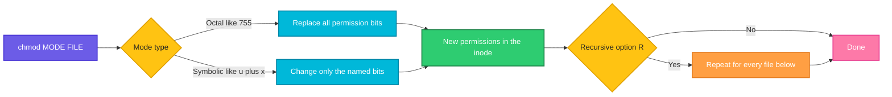

# chmod

## What is it?
`chmod` (change mode) changes the **permissions** of files and directories: who may **read**, **write** and **execute** them. Every file has three groups of permissions: for the **owner** (user), for the **group** and for **others** (everybody else). You can write the new permissions as a number (`chmod 755 file`) or in symbolic form (`chmod u+x file`). Only the owner of a file, or `root`, can change its permissions.

## Syntax
```bash
chmod [OPTIONS] MODE[,MODE]... FILE...
chmod [OPTIONS] OCTAL-MODE FILE...
chmod [OPTIONS] --reference=RFILE FILE...
```
A **mode** is either an octal number (`755`) or a symbolic expression (`u+x`, `go-w`, `a=r`).

### Reading `ls -l`
```text
-rwxr-xr-- 1 deploy deploy 120 Oct 12 10:00 run.sh
│└┬┘└┬┘└┬┘
│ │  │  └─ others:  r--  (read)
│ │  └──── group:   r-x  (read and execute)
│ └─────── owner:   rwx  (read, write and execute)
└───────── type:    -  file,  d  directory,  l  symbolic link
```

### What the permissions mean
| Permission | On a **file** | On a **directory** |
|------------|---------------|--------------------|
| `r` (read, 4) | Read the content | List the names of the files in it (`ls`) |
| `w` (write, 2) | Change the content | Create, delete and rename the files in it (needs `x` too) |
| `x` (execute, 1) | Run it as a program | Enter it (`cd`) and reach the files in it |

### Octal (numeric) modes
Each digit is the sum of `r=4`, `w=2` and `x=1`. The three digits are for the owner, the group and others.

| Digit | Permissions | Digit | Permissions |
|-------|-------------|-------|-------------|
| `0` | `---` | `4` | `r--` |
| `1` | `--x` | `5` | `r-x` |
| `2` | `-w-` | `6` | `rw-` |
| `3` | `-wx` | `7` | `rwx` |

| Mode | Symbolic | Typical use |
|------|----------|-------------|
| `600` | `rw-------` | Private files: SSH keys, secrets, `.env` |
| `644` | `rw-r--r--` | Normal files: configs, web pages |
| `664` | `rw-rw-r--` | Files shared with a group |
| `640` | `rw-r-----` | Config with passwords, readable by a service group |
| `700` | `rwx------` | Private directories and scripts, `~/.ssh` |
| `750` | `rwxr-x---` | Directories shared with one group |
| `755` | `rwxr-xr-x` | Programs, scripts and public directories |
| `775` | `rwxrwxr-x` | Directories that a group writes to |
| `777` | `rwxrwxrwx` | Everybody can do everything. Avoid it |
| `400` | `r--------` | Read-only secrets (a private key) |
| `444` | `r--r--r--` | Read-only for everybody |

### Special bits (a fourth digit in front)
| Octal | Symbolic | Name | On a file | On a directory |
|-------|----------|------|-----------|----------------|
| `4000` | `u+s` | setuid | The program runs with the rights of the **owner** (`passwd`, `sudo`) | No effect |
| `2000` | `g+s` | setgid | The program runs with the rights of the **group** | New files get the **group of the directory** |
| `1000` | `+t` | sticky | No effect (old systems) | Only the owner of a file (or of the directory) can delete or rename it (`/tmp`) |

In `ls -l`, setuid shows as `s` in the owner's `x` position, setgid as `s` in the group's `x` position and the sticky bit as `t` in the last position. A capital `S` or `T` means that the special bit is set but the `x` bit below it is **not**.

## Visual Overview
> `chmod` reads the mode, combines it with the current permissions of each file and writes the new permissions into the inode of the file. The content of the file does not change.



## Options/Flags

### Options
| Flag | Description |
|------|-------------|
| `-R` / `--recursive` | Change the files and the directories below a directory, too |
| `-v` / `--verbose` | Print a line for every file that is processed |
| `-c` / `--changes` | Like `-v`, but only for the files whose permissions really change |
| `-f` / `--silent` / `--quiet` | Hide most error messages |
| `--reference=RFILE` | Use the permissions of the file `RFILE` instead of a mode |
| `--preserve-root` | Refuse to run recursively on `/` |
| `--no-preserve-root` | Do not treat `/` in a special way (the default) |
| `--help` | Show the help text |
| `--version` | Show the version |

### Symbolic mode: `[WHO][OPERATOR][PERMISSIONS]`
| Part | Value | Meaning |
|------|-------|---------|
| Who | `u` | The user (owner) |
| | `g` | The group |
| | `o` | Others |
| | `a` | All (`u`, `g` and `o`). Used when you give nothing, but then the `umask` is applied |
| Operator | `+` | Add the permissions |
| | `-` | Remove the permissions |
| | `=` | Set exactly these permissions (and remove the others) |
| Permission | `r` `w` `x` | Read, write, execute |
| | `X` | Execute only for directories, and for files that already have `x` for somebody |
| | `s` | setuid (with `u`) or setgid (with `g`) |
| | `t` | The sticky bit |
| | `u` `g` `o` | Copy the permissions that the user, the group or others have now |

Several changes are joined with a comma: `u=rwx,g=rx,o=`.

## Usage Examples

Let's say we have the server `web01`. We are logged in as the user `deploy` (UID `1001`, group `deploy`). We work in the directory `/srv/myapp`. Today is `2026-10-12`. This is the content of the directory:

**Input (directory content)** (`/srv/myapp`):
```text
-rw-r--r-- 1 deploy deploy  120 Oct 12 10:00 app.conf
-rw-r--r-- 1 deploy deploy   45 Oct 12 10:00 run.sh
-rw-r--r-- 1 deploy deploy   30 Oct 12 10:00 secrets.env
drwxr-xr-x 3 deploy deploy 4096 Oct 12 10:00 data
```
The directory `data` holds the file `data/a.csv` (`-rw-r--r--`) and the sub directory `data/sub` (`drwxr-xr-x`) with the file `data/sub/b.csv` (`-rw-r--r--`).

**Input file** (`run.sh`):
```text
#!/bin/bash
echo "hello from run.sh"
```
Each example starts again from this state.

### Example 1: Make a script executable (`u+x`)
Without the `x` bit, `./run.sh` gives `Permission denied`.

**Command:**
```bash
./run.sh
chmod u+x run.sh
ls -l run.sh
./run.sh
```
**Sample Output:**
```text
bash: ./run.sh: Permission denied
-rwxr--r-- 1 deploy deploy 45 Oct 12 10:00 run.sh
hello from run.sh
```

### Example 2: Set the permissions with an octal number
**Command:**
```bash
chmod 755 run.sh
ls -l run.sh
```
**Sample Output:**
```text
-rwxr-xr-x 1 deploy deploy 45 Oct 12 10:00 run.sh
```
`7` = `rwx` for the owner, `5` = `r-x` for the group, `5` = `r-x` for others.

### Example 3: Private file (`600`)
**Command:**
```bash
chmod 600 secrets.env
ls -l secrets.env
```
**Sample Output:**
```text
-rw------- 1 deploy deploy 30 Oct 12 10:00 secrets.env
```
Only the owner can read and write the file.

### Example 4: Add permissions for the group and others (`g+w`, `o+r`)
**Command:**
```bash
chmod g+w app.conf
ls -l app.conf
chmod o-r app.conf
ls -l app.conf
```
**Sample Output:**
```text
-rw-rw-r-- 1 deploy deploy 120 Oct 12 10:00 app.conf
-rw-rw---- 1 deploy deploy 120 Oct 12 10:00 app.conf
```

### Example 5: Set exact permissions (`=`)
`=` replaces the permissions of the chosen group. `go=` removes everything for the group and others.

**Command:**
```bash
chmod u=rw,go= app.conf
ls -l app.conf
chmod g=rx app.conf
ls -l app.conf
```
**Sample Output:**
```text
-rw------- 1 deploy deploy 120 Oct 12 10:00 app.conf
-rw-r-x--- 1 deploy deploy 120 Oct 12 10:00 app.conf
```

### Example 6: Change several classes at once (`a`, `ug` and a comma)
**Command:**
```bash
chmod a+r app.conf
chmod ug+x,o-rwx run.sh
ls -l app.conf run.sh
```
**Sample Output:**
```text
-rw-r--r-- 1 deploy deploy 120 Oct 12 10:00 app.conf
-rwxr-x--- 1 deploy deploy  45 Oct 12 10:00 run.sh
```

### Example 7: No "who" given (`+x`)
Without `u`, `g`, `o` or `a`, the change applies to all, but the bits that are set in your `umask` are not touched. With the usual `umask` `022`, `+w` only gives write to the owner.

**Command:**
```bash
chmod +x run.sh
ls -l run.sh
chmod +w app.conf
ls -l app.conf
```
**Sample Output:**
```text
-rwxr-xr-x 1 deploy deploy 45 Oct 12 10:00 run.sh
-rw-r--r-- 1 deploy deploy 120 Oct 12 10:00 app.conf
```
`+x` is applied to all three classes. `+w` changed nothing, because the owner already had `w`, and group and others are blocked by the `umask`. Write `a+w` or `g+w` to be explicit.

### Example 8: Copy the permissions of another class (`g=u`)
**Command:**
```bash
chmod u+x run.sh
chmod g=u run.sh
ls -l run.sh
```
**Sample Output:**
```text
-rwxrwxr-- 1 deploy deploy 45 Oct 12 10:00 run.sh
```
`g=u` gives the group the same permissions as the owner (`rwx`).

### Example 9: Capital `X`: execute only for directories
`X` sets the `x` bit on directories (and on files that are already executable), but not on normal files. It is perfect for recursive changes.

**Command:**
```bash
chmod -R u+rwX,g+rX,o-rwx data
ls -ld data data/sub
ls -l data/a.csv
```
**Sample Output:**
```text
drwxr-x--- 3 deploy deploy 4096 Oct 12 10:00 data
drwxr-x--- 2 deploy deploy 4096 Oct 12 10:00 data/sub
-rw-r----- 1 deploy deploy   55 Oct 12 10:00 data/a.csv
```
The directories got `x` (so you can enter them). The files did not.

### Example 10: Recursive change (`-R`)
**Command:**
```bash
chmod -R 750 data
ls -lR data
```
**Sample Output:**
```text
data:
total 8
-rwxr-x--- 1 deploy deploy   55 Oct 12 10:00 a.csv
drwxr-x--- 2 deploy deploy 4096 Oct 12 10:00 sub

data/sub:
total 4
-rwxr-x--- 1 deploy deploy   32 Oct 12 10:00 b.csv
```
Careful: `750` also made the CSV files executable. Example 9 or Use Case 3 are better for mixed trees.

### Example 11: Show what is done (`-v`)
`-v` prints a line for every file, also if nothing changes.

**Command:**
```bash
chmod -v 755 run.sh app.conf
chmod -v 755 run.sh
```
**Sample Output:**
```text
mode of 'run.sh' changed from 0644 (rw-r--r--) to 0755 (rwxr-xr-x)
mode of 'app.conf' changed from 0644 (rw-r--r--) to 0755 (rwxr-xr-x)
mode of 'run.sh' retained as 0755 (rwxr-xr-x)
```

### Example 12: Show only the real changes (`-c`)
**Command:**
```bash
chmod -c 755 run.sh
chmod -c 755 run.sh
```
**Sample Output:**
```text
mode of 'run.sh' changed from 0644 (rw-r--r--) to 0755 (rwxr-xr-x)
```
The second command changed nothing, so `-c` prints nothing.

### Example 13: Hide the errors (`-f`)
**Command:**
```bash
chmod 644 nonexistent.txt
echo "exit code: $?"
chmod -f 644 nonexistent.txt
echo "exit code: $?"
```
**Sample Output:**
```text
chmod: cannot access 'nonexistent.txt': No such file or directory
exit code: 1
exit code: 1
```
`-f` hides the message, but the exit code is still `1`.

### Example 14: Copy the permissions of another file (`--reference`)
**Command:**
```bash
chmod 640 app.conf
chmod --reference=app.conf secrets.env
ls -l app.conf secrets.env
```
**Sample Output:**
```text
-rw-r----- 1 deploy deploy 120 Oct 12 10:00 app.conf
-rw-r----- 1 deploy deploy  30 Oct 12 10:00 secrets.env
```

### Example 15: Setuid, setgid and sticky bit with octal numbers
The extra first digit sets the special bits.

**Command:**
```bash
chmod 4755 run.sh
ls -l run.sh
chmod 2775 data
ls -ld data
chmod 1777 data/sub
ls -ld data/sub
```
**Sample Output:**
```text
-rwsr-xr-x 1 deploy deploy   45 Oct 12 10:00 run.sh
drwxrwsr-x 3 deploy deploy 4096 Oct 12 10:00 data
drwxrwxrwt 2 deploy deploy 4096 Oct 12 10:00 data/sub
```
`s` in the owner position is setuid, `s` in the group position is setgid, `t` at the end is the sticky bit.

### Example 16: Special bits in symbolic form (`u+s`, `g+s`, `+t`)
**Command:**
```bash
chmod u+s run.sh
chmod g+s data
chmod +t data/sub
ls -l run.sh
ls -ld data data/sub
```
**Sample Output:**
```text
-rwSr--r-- 1 deploy deploy   45 Oct 12 10:00 run.sh
drwxr-sr-x 3 deploy deploy 4096 Oct 12 10:00 data
drwxr-xr-t 2 deploy deploy 4096 Oct 12 10:00 data/sub
```
`run.sh` shows `S` (capital), because setuid is set but the file has no `x` for the owner.

### Example 17: Remove a special bit (`u-s`, `g-s`, `-t`)
**Command:**
```bash
chmod 4755 run.sh
chmod u-s run.sh
ls -l run.sh
chmod 0755 data
ls -ld data
```
**Sample Output:**
```text
-rwxr-xr-x 1 deploy deploy   45 Oct 12 10:00 run.sh
drwxr-xr-x 3 deploy deploy 4096 Oct 12 10:00 data
```
An octal mode with four digits (`0755`) clears the special bits. With only three digits (`755`) the special bits of a **directory** are left alone, but those of a file are cleared on some systems.

### Example 18: Remove all access (`000`)
**Command:**
```bash
chmod 000 secrets.env
ls -l secrets.env
cat secrets.env
```
**Sample Output:**
```text
---------- 1 deploy deploy 30 Oct 12 10:00 secrets.env
cat: secrets.env: Permission denied
```
The owner can still change the permissions again with `chmod`.

### Example 19: You can only change your own files
**Command:**
```bash
chmod 644 /etc/hostname
sudo chmod 644 /etc/hostname
```
**Sample Output:**
```text
chmod: changing permissions of '/etc/hostname': Operation not permitted
```
The first command fails, because `/etc/hostname` belongs to `root`. With `sudo` it works, and prints nothing.

### Example 20: A bad mode
**Command:**
```bash
chmod 999 run.sh
chmod u+z run.sh
```
**Sample Output:**
```text
chmod: invalid mode: ‘999’
Try 'chmod --help' for more information.
chmod: invalid mode: ‘u+z’
Try 'chmod --help' for more information.
```

### Example 21: A file name that starts with a dash
**Command:**
```bash
touch -- -weird
chmod 600 -- -weird
ls -l -- -weird
```
**Sample Output:**
```text
-rw------- 1 deploy deploy 0 Oct 12 10:00 -weird
```
`--` ends the options, so `-weird` is read as a file name.

### Example 22: A mode that starts with a dash
A symbolic mode like `-x` looks like an option. Use `--` or the form `a-x`.

**Command:**
```bash
chmod a-x run.sh
chmod -- -x run.sh
```
**Sample Output:**
```text
```
Both commands remove the `x` bit and print nothing. `chmod -x run.sh` also works in `chmod`, which understands it as a mode.

### Example 23: Refuse to change the root directory (`--preserve-root`)
**Command:**
```bash
sudo chmod -R --preserve-root 755 /
```
**Sample Output:**
```text
chmod: it is dangerous to operate recursively on '/'
chmod: use --no-preserve-root to override this failsafe
```
Use `--preserve-root` as a safety net in scripts. Do not use `--no-preserve-root` unless you really want it.

### Example 24: Symbolic links are not changed
`chmod` follows a symbolic link and changes the **target**. It never changes the permissions of the link itself.

**Command:**
```bash
ln -s run.sh link.sh
ls -l link.sh
chmod 700 link.sh
ls -l link.sh run.sh
```
**Sample Output:**
```text
lrwxrwxrwx 1 deploy deploy  6 Oct 12 10:00 link.sh -> run.sh
lrwxrwxrwx 1 deploy deploy  6 Oct 12 10:00 link.sh -> run.sh
-rwx------ 1 deploy deploy 45 Oct 12 10:00 run.sh
```
The link is always `rwxrwxrwx`. Only `run.sh` changed.

### Example 25: Check the version (`--version`)
**Command:**
```bash
chmod --version | head -n 1
```
**Sample Output:**
```text
chmod (GNU coreutils) 8.32
```

### Example 26: Show the help (`--help`)
**Command:**
```bash
chmod --help | head -n 3
```
**Sample Output:**
```text
Usage: chmod [OPTION]... MODE[,MODE]... FILE...
  or:  chmod [OPTION]... OCTAL-MODE FILE...
  or:  chmod [OPTION]... --reference=RFILE FILE...
```

## Pitfalls / Gotchas
- **Never use `chmod -R 777`.** It gives everybody the right to change everything, and makes all files executable. It is a security risk, and it hides the real problem (a wrong owner or group). Use `chown`/`chgrp` and the exact permissions.
- **Files and directories need different modes.** A directory needs `x` to be entered, but normal files usually should not be executable. `chmod -R 755` makes every data file executable. Use `X`, or `find -type d` and `find -type f`.
- **A directory without `x` is closed,** even if it has `r`: you see the names but cannot open the files. A directory without `r` but with `x` lets you open a file only if you know its name.
- **Delete rights come from the directory,** not from the file. To delete a file you need `w` and `x` on the **directory**. The permissions of the file do not matter. The sticky bit changes this (see `/tmp`).
- **`chmod` does not change the owner.** If a service still cannot read a file with `644`, check the owner and the group (`ls -l`), and the permissions of **all the parent directories** (`namei -l /path/to/file`).
- **Symbolic `+w` or `+x` without a "who"** uses the `umask`. Write `a+x` if you want to be sure.
- **Scripts need `x` and a good interpreter line** (`#!/bin/bash`). A file with `x` but without `#!` can fail with `exec format error` when started from other programs.
- **The setuid bit on shell scripts is ignored** by Linux, for security. It works only for compiled programs.
- **Capital `S` and `T` are a warning sign.** The special bit is set, but the `x` bit is missing, so it has no real effect.
- **Octal numbers need to be octal.** `chmod 0755` and `chmod 755` are the same, but `chmod 8` is not valid. Leading `0` is for the special bits.
- **Network and special file systems** (NFS with root squash, FAT, NTFS, WSL mounts, some Docker volumes) can ignore or refuse `chmod`.
- **ACLs add more rights.** With `getfacl`, a file with `rw-r--r--` can still be writable for a named user. `chmod` on a file with ACLs changes the ACL mask, not just the group bits.
- **Git only stores the executable bit** (`755` or `644`), not other modes.

## DevOps Use Cases

### Use Case 1: Fix `Permission denied` when you start a script
**Situation:** A deploy script from a Git repository is not executable on the server, and the pipeline fails.

**Input file** (`run.sh`): same file as in the Usage Examples.

**Command:**
```bash
./run.sh
chmod +x run.sh && ./run.sh
```
**Output:**
```text
bash: ./run.sh: Permission denied
hello from run.sh
```
Make it permanent for the repository with `git update-index --chmod=+x run.sh`.

### Use Case 2: Lock down an SSH private key
**Situation:** `ssh` refuses a key file with `WARNING: UNPROTECTED PRIVATE KEY FILE!`, because it is readable by others.

**Input (directory content)** (`~/.ssh`): `id_ed25519` with the mode `-rw-r--r--`.

**Command:**
```bash
ssh -i ~/.ssh/id_ed25519 web01
chmod 600 ~/.ssh/id_ed25519
chmod 700 ~/.ssh
ssh -i ~/.ssh/id_ed25519 web01 hostname
```
**Output:**
```text
@@@@@@@@@@@@@@@@@@@@@@@@@@@@@@@@@@@@@@@@@@@@@@@@@@@@@@@@@@@
@         WARNING: UNPROTECTED PRIVATE KEY FILE!          @
@@@@@@@@@@@@@@@@@@@@@@@@@@@@@@@@@@@@@@@@@@@@@@@@@@@@@@@@@@@
Permissions 0644 for '/home/deploy/.ssh/id_ed25519' are too open.
Load key "/home/deploy/.ssh/id_ed25519": bad permissions
web01
```
The rules for SSH: the directory `700`, private keys `600`, `authorized_keys` `600` or `644`, and the home directory not writable by the group or others.

### Use Case 3: Set the right modes for a web root (directories and files)
**Situation:** Deploy a website. Directories must be `755`, and files `644`, and nothing must be executable. `find` selects the type.

**Input (directory content)** (`/var/www/site`): a mix of directories and files with the mode `777`.

**Command:**
```bash
find /var/www/site -type d -exec chmod 755 {} +
find /var/www/site -type f -exec chmod 644 {} +
ls -l /var/www/site
```
**Output:**
```text
total 8
drwxr-xr-x 2 www-data www-data 4096 Oct 12 10:00 assets
-rw-r--r-- 1 www-data www-data  512 Oct 12 10:00 index.html
```
The one-line version is `chmod -R u=rwX,go=rX /var/www/site`.

### Use Case 4: A shared directory where new files get the right group (setgid)
**Situation:** The team `devs` works in `/srv/shared`. Files that anybody creates there must belong to the group `devs`, and the group must be able to write.

**Command:**
```bash
sudo chgrp devs /srv/shared
sudo chmod 2775 /srv/shared
touch /srv/shared/report.txt
ls -ld /srv/shared
ls -l /srv/shared/report.txt
```
**Output:**
```text
drwxrwsr-x 2 root devs 4096 Oct 12 10:00 /srv/shared
-rw-r--r-- 1 deploy devs 0 Oct 12 10:00 /srv/shared/report.txt
```
`s` in the group position is the setgid bit. The new file has the group `devs`. To make new files group writable, set `umask 002` for the users.

### Use Case 5: A drop box directory with the sticky bit
**Situation:** Everybody may put files in `/srv/dropbox`, but nobody may delete the files of other users. This is how `/tmp` works.

**Command:**
```bash
sudo chmod 1777 /srv/dropbox
ls -ld /srv/dropbox /tmp
```
**Output:**
```text
drwxrwxrwt 2 root root 4096 Oct 12 10:00 /srv/dropbox
drwxrwxrwt 14 root root 4096 Oct 12 10:00 /tmp
```

### Use Case 6: Remove all access for "others" in a whole tree
**Situation:** An audit says that a data directory is readable by everybody. Remove the access for others, and keep the rest.

**Input (directory content)** (`data`): the directory from the Usage Examples.

**Command:**
```bash
chmod -R o-rwx data
ls -ld data data/sub
ls -l data/a.csv
```
**Output:**
```text
drwxr-x--- 3 deploy deploy 4096 Oct 12 10:00 data
drwxr-x--- 2 deploy deploy 4096 Oct 12 10:00 data/sub
-rw-r----- 1 deploy deploy   55 Oct 12 10:00 data/a.csv
```

### Use Case 7: Find files that everybody can write to (security audit)
**Situation:** A hardening checklist asks for world writable files. Find them and remove the write bit.

**Command:**
```bash
find /srv -xdev -type f -perm -o+w -print
find /srv -xdev -type f -perm -o+w -exec chmod o-w {} +
```
**Output:**
```text
/srv/myapp/upload.tmp
/srv/myapp/old/config.bak
```
The second command removes the write permission and prints nothing.

### Use Case 8: Find the setuid programs on a server
**Situation:** Setuid programs run as `root` and are a target for attacks. List them and compare with a list of the expected ones.

**Command:**
```bash
find /usr /bin /sbin -xdev -type f -perm -4000 2>/dev/null
```
**Output:**
```text
/usr/bin/passwd
/usr/bin/sudo
/usr/bin/mount
/usr/bin/su
```

### Use Case 9: Give the same permissions to new files as an existing template
**Situation:** A new config file must get exactly the same mode as the reference file `/etc/myapp/app.conf`.

**Command:**
```bash
chmod --reference=/etc/myapp/app.conf /etc/myapp/new.conf
stat -c '%a %U:%G %n' /etc/myapp/app.conf /etc/myapp/new.conf
```
**Output:**
```text
640 root:myapp /etc/myapp/app.conf
640 root:myapp /etc/myapp/new.conf
```
`--reference` copies only the permissions. To copy the owner and the group, use `chown --reference`.

### Use Case 10: Make a file immutable for a deployment user (read only)
**Situation:** A config file must not be changed by accident, even by its owner. Remove the write bit. Editors will warn when you try to save.

**Input file** (`app.conf`): same file as in the Usage Examples.

**Command:**
```bash
chmod a-w app.conf
echo "port=9090" >> app.conf
ls -l app.conf
```
**Output:**
```text
bash: app.conf: Permission denied
-r--r--r-- 1 deploy deploy 120 Oct 12 10:00 app.conf
```
`root` can still write. For a stronger protection use `chattr +i`.

### Use Case 11: Docker and Kubernetes volumes
**Situation:** A container runs as user `1000` and cannot write to a mounted directory. Fix the owner and set safe permissions. A secret mounted from Kubernetes can use a mode in the manifest.

**Input file** (`pod.yaml`):
```text
volumes:
  - name: tls
    secret:
      secretName: web-tls
      defaultMode: 0400
```
**Command:**
```bash
sudo chown -R 1000:1000 /data/app
sudo chmod -R u=rwX,g=rX,o= /data/app
ls -ld /data/app
```
**Output:**
```text
drwxr-x--- 4 1000 1000 4096 Oct 12 10:00 /data/app
```
`defaultMode: 0400` in the manifest mounts the secret files as read-only for their owner.

### Use Case 12: A safe default for a CI step that creates a deploy package
**Situation:** The build creates files with different modes, depending on the runner. Normalize them before you pack the artifact.

**Command:**
```bash
find build -type d -exec chmod 755 {} +
find build -type f -exec chmod 644 {} +
chmod 755 build/bin/*
tar czf app.tgz build
tar tvzf app.tgz | head -n 3
```
**Output:**
```text
drwxr-xr-x deploy/deploy     0 2026-10-12 10:00 build/
drwxr-xr-x deploy/deploy     0 2026-10-12 10:00 build/bin/
-rwxr-xr-x deploy/deploy  8421 2026-10-12 10:00 build/bin/app
```

## Related Commands
- [`chown`](chown.md) - change the owner and the group of a file
- [`chgrp`](chgrp.md) - change the group of a file
- [`umask`](umask.md) - the default permissions of new files
- [`ls`](../file-management/ls.md) - show the permissions with `ls -l`
- [`find`](../file-management/find.md) - find files by mode with `-perm`, and change them with `-exec`
- [`mkdir`](../file-management/mkdir.md) - `mkdir -m 700` creates a directory with a mode
- [`touch`](../file-management/touch.md) - create a file, which gets its mode from the `umask`
- [`cp`](../file-management/cp.md) - `cp -p` keeps the permissions, `cp --preserve=mode`
- `stat` - show the mode in octal (`stat -c %a file`)
- `getfacl` / `setfacl` - access control lists, for more exact rights
- `chattr` / `lsattr` - file attributes like the immutable flag
- `namei -l` - show the permissions of each directory on a path
