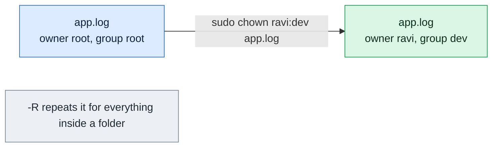

# chown

## What is it?
`chown` (change owner) changes the **owner** and, optionally, the **group** of files and directories. Every file belongs to one user and one group. The permissions (`chmod`) say what the owner, the group and others may do. `chown` says who the owner and the group are. It is one of the first commands to run when a service reports `Permission denied`: a web server that runs as `www-data` can only write to files that belong to it, or to its group. Only `root` can change the owner of a file.

## Syntax
```bash
chown [OPTIONS] OWNER[:GROUP] FILE...
chown [OPTIONS] :GROUP FILE...
chown [OPTIONS] --reference=RFILE FILE...
```
`OWNER` and `GROUP` can be names or numeric IDs (`1001`, `33`).

### Forms of the owner and group argument
| Argument | Effect |
|----------|--------|
| `deploy` | Change the owner only. The group stays |
| `deploy:www-data` | Change the owner **and** the group |
| `deploy:` | Change the owner, and set the group to the **login group** of `deploy` |
| `:www-data` | Change the group only (like `chgrp www-data`) |
| `deploy.www-data` | Old form with a dot instead of a colon. Avoid it, because a name can contain a dot |
| `1001:33` | The same, with numeric user and group IDs |
| `:` | Change nothing. This is a valid command that does nothing |

### Who may do what
| Action | Normal user | `root` |
|--------|-------------|--------|
| Change the **owner** of a file | No (not even to himself) | Yes |
| Change the **group** of own file to a group that he is a **member** of | Yes | Yes |
| Change the group to any group | No | Yes |
| Change files of other users | No | Yes |

## Visual Overview
> `chown` changes the owner and, optionally, the group in one go with `owner:group`. Only root can give a file to someone else.



## Options/Flags
| Flag | Description |
|------|-------------|
| `-R` / `--recursive` | Change the files and the directories below a directory, too |
| `-v` / `--verbose` | Print a line for every file that is processed |
| `-c` / `--changes` | Like `-v`, but only for the files that really change |
| `-f` / `--silent` / `--quiet` | Hide most error messages |
| `-h` / `--no-dereference` | Change a symbolic link itself, not the file it points to |
| `--dereference` | Change the file that a symbolic link points to (the default) |
| `--from=CURRENT_OWNER:CURRENT_GROUP` | Change the owner or the group only for files that have **now** this owner and group |
| `--reference=RFILE` | Use the owner and the group of the file `RFILE` |
| `-H` | With `-R`, follow a symbolic link that is given on the command line |
| `-L` | With `-R`, follow **all** symbolic links to directories |
| `-P` | With `-R`, do not follow any symbolic links (the default) |
| `--preserve-root` | Refuse to run recursively on `/` |
| `--no-preserve-root` | Do not treat `/` in a special way (the default) |
| `--help` | Show the help text |
| `--version` | Show the version |

## Usage Examples

Let's say we have the server `web01`. We are logged in as the user `deploy` (UID `1001`, group `deploy`, which also belongs to the groups `www-data` (GID `33`) and `devs` (GID `1002`)). We work in the directory `/srv/myapp`. Today is `2026-10-12`. The directory looks like this:

**Input (directory content)** (`/srv/myapp`):
```text
-rw-r--r-- 1 deploy deploy  120 Oct 12 10:00 app.conf
-rw-r--r-- 1 deploy deploy   45 Oct 12 10:00 run.sh
-rw-r--r-- 1 root   root     30 Oct 12 10:00 secrets.env
lrwxrwxrwx 1 deploy deploy    8 Oct 12 10:00 current -> releases
drwxr-xr-x 3 deploy deploy 4096 Oct 12 10:00 releases
```
The directory `releases` holds the file `releases/v1.txt` (`-rw-r--r-- deploy deploy`) and the directory `releases/old` (`drwxr-xr-x deploy deploy`) with the file `releases/old/v0.txt`.

Each example starts again from this state. Most examples use `sudo`, because only `root` can change an owner.

### Example 1: Change the owner
**Command:**
```bash
sudo chown www-data app.conf
ls -l app.conf
```
**Sample Output:**
```text
-rw-r--r-- 1 www-data deploy 120 Oct 12 10:00 app.conf
```
Only the owner changed. The group is still `deploy`.

### Example 2: Change the owner and the group (`OWNER:GROUP`)
**Command:**
```bash
sudo chown www-data:www-data app.conf
ls -l app.conf
```
**Sample Output:**
```text
-rw-r--r-- 1 www-data www-data 120 Oct 12 10:00 app.conf
```

### Example 3: Change only the group (`:GROUP`)
**Command:**
```bash
sudo chown :devs app.conf
ls -l app.conf
```
**Sample Output:**
```text
-rw-r--r-- 1 deploy devs 120 Oct 12 10:00 app.conf
```
This is the same as `chgrp devs app.conf`.

### Example 4: The login group (`OWNER:`)
With a colon and no group, the group is set to the **login group** of the new owner.

**Command:**
```bash
sudo chown www-data: secrets.env
ls -l secrets.env
```
**Sample Output:**
```text
-rw-r--r-- 1 www-data www-data 30 Oct 12 10:00 secrets.env
```

### Example 5: Use numeric IDs
Useful for files that belong to a user without a name on this server (for example in a container volume).

**Command:**
```bash
sudo chown 1000:1000 app.conf
ls -ln app.conf
ls -l app.conf
```
**Sample Output:**
```text
-rw-r--r-- 1 1000 1000 120 Oct 12 10:00 app.conf
-rw-r--r-- 1 1000 1000 120 Oct 12 10:00 app.conf
```
`ls -n` always shows numbers. `ls -l` shows numbers too, when no user or group with this ID exists.

### Example 6: Several files
**Command:**
```bash
sudo chown www-data:www-data app.conf run.sh
ls -l app.conf run.sh
```
**Sample Output:**
```text
-rw-r--r-- 1 www-data www-data 120 Oct 12 10:00 app.conf
-rw-r--r-- 1 www-data www-data  45 Oct 12 10:00 run.sh
```

### Example 7: A whole directory tree (`-R`)
**Command:**
```bash
sudo chown -R www-data:www-data releases
ls -lR releases
```
**Sample Output:**
```text
releases:
total 8
drwxr-xr-x 2 www-data www-data 4096 Oct 12 10:00 old
-rw-r--r-- 1 www-data www-data   21 Oct 12 10:00 v1.txt

releases/old:
total 4
-rw-r--r-- 1 www-data www-data   20 Oct 12 10:00 v0.txt
```

### Example 8: Show every change (`-v`)
`-v` prints a line for every file, also when nothing changes.

**Command:**
```bash
sudo chown -v www-data app.conf
sudo chown -v www-data app.conf
```
**Sample Output:**
```text
changed ownership of 'app.conf' from deploy to www-data
ownership of 'app.conf' retained as www-data
```

### Example 9: Show only the real changes (`-c`)
**Command:**
```bash
sudo chown -c www-data app.conf run.sh
sudo chown -c www-data app.conf run.sh
```
**Sample Output:**
```text
changed ownership of 'app.conf' from deploy to www-data
changed ownership of 'run.sh' from deploy to www-data
```
The second command changes nothing and prints nothing.

### Example 10: Hide the errors (`-f`)
**Command:**
```bash
chown www-data app.conf
echo "exit code: $?"
chown -f www-data app.conf
echo "exit code: $?"
```
**Sample Output:**
```text
chown: changing ownership of 'app.conf': Operation not permitted
exit code: 1
exit code: 1
```
As a normal user, you cannot give away a file. `-f` hides the message, but the exit code stays `1`.

### Example 11: A symbolic link (`-h` and `--dereference`)
By default, `chown` changes the **target** of a link. With `-h`, the **link itself** changes.

**Command:**
```bash
sudo chown www-data current
ls -ld current releases
sudo chown -h www-data current
ls -ld current releases
```
**Sample Output:**
```text
lrwxrwxrwx 1 deploy   deploy     8 Oct 12 10:00 current -> releases
drwxr-xr-x 3 www-data deploy  4096 Oct 12 10:00 releases
lrwxrwxrwx 1 www-data deploy     8 Oct 12 10:00 current -> releases
drwxr-xr-x 3 www-data deploy  4096 Oct 12 10:00 releases
```
The first command changed `releases` (the target). The second one changed the link `current`. `--dereference` is the default, and does the same as the first command.

### Example 12: Change only if the current owner matches (`--from`)
The change is done only for files that **now** belong to `root`.

**Command:**
```bash
sudo chown -v --from=root www-data secrets.env app.conf
```
**Sample Output:**
```text
changed ownership of 'secrets.env' from root to www-data
ownership of 'app.conf' retained as deploy
```
`app.conf` belongs to `deploy`, so it was left alone. With a group: `--from=root:root` or `--from=:devs`.

### Example 13: Copy the owner of another file (`--reference`)
**Command:**
```bash
sudo chown --reference=secrets.env app.conf
ls -l secrets.env app.conf
```
**Sample Output:**
```text
-rw-r--r-- 1 root root  30 Oct 12 10:00 secrets.env
-rw-r--r-- 1 root root 120 Oct 12 10:00 app.conf
```
The owner **and** the group of `secrets.env` were copied.

### Example 14: Recursion and symbolic links (`-H`, `-L`, `-P`)
`current` is a link to `releases`. These options decide if `-R` follows it.

**Command:**
```bash
sudo chown -R -P www-data current
sudo chown -R -H www-data current
sudo chown -R -L www-data current
```
**Sample Output:**
```text
```
There is no output. What happens:
- `-P` (default): `chown` changes the link `current` only. It does not follow the link into `releases`.
- `-H`: because `current` is given on the command line, it is followed, and `releases` and everything below it change.
- `-L`: every link to a directory that is found during the walk is followed. This can leave the tree and change files elsewhere. Use it with care.

### Example 15: A user that does not exist
**Command:**
```bash
sudo chown nosuchuser app.conf
echo "exit code: $?"
```
**Sample Output:**
```text
chown: invalid user: ‘nosuchuser’
exit code: 1
```

### Example 16: A group that does not exist
**Command:**
```bash
sudo chown :nosuchgroup app.conf
sudo chown deploy:nosuchgroup app.conf
```
**Sample Output:**
```text
chown: invalid group: ‘:nosuchgroup’
chown: invalid group: ‘deploy:nosuchgroup’
```

### Example 17: A normal user can change the group of an own file
`deploy` owns `app.conf` and is a member of `www-data`, so no `sudo` is needed.

**Command:**
```bash
chown :www-data app.conf
ls -l app.conf
chown :root app.conf
```
**Sample Output:**
```text
-rw-r--r-- 1 deploy www-data 120 Oct 12 10:00 app.conf
chown: changing group of 'app.conf': Operation not permitted
```
`deploy` is not a member of `root`, so the second command fails.

### Example 18: A file that does not exist
**Command:**
```bash
sudo chown www-data nonexistent.txt
```
**Sample Output:**
```text
chown: cannot access 'nonexistent.txt': No such file or directory
```

### Example 19: Protect against `chown -R` on `/` (`--preserve-root`)
**Command:**
```bash
sudo chown -R --preserve-root www-data /
```
**Sample Output:**
```text
chown: it is dangerous to operate recursively on '/'
chown: use --no-preserve-root to override this failsafe
```
Never use `--no-preserve-root` with `-R` on `/`. It would change the owner of the whole system.

### Example 20: Check the version (`--version`)
**Command:**
```bash
chown --version | head -n 1
```
**Sample Output:**
```text
chown (GNU coreutils) 8.32
```

### Example 21: Show the help (`--help`)
**Command:**
```bash
chown --help | head -n 3
```
**Sample Output:**
```text
Usage: chown [OPTION]... [OWNER][:[GROUP]] FILE...
  or:  chown [OPTION]... --reference=RFILE FILE...
Change the owner and/or group of each FILE to OWNER and/or GROUP.
```

## Pitfalls / Gotchas
- **A trailing slash and a symbolic link.** `chown -R user link/` follows the link, but `chown -R user link` does not (with `-P`). Check with `ls -ld` before a recursive command.
- **`chown -R` on the wrong path can break a system.** A typo such as `chown -R www-data /var/www /` or an empty variable (`chown -R $DIR/ www-data`) can change the owner of everything. Use `--preserve-root`, quote variables, and use `set -u` in scripts.
- **`chown` does not change the permissions.** A file with the right owner but a mode `600` is still unreadable for the group. Check both with `ls -l`.
- **`-R` and symbolic links.** `-L` can leave the directory tree. A link to `/etc` inside a web root would change `/etc`. Use `-P` (default) or `-H`.
- **A dot in the user name** (`first.last`) can be understood as owner and group with the old dot form. Always use the colon: `chown first.last:group file`.
- **Numeric IDs differ between servers and containers.** The user `www-data` is `33` on Debian, but `48` (`apache`) or `101` (`nginx`) elsewhere. A volume that is mounted in a container keeps the **numbers**, not the names.
- **Only `root` gives files away.** A normal user cannot `chown` a file to someone else. This is also a security feature, because it stops people from bypassing disk quotas.
- **Changing the owner clears the setuid and setgid bits** of a file on most systems. Set them again with `chmod` after the `chown`.
- **NFS with `root_squash`:** `root` on the client has no right to change owners on the server.
- **Slow on huge trees.** `chown -R` on millions of files takes a long time, and it touches the `ctime` of each file, so incremental backups think that everything changed. Change only what is needed (`--from`, or `find ! -user www-data -exec chown ...`).
- **Newly created files take the owner of the process,** and the group of the process (or of the directory, with setgid). `chown` is a one-time repair, not a setting. Fix the service user, `umask`, or setgid directory to solve the cause.

## DevOps Use Cases

### Use Case 1: A web server cannot write to its upload directory
**Situation:** PHP or Node returns `EACCES: permission denied` when it saves an upload. The files belong to `root`, because a deployment ran as `root`.

**Input (directory content)** (`/var/www/site/uploads`): the directory with `drwxr-xr-x root root`.

**Command:**
```bash
ls -ld /var/www/site/uploads
sudo chown -R www-data:www-data /var/www/site/uploads
ls -ld /var/www/site/uploads
```
**Output:**
```text
drwxr-xr-x 2 root root 4096 Oct 12 10:00 /var/www/site/uploads
drwxr-xr-x 2 www-data www-data 4096 Oct 12 10:00 /var/www/site/uploads
```

### Use Case 2: Fix a deployment that was done with `sudo`
**Situation:** `sudo git pull` or `sudo npm install` created files owned by `root` inside a project of the user `deploy`. Now the user cannot change them.

**Input (directory content)** (`/srv/myapp`): some files owned by `root`.

**Command:**
```bash
find /srv/myapp ! -user deploy -print
sudo chown -R deploy:deploy /srv/myapp
find /srv/myapp ! -user deploy -print
```
**Output:**
```text
/srv/myapp/package-lock.json
/srv/myapp/node_modules/.package-lock.json
```
The second `find` prints nothing, because all files now belong to `deploy`.

### Use Case 3: Change only the files that need it (`--from`)
**Situation:** A big directory has files of several users. Change only those that belong to the old service account `appold` to the new account `appnew`.

**Command:**
```bash
sudo chown -R -c --from=appold appnew /srv/data
```
**Output:**
```text
changed ownership of '/srv/data/a.dat' from appold to appnew
changed ownership of '/srv/data/b.dat' from appold to appnew
```
The files of other users are not touched.

### Use Case 4: A container volume with the right user ID
**Situation:** A container runs as the user `1000`. The host directory that is mounted as a volume belongs to `root`, so the container cannot write to it.

**Command:**
```bash
sudo mkdir -p /data/app
sudo chown 1000:1000 /data/app
docker run --rm -u 1000:1000 -v /data/app:/data alpine sh -c 'touch /data/test && ls -ln /data'
```
**Output:**
```text
total 0
-rw-r--r--    1 1000     1000             0 Oct 12 10:00 test
```
Use the numeric IDs, because the user name may not exist on the host.

### Use Case 5: A shared project directory for a team
**Situation:** The team `devs` works together in `/srv/shared`. The owner is `root`. The group is `devs`. The setgid bit gives all the new files the group `devs`.

**Command:**
```bash
sudo chown root:devs /srv/shared
sudo chmod 2775 /srv/shared
ls -ld /srv/shared
```
**Output:**
```text
drwxrwsr-x 2 root devs 4096 Oct 12 10:00 /srv/shared
```

### Use Case 6: Restore the owner of the system files of a service
**Situation:** After a restore from a backup that was extracted as `root`, the files of the database belong to the wrong user, and the service does not start.

**Command:**
```bash
sudo chown -R postgres:postgres /var/lib/postgresql/14/main
sudo chmod 700 /var/lib/postgresql/14/main
sudo systemctl start postgresql
systemctl is-active postgresql
```
**Output:**
```text
active
```
PostgreSQL also needs the directory to be `700`. `chown` alone is not enough.

### Use Case 7: Copy the owner of a good file to a new one
**Situation:** A new config file must have the same owner and group as the old one.

**Command:**
```bash
sudo chown --reference=/etc/nginx/nginx.conf /etc/nginx/conf.d/new.conf
ls -l /etc/nginx/nginx.conf /etc/nginx/conf.d/new.conf
```
**Output:**
```text
-rw-r--r-- 1 root root 1490 Oct 12 10:00 /etc/nginx/nginx.conf
-rw-r--r-- 1 root root  210 Oct 12 10:00 /etc/nginx/conf.d/new.conf
```

### Use Case 8: Find and fix all files without a valid owner
**Situation:** After you removed a user, their files show a number as the owner. Find the "orphans" and give them to another user.

**Command:**
```bash
sudo find /srv /home -xdev -nouser -ls
sudo find /srv /home -xdev -nouser -exec chown root {} +
```
**Output:**
```text
 524300      4 -rw-r--r--   1 1005     1005          312 Sep 20 12:00 /srv/old/report.txt
```
The second command prints nothing. All the orphaned files now belong to `root`.

### Use Case 9: Take over a file from a former colleague
**Situation:** A file in your project belongs to another user, and you need to edit it. You are in the `sudoers` file.

**Command:**
```bash
sudo chown "$USER" notes.txt
ls -l notes.txt
```
**Output:**
```text
-rw-r--r-- 1 deploy deploy 45 Oct 12 10:00 notes.txt
```
If you only need to read the file, check `chmod` or the group first. Taking over a file hides who owned it. Use `-c` or `-v` to keep a record in the terminal log.

### Use Case 10: Set the owner when you install files
**Situation:** An install script copies a config file. `install` sets the owner, the group and the mode in one step, so a separate `chown` and `chmod` is not needed.

**Command:**
```bash
sudo install -o www-data -g www-data -m 640 app.conf /etc/myapp/app.conf
ls -l /etc/myapp/app.conf
```
**Output:**
```text
-rw-r----- 1 www-data www-data 120 Oct 12 10:00 /etc/myapp/app.conf
```

### Use Case 11: Safe recursive change in a script
**Situation:** A script gets the directory as a variable. If the variable is empty, a wrong command could change the whole system. Check it, and use `--preserve-root`.

**Command:**
```bash
set -eu
dir="${1:?usage: fix-owner.sh DIRECTORY}"
[ -d "$dir" ] || { echo "not a directory: $dir"; exit 1; }
sudo chown -R --preserve-root www-data:www-data -- "$dir"
echo "owner of $dir fixed"
```
**Output:**
```text
owner of /var/www/site fixed
```

## Related Commands
- [`chmod`](chmod.md) - change the permissions (the other half of access control)
- [`chgrp`](chgrp.md) - change only the group
- [`umask`](umask.md) - the default permissions of new files
- [`ls`](../file-management/ls.md) - show the owner and the group with `ls -l` (or the numbers with `-n`)
- [`find`](../file-management/find.md) - find files by owner (`-user`, `-nouser`, `-group`) and fix them with `-exec`
- [`cp`](../file-management/cp.md) - `cp -a` keeps the owner when `root` copies
- [`mv`](../file-management/mv.md) - a moved file keeps its owner
- [`whoami`](../user-management/whoami.md) - show the current user
- [`sudo`](../user-management/sudo.md) - run `chown` as `root`
- `id` - show the user, the group and the other groups of a user
- `stat` - show the owner and the group in detail (`stat -c '%U:%G %n'`)
- `install` - copy a file and set the owner and the mode at once
