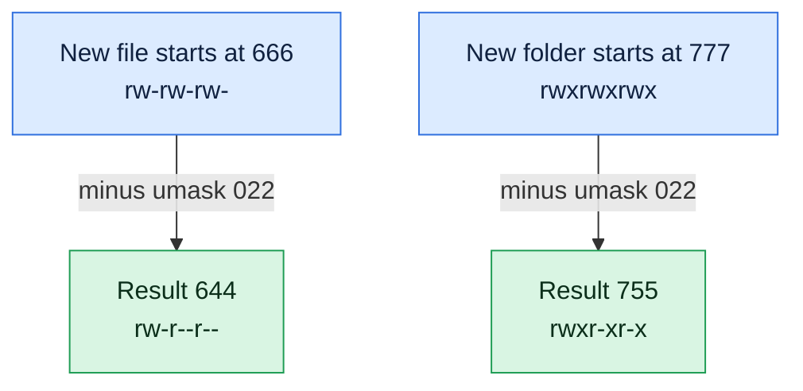

# umask

## What is it?
`umask` (user file creation mask) sets the **default permissions of new files and directories**. When a program creates a file, it asks for a mode (usually `666` for files and `777` for directories). The `umask` then **removes** some permission bits from it. With the common `umask` `022`, new files become `644` (`rw-r--r--`) and new directories become `755` (`rwxr-xr-x`). It is a **shell built-in**. It works for the current shell and for the programs that this shell starts. It does not change files that already exist (use `chmod` for them).

## Syntax
```bash
umask                  # show the current mask (octal)
umask [-p] [-S]        # show it in another format
umask MODE             # set the mask
```
`MODE` is an octal number (`022`, `0027`, `077`) or a symbolic mode (`u=rwx,g=rx,o=rx`).

### How the mask works
The mask says which bits must be **off** in a new file.

| | Files | Directories |
|-|-------|-------------|
| What programs ask for | `666` (`rw-rw-rw-`) | `777` (`rwxrwxrwx`) |
| With `umask 022` | `666` minus `022` = **`644`** | `777` minus `022` = **`755`** |
| With `umask 002` | `666` minus `002` = **`664`** | `777` minus `002` = **`775`** |
| With `umask 027` | `666` minus `027` = **`640`** | `777` minus `027` = **`750`** |
| With `umask 077` | `666` minus `077` = **`600`** | `777` minus `077` = **`700`** |
| With `umask 000` | `666` | `777` |

New files **never** get the execute bit from the `umask` alone, because programs ask for `666`. Programs like compilers ask for `777` explicitly. The calculation is a bit operation (`mode AND NOT mask`). For files and the usual masks, "subtract" gives the same result.

### Common masks
| Mask | New files | New directories | Typical use |
|------|-----------|-----------------|-------------|
| `022` | `644` | `755` | The default of most Linux systems for `root` and for normal users on many distributions |
| `002` | `664` | `775` | Teams that work in shared directories. The default for users on Debian and Ubuntu when the user has a private group |
| `027` | `640` | `750` | Servers: the group may read, others have no access |
| `077` | `600` | `700` | Private: only the owner has access. Good for secrets |
| `007` | `660` | `770` | A group works together, and others are excluded |

## Visual Overview
> `umask` is the list of permission bits that are taken away from every new file or folder. With `umask 022` the group and others lose write access.



## Options/Flags
| Flag | Description |
|------|-------------|
| *(none)* | Print the current mask as an octal number (`0022`) |
| `-S` | Print the mask in **symbolic** form, as the permissions that are **allowed** (`u=rwx,g=rx,o=rx`) |
| `-p` | Print the mask in a form that can be used as input again (`umask 0022`) |
| `MODE` | Set the mask. Octal (`022`) or symbolic (`u=rwx,g=rx,o=`). A symbolic mode names the permissions that stay **allowed** |
| `--help` | Show the help text of the built-in (`bash`) |

> A symbolic `MODE` is the opposite of the octal one: `umask u=rwx,g=rx,o=` is the same as `umask 027`. In octal you write the bits to **remove**, in symbolic form the bits to **keep**.

## Usage Examples

Let's say we are logged in as the user `deploy` on the server `web01`. Our shell has the default `umask` `022`. Each example starts again with this state. The commands that set the `umask` apply only to the current shell, so the examples show the effect in the same session.

### Example 1: Show the current mask
**Command:**
```bash
umask
```
**Sample Output:**
```text
0022
```
The first digit is for the special bits. `022` means: remove the write bit for the group and for others.

### Example 2: Show the mask in symbolic form (`-S`)
**Command:**
```bash
umask -S
```
**Sample Output:**
```text
u=rwx,g=rx,o=rx
```
This shows what is **allowed** (the maximum for a new directory), not what is removed.

### Example 3: Show the mask in a re-usable form (`-p`)
**Command:**
```bash
umask -p
```
**Sample Output:**
```text
umask 0022
```
This line can be saved in a script and run again to restore the mask.

### Example 4: See the effect of the default mask
**Command:**
```bash
touch file1
mkdir dir1
ls -ld file1 dir1
```
**Sample Output:**
```text
-rw-r--r-- 1 deploy deploy    0 Oct 12 10:00 file1
drwxr-xr-x 2 deploy deploy 4096 Oct 12 10:00 dir1
```
The file got `644` and the directory `755`.

### Example 5: A private mask for secrets (`umask 077`)
**Command:**
```bash
umask 077
umask
touch secret.txt
mkdir private
ls -ld secret.txt private
```
**Sample Output:**
```text
0077
-rw------- 1 deploy deploy    0 Oct 12 10:00 secret.txt
drwx------ 2 deploy deploy 4096 Oct 12 10:00 private
```

### Example 6: A group mask for servers (`umask 027`)
**Command:**
```bash
umask 027
touch conf.txt
mkdir confdir
ls -ld conf.txt confdir
```
**Sample Output:**
```text
-rw-r----- 1 deploy deploy    0 Oct 12 10:00 conf.txt
drwxr-x--- 2 deploy deploy 4096 Oct 12 10:00 confdir
```
The owner has full access, the group may read, and others have nothing.

### Example 7: A mask for team work (`umask 002`)
**Command:**
```bash
umask 002
touch shared.txt
mkdir shareddir
ls -ld shared.txt shareddir
```
**Sample Output:**
```text
-rw-rw-r-- 1 deploy deploy    0 Oct 12 10:00 shared.txt
drwxrwxr-x 2 deploy deploy 4096 Oct 12 10:00 shareddir
```
The group can write. In a directory with the setgid bit (`chmod g+s`), the group is the group of the directory, so the team can work together.

### Example 8: No mask at all (`umask 000`)
**Command:**
```bash
umask 000
touch open.txt
mkdir opendir
ls -ld open.txt opendir
```
**Sample Output:**
```text
-rw-rw-rw- 1 deploy deploy    0 Oct 12 10:00 open.txt
drwxrwxrwx 2 deploy deploy 4096 Oct 12 10:00 opendir
```
This is not safe. Everybody can change these files. Files are `666`, and not `777`, because programs do not ask for the execute bit.

### Example 9: Set the mask in symbolic form
A symbolic mode names the permissions that stay allowed. `u=rwx,g=rx,o=` is the same as `umask 027`.

**Command:**
```bash
umask u=rwx,g=rx,o=
umask
umask -S
```
**Sample Output:**
```text
0027
u=rwx,g=rx,o=
```

### Example 10: Change the mask relative to the old one
Symbolic modes can also add or remove. `o-rwx` removes all the permissions of others from the allowed set.

**Command:**
```bash
umask
umask o-rwx
umask
umask g-w
umask
```
**Sample Output:**
```text
0022
0027
0027
```
After `umask o-rwx` the mask is `027`. `g-w` does not change it, because the group already has no write bit in the allowed set. Write the changes you want to be sure.

### Example 11: Set the mask (nothing is printed)
With a `MODE`, the shell sets the mask and prints nothing. The exit code `0` means that it worked. Then `-S` shows the new mask.

**Command:**
```bash
umask 0077
echo "exit code: $?"
umask -S
```
**Sample Output:**
```text
exit code: 0
u=rwx,g=,o=
```
The empty `g=` and `o=` mean that no permissions are allowed for the group and others.

### Example 12: The mask is local to the shell and its children
A change in a subshell does not change the parent shell.

**Command:**
```bash
umask
( umask 077; umask; touch inside.txt; ls -l inside.txt )
umask
touch outside.txt
ls -l outside.txt
```
**Sample Output:**
```text
0022
0077
-rw------- 1 deploy deploy 0 Oct 12 10:00 inside.txt
0022
-rw-r--r-- 1 deploy deploy 0 Oct 12 10:00 outside.txt
```
Use a subshell `( ... )` to change the mask for one task only.

### Example 13: The mask does not change existing files
**Command:**
```bash
touch old.txt
ls -l old.txt
umask 077
ls -l old.txt
```
**Sample Output:**
```text
-rw-r--r-- 1 deploy deploy 0 Oct 12 10:00 old.txt
-rw-r--r-- 1 deploy deploy 0 Oct 12 10:00 old.txt
```
Use `chmod` to change a file that exists.

### Example 14: Programs can ask for more or less than 666
`mkdir -m` and `install -m` set a mode exactly, and the `umask` is **not** applied to them.

**Command:**
```bash
umask 077
mkdir -m 755 publicdir
install -m 644 /dev/null public.txt
ls -ld publicdir public.txt
```
**Sample Output:**
```text
drwxr-xr-x 2 deploy deploy 4096 Oct 12 10:00 publicdir
-rw-r--r-- 1 deploy deploy    0 Oct 12 10:00 public.txt
```
`chmod` does not use the `umask` either, unless you leave out "who" in a symbolic mode (`chmod +w`).

### Example 15: An executable program from a compiler
Compilers ask for `777`. The `umask` takes away what it masks, so the result has the `x` bit.

**Command:**
```bash
umask 022
gcc -o hello hello.c
ls -l hello
```
**Sample Output:**
```text
-rwxr-xr-x 1 deploy deploy 16056 Oct 12 10:00 hello
```

### Example 16: Show the help
**Command:**
```bash
umask --help
help umask | head -n 3
```
**Sample Output:**
```text
umask: umask [-p] [-S] [mode]
    Display or set file mode mask.

umask: umask [-p] [-S] [mode]
```

### Example 17: A wrong mask
**Command:**
```bash
umask 999
umask abc
```
**Sample Output:**
```text
bash: umask: 999: octal number out of range
bash: umask: `b': invalid symbolic mode operator
```

## Pitfalls / Gotchas
- **The mask is a subtraction of bits, not a permission.** `umask 022` does not give `022`, it **removes** `022`. A common mistake is to read the umask as the permissions of the new files.
- **`umask` is only for new files.** To fix existing files you need `chmod`.
- **It is per process.** It is inherited from the parent. Changing it in a script does not change your login shell. A script, a `cron` job or a `systemd` service starts with its own `umask`, which can differ from the one in your terminal.
- **Where the default comes from.** The default of a login shell comes from `/etc/profile`, `/etc/bash.bashrc`, `~/.bashrc`, `~/.profile`, `/etc/login.defs` (`UMASK`) and the PAM module `pam_umask`. On Debian and Ubuntu, users with a private group get `002`, and `root` gets `022`.
- **Services use their own `umask`.** In `systemd` use `UMask=0027` in the unit file. In Docker the `umask` of the process in the container is mostly `022`. For `cron`, set it in the script.
- **ACLs can override it.** A directory with a **default ACL** (`setfacl -d`) uses the ACL mask and ignores the `umask`.
- **The execute bit is never added by the `umask`.** To get `755` for a script, use `chmod +x` or `install -m 755`.
- **A restrictive mask can break shared work.** With `umask 077`, files that you create in a shared directory are unreadable for the group, even if the directory is `2775`. The effect is "I can see the file, but cannot open it".
- **`umask 000` is a security risk.** All new files are writable for everybody.
- **`umask 0027` and `umask 027` are the same.** The first digit is the mask of the special bits, and it is almost always `0`.
- **Symbolic masks mean "allowed" bits,** the opposite of octal. `umask g-w` means "do not allow the group to write", so it makes the octal mask higher. Many people get this wrong.
- **`sudo` can reset the `umask`.** Depending on the `sudoers` option `umask`, commands that run with `sudo` can have another mask. Test it with `sudo sh -c umask`.

## DevOps Use Cases

### Use Case 1: Create a secret file that nobody else can read, from the first byte
**Situation:** A script writes an API token to a file. If you create the file with the default mask and then call `chmod 600`, there is a short time when others can read it. Set the mask first, in a subshell.

**Command:**
```bash
( umask 077; echo "token=abc123" > /tmp/api.token )
ls -l /tmp/api.token
```
**Output:**
```text
-rw------- 1 deploy deploy 13 Oct 12 10:00 /tmp/api.token
```
The file was **created** as `600`. There was no moment when it was `644`.

### Use Case 2: A default mask for all the users of a server
**Situation:** On a server with sensitive data, new files of all the users must not be readable by others.

**Input file** (`/etc/login.defs`, the line is changed):
```text
UMASK           027
```
**Command:**
```bash
grep '^UMASK' /etc/login.defs
```
**Output:**
```text
UMASK           027
```
The value is used at the next login of a user. Also check `/etc/profile` and `/etc/bash.bashrc`, where some distributions set the mask for the shell. With `pam_umask` in `/etc/pam.d/common-session` the value applies to all the login methods (SSH, console).

### Use Case 3: A team directory where everybody can write
**Situation:** A team works in `/srv/shared`. The directory has the group `devs` and the setgid bit. Every member needs `umask 002`, so that new files are group writable.

**Command:**
```bash
echo 'umask 002' >> ~/.bashrc
sudo chgrp devs /srv/shared && sudo chmod 2775 /srv/shared
umask 002
touch /srv/shared/plan.txt
ls -l /srv/shared/plan.txt
```
**Output:**
```text
-rw-rw-r-- 1 deploy devs 0 Oct 12 10:00 /srv/shared/plan.txt
```
The file is `664`, and has the group `devs` because of the setgid directory.

### Use Case 4: Set the `umask` for a systemd service
**Situation:** A service writes log and data files. They must be readable only by the service user and its group. Set the mask in the unit file, and not in a script.

**Input file** (`/etc/systemd/system/myapp.service`):
```text
[Service]
User=myapp
Group=myapp
UMask=0027
ExecStart=/usr/local/bin/myapp
```
**Command:**
```bash
sudo systemctl daemon-reload && sudo systemctl restart myapp
sudo ls -l /var/lib/myapp/state.db
```
**Output:**
```text
-rw-r----- 1 myapp myapp 8192 Oct 12 10:00 /var/lib/myapp/state.db
```

### Use Case 5: Find out why a new file has surprising permissions
**Situation:** A deployment script creates a file that nobody else can read, but on your laptop it works. The reason is a different `umask` in the two environments.

**Command:**
```bash
umask
sudo sh -c 'umask'
```
**Output:**
```text
0002
0022
```
Your shell has `002`, and a command that is run through `sudo` has `022`. A `cron` job or a `systemd` service starts with its own mask, too. Set the `umask` explicitly at the top of the script: `umask 022`.

### Use Case 6: A CI job that must create files for a container
**Situation:** The CI runner has `umask 077`. Files that it creates and mounts into a container are unreadable for the container user. Set a friendlier mask for the build step only.

**Command:**
```bash
umask
( umask 022; mkdir -p build/out && echo "ok" > build/out/result.txt )
ls -l build/out/result.txt
```
**Output:**
```text
0077
-rw-r--r-- 1 runner runner 3 Oct 12 10:00 build/out/result.txt
```

### Use Case 7: Compute the mask that you need
**Situation:** You want new files to be `640`. What mask do you need? Calculate: `666 - 640 = 026`. For directories `777 - 026 = 751`. Check it.

**Command:**
```bash
umask 026
touch f640
mkdir d751
ls -ld f640 d751
```
**Output:**
```text
-rw-r----- 1 deploy deploy    0 Oct 12 10:00 f640
drwxr-x--x 2 deploy deploy 4096 Oct 12 10:00 d751
```
The file is `640`. The directory is `751`. For a directory `750` you need `027`. It is common to use `027`, because it gives `640` for files and `750` for directories.

### Use Case 8: Save and restore the mask in a script
**Situation:** A library function needs a strict mask for a moment and must not change the mask of its caller.

**Command:**
```bash
old=$(umask)
umask 077
echo "work with a strict mask: $(umask)"
umask "$old"
echo "restored: $(umask)"
```
**Output:**
```text
work with a strict mask: 0077
restored: 0022
```
A subshell `( umask 077; ... )` is shorter, when the work can run in it.

### Use Case 9: Create a directory with exact permissions, whatever the mask
**Situation:** A script must create `/srv/app/uploads` with `775`, on servers that have different masks. `mkdir -m` ignores the `umask`.

**Command:**
```bash
mkdir -m 775 /srv/app/uploads
ls -ld /srv/app/uploads
```
**Output:**
```text
drwxrwxr-x 2 deploy deploy 4096 Oct 12 10:00 /srv/app/uploads
```
Parent directories that `mkdir -p` creates on the way still use the `umask`.

## Related Commands
- [`chmod`](chmod.md) - change the permissions of existing files
- [`chown`](chown.md) - change the owner of a file
- [`chgrp`](chgrp.md) - change the group of a file
- [`touch`](../file-management/touch.md) - create an empty file with the mask applied
- [`mkdir`](../file-management/mkdir.md) - create a directory (`-m` sets the mode exactly)
- [`ls`](../file-management/ls.md) - check the result with `ls -l`
- [`cp`](../file-management/cp.md) - `cp` creates files with the mask applied, and `cp -p` keeps the mode
- [`sudo`](../user-management/sudo.md) - may run commands with another mask
- `install` - copy a file and set the mode, owner and group exactly
- `setfacl -d` - default ACLs, which override the `umask`
- `ulimit` - another per-process setting of the shell
- `systemd` `UMask=` - the mask for a service

---
<!-- nav -->
[← Previous: `chgrp`](chgrp.md) | [Learning path](../README.md) | [Next: `whoami` →](../user-management/whoami.md)
