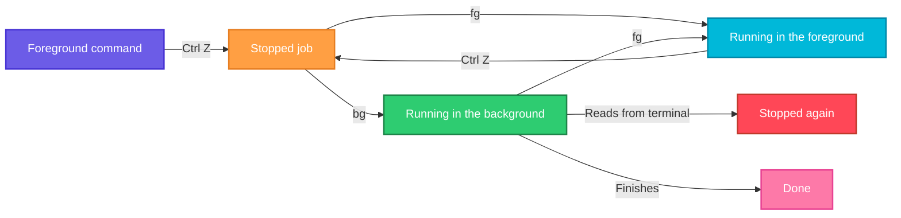

# bg

## What is it?
`bg` (background) continues a **stopped** job **in the background**. You use it after you pressed `Ctrl+Z` to suspend a command: the command is frozen, and `bg` lets it run again while you get the prompt back. It is a **built-in command** of the shell (`bash`, `zsh`) and works on the jobs listed by `jobs`. The opposite is `fg`, which brings a job to the foreground.

## Syntax
```bash
bg [JOBSPEC...]
```
Without an argument, `bg` uses the **current job** (the one marked `+` in `jobs`). `bg` has no options. You only choose the jobs with job specifications.

### Job specifications (`JOBSPEC`)
| Spec | Meaning |
|------|---------|
| `%N` | The job with the number `N` (`%1`, `%2`) |
| `%%` or `%+` | The current job (marked `+` in `jobs`). The default |
| `%-` | The previous job (marked `-`) |
| `%STRING` | The job whose command starts with `STRING` |
| `%?STRING` | The job whose command contains `STRING` |

### Keys of the terminal
| Key | Meaning |
|-----|---------|
| `Ctrl+Z` | Suspend the foreground job (sends `SIGTSTP`). The job becomes `Stopped` |
| `Ctrl+Y` | Suspend the job when it tries to read from the terminal (on systems that support it) |
| `Ctrl+C` | Interrupt (end) the foreground job |

## Visual Overview
> A foreground job that you suspend with `Ctrl+Z` is frozen. `bg` sends it `SIGCONT`, so it continues, but without the terminal as its input.



## Options/Flags
| Flag | Description |
|------|-------------|
| *(none)* | Continue the current job (`%+`) in the background |
| `%N` / `%STRING` / `%?STRING` | Continue the job you name |
| `JOBSPEC JOBSPEC ...` | Continue several jobs at once |
| `--help` | Show the help of the built-in (`bash`) |

## Usage Examples

Let's say we are logged in as the user `deploy` in a `bash` shell. We start a long command, `sleep 300`, and press `Ctrl+Z`. Then we start `python3 worker.py` and press `Ctrl+Z` again. The state of the shell is now:

**Input (what we typed and what the shell answered)**:
```text
$ sleep 300
^Z
[1]+  Stopped                 sleep 300
$ python3 worker.py
^Z
[2]+  Stopped                 python3 worker.py
$ jobs
[1]-  Stopped                 sleep 300
[2]+  Stopped                 python3 worker.py
```
The processes have the PIDs `4401` (`sleep`) and `4402` (`python3`).

### Example 1: Continue the current job in the background
Without an argument, `bg` uses the job marked `+`, here job `2`.

**Command:**
```bash
bg
```
**Sample Output:**
```text
[2]+ python3 worker.py &
```
The shell prints the job and a `&`, and shows the prompt again. The command runs now, but in the background.

### Example 2: Continue a job by its number (`%N`)
**Command:**
```bash
bg %1
jobs
```
**Sample Output:**
```text
[1]- sleep 300 &
[1]-  Running                 sleep 300 &
[2]+  Stopped                 python3 worker.py
```
Job `1` runs again. Job `2` is still stopped.

### Example 3: `bg` with a number without the percent sign
The `%` is optional for `bg`, but it is clearer with it.

**Command:**
```bash
bg 1
```
**Sample Output:**
```text
[1]- sleep 300 &
```

### Example 4: Continue a job by the beginning of its command (`%STRING`)
**Command:**
```bash
bg %python3
```
**Sample Output:**
```text
[2]+ python3 worker.py &
```

### Example 5: Continue a job by a part of its command (`%?STRING`)
**Command:**
```bash
bg %?worker
```
**Sample Output:**
```text
[2]+ python3 worker.py &
```

### Example 6: Continue several jobs at once
**Command:**
```bash
bg %1 %2
jobs
```
**Sample Output:**
```text
[1]- sleep 300 &
[2]+ python3 worker.py &
[1]-  Running                 sleep 300 &
[2]+  Running                 python3 worker.py &
```

### Example 7: The previous job (`%-`)
**Command:**
```bash
bg %-
```
**Sample Output:**
```text
[1]- sleep 300 &
```
`%-` is the job marked `-` (here `1`), and `%+` or `%%` is the job marked `+`.

### Example 8: No job to continue
**Command:**
```bash
bg
```
**Sample Output:**
```text
bash: bg: current: no such job
```
This happens when the shell has no jobs. Older versions of `bash` print `bash: bg: no current job`.

### Example 9: A job that is already running in the background
**Command:**
```bash
bg %1
bg %1
```
**Sample Output:**
```text
[1]- sleep 300 &
bash: bg: job 1 already in background
```

### Example 10: A job that does not exist
**Command:**
```bash
bg %9
```
**Sample Output:**
```text
bash: bg: %9: no such job
```

### Example 11: The command wants to read from the terminal
A background job cannot read from the terminal. It is stopped again as soon as it tries.

**Command:**
```bash
cat
^Z
bg
```
**Sample Output:**
```text
[1]+  Stopped                 cat
[1]+ cat &

[1]+  Stopped (tty input)     cat
```
`cat` waits for input from the keyboard. Bring it to the foreground with `fg`, or give it a file to read.

### Example 12: A job that writes to the terminal
A background job can still write to your terminal. Its lines are mixed with the commands that you type. Let's say we have this script `ticker.sh`:

**Input file** (`ticker.sh`):
```text
#!/bin/bash
for i in 1 2 3; do
  echo "tick $i"
  sleep 1
done
```
**Command:**
```bash
./ticker.sh &
```
**Sample Output:**
```text
[1] 4410
tick 1
tick 2
tick 3
[1]+  Done                    ./ticker.sh
```
To avoid this, redirect the output: `./ticker.sh > ticker.log 2>&1 &`.

### Example 13: Start a command in the background from the beginning (`&`)
`bg` is for commands that are already running. With `&` you do not need it.

**Command:**
```bash
sleep 300 &
```
**Sample Output:**
```text
[1] 4420
```

### Example 14: Show the help (`--help`)
**Command:**
```bash
help bg | head -n 3
bg --help | head -n 1
```
**Sample Output:**
```text
bg: bg [job_spec ...]
    Move jobs to the background.

bg: bg [job_spec ...]
```

## Pitfalls / Gotchas
- **`bg` only works with job control.** It works in an interactive shell. In a script (`bash script.sh`) there is no job control, and you get `bg: no job control`.
- **A background job loses the keyboard.** If the program reads from the terminal, it is stopped again (`Stopped (tty input)`). Use `fg`, or redirect the input.
- **The output still goes to your terminal.** Redirect it to a file when the job is noisy.
- **The job ends with the shell.** When you close the terminal, a background job gets `SIGHUP`. For a job that must stay, use `nohup`, `disown` or `tmux`.
- **A program that was stopped by a terminal request** (`SIGTTIN`/`SIGTTOU`) needs `fg`, not `bg`.
- **A stopped job is not a running job.** Do not forget `bg`, and do not leave jobs stopped for a long time. They hold memory, files and locks.
- **The default job is not always the one you think.** Check with `jobs`, or give the number.
- **`bg` does not give you a PID.** Use `jobs -l` or `$!` (only for jobs that you started with `&`).
- **Some programs do not like to run in the background,** for example full screen programs such as `vim` or `top`. They will stop again or garble the screen.
- **`kill -CONT PID` is an alternative.** It continues a stopped process, but without the job bookkeeping of the shell.

## DevOps Use Cases

### Use Case 1: You forgot the `&` for a long command
**Situation:** You started a 20 minute `tar` in the foreground, and need the prompt back, without losing the work that is already done.

**Input (what we typed)**: `tar czf /backup/data.tgz /data` (still running).

**Command:**
```bash
# press Ctrl+Z
bg
```
**Output:**
```text
^Z
[1]+  Stopped                 tar czf /backup/data.tgz /data
[1]+ tar czf /backup/data.tgz /data &
```
The `tar` continues. If you need it to survive a logout, run `disown %1`.

### Use Case 2: Pause a heavy job, then continue it in the background
**Situation:** A compression job slows down the application at 10:00. Pause it with `Ctrl+Z`, and let it continue later without taking the terminal.

**Input (what is running)**: `gzip -9 /data/big.log` in the foreground.

**Command:**
```bash
# press Ctrl+Z
jobs
bg %1
```
**Output:**
```text
[1]+  Stopped                 gzip -9 /data/big.log
[1]+ gzip -9 /data/big.log &
```

### Use Case 3: Keep an SSH session usable while a script runs
**Situation:** A deployment script prints progress for 10 minutes. Move it to the background, and read the progress in a file.

**Input (what is running)**: `./deploy.sh | tee deploy.log` in the foreground.

**Command:**
```bash
# press Ctrl+Z
bg
tail -f deploy.log
```
**Output:**
```text
[1]+  Stopped                 ./deploy.sh | tee deploy.log
[1]+ ./deploy.sh | tee deploy.log &
step 1: build image
step 2: push image
```
The script still writes to the terminal, and to the file.

### Use Case 4: Start the next task while the first one still runs
**Situation:** Run two long database exports at the same time, from one terminal.

**Command:**
```bash
pg_dump mydb1 > mydb1.sql      # press Ctrl+Z
bg
pg_dump mydb2 > mydb2.sql &
jobs
```
**Output:**
```text
[1]+  Stopped                 pg_dump mydb1 > mydb1.sql
[1]+ pg_dump mydb1 > mydb1.sql &
[2] 4510
[1]-  Running                 pg_dump mydb1 > mydb1.sql &
[2]+  Running                 pg_dump mydb2 > mydb2.sql &
```

### Use Case 5: Resume a job after you fixed what blocked it
**Situation:** A job stopped itself with `Stopped (tty input)` because it asked a question. Provide the answer through a file, then continue it.

**Command:**
```bash
jobs
fg %1
```
**Output:**
```text
[1]+  Stopped (tty input)     ./installer.sh
./installer.sh
Continue? [y/N] y
```
Bring it to the foreground with `fg`, answer the question, and then you can press `Ctrl+Z` and `bg` to run the rest in the background.

### Use Case 6: Resume a stopped job of another user's shell, with signals
**Situation:** `bg` works only in the shell that owns the job. For a process that was stopped by `kill -STOP` from another terminal, send `SIGCONT`.

**Command:**
```bash
kill -CONT 4402
ps -o pid,stat,cmd -p 4402
```
**Output:**
```text
    PID STAT CMD
   4402 S    python3 worker.py
```

## Related Commands
- [`fg`](fg.md) - bring a job to the foreground
- [`jobs`](jobs.md) - list the jobs and their state
- [`kill`](kill.md) - `kill -CONT` also continues a stopped process
- [`nohup`](nohup.md) - make a job survive the logout
- [`ps`](ps.md) - see the state of the processes
- [`pgrep`](pgrep.md) - find the jobs of other shells
- `disown` - remove a job from the job table of the shell
- `wait` - wait for the background jobs
- `tmux` / `screen` - sessions that stay alive when you disconnect
