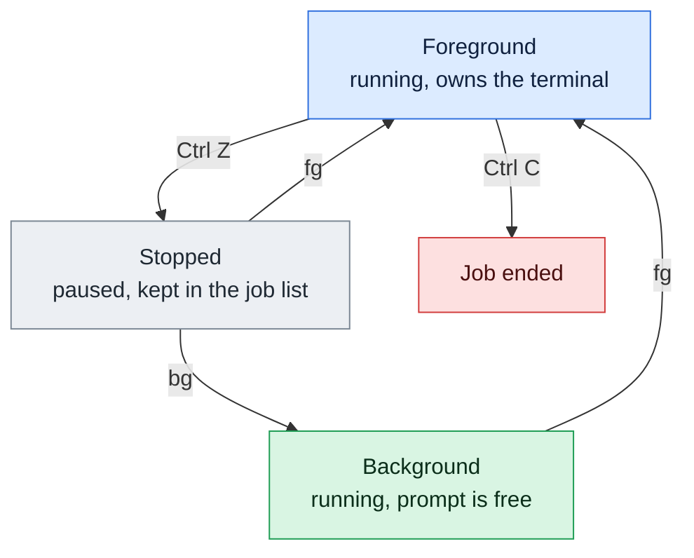

# fg

## What is it?
`fg` (foreground) brings a **background or stopped job** back to the **foreground** of the terminal. The job gets the keyboard again, so you can type into it, see its output as normal and stop it with `Ctrl+C`. If the job was stopped, `fg` also continues it. It is a **built-in command** of the shell (`bash`, `zsh`) that works on the jobs shown by `jobs`. The opposite of `fg` is `bg`.

## Syntax
```bash
fg [JOBSPEC]
```
Without an argument, `fg` uses the **current job**, the one marked `+` in `jobs`. `fg` has no options, only job specifications. It brings **one** job to the foreground at a time, because only one job can use the terminal.

### Job specifications (`JOBSPEC`)
| Spec | Meaning |
|------|---------|
| `%N` | The job with the number `N` (`%1`, `%2`) |
| `%%` or `%+` | The current job (marked `+`). The default |
| `%-` | The previous job (marked `-`) |
| `%STRING` | The job whose command starts with `STRING` |
| `%?STRING` | The job whose command contains `STRING` |

### Keys of the terminal
| Key | Meaning |
|-----|---------|
| `Ctrl+Z` | Suspend the foreground job again. It becomes `Stopped` |
| `Ctrl+C` | End the foreground job |
| `Ctrl+D` | End the input of the foreground job (end of file) |

## Visual Overview
> `fg` brings a background or stopped job back to the foreground, so it owns the terminal and you can see or stop it. The arrows labelled `fg` are this command.



## Options/Flags
| Flag | Description |
|------|-------------|
| *(none)* | Bring the current job (`%+`) to the foreground |
| `%N` / `%STRING` / `%?STRING` | Bring the job you name |
| `%%` / `%+` / `%-` | The current job / the current job / the previous job |
| `--help` | Show the help of the built-in (`bash`) |

## Usage Examples

Let's say we are logged in as the user `deploy` in a `bash` shell. We started `sleep 300` in the background, and `python3 worker.py` (which prints `working...` every second) was suspended with `Ctrl+Z`. Then `vim notes.txt` was suspended, too. This is the state:

**Input (what we typed and what the shell answered)**:
```text
$ sleep 300 &
[1] 4401
$ python3 worker.py
^Z
[2]+  Stopped                 python3 worker.py
$ vim notes.txt
^Z
[3]+  Stopped                 vim notes.txt
$ jobs
[1]   Running                 sleep 300 &
[2]-  Stopped                 python3 worker.py
[3]+  Stopped                 vim notes.txt
```

### Example 1: Bring the current job to the foreground
Without an argument, `fg` takes the job marked `+`, here the editor.

**Command:**
```bash
fg
```
**Sample Output:**
```text
vim notes.txt
```
The shell prints the command line of the job, and the editor appears again, exactly as you left it.

### Example 2: Bring a job by its number (`%N`)
**Command:**
```bash
fg %2
```
**Sample Output:**
```text
python3 worker.py
working...
working...
```
The program continues where it was stopped and writes to your terminal.

### Example 3: Without the percent sign
For `fg` the `%` can be left out. It is easier to read with it.

**Command:**
```bash
fg 1
```
**Sample Output:**
```text
sleep 300
```
Now the terminal is busy until the `sleep` ends or you press `Ctrl+C`.

### Example 4: By the beginning of the command (`%STRING`)
**Command:**
```bash
fg %python3
```
**Sample Output:**
```text
python3 worker.py
```

### Example 5: By a part of the command (`%?STRING`)
**Command:**
```bash
fg %?notes
```
**Sample Output:**
```text
vim notes.txt
```

### Example 6: The previous job (`%-`)
**Command:**
```bash
fg %-
```
**Sample Output:**
```text
python3 worker.py
```
`%-` is the job marked `-`, here job `2`.

### Example 7: The current job with `%%` or `%+`
**Command:**
```bash
fg %%
fg %+
```
**Sample Output:**
```text
vim notes.txt
```
Both forms mean the same as `fg` without an argument.

### Example 8: A shortcut: only the job spec
In `bash`, you can type the job spec alone. `%2` is the same as `fg %2`, and `%2 &` is the same as `bg %2`.

**Command:**
```bash
%2
```
**Sample Output:**
```text
python3 worker.py
```

### Example 9: Stop a job again and put it back
Bring the job to the foreground, press `Ctrl+Z`, and send it to the background.

**Command:**
```bash
fg %2
# press Ctrl+Z
bg %2
```
**Sample Output:**
```text
python3 worker.py
working...
^Z
[2]+  Stopped                 python3 worker.py
[2]+ python3 worker.py &
```

### Example 10: End a job with `Ctrl+C`
**Command:**
```bash
fg %1
# press Ctrl+C
```
**Sample Output:**
```text
sleep 300
^C
```
After `Ctrl+C`, the job is gone from the list.

### Example 11: No job
**Command:**
```bash
fg
```
**Sample Output:**
```text
bash: fg: current: no such job
```
Older versions of `bash` print `bash: fg: no current job`.

### Example 12: A job that does not exist
**Command:**
```bash
fg %9
```
**Sample Output:**
```text
bash: fg: %9: no such job
```

### Example 13: A job that has already finished
**Command:**
```bash
fg %1
```
**Sample Output:**
```text
bash: fg: job has terminated
[1]+  Done                    sleep 300
```

### Example 14: `fg` does not work in a script
**Command:**
```bash
bash -c 'sleep 5 & fg'
```
**Sample Output:**
```text
bash: line 1: fg: no job control
```
Job control exists only in interactive shells, or after `set -m`.

### Example 15: Show the help (`--help`)
**Command:**
```bash
help fg | head -n 3
fg --help | head -n 1
```
**Sample Output:**
```text
fg: fg [job_spec]
    Move job to the foreground.

fg: fg [job_spec]
```

## Pitfalls / Gotchas
- **Only one job can be in the foreground.** `fg %1 %2` is not possible. Bring them one after the other.
- **`fg` waits.** The prompt comes back only when the job ends or is stopped. If you need the prompt, use `bg` or start the job with `&`.
- **A background job that reads from the terminal is stopped** (`Stopped (tty input)`). Bring it to the foreground with `fg` and type the input.
- **The current job is not always the one you want.** `fg` without an argument takes the `+` job. When you have several jobs, check with `jobs` first.
- **`fg` only works with the jobs of the current shell.** A process that you started in another terminal is not in your job table. You cannot move it with `fg`. Use `tmux`, `screen` or `reptyr` for that.
- **Closing the terminal ends the jobs.** `fg` cannot bring back a job after you logged out. If the job was started with `nohup` or `disown`, it is not a job of the new shell, and you cannot reach it with `fg`.
- **`Ctrl+Z` is not `Ctrl+C`.** `Ctrl+Z` only freezes the program, and it keeps its memory and its files. Kill it (`kill %1`) when you do not need it.
- **Programs that catch `Ctrl+Z`** (like some editors in raw mode) may ignore it.
- **A job that you brought back may have lost its connections.** A network connection of a program that was stopped for a long time may time out.
- **`fg` prints the command line.** This is normal and helps you to see which job came back.

## DevOps Use Cases

### Use Case 1: Go back to the editor after a quick command
**Situation:** You are editing a config in `vim` and need to check a log. Press `Ctrl+Z`, look at the log, and come back.

**Command:**
```bash
vim /etc/nginx/nginx.conf
# press Ctrl+Z
tail -n 3 /var/log/nginx/error.log
fg
```
**Output:**
```text
[1]+  Stopped                 vim /etc/nginx/nginx.conf
2026-10-12 10:04:55 [error] connect() failed (111: Connection refused)
2026-10-12 10:04:58 [error] connect() failed (111: Connection refused)
vim /etc/nginx/nginx.conf
```

### Use Case 2: Watch a background build again
**Situation:** A build runs in the background. You want to see its live output now and then.

**Input (what we typed)**: `make build > build.log 2>&1 &` (job `1`).

**Command:**
```bash
jobs
fg %1
```
**Output:**
```text
[1]+  Running                 make build > build.log 2>&1 &
make build > build.log 2>&1
```
The output goes to `build.log`, so `fg` shows no new text. To watch the log use `tail -f build.log`.

### Use Case 3: Answer a question of a background installer
**Situation:** An installer that was started in the background has stopped, because it asked a question.

**Command:**
```bash
jobs
fg %1
```
**Output:**
```text
[1]+  Stopped (tty input)     ./installer.sh
./installer.sh
Overwrite existing config? [y/N] y
Installing...
```

### Use Case 4: Interrupt a stuck command that you suspended
**Situation:** A command hangs. You suspended it with `Ctrl+Z` to try something else. Now you decided to end it.

**Command:**
```bash
fg %1
# press Ctrl+C
```
**Output:**
```text
ping 10.0.0.99
^C
--- 10.0.0.99 ping statistics ---
12 packets transmitted, 0 received, 100% packet loss, time 11264ms
```
You could also use `kill %1` without bringing it to the foreground.

### Use Case 5: Switch between two interactive programs
**Situation:** You work with a Python shell and with an editor, and switch back and forth, without losing either state.

**Command:**
```bash
python3
# press Ctrl+Z
vim script.py
# press Ctrl+Z
jobs
fg %python3
```
**Output:**
```text
[1]+  Stopped                 python3
[2]+  Stopped                 vim script.py
[1]-  Stopped                 python3
[2]+  Stopped                 vim script.py
python3
>>>
```
Your variables in the Python session are still there.

### Use Case 6: Use `fg` to see the final output of a long job
**Situation:** A job ran in the background and finished while you were away. The shell remembers it, so you see `Done`. Check the status.

**Command:**
```bash
jobs
```
**Output:**
```text
[1]+  Done                    tar czf /backup/data.tgz /data
```
When a background job prints `Done`, it ended with the exit code `0`. `Exit 1` would mean a failure. `fg` can no longer bring it back.

## Related Commands
- [`bg`](bg.md) - continue a job in the background
- [`jobs`](jobs.md) - list the jobs
- [`kill`](kill.md) - end a job without bringing it to the foreground
- [`nohup`](nohup.md) - start a job that survives the logout
- [`ps`](ps.md) - look at the processes of all shells
- [`timeout`](timeout.md) - limit how long a command runs
- `disown` - remove a job from the job table
- `wait` - wait for background jobs to finish
- `tmux` / `screen` - sessions that you can leave and enter again
