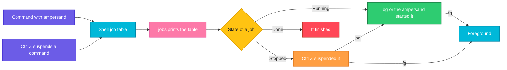

# jobs

## What is it?
`jobs` lists the **jobs** of the current shell: the commands that you started in the background (`command &`) or that you suspended with `Ctrl+Z`. Every job has a small number (`[1]`, `[2]`, ...) and a state (`Running`, `Stopped`, `Done`). You use these numbers with `fg`, `bg` and `kill`. `jobs` is a **built-in command** of the shell (`bash`, `zsh`), so it only knows the jobs of the shell where you run it, not the jobs of other terminals.

## Syntax
```bash
jobs [-lnprs] [JOBSPEC...]
jobs -x COMMAND [ARGS...]
```
Without arguments, `jobs` lists all the jobs of the shell.

### Job specifications (`JOBSPEC`)
| Spec | Meaning |
|------|---------|
| `%N` | The job with the number `N` (`%1`, `%2`) |
| `%%` or `%+` | The **current** job, the one that was last stopped or sent to the background (marked with `+`) |
| `%-` | The **previous** job (marked with `-`) |
| `%STRING` | The job whose command **starts** with `STRING` (`%python`) |
| `%?STRING` | The job whose command **contains** `STRING` (`%?worker`) |

## Visual Overview
> The shell keeps a table of its jobs. `jobs` prints the table. The `+` marks the job that `fg` and `bg` use when you give no number.



## Options/Flags
| Flag | Description |
|------|-------------|
| *(none)* | List all jobs: number, `+` or `-` mark, state and command |
| `-l` | Also show the process ID (PID) of each job |
| `-p` | Show only the PIDs (the PID of the process group leader) |
| `-r` | Show only the running jobs |
| `-s` | Show only the stopped jobs |
| `-n` | Show only the jobs whose state has changed since the last time you were told |
| `-x COMMAND` | Replace each job spec in `COMMAND` by the PID of the job, and run it |
| `--help` | Show the help of the built-in (in `bash`) |

### Columns of the output
| Part | Meaning |
|------|---------|
| `[1]` | The job number |
| `+` / `-` | The current job / the previous job |
| `Running` | The job runs (in the background) |
| `Stopped` | The job is suspended (`Ctrl+Z` or `SIGSTOP`) |
| `Done` | The job ended normally (exit code `0`) |
| `Exit 1` | The job ended with the exit code `1` |
| `Terminated` / `Killed` | The job was ended by `SIGTERM` / `SIGKILL` |
| `&` at the end | The command was started in the background |

## Usage Examples

Let's say we are logged in as the user `deploy` in a `bash` shell. We start three jobs. The first job is a `sleep`, the second job is the script `worker.py` that we suspend with `Ctrl+Z`, and the third job is a `tail` that we start in the background last.

**Input (what we typed)**:
```bash
sleep 300 &
python3 worker.py          # then we press Ctrl+Z
tail -f app.log > /dev/null &
```
The shell answers:
```text
[1] 4401
^Z
[2]+  Stopped                 python3 worker.py
[3] 4403
```
The processes have the PIDs `4401` (`sleep`), `4402` (`python3`) and `4403` (`tail`). Each example below starts from this state.

### Example 1: List the jobs
**Command:**
```bash
jobs
```
**Sample Output:**
```text
[1]   Running                 sleep 300 &
[2]-  Stopped                 python3 worker.py
[3]+  Running                 tail -f app.log > /dev/null &
```
`[3]+` is the current job (the last one that was started or stopped). `[2]-` is the previous one.

### Example 2: Show the PIDs too (`-l`)
**Command:**
```bash
jobs -l
```
**Sample Output:**
```text
[1]   4401 Running                 sleep 300 &
[2]-  4402 Stopped                 python3 worker.py
[3]+  4403 Running                 tail -f app.log > /dev/null &
```

### Example 3: Only the PIDs (`-p`)
**Command:**
```bash
jobs -p
```
**Sample Output:**
```text
4401
4402
4403
```
Useful in scripts: `kill $(jobs -p)` stops all the jobs.

### Example 4: Only the running jobs (`-r`)
**Command:**
```bash
jobs -r
```
**Sample Output:**
```text
[1]   Running                 sleep 300 &
[3]+  Running                 tail -f app.log > /dev/null &
```

### Example 5: Only the stopped jobs (`-s`)
**Command:**
```bash
jobs -s
```
**Sample Output:**
```text
[2]-  Stopped                 python3 worker.py
```

### Example 6: A selected job
You can give a job spec to show only that job.

**Command:**
```bash
jobs %2
jobs -l %1
jobs %tail
jobs %?worker
```
**Sample Output:**
```text
[2]-  Stopped                 python3 worker.py
[1]   4401 Running                 sleep 300 &
[3]+  Running                 tail -f app.log > /dev/null &
[2]-  Stopped                 python3 worker.py
```
`%tail` finds the job whose command starts with `tail`. `%?worker` finds the job whose command contains `worker`.

### Example 7: Only the jobs that changed (`-n`)
Let's say `sleep 300` has just finished. `-n` shows only the jobs whose state changed since the shell last told you. The shell also prints this at the next prompt, but `-n` lets you ask for it.

**Command:**
```bash
jobs -n
```
**Sample Output:**
```text
[1]   Done                    sleep 300
```
A second `jobs -n` prints nothing, because you have already seen the change.

### Example 8: Use job numbers as PIDs in a command (`-x`)
`jobs -x` replaces `%2` by the PID of the job `2`, then runs the command.

**Command:**
```bash
jobs -x echo PID of job 2 is %2
jobs -x kill %2
```
**Sample Output:**
```text
PID of job 2 is 4402
```
The second command runs `kill 4402`. It prints nothing on success. In `bash` you can also write `kill %2` directly, because `kill` is a built-in command that knows job specs.

### Example 9: The current and the previous job (`%+` and `%-`)
**Command:**
```bash
jobs %+
jobs %-
jobs %%
```
**Sample Output:**
```text
[3]+  Running                 tail -f app.log > /dev/null &
[2]-  Stopped                 python3 worker.py
[3]+  Running                 tail -f app.log > /dev/null &
```
`%%` and `%+` mean the same.

### Example 10: No jobs
**Command:**
```bash
jobs
echo "exit code: $?"
```
**Sample Output:**
```text
exit code: 0
```
`jobs` prints nothing when the shell has no jobs.

### Example 11: A job spec that does not exist
**Command:**
```bash
jobs %9; echo "exit code: $?"
```
**Sample Output:**
```text
bash: jobs: %9: no such job
exit code: 1
```

### Example 12: Leaving a shell with stopped jobs
When you try to `exit` and there are stopped jobs, the shell warns you. A second `exit` closes the shell and ends the stopped jobs.

**Command:**
```bash
exit
```
**Sample Output:**
```text
There are stopped jobs.
```

### Example 13: The jobs of another terminal are not visible
The job table belongs to one shell. In a second terminal window, `jobs` shows nothing, although the processes run.

**Command:**
```bash
jobs
pgrep -a sleep
```
**Sample Output:**
```text
4401 sleep 300
```
`jobs` is empty in the new shell, but `pgrep` finds the process of the first shell.

### Example 14: Show the help (`--help`)
**Command:**
```bash
help jobs | head -n 3
jobs --help | head -n 1
```
**Sample Output:**
```text
jobs: jobs [-lnprs] [jobspec ...] or jobs -x command [args]
    Display status of jobs.

jobs: jobs [-lnprs] [jobspec ...] or jobs -x command [args]
```

## Pitfalls / Gotchas
- **`jobs` is per shell.** It cannot see the jobs of another terminal, of `ssh` sessions or of `cron`. Use `ps` or `pgrep` for those.
- **Jobs end when the shell ends.** When you close the terminal, a shell sends `SIGHUP` to its jobs. Use `nohup`, `disown` or `tmux` for jobs that must survive.
- **Job numbers are not PIDs.** `%1` is the job number. The PID comes from `jobs -l`. `kill 1` would try to stop `init`.
- **A finished job is shown once.** After `Done` has been printed, the job is removed from the list.
- **`jobs` in a script prints nothing**, because job control is off in non-interactive shells. Add `set -m` to turn it on, or use `$!` to get the PID of the last background command.
- **The `+` job is the default.** `fg` and `bg` without a number use it. It is the last job that was started in the background or stopped, which is not always the one you expect. Always give the number.
- **`jobs` output goes to standard output,** but the notices such as `[1]+ Done` that the shell prints by itself go to the terminal at the next prompt.
- **Stopped jobs hold their resources.** A stopped job keeps its memory and its open files, and blocks the exit of the shell.
- **zsh and bash print a little differently.** `zsh` prints `suspended` instead of `Stopped` and adds the current directory with `-d`.
- **`dash` (`/bin/sh`) has a smaller `jobs`.** Some options are missing there.

## DevOps Use Cases

### Use Case 1: Check what is still running in your session
**Situation:** You started several tasks over SSH and do not remember which ones are still running.

**Input (what we typed)**: the three jobs from the Usage Examples.

**Command:**
```bash
jobs -l
```
**Output:**
```text
[1]   4401 Running                 sleep 300 &
[2]-  4402 Stopped                 python3 worker.py
[3]+  4403 Running                 tail -f app.log > /dev/null &
```
Job `2` is stopped. You can resume it with `bg %2` or `fg %2`.

### Use Case 2: Stop all the background jobs at the end of a script
**Situation:** A script starts helper processes in the background. When the script finishes, it must not leave them behind.

**Command:**
```bash
set -m
sleep 100 &
sleep 200 &
echo "jobs before: $(jobs -p | wc -l)"
kill $(jobs -p)
sleep 0.5
echo "jobs after: $(jobs -r | wc -l)"
```
**Output:**
```text
jobs before: 2
jobs after: 0
```

### Use Case 3: Start a task and wait for all the parts
**Situation:** Run three checks in parallel, then continue when all three are finished. `wait` waits for all the jobs of the shell.

**Command:**
```bash
sleep 2 &
sleep 3 &
sleep 1 &
jobs -r | wc -l
wait
echo "all checks finished"
```
**Output:**
```text
3
all checks finished
```

### Use Case 4: See which job failed
**Situation:** After a number of background tasks, you want to know which one ended with an error.

**Command:**
```bash
sleep 1 &
false &
sleep 2
jobs
```
**Output:**
```text
[1]-  Done                    sleep 1
[2]+  Exit 1                  false
```
`Exit 1` shows that the command ended with the exit code `1`.

### Use Case 5: Resume a suspended editor or an installer
**Situation:** You pressed `Ctrl+Z` in `vim` to run a command. Come back to the editor.

**Input (what we typed)**: `vim /etc/nginx/nginx.conf`, then `Ctrl+Z`.

**Command:**
```bash
jobs
fg %vim
```
**Output:**
```text
[1]+  Stopped                 vim /etc/nginx/nginx.conf
vim /etc/nginx/nginx.conf
```
`fg %vim` brings the editor back, with the file as you left it.

### Use Case 6: Find the PID of the last background job
**Situation:** A script starts a program in the background and needs its PID, to stop it later.

**Command:**
```bash
python3 -m http.server 8000 > /dev/null 2>&1 &
echo "server PID: $!"
jobs -p
```
**Output:**
```text
[1] 4501
server PID: 4501
4501
```

### Use Case 7: Warn the user about running jobs before the logout
**Situation:** A login script prints a reminder if the user still has background jobs.

**Command:**
```bash
if [ "$(jobs -p | wc -l)" -gt 0 ]; then
  echo "You still have $(jobs -p | wc -l) background job(s). Use nohup or tmux."
fi
```
**Output:**
```text
You still have 3 background job(s). Use nohup or tmux.
```

## Related Commands
- [`bg`](bg.md) - continue a stopped job in the background
- [`fg`](fg.md) - bring a job to the foreground
- [`kill`](kill.md) - stop a job with `kill %1`
- [`nohup`](nohup.md) - start a job that survives the logout
- [`ps`](ps.md) - see all the processes, not only those of the shell
- [`pgrep`](pgrep.md) - find the processes of the other shells
- [`timeout`](timeout.md) - limit the time of a command
- `disown` - remove a job from the table, so that it survives the shell
- `wait` - wait for background jobs to finish
- `tmux` / `screen` - sessions that continue after a disconnect
