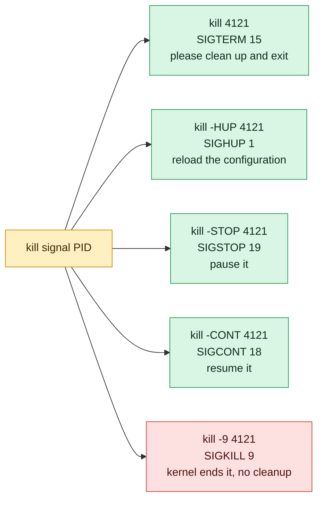

# kill

## What is it?
`kill` sends a **signal** to a process. Most of the time the signal asks the process to stop, so the name is `kill`. But a signal can also ask a process to reload its configuration (`SIGHUP`), to pause (`SIGSTOP`) or to continue (`SIGCONT`). You give the process by its ID (PID), as found with `ps` or `pgrep`. Without a signal name, `kill` sends `SIGTERM` (15), which asks the process to stop in a clean way.

## Syntax
```bash
kill [-s SIGNAL | -SIGNAL | -n NUMBER] PID...
kill -l [SIGNAL | EXIT_STATUS]
kill -L
```
`kill` is a **built-in command** of `bash`, and there is also a program `/bin/kill`. They accept nearly the same options. A negative PID (`-1234`) means a whole **process group**. The special PID `0` means all the processes of the current group, and `-1` means all the processes you may signal.

## Visual Overview
> `kill` does not always kill. It sends a signal. The default `15` asks the process to exit politely. Only `-9` forces it.



## Options/Flags

### Options
| Flag | Description |
|------|-------------|
| `-s SIGNAL` | Send this signal (name or number) |
| `-SIGNAL` | The same, short: `-9`, `-KILL`, `-SIGKILL`, `-HUP` |
| `-n NUMBER` | Send the signal with this number (bash built-in) |
| `-l [SIGNAL]` | List the signal names. With a number, print the name. With a name, print the number |
| `-L` | Same as `-l` (a table in `/bin/kill`) |
| `-p` | (`/bin/kill`) Print the PID instead of sending the signal |
| `-q VALUE` | (`/bin/kill`) Send the signal with `sigqueue` and the given value |
| `-V` / `--version` | (`/bin/kill`) Show the version |
| `--help` | Show the help text |
| `--` | End of options. Use it before a negative PID: `kill -- -1234` |

### The most used signals
| Number | Name | Meaning | Can the process catch it? |
|--------|------|---------|--------------------------|
| `0` | (none) | Does not send anything. Only tests if the process exists and if you may signal it | - |
| `1` | `SIGHUP` | Hang up. Most daemons reload their configuration | Yes |
| `2` | `SIGINT` | Interrupt, the same as `Ctrl+C` | Yes |
| `3` | `SIGQUIT` | Quit and make a core dump, the same as `Ctrl+\` | Yes |
| `9` | `SIGKILL` | Kill at once. The process gets no chance to clean up | **No** |
| `10` | `SIGUSR1` | User defined. Many programs use it for "reopen the logs" or "print the status" | Yes |
| `12` | `SIGUSR2` | User defined | Yes |
| `15` | `SIGTERM` | Terminate in a clean way. The default signal | Yes |
| `17` | `SIGCHLD` | A child process stopped or ended | Yes |
| `18` | `SIGCONT` | Continue a stopped process | Yes |
| `19` | `SIGSTOP` | Stop (pause) the process | **No** |
| `20` | `SIGTSTP` | Stop from the terminal, the same as `Ctrl+Z` | Yes |

### Ways to name the target
| Target | Meaning |
|--------|---------|
| `1234` | The process with ID `1234` |
| `1234 1235` | Several processes |
| `%1`, `%%`, `%name` | A job of the current shell (bash built-in) |
| `-1234` | The process **group** `1234` (write `kill -- -1234`) |
| `0` | Every process in the current process group |
| `-1` | Every process that you are allowed to signal. Very dangerous |

### Exit status
| Code | Meaning |
|------|---------|
| `0` | At least one signal was sent |
| `1` | The signal could not be sent (no such process, no permission, bad name) |

## Usage Examples

Let's say we have the server `web01` from the `ps` guide. Today is `2026-10-12 10:05`. We are logged in as the user `deploy` in a shell with PID `2302`. These processes are running:

**Input (what is running)**:

| PID | User | State | Command line |
|-----|------|-------|--------------|
| 812 | root | `Ss` | `nginx: master process /usr/sbin/nginx` |
| 813, 814 | www-data | `S` | `nginx: worker process` |
| 2045 | deploy | `Sl` | `node /srv/myapp/server.js` |
| 3120 | deploy | `R` | `python3 worker.py` (uses 97% CPU, started from the shell `2302`) |

### Example 1: Stop a process in a clean way (default `SIGTERM`)
**Command:**
```bash
kill 3120
ps -p 3120
```
**Sample Output:**
```text
[1]+  Terminated              python3 worker.py
    PID TTY          TIME CMD
```
`kill` prints nothing when it works. The process got `SIGTERM` (15) and exited (the shell prints the line `Terminated` for a job it started). `ps` shows only its header line, because the process is not in the list any more. The default signal gives the program the chance to close its files and connections.

### Example 2: Force the process to end (`-9`)
Use it only when `SIGTERM` was not enough.

**Command:**
```bash
kill -9 3120
```
**Sample Output:**
```text
[1]+  Killed                  python3 worker.py
```
The word `Killed` (not `Terminated`) says that the process died from `SIGKILL`.

### Example 3: Four ways to write the same signal
`-9`, `-KILL`, `-SIGKILL` and `-s KILL` all send signal 9. `-n 9` does it too, in the bash built-in.

**Command:**
```bash
kill -9 3120
kill -KILL 3120
kill -SIGKILL 3120
kill -s KILL 3120
kill -n 9 3120
```
**Sample Output:**
```text
```
There is no output. Each command sends `SIGKILL` to the process `3120`. If the process is already gone, you get an error (see Example 14).

### Example 4: List the signals (`-l`)
**Command:**
```bash
kill -l
```
**Sample Output:**
```text
 1) SIGHUP       2) SIGINT       3) SIGQUIT      4) SIGILL       5) SIGTRAP
 6) SIGABRT      7) SIGBUS       8) SIGFPE       9) SIGKILL     10) SIGUSR1
11) SIGSEGV     12) SIGUSR2     13) SIGPIPE     14) SIGALRM     15) SIGTERM
16) SIGSTKFLT   17) SIGCHLD     18) SIGCONT     19) SIGSTOP     20) SIGTSTP
21) SIGTTIN     22) SIGTTOU     23) SIGURG      24) SIGXCPU     25) SIGXFSZ
26) SIGVTALRM   27) SIGPROF     28) SIGWINCH    29) SIGIO       30) SIGPWR
31) SIGSYS      34) SIGRTMIN    35) SIGRTMIN+1  36) SIGRTMIN+2  37) SIGRTMIN+3
```
The list goes on with the real-time signals up to `64) SIGRTMAX`.

### Example 5: Convert between number and name (`-l SIGNAL`)
**Command:**
```bash
kill -l 15
kill -l TERM
kill -l SIGKILL
kill -l 137
```
**Sample Output:**
```text
TERM
15
9
KILL
```
`kill -l 137` returns `KILL`. An exit status above 128 means "killed by signal (status minus 128)", so `137` is `128 + 9`.

### Example 6: The same list (`-L`)
In the `bash` built-in, `-L` is the same as `-l`. In `/bin/kill`, `-L` prints a table without the `SIG` prefix.

**Command:**
```bash
kill -L | head -n 3
```
**Sample Output:**
```text
 1) SIGHUP       2) SIGINT       3) SIGQUIT      4) SIGILL       5) SIGTRAP
 6) SIGABRT      7) SIGBUS       8) SIGFPE       9) SIGKILL     10) SIGUSR1
11) SIGSEGV     12) SIGUSR2     13) SIGPIPE     14) SIGALRM     15) SIGTERM
```

### Example 7: Test if a process exists (signal `0`)
Signal `0` does not touch the process. The exit code says if you could signal it.

**Command:**
```bash
kill -0 2045; echo "exit code: $?"
kill -0 99999; echo "exit code: $?"
kill -0 812; echo "exit code: $?"
```
**Sample Output:**
```text
exit code: 0
bash: kill: (99999) - No such process
exit code: 1
bash: kill: (812) - Operation not permitted
exit code: 1
```
`812` is owned by `root`, so the user `deploy` cannot signal it.

### Example 8: Signal several processes
**Command:**
```bash
kill 813 814
```
**Sample Output:**
```text
bash: kill: (813) - Operation not permitted
bash: kill: (814) - Operation not permitted
```
The workers belong to `www-data`. As `deploy` you may not stop them. With `sudo kill 813 814` it works. Nothing is printed on success.

### Example 9: Reload the configuration (`-HUP`)
`SIGHUP` tells nginx to read its configuration again, without a restart and without dropping connections.

**Command:**
```bash
sudo kill -HUP 812
ps -p 813,814 -o pid,etime,cmd
```
**Sample Output:**
```text
    PID     ELAPSED CMD
    901       00:02 nginx: worker process
    902       00:02 nginx: worker process
```
The master process started two new workers (`901`, `902`) with the new configuration, and the old ones finished their work and exited.

### Example 10: Pause and continue a process (`-STOP` and `-CONT`)
**Command:**
```bash
kill -STOP 2045
ps -p 2045 -o pid,stat,cmd
kill -CONT 2045
ps -p 2045 -o pid,stat,cmd
```
**Sample Output:**
```text
    PID STAT CMD
   2045 Tl   node /srv/myapp/server.js
    PID STAT CMD
   2045 Sl   node /srv/myapp/server.js
```
In state `T` the process does not use any CPU, but keeps its memory and its connections. `SIGSTOP` cannot be caught or ignored.

### Example 11: Use a custom signal (`-USR1`)
Many programs use `SIGUSR1` for a special action. For nginx, it means "reopen the log files". It is used after `logrotate` has moved the files.

**Command:**
```bash
sudo kill -USR1 812
```
**Sample Output:**
```text
```
There is no output. nginx reopens `access.log` and `error.log`.

### Example 12: Stop a job of the shell (`%1`)
The bash built-in understands job numbers. Let's say we started `sleep 300 &` and it became job `1`.

**Command:**
```bash
sleep 300 &
jobs
kill %1
```
**Sample Output:**
```text
[1] 3150
[1]+  Running                 sleep 300 &
[1]+  Terminated              sleep 300
```

### Example 13: Stop a whole process group (negative PID)
A script that starts several children belongs to one process group. `kill -- -PGID` signals all of them. Let's say the script `deploy.sh` has the group ID `3200`.

**Command:**
```bash
ps -o pid,pgid,cmd -g 3200
kill -- -3200
ps -o pid,pgid,cmd -g 3200
```
**Sample Output:**
```text
    PID    PGID CMD
   3200    3200 /bin/bash ./deploy.sh
   3201    3200 sleep 600
   3202    3200 tar czf /backup/data.tgz /data
    PID    PGID CMD
```
All three processes got `SIGTERM` at the same time. `--` is needed, or `kill` takes `-3200` as an option.

### Example 14: Common errors
**Command:**
```bash
kill 99999
kill abc
kill -FOO 2045
kill
```
**Sample Output:**
```text
bash: kill: (99999) - No such process
bash: kill: abc: arguments must be process or job IDs
bash: kill: FOO: invalid signal specification
kill: usage: kill [-s sigspec | -n signum | -sigspec] pid | jobspec ... or kill -l [sigspec]
```

### Example 15: Use the program instead of the built-in (`/bin/kill`)
`/bin/kill` can send a signal with a value (`-q`) and can print PIDs (`-p`). The built-in does not have these options.

**Command:**
```bash
/bin/kill -p 2045
/bin/kill -V
```
**Sample Output:**
```text
2045
kill from procps-ng 3.3.17
```

### Example 16: Send a signal with a value (`-q`)
`-q` uses `sigqueue`. The program receives the number with the signal. It is for programs that were written for it.

**Command:**
```bash
/bin/kill -q 42 -s USR1 2045
```
**Sample Output:**
```text
```
There is no output when it works.

### Example 17: Show the help (`--help`)
**Command:**
```bash
/bin/kill --help | head -n 4
```
**Sample Output:**
```text

Usage:
 kill [options] <pid> [...]

```

### Example 18: Stop the process and check that it is gone
`kill` returns at once. The process may need a moment to stop. Check with `ps`, or use `while kill -0`.

**Command:**
```bash
kill 2045
while kill -0 2045 2>/dev/null; do sleep 0.5; done
echo "process 2045 is gone"
```
**Sample Output:**
```text
process 2045 is gone
```

## Pitfalls / Gotchas
- **Try `SIGTERM` first, `SIGKILL` last.** `kill -9` does not let the program close files, remove lock files, flush buffers or tell its children. It can corrupt data (for example of a database).
- **`SIGKILL` and `SIGSTOP` cannot be caught.** If a process does not stop with `kill -9`, it is in uninterruptible sleep (`D` state in `ps`), waiting for I/O, or it is a zombie (`Z`). Fix the disk or network problem, or restart the **parent** of the zombie.
- **`kill` does not wait.** It returns when the signal is delivered, not when the process is gone.
- **Check the PID before you press Enter.** PIDs are reused. A PID from an old note can point to another program. Check with `ps -p PID -o cmd`.
- **`kill -9 -1` kills everything you can signal** (and for `root`, the whole system, including your own session). Never run it.
- **`kill 0` and negative PIDs act on groups.** `kill 0` also stops your own shell session.
- **Negative PIDs need `--`.** `kill -9 -1234` means "signal 9 to the group 1234" only with `kill -9 -- -1234`.
- **A normal user can only signal their own processes.** For others use `sudo`. An error `Operation not permitted` is not a bug.
- **The default signal can be ignored.** A program that handles `SIGTERM` badly may not stop. Look at its logs before you use `-9`.
- **Killing the shell script does not kill its children.** Use the process group (`kill -- -PGID`) or `pkill -P PID` for the children.
- **The signal numbers differ on other systems.** On macOS, `SIGUSR1` is 30. Use the names in portable scripts.
- **`SIGHUP` does not reload every program.** Some programs stop on `SIGHUP`. Read the documentation, or use `systemctl reload`.

## DevOps Use Cases

### Use Case 1: Stop a runaway process the right way
**Situation:** `python3 worker.py` uses a full CPU core. First ask it to stop. If it is still there after 10 seconds, force it.

**Input (what is running)**: the processes of `web01` from the Usage Examples.

**Command:**
```bash
kill 3120
sleep 10
kill -0 3120 2>/dev/null && { echo "still running, using SIGKILL"; kill -9 3120; } || echo "stopped cleanly"
```
**Output:**
```text
stopped cleanly
```

### Use Case 2: Reload a service without downtime
**Situation:** You changed `nginx.conf`. Check it, then reload it with a signal.

**Input file** (`/etc/nginx/nginx.conf` after the change):
```text
worker_processes 4;
```
**Command:**
```bash
sudo nginx -t && sudo kill -HUP "$(cat /run/nginx.pid)"
```
**Output:**
```text
nginx: the configuration file /etc/nginx/nginx.conf syntax is ok
nginx: configuration file /etc/nginx/nginx.conf test is successful
```
Existing connections continue. The new workers use the new settings. `sudo systemctl reload nginx` does the same.

### Use Case 3: Stop the process that holds a port
**Situation:** Port `3000` is busy and a new instance cannot start. `lsof -t` gives the PID.

**Command:**
```bash
kill "$(lsof -t -i :3000 -sTCP:LISTEN)"
```
**Output:**
```text
```
There is no output. The old process gets `SIGTERM` and frees the port.

### Use Case 4: Pause a heavy job during working hours
**Situation:** A big backup slows the application. Pause it at 08:00 and let it continue at 20:00 with two cron lines. The PID is read from the PID file.

**Input file** (`/run/backup.pid`):
```text
4410
```
**Command:**
```bash
kill -STOP "$(cat /run/backup.pid)"
ps -p 4410 -o pid,stat,cmd
```
**Output:**
```text
    PID STAT CMD
   4410 T    /usr/local/bin/backup.sh
```
Later, `kill -CONT "$(cat /run/backup.pid)"` lets it continue.

### Use Case 5: Kill a process group created by a CI job
**Situation:** A CI job started a build with many child processes and timed out. Kill the whole group, so no orphan stays.

**Input (what is running)**: the build script has PID `3200`, which is also its process group ID.

**Command:**
```bash
kill -TERM -- -3200
sleep 5
kill -KILL -- -3200 2>/dev/null; echo "cleanup done"
```
**Output:**
```text
cleanup done
```

### Use Case 6: Debug a hanging process with a thread dump
**Situation:** A Java program hangs. `SIGQUIT` makes the JVM print all thread stacks to its output, without stopping it.

**Command:**
```bash
kill -3 4100
tail -n 5 /var/log/myapp/catalina.out
```
**Output:**
```text
Full thread dump OpenJDK 64-Bit Server VM (17.0.9+9 mixed mode):

"main" #1 prio=5 os_prio=0 tid=0x00007f2a4c00c800 nid=0x1004 waiting on condition
   java.lang.Thread.State: WAITING (parking)
        at jdk.internal.misc.Unsafe.park(Native Method)
```

### Use Case 7: Check if a service is alive from a script
**Situation:** A health script reads the PID file and tests the process with signal 0. It does not send a real signal.

**Input file** (`/run/myapp.pid`):
```text
2045
```
**Command:**
```bash
if kill -0 "$(cat /run/myapp.pid)" 2>/dev/null; then
  echo "myapp is running"
else
  echo "myapp is DOWN"
fi
```
**Output:**
```text
myapp is running
```

### Use Case 8: Rotate logs of a service that does not reopen files
**Situation:** `logrotate` moved `app.log`. The service must reopen the new file. Many daemons do this on `SIGUSR1` or `SIGHUP`.

**Input file** (`/etc/logrotate.d/myapp`):
```text
/var/log/myapp/app.log {
    daily
    rotate 7
    postrotate
        kill -USR1 "$(cat /run/myapp.pid)"
    endscript
}
```
**Command:**
```bash
sudo logrotate -f /etc/logrotate.d/myapp
ls /var/log/myapp/
```
**Output:**
```text
app.log  app.log.1
```

### Use Case 9: Find out why a container stopped
**Situation:** A container exits with code `137`. That means it was killed by signal 9 (`137 - 128 = 9`), often by the out-of-memory killer.

**Command:**
```bash
docker inspect --format '{{.State.ExitCode}} {{.State.OOMKilled}}' web
kill -l 137
```
**Output:**
```text
137 true
KILL
```
`OOMKilled` is `true`: the container used more memory than its limit.

### Use Case 10: Stop all the children of a parent process
**Situation:** The master process `812` of nginx has two workers. Send `SIGTERM` to the children only.

**Input (what is running)**: the processes of `web01` from the Usage Examples.

**Command:**
```bash
pkill -TERM -P 812
```
**Output:**
```text
```
There is no output. With `kill` you would first list the children (`pgrep -P 812`) and pass the PIDs.

## Related Commands
- [`pkill`](pkill.md) - send a signal to processes found by name
- [`killall`](killall.md) - send a signal to all processes with a given name
- [`pgrep`](pgrep.md) - find the PIDs to signal
- [`ps`](ps.md) - show the processes and their state
- [`top`](top.md) - the `k` key sends a signal from inside `top`
- [`jobs`](jobs.md) / [`bg`](bg.md) / [`fg`](fg.md) - the jobs that `kill %1` addresses
- [`nohup`](nohup.md) - a process that ignores `SIGHUP`
- [`timeout`](timeout.md) - send a signal after a time limit
- [`lsof`](lsof.md) - find the process that uses a port or a file
- `trap` - catch signals in a shell script
- `systemctl` - stop and reload services in a clean way
