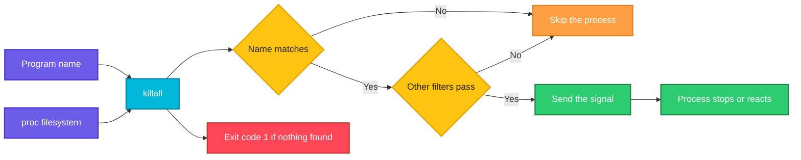

# killall

## What is it?
`killall` sends a signal to **all the processes that run a given program name**. You do not need the PID: `killall nginx` stops every process called `nginx`. The default signal is `SIGTERM` (15). It is part of the `psmisc` package, which also has `pstree` and `fuser`. It is simple and quick, but it matches the **name** exactly, unlike `pkill`, which matches a pattern.

> **Warning:** On some other Unix systems (Solaris, older UNIX System V) `killall` with no argument kills **all** processes of the system. The Linux `killall` of `psmisc` is not like that, but never run `killall` on an unknown system without checking.

## Syntax
```bash
killall [OPTIONS] [-s SIGNAL | -SIGNAL] NAME...
killall -l
killall -V
```
You can give several names. The name is compared with the name of the program of each process, not with the whole command line.

### Exit status
| Code | Meaning |
|------|---------|
| `0` | At least one process was signalled |
| `1` | No process was found, or a signal could not be sent |

## Visual Overview
> `killall` lists the processes, picks those whose program name is equal to the name you gave (and the other filters), and sends the signal to each of them.



## Options/Flags
| Flag | Description |
|------|-------------|
| `-s SIGNAL` / `--signal SIGNAL` | Send this signal (name or number) |
| `-SIGNAL` | The same, in short form: `-9`, `-KILL`, `-HUP` |
| `-e` / `--exact` | Require an exact match for names longer than 15 characters (the kernel cuts the stored name) |
| `-I` / `--ignore-case` | Match the name without regard to case |
| `-r` / `--regexp` | Treat the name as an extended regular expression |
| `-g` / `--process-group` | Send the signal to the whole process group of each matching process |
| `-u USER` / `--user USER` | Only kill processes of this user |
| `-y TIME` / `--younger-than TIME` | Only processes that started less than `TIME` ago |
| `-o TIME` / `--older-than TIME` | Only processes that started more than `TIME` ago |
| `-i` / `--interactive` | Ask before each kill |
| `-v` / `--verbose` | Report each process that was killed |
| `-q` / `--quiet` | Do not complain when no process was found |
| `-w` / `--wait` | Wait until all the killed processes are gone |
| `-Z PATTERN` / `--context PATTERN` | Only processes with a SELinux context that matches `PATTERN` |
| `-l` / `--list` | List the signal names |
| `-V` / `--version` | Show the version |
| `--help` | Show the help text |

> The `TIME` value is a number with a unit: `s` seconds, `m` minutes, `h` hours, `d` days, `w` weeks, `M` months, `y` years. For example `30m` or `2d`.

## Usage Examples

Let's say we have the server `web01` from the `ps` guide. We are logged in as the user `deploy` in a shell with PID `2302` on the terminal `pts/0`. Today is `2026-10-12 10:05`. These processes are running:

**Input (what is running)**:

| PID | PPID | User | Started | Command line |
|-----|------|------|---------|--------------|
| 640 | 1 | root | Oct05 | `/usr/sbin/sshd -D` |
| 812 | 1 | root | Oct05 | `nginx: master process /usr/sbin/nginx` |
| 813 | 812 | www-data | Oct05 | `nginx: worker process` |
| 814 | 812 | www-data | Oct05 | `nginx: worker process` |
| 2045 | 1 | deploy | 09:30 (35 minutes ago) | `node /srv/myapp/server.js` |
| 2302 | 2301 | deploy | 09:45 | `-bash` |
| 3120 | 2302 | deploy | 10:00 (5 minutes ago) | `python3 worker.py` |
| 3125 | 2302 | deploy | 10:01 (4 minutes ago) | `python3 worker.py` |
| 3140 | 2302 | deploy | 10:02 | `Python3` (a program with an upper case name) |

`killall` prints nothing when it works, unless you add `-v`. Each example starts again from this list.

### Example 1: Stop all the processes with a name
**Command:**
```bash
killall python3
pgrep -c python3
```
**Sample Output:**
```text
0
```
Both copies of `python3` (`3120` and `3125`) got `SIGTERM`. The name `Python3` with the capital letter was not matched.

### Example 2: Choose the signal (`-s`, `-SIGNAL`)
**Command:**
```bash
killall -s KILL python3
killall -9 python3
killall -KILL python3
killall -s 9 python3
```
**Sample Output:**
```text
```
All lines send signal 9. After the first one there is no process left, so the others would print `python3: no process found`.

### Example 3: Reload a service (`-HUP`)
**Command:**
```bash
sudo killall -HUP nginx
```
**Sample Output:**
```text
```
There is no output. All the nginx processes get `SIGHUP`, and the master process reloads the configuration.

### Example 4: Show what was killed (`-v`)
**Command:**
```bash
killall -v python3
```
**Sample Output:**
```text
Killed python3(3120) with signal 15
Killed python3(3125) with signal 15
```

### Example 5: No process found (and `-q`)
**Command:**
```bash
killall nosuchprocess; echo "exit code: $?"
killall -q nosuchprocess; echo "exit code: $?"
```
**Sample Output:**
```text
nosuchprocess: no process found
exit code: 1
exit code: 1
```
`-q` hides the message, but the exit code is still `1`.

### Example 6: Ignore case (`-I`)
**Command:**
```bash
killall -v -I python3
```
**Sample Output:**
```text
Killed python3(3120) with signal 15
Killed python3(3125) with signal 15
Killed Python3(3140) with signal 15
```

### Example 7: A regular expression (`-r`)
**Command:**
```bash
sudo killall -v -r '^ngin'
```
**Sample Output:**
```text
Killed nginx(812) with signal 15
Killed nginx(813) with signal 15
Killed nginx(814) with signal 15
```
Without `-r`, `killall ngin` would not match the name `nginx`.

### Example 8: Names longer than 15 characters (`-e`)
The kernel keeps only the first 15 characters of a process name. `killall` takes a longer name and cuts it to 15 characters too, so two programs can look the same. `-e` checks the full path of the program in `/proc/PID/exe`.

**Command:**
```bash
killall -e -v my-long-program-name
```
**Sample Output:**
```text
Killed my-long-program-(4200) with signal 15
```
The name that is printed is the cut name from the kernel. Programs with the same first 15 characters but another full name are not killed.

### Example 9: Only the processes of a user (`-u`)
**Command:**
```bash
killall -u deploy -v node
sudo killall -u www-data -v nginx
```
**Sample Output:**
```text
Killed node(2045) with signal 15
Killed nginx(813) with signal 15
Killed nginx(814) with signal 15
```
The root owned master process `812` is not killed by the second command.

### Example 10: Only the young processes (`-y`)
Only processes that started less than 1 hour ago. `node` (35 minutes) matches, `nginx` (7 days) does not.

**Command:**
```bash
sudo killall -y 1h -v node nginx
```
**Sample Output:**
```text
Killed node(2045) with signal 15
```

### Example 11: Only the old processes (`-o`)
Only the processes that started more than 1 day ago.

**Command:**
```bash
sudo killall -o 1d -v node nginx
```
**Sample Output:**
```text
Killed nginx(812) with signal 15
Killed nginx(813) with signal 15
Killed nginx(814) with signal 15
```

### Example 12: Ask for each process (`-i`)
**Command:**
```bash
killall -i python3
```
**Sample Output** (you answer `y` or `n`):
```text
Kill python3(3120) ? (y/N) y
Kill python3(3125) ? (y/N) n
```

### Example 13: Wait until the processes are gone (`-w`)
`killall` returns at once. With `-w`, it waits until the processes have really ended, and then continues. Without a limit it checks every second.

**Command:**
```bash
killall -w python3
echo "all python3 processes have ended"
```
**Sample Output:**
```text
all python3 processes have ended
```

### Example 14: Signal the whole process group (`-g`)
Each matching process gets its group killed. If `3120` is the leader of a group that also holds the child `3121`, both are signalled.

**Command:**
```bash
killall -g -v python3
```
**Sample Output:**
```text
Killed process group 3120 as python3(3120) with signal 15
Killed process group 3125 as python3(3125) with signal 15
```

### Example 15: SELinux context (`-Z`)
Only the processes whose SELinux context matches the pattern.

**Command:**
```bash
sudo killall -Z 'httpd_t' -v nginx
```
**Sample Output:**
```text
Killed nginx(812) with signal 15
Killed nginx(813) with signal 15
Killed nginx(814) with signal 15
```
On a system without SELinux this option is not available.

### Example 16: List the signals (`-l`)
**Command:**
```bash
killall -l
```
**Sample Output:**
```text
HUP INT QUIT ILL TRAP ABRT BUS FPE KILL USR1 SEGV USR2 PIPE ALRM TERM STKFLT
CHLD CONT STOP TSTP TTIN TTOU URG XCPU XFSZ VTALRM PROF WINCH IO PWR SYS UNUSED
```

### Example 17: Several names
**Command:**
```bash
killall -v python3 node
```
**Sample Output:**
```text
Killed python3(3120) with signal 15
Killed python3(3125) with signal 15
Killed node(2045) with signal 15
```

### Example 18: Not your process
**Command:**
```bash
killall nginx; echo "exit code: $?"
```
**Sample Output:**
```text
nginx(812): Operation not permitted
nginx(813): Operation not permitted
nginx(814): Operation not permitted
exit code: 1
```
You are `deploy`. Use `sudo killall nginx`.

### Example 19: Check the version (`-V`)
**Command:**
```bash
killall -V
```
**Sample Output:**
```text
killall (PSmisc) 23.4
Copyright (C) 1993-2021 Werner Almesberger and Craig Small

PSmisc comes with ABSOLUTELY NO WARRANTY.
This is free software, and you are welcome to redistribute it under
the terms of the GNU General Public License.
For more information about these matters, see the files named COPYING.
```

### Example 20: Show the help (`--help`)
**Command:**
```bash
killall --help | head -n 3
```
**Sample Output:**
```text
Usage: killall [OPTION]... [--] NAME...
       killall -l, --list
       killall -V, --version
```

## Pitfalls / Gotchas
- **`killall` is not portable.** On Solaris and some UNIX systems, it means "kill all processes of the system", and can shut down a server. On Linux (`psmisc`) it kills by name. Scripts that must run on both should use `pkill` or `kill`.
- **It matches the program name only,** not the arguments. `killall python3` stops **all** Python programs, not only your script. For a specific script use `pkill -f 'worker.py'`.
- **The name is cut to 15 characters.** A longer name is compared with the cut name, so similar programs are killed together unless you add `-e`.
- **It matches all users' processes.** As `root`, `killall` stops the programs of all users. Add `-u USER` to limit the damage.
- **Interpreted programs hide behind their interpreter.** A Java application is called `java`, and a script is `python3` or `bash`. `killall java` stops all Java programs on the machine.
- **Case matters** unless you use `-I`.
- **It sends the signal and returns.** The process may still run for a short time. Use `-w` to wait.
- **`SIGTERM` can be ignored.** If the processes stay, send `SIGKILL` (`-9`), but only when needed.
- **A supervisor restarts what you stop.** `systemd`, `supervisord` or Kubernetes will start the service again. Stop it with the manager.
- **`killall` is not installed everywhere.** Install `psmisc` (`sudo apt install psmisc`). Minimal containers often lack it. `pkill` comes with `procps`, which is more common.
- **Exit code `1` also means "not found".** In a script with `set -e` add `|| true` where "no process" is fine.

## DevOps Use Cases

### Use Case 1: Stop all the workers of an application before an update
**Situation:** The deployment script must stop every `gunicorn` process, and wait until they have finished their work.

**Command:**
```bash
sudo killall -w gunicorn
echo "gunicorn is stopped"
```
**Output:**
```text
gunicorn is stopped
```

### Use Case 2: Reload a daemon on all instances
**Situation:** After a configuration change, tell every `nginx` process to reload.

**Input (what is running)**: the processes of `web01` from the Usage Examples.

**Command:**
```bash
sudo killall -HUP nginx
```
**Output:**
```text
```
There is no output. Check it with `pgrep -a nginx` (new PIDs for the workers).

### Use Case 3: Clean up a test environment
**Situation:** A test run starts a headless browser, a mock server and a database. Stop them all at the end, and ignore the ones that are not there.

**Command:**
```bash
for name in chromium node mock-server; do
  killall -q "$name"
done
echo "test processes cleaned"
```
**Output:**
```text
test processes cleaned
```

### Use Case 4: Remove processes that run for too long
**Situation:** A report generator should finish in 1 hour. Stop the ones that run longer.

**Command:**
```bash
killall -o 1h -v report-gen
```
**Output:**
```text
Killed report-gen(5120) with signal 15
```

### Use Case 5: Stop only the new instances after a failed rollout
**Situation:** The new version of `myapp` started 10 minutes ago and is faulty, but the old instances are healthy. Stop only the young ones.

**Command:**
```bash
killall -y 15m -v myapp
```
**Output:**
```text
Killed myapp(6101) with signal 15
Killed myapp(6102) with signal 15
```

### Use Case 6: Safely stop the processes of one user
**Situation:** A user's Python scripts must be stopped, but not those of other users.

**Input (what is running)**: the processes of `web01` from the Usage Examples.

**Command:**
```bash
sudo killall -u deploy -v python3
```
**Output:**
```text
Killed python3(3120) with signal 15
Killed python3(3125) with signal 15
```

### Use Case 7: Restart a desktop service on a developer machine
**Situation:** The window manager panel is frozen. Stop it so that the session starts it again.

**Command:**
```bash
killall -v plasmashell
```
**Output:**
```text
Killed plasmashell(2210) with signal 15
```

### Use Case 8: Confirm before you kill on a production host
**Situation:** On a critical server you want to confirm each kill by hand.

**Command:**
```bash
sudo killall -i -v nginx
```
**Output:**
```text
Kill nginx(813) ? (y/N) y
Killed nginx(813) with signal 15
Kill nginx(814) ? (y/N) n
```

## Related Commands
- [`kill`](kill.md) - send a signal to a PID
- [`pkill`](pkill.md) - send a signal by pattern, user or terminal, and on every Unix
- [`pgrep`](pgrep.md) - list the processes before you signal them
- [`ps`](ps.md) - show the processes and their start times
- [`top`](top.md) - watch the processes live
- [`timeout`](timeout.md) - stop a command after a time limit
- `pstree` - the other tool of the `psmisc` package
- `fuser` - find and kill the processes that use a file or a port (`fuser -k 3000/tcp`)
- `systemctl` - stop and restart services in a managed way
