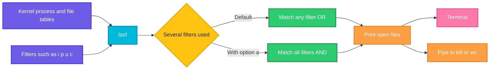

# lsof

## What is it?
`lsof` (list open files) shows which processes have which files open. On Linux, almost everything is a file: regular files, directories, **network sockets**, UNIX sockets and pipes. So `lsof` is also a very useful network tool. It answers questions like "which process is listening on port 8080?", "who is connected to my database?" and "why can't I unmount this disk?". Run it with `sudo` to see the processes of all users.

## Syntax
```bash
lsof [OPTIONS] [FILE...]
lsof -i [PROTOCOL][@HOST][:PORT]
```
Without options, `lsof` lists **all** open files of **all** processes. When you give several selection options (`-i`, `-p`, `-u`, `-c` ...), they are joined with **OR**, unless you add `-a` (**AND**).

### Columns of the output
| Column | Meaning |
|--------|---------|
| `COMMAND` | Name of the process (the first 9 characters) |
| `PID` | Process ID |
| `USER` | Owner of the process |
| `FD` | File descriptor: `cwd` current directory, `txt` program, `mem` memory mapped file, or a number followed by the mode (`r` read, `w` write, `u` read and write) |
| `TYPE` | `IPv4`, `IPv6`, `REG` regular file, `DIR` directory, `unix` UNIX socket, `FIFO` pipe, `CHR` device |
| `DEVICE` | Device numbers, or the kernel socket ID |
| `SIZE/OFF` | File size or offset. For sockets it is `0t0` |
| `NODE` | Inode number, or the protocol (`TCP`, `UDP`) for network files |
| `NAME` | The name of the file, or for sockets the addresses and the connection state |

## Visual Overview
> `lsof` reads the process table and the open file tables of the kernel (`/proc`), keeps the entries that match your filters and prints them.



## Options/Flags

### Network selection
| Flag | Description |
|------|-------------|
| `-i` | Select all network files (sockets) |
| `-i[46][PROTOCOL][@HOST][:PORT]` | Select network files that match: `-i4` IPv4 only, `-i6` IPv6 only, `-iTCP`, `-iUDP`, `-i@10.0.0.5`, `-i:80`, `-i:80,443`, `-i:1-1024` or a combination like `-iTCP@10.0.0.5:51234` |
| `-s PROTOCOL:STATE` | Select by the protocol state, for example `-sTCP:LISTEN` or `-sTCP:ESTABLISHED`. `^` excludes a state |
| `-U` | Select UNIX domain sockets |

### Process, user and file selection
| Flag | Description |
|------|-------------|
| `-p PID[,PID]` | Select the process with this ID. `^PID` excludes it |
| `-u USER[,USER]` | Select files of this user (name or UID). `^USER` excludes the user |
| `-c NAME` | Select processes whose command starts with `NAME` (also `-c /REGEX/`) |
| `+c WIDTH` | Set the width of the `COMMAND` column. `+c 0` shows the full command name |
| `-d FD` | Select by file descriptor, for example `-d 1`, `-d cwd`, `-d 0-10`, `-d ^mem` |
| `-a` | Combine the selection options with AND instead of OR |
| `+D DIR` | Select all open files below the directory `DIR` (recursive, slow on big trees) |
| `+d DIR` | Select the open files that are directly in the directory `DIR` (not recursive) |
| `+L[N]` | Select files with fewer than `N` links. `+L1` finds deleted files that are still open |

### Output
| Flag | Description |
|------|-------------|
| `-P` | Do not convert port numbers to names (`80` instead of `http`) |
| `-n` | Do not convert IP addresses to host names. Much faster |
| `-t` | Print only the process IDs (terse). Useful with `kill` |
| `-l` | Show the user ID number instead of the user name |
| `-R` | Add the parent process ID (`PPID`) column |
| `-F[FIELDS]` | Print fields in a format that scripts can parse, one field per line. `p` PID, `c` command, `n` name, `f` descriptor |
| `-r SECONDS` | Repeat the listing every `SECONDS` seconds, until interrupted |
| `-w` | Do not print warnings |
| `-b` | Avoid kernel functions that can block (for example on a hung NFS mount) |
| `-v` | Show the version |
| `-h` | Show the help text |

## Usage Examples

Let's say we have a server `web01` (IP address `10.0.0.12`). These are the processes that have network files open:

**Input (what is running)**:

| Process | PID | User | Network files |
|---------|-----|------|---------------|
| `systemd-resolved` | 560 | `systemd-resolve` | UDP `127.0.0.53:53` |
| `sshd` | 640 | `root` | TCP `*:22` listening (IPv4 and IPv6) |
| `chronyd` | 702 | `_chrony` | UDP `127.0.0.1:323` |
| `dockerd` | 700 | `root` | UNIX socket `/run/docker.sock` |
| `nginx` (master) | 812 | `root` | TCP `*:80` and `*:443` listening |
| `nginx` (worker) | 813 | `www-data` | the same two listening sockets |
| `postgres` | 1100 | `postgres` | TCP `127.0.0.1:5432` listening |
| `node` | 2045 | `deploy` | TCP `*:3000` listening; a client `10.0.0.5:51234` is connected; a connection from `10.0.0.12:40122` to the database `10.0.0.20:5432` |
| `sshd` (session) | 2301 | `deploy` | TCP `10.0.0.12:22` connected to `10.0.0.5:50122` |

The node application also writes to the file `/var/log/myapp/app.log`. A log file `/var/log/myapp/old.log` was deleted, but the process still has it open.

The column widths of `lsof` change with the data. The examples are aligned by hand, and the order of the lines can differ on your system.

### Example 1: List all network connections (`-i`)
Port numbers and host names are converted to names. This can be slow when DNS is slow.

**Command:**
```bash
sudo lsof -i
```
**Sample Output:**
```text
COMMAND    PID            USER   FD   TYPE DEVICE SIZE/OFF NODE NAME
systemd-r  560 systemd-resolve   13u  IPv4  14120      0t0  UDP localhost:domain
sshd       640            root    3u  IPv4  15012      0t0  TCP *:ssh (LISTEN)
sshd       640            root    4u  IPv6  15014      0t0  TCP *:ssh (LISTEN)
chronyd    702         _chrony    5u  IPv4  14201      0t0  UDP localhost:323
nginx      812            root    6u  IPv4  16240      0t0  TCP *:http (LISTEN)
nginx      812            root    7u  IPv4  16241      0t0  TCP *:https (LISTEN)
nginx      813        www-data    6u  IPv4  16240      0t0  TCP *:http (LISTEN)
nginx      813        www-data    7u  IPv4  16241      0t0  TCP *:https (LISTEN)
postgres  1100        postgres    5u  IPv4  17002      0t0  TCP localhost:postgresql (LISTEN)
node      2045          deploy   19u  IPv4  18331      0t0  TCP *:3000 (LISTEN)
node      2045          deploy   21u  IPv4  18340      0t0  TCP web01:3000->client01:51234 (ESTABLISHED)
node      2045          deploy   22u  IPv4  18355      0t0  TCP web01:40122->db01:postgresql (ESTABLISHED)
sshd      2301          deploy    4u  IPv4  19002      0t0  TCP web01:ssh->client01:50122 (ESTABLISHED)
```

### Example 2: Numbers instead of names (`-P` and `-n`)
Use both in scripts and on servers. The result is faster and the output is exact.

**Command:**
```bash
sudo lsof -i -P -n
```
**Sample Output:**
```text
COMMAND    PID            USER   FD   TYPE DEVICE SIZE/OFF NODE NAME
systemd-r  560 systemd-resolve   13u  IPv4  14120      0t0  UDP 127.0.0.53:53
sshd       640            root    3u  IPv4  15012      0t0  TCP *:22 (LISTEN)
sshd       640            root    4u  IPv6  15014      0t0  TCP *:22 (LISTEN)
chronyd    702         _chrony    5u  IPv4  14201      0t0  UDP 127.0.0.1:323
nginx      812            root    6u  IPv4  16240      0t0  TCP *:80 (LISTEN)
nginx      812            root    7u  IPv4  16241      0t0  TCP *:443 (LISTEN)
nginx      813        www-data    6u  IPv4  16240      0t0  TCP *:80 (LISTEN)
nginx      813        www-data    7u  IPv4  16241      0t0  TCP *:443 (LISTEN)
postgres  1100        postgres    5u  IPv4  17002      0t0  TCP 127.0.0.1:5432 (LISTEN)
node      2045          deploy   19u  IPv4  18331      0t0  TCP *:3000 (LISTEN)
node      2045          deploy   21u  IPv4  18340      0t0  TCP 10.0.0.12:3000->10.0.0.5:51234 (ESTABLISHED)
node      2045          deploy   22u  IPv4  18355      0t0  TCP 10.0.0.12:40122->10.0.0.20:5432 (ESTABLISHED)
sshd      2301          deploy    4u  IPv4  19002      0t0  TCP 10.0.0.12:22->10.0.0.5:50122 (ESTABLISHED)
```

### Example 3: Who uses a port? (`-i :PORT`)
**Command:**
```bash
sudo lsof -i :3000 -P -n
```
**Sample Output:**
```text
COMMAND  PID   USER   FD   TYPE DEVICE SIZE/OFF NODE NAME
node    2045 deploy   19u  IPv4  18331      0t0  TCP *:3000 (LISTEN)
node    2045 deploy   21u  IPv4  18340      0t0  TCP 10.0.0.12:3000->10.0.0.5:51234 (ESTABLISHED)
```
`lsof` shows both the listening socket and the connected client.

### Example 4: Several ports and port ranges
**Command:**
```bash
sudo lsof -i :80,443 -P -n
sudo lsof -i :20-25 -P -n
```
**Sample Output:**
```text
COMMAND PID     USER   FD   TYPE DEVICE SIZE/OFF NODE NAME
nginx   812     root    6u  IPv4  16240      0t0  TCP *:80 (LISTEN)
nginx   812     root    7u  IPv4  16241      0t0  TCP *:443 (LISTEN)
nginx   813 www-data    6u  IPv4  16240      0t0  TCP *:80 (LISTEN)
nginx   813 www-data    7u  IPv4  16241      0t0  TCP *:443 (LISTEN)
COMMAND  PID   USER   FD   TYPE DEVICE SIZE/OFF NODE NAME
sshd     640   root    3u  IPv4  15012      0t0  TCP *:22 (LISTEN)
sshd     640   root    4u  IPv6  15014      0t0  TCP *:22 (LISTEN)
sshd    2301 deploy    4u  IPv4  19002      0t0  TCP 10.0.0.12:22->10.0.0.5:50122 (ESTABLISHED)
```

### Example 5: Only TCP (`-iTCP`)
**Command:**
```bash
sudo lsof -iTCP -P -n | head -n 4
```
**Sample Output:**
```text
COMMAND  PID USER   FD   TYPE DEVICE SIZE/OFF NODE NAME
sshd     640 root    3u  IPv4  15012      0t0  TCP *:22 (LISTEN)
sshd     640 root    4u  IPv6  15014      0t0  TCP *:22 (LISTEN)
nginx    812 root    6u  IPv4  16240      0t0  TCP *:80 (LISTEN)
```

### Example 6: Only UDP (`-iUDP`)
**Command:**
```bash
sudo lsof -iUDP -P -n
```
**Sample Output:**
```text
COMMAND   PID            USER   FD   TYPE DEVICE SIZE/OFF NODE NAME
systemd-r 560 systemd-resolve   13u  IPv4  14120      0t0  UDP 127.0.0.53:53
chronyd   702         _chrony    5u  IPv4  14201      0t0  UDP 127.0.0.1:323
```

### Example 7: Only IPv4 or only IPv6 (`-i4`, `-i6`)
**Command:**
```bash
sudo lsof -i6 -P -n
```
**Sample Output:**
```text
COMMAND PID USER   FD   TYPE DEVICE SIZE/OFF NODE NAME
sshd    640 root    4u  IPv6  15014      0t0  TCP *:22 (LISTEN)
```
`-i4` shows all the IPv4 files of the list in Example 2.

### Example 8: Connections to or from one host (`-i@HOST`)
**Command:**
```bash
sudo lsof -i @10.0.0.5 -P -n
```
**Sample Output:**
```text
COMMAND  PID   USER   FD   TYPE DEVICE SIZE/OFF NODE NAME
node    2045 deploy   21u  IPv4  18340      0t0  TCP 10.0.0.12:3000->10.0.0.5:51234 (ESTABLISHED)
sshd    2301 deploy    4u  IPv4  19002      0t0  TCP 10.0.0.12:22->10.0.0.5:50122 (ESTABLISHED)
```

### Example 9: Protocol, host and port together
**Command:**
```bash
sudo lsof -iTCP@10.0.0.20:5432 -P -n
```
**Sample Output:**
```text
COMMAND  PID   USER   FD   TYPE DEVICE SIZE/OFF NODE NAME
node    2045 deploy   22u  IPv4  18355      0t0  TCP 10.0.0.12:40122->10.0.0.20:5432 (ESTABLISHED)
```

### Example 10: Only listening sockets (`-sTCP:LISTEN`)
This is the list of open ports of the server. The `-iTCP` selects the protocol.

**Command:**
```bash
sudo lsof -iTCP -sTCP:LISTEN -P -n
```
**Sample Output:**
```text
COMMAND  PID     USER   FD   TYPE DEVICE SIZE/OFF NODE NAME
sshd     640     root    3u  IPv4  15012      0t0  TCP *:22 (LISTEN)
sshd     640     root    4u  IPv6  15014      0t0  TCP *:22 (LISTEN)
nginx    812     root    6u  IPv4  16240      0t0  TCP *:80 (LISTEN)
nginx    812     root    7u  IPv4  16241      0t0  TCP *:443 (LISTEN)
nginx    813 www-data    6u  IPv4  16240      0t0  TCP *:80 (LISTEN)
nginx    813 www-data    7u  IPv4  16241      0t0  TCP *:443 (LISTEN)
postgres 1100 postgres   5u  IPv4  17002      0t0  TCP 127.0.0.1:5432 (LISTEN)
node    2045   deploy   19u  IPv4  18331      0t0  TCP *:3000 (LISTEN)
```

### Example 11: Only established connections (`-sTCP:ESTABLISHED`)
**Command:**
```bash
sudo lsof -iTCP -sTCP:ESTABLISHED -P -n
```
**Sample Output:**
```text
COMMAND  PID   USER   FD   TYPE DEVICE SIZE/OFF NODE NAME
node    2045 deploy   21u  IPv4  18340      0t0  TCP 10.0.0.12:3000->10.0.0.5:51234 (ESTABLISHED)
node    2045 deploy   22u  IPv4  18355      0t0  TCP 10.0.0.12:40122->10.0.0.20:5432 (ESTABLISHED)
sshd    2301 deploy    4u  IPv4  19002      0t0  TCP 10.0.0.12:22->10.0.0.5:50122 (ESTABLISHED)
```

### Example 12: Only the process IDs (`-t`)
**Command:**
```bash
sudo lsof -t -i :80
sudo lsof -t -i :3000
```
**Sample Output:**
```text
812
813
2045
```
The process IDs are listed without duplicates. The output of the first command is `812` and `813`, and of the second one `2045`.

### Example 13: Files of a process (`-p`)
A process has many open files besides sockets: its program, libraries, log files and so on. The list is cut here with `head`.

**Command:**
```bash
sudo lsof -p 2045 | head -n 8
```
**Sample Output:**
```text
COMMAND  PID   USER   FD      TYPE DEVICE SIZE/OFF   NODE NAME
node    2045 deploy  cwd       DIR    8,1     4096 131074 /srv/myapp
node    2045 deploy  rtd       DIR    8,1     4096      2 /
node    2045 deploy  txt       REG    8,1 94253448 262310 /usr/bin/node
node    2045 deploy  mem       REG    8,1  2029592 396211 /usr/lib/x86_64-linux-gnu/libc.so.6
node    2045 deploy    0u      CHR  136,0      0t0      3 /dev/pts/0
node    2045 deploy    3w      REG    8,1   524288 131120 /var/log/myapp/app.log
node    2045 deploy   19u     IPv4  18331      0t0    TCP *:3000 (LISTEN)
```

### Example 14: Network files of a process (`-a` with `-p` and `-i`)
Without `-a`, `-p` and `-i` are joined with OR. With `-a`, only the network files of this process are shown.

**Command:**
```bash
sudo lsof -a -p 2045 -i -P -n
```
**Sample Output:**
```text
COMMAND  PID   USER   FD   TYPE DEVICE SIZE/OFF NODE NAME
node    2045 deploy   19u  IPv4  18331      0t0  TCP *:3000 (LISTEN)
node    2045 deploy   21u  IPv4  18340      0t0  TCP 10.0.0.12:3000->10.0.0.5:51234 (ESTABLISHED)
node    2045 deploy   22u  IPv4  18355      0t0  TCP 10.0.0.12:40122->10.0.0.20:5432 (ESTABLISHED)
```

### Example 15: Files of a user (`-u`)
**Command:**
```bash
sudo lsof -a -u deploy -i -P -n
```
**Sample Output:**
```text
COMMAND  PID   USER   FD   TYPE DEVICE SIZE/OFF NODE NAME
node    2045 deploy   19u  IPv4  18331      0t0  TCP *:3000 (LISTEN)
node    2045 deploy   21u  IPv4  18340      0t0  TCP 10.0.0.12:3000->10.0.0.5:51234 (ESTABLISHED)
node    2045 deploy   22u  IPv4  18355      0t0  TCP 10.0.0.12:40122->10.0.0.20:5432 (ESTABLISHED)
sshd    2301 deploy    4u  IPv4  19002      0t0  TCP 10.0.0.12:22->10.0.0.5:50122 (ESTABLISHED)
```

### Example 16: Exclude a user or a process (`^`)
All network files that do **not** belong to `root` and `nginx`'s worker user.

**Command:**
```bash
sudo lsof -a -u ^root,^www-data -i TCP -sTCP:LISTEN -P -n
```
**Sample Output:**
```text
COMMAND  PID     USER   FD   TYPE DEVICE SIZE/OFF NODE NAME
postgres 1100 postgres   5u  IPv4  17002      0t0  TCP 127.0.0.1:5432 (LISTEN)
node     2045   deploy  19u  IPv4  18331      0t0  TCP *:3000 (LISTEN)
```

### Example 17: Files of a command (`-c`)
`-c nginx` matches every process whose command starts with `nginx`.

**Command:**
```bash
sudo lsof -a -c nginx -i -P -n
```
**Sample Output:**
```text
COMMAND PID     USER   FD   TYPE DEVICE SIZE/OFF NODE NAME
nginx   812     root    6u  IPv4  16240      0t0  TCP *:80 (LISTEN)
nginx   812     root    7u  IPv4  16241      0t0  TCP *:443 (LISTEN)
nginx   813 www-data    6u  IPv4  16240      0t0  TCP *:80 (LISTEN)
nginx   813 www-data    7u  IPv4  16241      0t0  TCP *:443 (LISTEN)
```

### Example 18: Full command names (`+c 0`)
By default, `lsof` cuts the command name to 9 characters.

**Command:**
```bash
sudo lsof +c 0 -i UDP -P -n
```
**Sample Output:**
```text
COMMAND            PID            USER   FD   TYPE DEVICE SIZE/OFF NODE NAME
systemd-resolved   560 systemd-resolve   13u  IPv4  14120      0t0  UDP 127.0.0.53:53
chronyd            702         _chrony    5u  IPv4  14201      0t0  UDP 127.0.0.1:323
```

### Example 19: Select by file descriptor (`-d`)
Show the current directory (`cwd`) of the processes of the user `deploy`.

**Command:**
```bash
sudo lsof -a -u deploy -d cwd
```
**Sample Output:**
```text
COMMAND  PID   USER  FD  TYPE DEVICE SIZE/OFF   NODE NAME
node    2045 deploy cwd   DIR    8,1     4096 131074 /srv/myapp
sshd    2301 deploy cwd   DIR    8,1     4096      2 /
```

### Example 20: Who has a file open?
Give the file name as an argument.

**Command:**
```bash
sudo lsof /var/log/myapp/app.log
```
**Sample Output:**
```text
COMMAND  PID   USER   FD   TYPE DEVICE SIZE/OFF   NODE NAME
node    2045 deploy    3w   REG    8,1   524288 131120 /var/log/myapp/app.log
```

### Example 21: Everything open below a directory (`+D`)
This also finds files in all sub directories. It can be slow on big trees.

**Command:**
```bash
sudo lsof +D /var/log/myapp
```
**Sample Output:**
```text
COMMAND  PID   USER   FD   TYPE DEVICE SIZE/OFF   NODE NAME
node    2045 deploy    3w   REG    8,1   524288 131120 /var/log/myapp/app.log
node    2045 deploy   23w   REG    8,1  1048576 131121 /var/log/myapp/old.log (deleted)
```

### Example 22: Only the files directly in a directory (`+d`)
**Command:**
```bash
sudo lsof +d /var/log
```
**Sample Output:**
```text
COMMAND   PID USER   FD   TYPE DEVICE SIZE/OFF   NODE NAME
rsyslogd  655 syslog 7w   REG    8,1    91234 131300 /var/log/syslog
```
`+d` lists only files that are directly in `/var/log`, and not those in `/var/log/myapp`.

### Example 23: Find deleted files that still use disk space (`+L1`)
`+L1` selects files with fewer than 1 link, which means deleted files. A column `NLINK` is added.

**Command:**
```bash
sudo lsof +L1
```
**Sample Output:**
```text
COMMAND  PID   USER   FD   TYPE DEVICE SIZE/OFF NLINK   NODE NAME
node    2045 deploy   23w   REG    8,1  1048576     0 131121 /var/log/myapp/old.log (deleted)
```

### Example 24: UNIX domain sockets (`-U`)
**Command:**
```bash
sudo lsof -U | grep docker
```
**Sample Output:**
```text
dockerd  700 root    5u  unix 0xffff8a3b4c2d0000      0t0 20311 /run/docker.sock type=STREAM
dockerd  700 root    8u  unix 0xffff8a3b4c2d1400      0t0 20315 /run/docker.sock type=STREAM
```

### Example 25: Parent process ID (`-R`)
**Command:**
```bash
sudo lsof -R -i :80 -P -n
```
**Sample Output:**
```text
COMMAND PID PPID     USER   FD   TYPE DEVICE SIZE/OFF NODE NAME
nginx   812    1     root    6u  IPv4  16240      0t0  TCP *:80 (LISTEN)
nginx   813  812 www-data    6u  IPv4  16240      0t0  TCP *:80 (LISTEN)
```
The worker `813` is a child of the master process `812`.

### Example 26: User ID numbers (`-l`)
**Command:**
```bash
sudo lsof -l -i :3000 -P -n
```
**Sample Output:**
```text
COMMAND  PID  UID   FD   TYPE DEVICE SIZE/OFF NODE NAME
node    2045 1001  19u  IPv4  18331      0t0  TCP *:3000 (LISTEN)
node    2045 1001  21u  IPv4  18340      0t0  TCP 10.0.0.12:3000->10.0.0.5:51234 (ESTABLISHED)
```

### Example 27: Output for scripts (`-F`)
Each line starts with a letter that says what the field is: `p` process ID, `c` command and `n` name.

**Command:**
```bash
sudo lsof -F pcn -i :3000 -P -n
```
**Sample Output:**
```text
p2045
cnode
n*:3000
n10.0.0.12:3000->10.0.0.5:51234
```

### Example 28: Repeat the listing (`-r`)
Show the connections of port 3000 every 2 seconds. Press `Ctrl+C` to stop. Each repeat starts with a line `=======`.

**Command:**
```bash
sudo lsof -r 2 -i :3000 -P -n
```
**Sample Output** (keeps running):
```text
COMMAND  PID   USER   FD   TYPE DEVICE SIZE/OFF NODE NAME
node    2045 deploy   19u  IPv4  18331      0t0  TCP *:3000 (LISTEN)
node    2045 deploy   21u  IPv4  18340      0t0  TCP 10.0.0.12:3000->10.0.0.5:51234 (ESTABLISHED)
=======
COMMAND  PID   USER   FD   TYPE DEVICE SIZE/OFF NODE NAME
node    2045 deploy   19u  IPv4  18331      0t0  TCP *:3000 (LISTEN)
=======
```
In the second listing the client is gone.

### Example 29: Hide warnings (`-w`)
Without `-w`, `lsof` can print warnings on standard error, such as `can't stat() fuse.gvfsd-fuse file system`. `-w` hides them, so the output is clean for scripts.

**Command:**
```bash
sudo lsof -w -i :80 -P -n
```
**Sample Output:**
```text
COMMAND PID     USER   FD   TYPE DEVICE SIZE/OFF NODE NAME
nginx   812     root    6u  IPv4  16240      0t0  TCP *:80 (LISTEN)
nginx   813 www-data    6u  IPv4  16240      0t0  TCP *:80 (LISTEN)
```

### Example 30: Do not block on broken mounts (`-b`)
`-b` tells `lsof` to avoid kernel calls that can hang, for example on a stuck NFS mount.

**Command:**
```bash
sudo lsof -b -i :22 -P -n
```
**Sample Output:**
```text
COMMAND  PID   USER   FD   TYPE DEVICE SIZE/OFF NODE NAME
sshd     640   root    3u  IPv4  15012      0t0  TCP *:22 (LISTEN)
sshd     640   root    4u  IPv6  15014      0t0  TCP *:22 (LISTEN)
sshd    2301 deploy    4u  IPv4  19002      0t0  TCP 10.0.0.12:22->10.0.0.5:50122 (ESTABLISHED)
```

### Example 31: Check the version (`-v`)
**Command:**
```bash
lsof -v 2>&1 | head -n 3
```
**Sample Output:**
```text
lsof version information:
    revision: 4.93.2
    latest revision: ftp://lsof.itap.purdue.edu/pub/tools/unix/lsof/
```

### Example 32: Show the help (`-h`)
**Command:**
```bash
lsof -h 2>&1 | head -n 2
```
**Sample Output:**
```text
lsof 4.93.2
 latest revision: ftp://lsof.itap.purdue.edu/pub/tools/unix/lsof/
```

## Pitfalls / Gotchas
- **Use `sudo`.** As a normal user you only see your own processes. A port that looks free can be used by another user.
- **Use `-P -n` on servers.** Without them, `lsof` does DNS lookups for every address and can be very slow, and ports are shown as names (`http`) that you cannot search for with `grep`.
- **Filters are joined with OR by default.** `lsof -u deploy -i` lists all files of `deploy` **plus** all network files. Add `-a` to get only the network files of `deploy`.
- **`-i :80` also matches the remote side.** A client connecting to port 80 of another server appears when its remote port is 80. Add `-sTCP:LISTEN` to see only the servers.
- **`+D` is slow.** It walks the whole directory tree and scans all processes. Use `+d` or give the file name when you can.
- **A space after `-i` changes the meaning on some versions.** Write `-i:80` or `-i :80`, but not `-i : 80`. Also quote or escape characters such as `@` and `^` in some shells.
- **`lsof` is not instant on a busy host.** It scans all processes. For only the listening ports `ss -tlnp` is faster. `lsof` is stronger when you search by file, by process or by user.
- **Deleted files still use disk space** as long as a process has them open. `df` shows a full disk but `du` does not find the files. Use `lsof +L1`.
- **A `COMMAND` is cut to 9 characters.** Use `+c 0` for the full name, and use `-c` with a prefix.
- **`lsof` can show the same socket several times.** The master and worker processes of `nginx` share the same listening socket, so it appears twice.
- **`lsof` is not installed on all systems.** Install it with `sudo apt install lsof` or `sudo dnf install lsof`. On minimal containers use `ss` or `/proc`.

## DevOps Use Cases

### Use Case 1: Fix "address already in use"
**Situation:** A new instance of the application fails with `Error: listen EADDRINUSE: address already in use :::3000`. Find out which process holds the port.

**Input (what is running)**: the server `web01` from the Usage Examples.

**Command:**
```bash
sudo lsof -i :3000 -sTCP:LISTEN -P -n
```
**Output:**
```text
COMMAND  PID   USER   FD   TYPE DEVICE SIZE/OFF NODE NAME
node    2045 deploy   19u  IPv4  18331      0t0  TCP *:3000 (LISTEN)
```
The old `node` process with PID `2045` still runs.

### Use Case 2: Stop the process that holds a port
**Situation:** Free port `3000` in a script, with the PID from `-t`.

**Input (what is running)**: the server `web01` from the Usage Examples.

**Command:**
```bash
sudo lsof -t -i :3000 -sTCP:LISTEN | xargs -r sudo kill
sudo lsof -i :3000 -sTCP:LISTEN -P -n; echo "exit code: $?"
```
**Output:**
```text
exit code: 1
```
`lsof` returns exit code `1` when it finds nothing, so the port is free. `-r` of `xargs` avoids running `kill` with no PID.

### Use Case 3: Audit the open ports of a server
**Situation:** A security check needs a list of every listening port with the program behind it.

**Input (what is running)**: the server `web01` from the Usage Examples.

**Command:**
```bash
sudo lsof -iTCP -sTCP:LISTEN -P -n | awk 'NR>1{print $9, $1, $3}' | sort -u
```
**Output:**
```text
*:22 sshd root
*:3000 node deploy
*:443 nginx root
*:443 nginx www-data
*:80 nginx root
*:80 nginx www-data
127.0.0.1:5432 postgres postgres
```
Services that listen on `*` are reachable from all networks. The database on `127.0.0.1` is only reachable locally.

### Use Case 4: Disk is full but `du` finds nothing (deleted files)
**Situation:** `df -h` says the disk is 98% full, but the files in `/var/log` are small. A log file was deleted while the application still writes to it.

**Input (what is running)**: the server `web01` from the Usage Examples, with the deleted file `/var/log/myapp/old.log` (1 MiB).

**Command:**
```bash
sudo lsof +L1 | awk 'NR>1{print $1, $2, $7, $NF}'
```
**Output:**
```text
node 2045 1048576 (deleted)
```
The space comes back when the process closes the file. Restart the application (or truncate the file with `: > /proc/2045/fd/23`).

### Use Case 5: "Target is busy" when unmounting a disk
**Situation:** `umount /mnt/data` fails with `target is busy`. Find the processes that use the mount.

**Command:**
```bash
sudo lsof +D /mnt/data
```
**Output:**
```text
COMMAND  PID   USER   FD   TYPE DEVICE SIZE/OFF   NODE NAME
bash    3120 deploy  cwd    DIR   8,17     4096      2 /mnt/data
python  3188 deploy    4r   REG   8,17  2048000     12 /mnt/data/export.csv
```
Close the shell in `/mnt/data` and stop the Python job, then unmount again.

### Use Case 6: Count the connections to a service
**Situation:** An alert fires when more than 1000 clients are connected to port 3000. Count the established connections.

**Input (what is running)**: the server `web01` from the Usage Examples.

**Command:**
```bash
sudo lsof -iTCP:3000 -sTCP:ESTABLISHED -P -n | tail -n +2 | wc -l
```
**Output:**
```text
1
```

### Use Case 7: Find who is connected to the database
**Situation:** The database has too many connections. Which client machines and processes are the cause?

**Command:**
```bash
sudo lsof -iTCP:5432 -sTCP:ESTABLISHED -P -n | awk 'NR>1{print $1, $2, $9}'
```
**Output:**
```text
postgres 1250 10.0.0.20:5432->10.0.0.12:40122
postgres 1301 10.0.0.20:5432->10.0.0.14:38812
```
Run it on the database host. The right side of each arrow is the client.

### Use Case 8: Look for suspicious outgoing connections
**Situation:** During an incident, check which processes talk to hosts outside of your network.

**Command:**
```bash
sudo lsof -i -P -n -sTCP:ESTABLISHED | grep -v '10\.0\.0\.'
```
**Output:**
```text
curl    4410 deploy    3u  IPv4  21001      0t0  TCP 10.0.0.12:52244->203.0.113.50:443 (ESTABLISHED)
```
A `curl` process sends data to the outside address `203.0.113.50`.

### Use Case 9: Look for a file descriptor leak
**Situation:** The application fails with `Too many open files`. Count its open files and see what kind they are.

**Input (what is running)**: the node process `2045`, which has a connection leak.

**Command:**
```bash
sudo lsof -p 2045 | wc -l
sudo lsof -p 2045 | awk 'NR>1{print $5}' | sort | uniq -c | sort -rn
```
**Output:**
```text
1031
    980 IPv4
     38 REG
      6 DIR
      4 CHR
      3 unix
```
Almost all of the open files are network sockets. Compare it with the limit in `/proc/2045/limits` (`Max open files`).

### Use Case 10: Watch the connections of a service live
**Situation:** During a load test, follow the connection count every second.

**Command:**
```bash
sudo lsof -r 1 -iTCP:443 -sTCP:ESTABLISHED -P -n | grep -c ESTABLISHED
```
**Output:**
```text
14
```
For a number that updates in place, use `watch`: `watch -n1 "sudo lsof -iTCP:443 -sTCP:ESTABLISHED -P -n | tail -n +2 | wc -l"`.

### Use Case 11: Check which log file an application writes to
**Situation:** A deploy changed the log path. Check where the process really writes.

**Input (what is running)**: the node process `2045`, which has `app.log` open.

**Command:**
```bash
sudo lsof -a -p 2045 -d 1-20 | grep -E ' [0-9]+w '
```
**Output:**
```text
node    2045 deploy    3w   REG    8,1   524288 131120 /var/log/myapp/app.log
node    2045 deploy   23w   REG    8,1  1048576 131121 /var/log/myapp/old.log (deleted)
```

### Use Case 12: Find the Docker daemon and its clients
**Situation:** Check who is connected to the Docker socket, for example to see which tools can control the host.

**Command:**
```bash
sudo lsof /run/docker.sock
```
**Output:**
```text
COMMAND   PID   USER   FD   TYPE             DEVICE SIZE/OFF  NODE NAME
dockerd   700   root    5u  unix 0xffff8a3b4c2d0000      0t0 20311 /run/docker.sock type=STREAM
docker   3401 deploy    3u  unix 0xffff8a3b4c2d5000      0t0 20990 type=STREAM
```

## Related Commands
- [`ss`](../networking/ss.md) - faster socket statistics, `ss -tlnp` lists listening ports with their processes
- [`netstat`](../networking/netstat.md) - the older tool for connections and ports
- [`nc`](../networking/nc.md) - test if a port is open
- [`tcpdump`](../networking/tcpdump.md) - capture the packets of a connection
- [`ip`](../networking/ip.md) - show addresses and routes
- [`curl`](../networking/curl.md) - make a request to the port you found
- [`ssh`](../networking/ssh.md) - the sessions that `lsof -i :22` shows
- `ps` - show the processes you found
- `kill` / `pkill` - stop a process by PID or by name
- `fuser` - find the processes that use a file or a port (`fuser 3000/tcp`)
- `df` / `du` - disk usage, compare with `lsof +L1`
