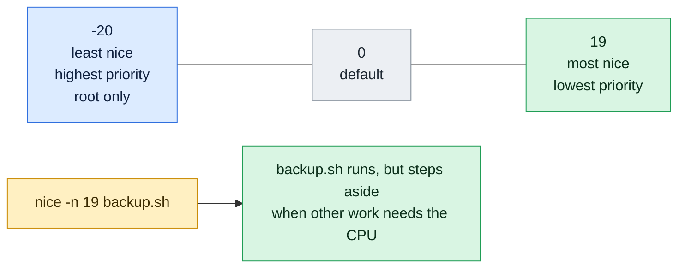

# nice

## What is it?
`nice` starts a command with a changed **niceness**, which is its scheduling priority on the CPU. The niceness is a number from `-20` to `19`. A **higher** number means "nicer": the process gives way to others, so it gets less CPU time when the machine is busy. A **lower** number gives the process more CPU time. The default is `0`. Use `nice` to run a heavy job (a backup, a build, a compression) without slowing down the important services. To change a process that is already running, use `renice`.

## Syntax
```bash
nice [OPTION] [COMMAND [ARGUMENTS]...]
nice -n ADJUSTMENT COMMAND [ARGUMENTS]...
```
Without a command, `nice` prints the current niceness of the shell. With a command, the niceness is **increased by the adjustment** (default `10`). Only `root` may use a negative adjustment, which gives more priority.

### The scale
| Niceness | Meaning |
|----------|---------|
| `-20` | The highest priority (only for `root`) |
| `0` | The default priority of a normal process |
| `10` | The default adjustment of `nice`. A "background" priority |
| `19` | The lowest priority. The process only runs when nothing else needs the CPU |

### Exit status
| Code | Meaning |
|------|---------|
| The status of the command | If the command ran, `nice` returns what the command returns |
| `125` | `nice` itself failed |
| `126` | The command was found but could not be run |
| `127` | The command was not found |

## Visual Overview
> Niceness is how polite a process is. A high number means it gives way to others, which is what you want for backups and batch jobs.



## Options/Flags
| Flag | Description |
|------|-------------|
| *(no command)* | Print the current niceness |
| `-n N` / `--adjustment=N` | Add `N` to the niceness of the command. A negative `N` needs `root` |
| `-N` (old style) | The same as `-n N`: `nice -10 command` adds 10 |
| `--N` (old style) | The same as `-n -N`: `nice --10 command` subtracts 10 |
| `--help` | Show the help text |
| `--version` | Show the version |

## Usage Examples

Let's say we are logged in as the user `deploy` on the server `web01` from the `ps` guide. The niceness of our shell is `0`. We have a script `backup.sh` that compresses a big directory:

**Input file** (`backup.sh`):
```text
#!/bin/bash
tar czf /backup/data.tgz /data
```

### Example 1: Print the current niceness
**Command:**
```bash
nice
```
**Sample Output:**
```text
0
```

### Example 2: Run a command with the default adjustment
Without `-n`, the adjustment is `10`.

**Command:**
```bash
nice nice
```
**Sample Output:**
```text
10
```
The second `nice` is the command. It prints its own niceness, which is `0 + 10`.

### Example 3: Choose the adjustment (`-n`)
**Command:**
```bash
nice -n 5 nice
nice -n 19 nice
```
**Sample Output:**
```text
5
19
```

### Example 4: The old style (`-N`)
**Command:**
```bash
nice -10 nice
```
**Sample Output:**
```text
10
```
`-10` means "add 10" here, and not "minus 10".

### Example 5: A negative adjustment needs `root` (`-n -N` and `--N`)
A normal user is not allowed to give a process more priority. `nice` prints a warning and runs the command with the normal niceness.

**Command:**
```bash
nice -n -5 nice
sudo nice -n -5 nice
sudo nice --5 nice
```
**Sample Output:**
```text
nice: cannot set niceness: Permission denied
0
-5
-5
```
As `deploy`, the first command prints the warning, and runs `nice` with niceness `0`. As `root`, it works. `--5` is the old way to write `-n -5`.

### Example 6: The limit of the scale
Values above `19` become `19`, values below `-20` become `-20`.

**Command:**
```bash
nice -n 25 nice
sudo nice -n -30 nice
```
**Sample Output:**
```text
19
-20
```

### Example 7: Niceness is added to the current one
A shell that already has niceness `10` starts commands at `10 + the adjustment`.

**Command:**
```bash
nice -n 10 bash -c 'nice; nice -n 5 nice'
```
**Sample Output:**
```text
10
15
```

### Example 8: Run a heavy job with a low priority
**Command:**
```bash
nice -n 19 ./backup.sh &
ps -o pid,ni,pcpu,cmd -p $!
```
**Sample Output:**
```text
[1] 4601
    PID  NI %CPU CMD
   4601  19  2.0 /bin/bash ./backup.sh
```
`NI` is the niceness. The backup uses CPU only when the machine has some to spare.

### Example 9: Compare two jobs
Two CPU hungry jobs on one core: one with `0`, one with `19`.

**Command:**
```bash
nice -n 0  sha256sum /dev/zero &
nice -n 19 sha256sum /dev/zero &
top -b -n 1 | grep sha256sum
```
**Sample Output:**
```text
   4611 deploy    20   0    5000   1000    800 R  97.5   0.0   0:09.50 sha256sum
   4612 deploy    39  19    5000   1000    800 R   2.0   0.0   0:00.20 sha256sum
```
The nice job gets almost no CPU as long as the other job wants it. `PR` is `39` and `NI` is `19` for it.

### Example 10: The command does not exist
**Command:**
```bash
nice -n 5 nosuchcommand; echo "exit code: $?"
```
**Sample Output:**
```text
nice: ‘nosuchcommand’: No such file or directory
exit code: 127
```

### Example 11: A bad adjustment
**Command:**
```bash
nice -n abc ls; echo "exit code: $?"
```
**Sample Output:**
```text
nice: invalid adjustment ‘abc’
Try 'nice --help' for more information.
exit code: 125
```

### Example 12: Check the version (`--version`)
**Command:**
```bash
nice --version | head -n 1
```
**Sample Output:**
```text
nice (GNU coreutils) 8.32
```

### Example 13: Show the help (`--help`)
**Command:**
```bash
nice --help | head -n 3
```
**Sample Output:**
```text
Usage: nice [OPTION] [COMMAND [ARG]...]
Run COMMAND with an adjusted niceness, which affects process scheduling.
With no COMMAND, print the current niceness.  Niceness values range from
```

## Pitfalls / Gotchas
- **`nice` only matters when the CPU is busy.** On an idle machine, a nice process runs at full speed. It does not make a job slower in itself.
- **It changes the CPU priority, not the disk priority.** A backup with `nice` can still make the disk slow. Add `ionice -c3` for the disk: `nice -n 19 ionice -c3 ./backup.sh`.
- **A big number is a low priority.** This confuses many people. `-n 19` is the most polite.
- **`nice -10` and `nice --10` are different.** `-10` adds 10, `--10` subtracts 10. Write `-n 10` and `-n -10` to be clear.
- **A normal user cannot lower the niceness** (give more priority), not even back to the value they had. Once you used `nice -n 10`, you cannot go back with `renice` without `root`.
- **Niceness is inherited.** The children of a process have the same niceness. A `nice -n 19` shell makes everything inside it nice.
- **`nice` does not work on a running process.** Use `renice -n 10 -p PID`.
- **Real-time processes ignore the niceness.** Processes with the policy `SCHED_FIFO` or `SCHED_RR` do not use it. See `chrt`.
- **Nice values are relative within a group.** With `systemd` and control groups (containers), the CPU shares of the groups are more important than the niceness inside the groups. Use `CPUWeight=` or the CPU shares of the container.
- **The shell `time` is not `nice`.** Do not mix up `nice` with `nohup`. They are often used together: `nohup nice -n 19 ./job.sh &`.

## DevOps Use Cases

### Use Case 1: Run a backup without slowing down the service
**Situation:** A nightly `tar` backup uses a lot of CPU, and the website becomes slow. Run it at the lowest priority.

**Input file** (`backup.sh`): same file as in the Usage Examples.

**Command:**
```bash
nice -n 19 ./backup.sh
echo "backup exit code: $?"
```
**Output:**
```text
backup exit code: 0
```

### Use Case 2: Low priority for CPU and disk together
**Situation:** The backup reads and writes a lot. Lower the priority of the CPU (`nice`) and of the disk (`ionice`, class 3 = idle).

**Command:**
```bash
nice -n 19 ionice -c3 ./backup.sh
```
**Output:**
```text
```
There is no output. The backup runs in the background of the system, and uses only idle time.

### Use Case 3: Compile on a shared build server
**Situation:** A developer compiles a big project on a server that other people use. Use all the cores, but be polite.

**Command:**
```bash
nice -n 10 make -j"$(nproc)"
```
**Output:**
```text
[ 25%] Building C object src/main.o
[ 50%] Building C object src/util.o
[100%] Linking C executable app
```

### Use Case 4: A low priority job in a cron file
**Situation:** A cron job rebuilds the search index every hour. It must not disturb the users.

**Input file** (`/etc/cron.d/reindex`):
```text
0 * * * * deploy nice -n 15 /usr/local/bin/reindex.sh >> /var/log/reindex.log 2>&1
```
**Command:**
```bash
cat /etc/cron.d/reindex
```
**Output:**
```text
0 * * * * deploy nice -n 15 /usr/local/bin/reindex.sh >> /var/log/reindex.log 2>&1
```

### Use Case 5: Run an important repair job with a high priority
**Situation:** A database repair must finish quickly, and the other work on the machine can wait. Only `root` can do this.

**Command:**
```bash
sudo nice -n -10 ./repair-db.sh
```
**Output:**
```text
repair started
repair finished
```

### Use Case 6: Check the niceness of a started job
**Situation:** Make sure that the job really runs with the low priority that you asked for.

**Command:**
```bash
nice -n 15 sleep 60 &
ps -o pid,ni,cmd -p $!
```
**Output:**
```text
[1] 4701
    PID  NI CMD
   4701  15 sleep 60
```

### Use Case 7: Set the priority of a whole script
**Situation:** Lower the priority at the top of a script, so that everything it starts is nice. `renice` on the shell itself changes `$$`.

**Command:**
```bash
renice -n 10 -p $$ > /dev/null
nice
```
**Output:**
```text
10
```
Everything that the script starts afterwards inherits niceness `10`.

### Use Case 8: Combine with `nohup` for a long job
**Situation:** Start a long, low priority job that survives the logout.

**Command:**
```bash
nohup nice -n 19 ./backup.sh > backup.log 2>&1 < /dev/null &
```
**Output:**
```text
[1] 4801
```

## Related Commands
- [`renice`](renice.md) - change the niceness of a running process
- [`ps`](ps.md) - show the niceness with `-o ni` or `-l`
- [`top`](top.md) - show `NI` and `PR`, and renice with the `r` key
- [`nohup`](nohup.md) - keep a job running after the logout
- [`timeout`](timeout.md) - limit how long a command can run
- [`kill`](kill.md) - stop a job that takes too long
- `ionice` - set the disk priority
- `chrt` - set a real-time scheduling policy
- `taskset` - pin a process to some CPU cores
- `systemd-run --property=CPUWeight=` - priorities for control groups

---
<!-- nav -->
[← Previous: `lsof`](lsof.md) | [Learning path](../README.md) | [Next: `pgrep` →](pgrep.md)
