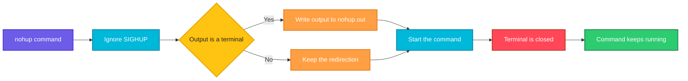

# nohup

## What is it?
`nohup` (no hang up) runs a command that **keeps running after you log out** or close the terminal. When a terminal closes, the system sends `SIGHUP` (hang up) to the processes that were started from it, and by default they stop. `nohup` makes the command ignore `SIGHUP`. It also redirects the output to a file, so the command can continue without a terminal. It is the fastest way to leave a long job running over SSH.

## Syntax
```bash
nohup COMMAND [ARGUMENTS]...
nohup COMMAND [ARGUMENTS]... > FILE 2>&1 &
nohup --help
nohup --version
```
`nohup` has no real options. All the arguments after the command name belong to the command. In most cases you add `&` at the end, to run the command in the background, or the terminal stays busy until the command ends.

### What `nohup` does
| Situation | What `nohup` does | Message |
|-----------|-------------------|---------|
| Standard input is a terminal | Redirects it from an unreadable file, so the command does not read from the terminal | `nohup: ignoring input` |
| Standard output is a terminal | Appends the output to `nohup.out` in the current directory (or in `$HOME` if that fails) | `nohup: ignoring input and appending output to 'nohup.out'` |
| Standard error is a terminal | Redirects it to standard output | `nohup: ignoring input and redirecting stderr to stdout` |
| Everything is already redirected | Does nothing about the files | (no message) |
| In all cases | The command ignores `SIGHUP` | |

### Exit status
| Code | Meaning |
|------|---------|
| The status of the command | If the command ran, `nohup` returns what the command returns |
| `125` | `nohup` itself failed |
| `126` | The command was found but could not be run |
| `127` | The command was not found |

## Visual Overview
> `nohup` prepares the command so that it ignores the hang up signal and does not depend on the terminal, then starts it with `exec`. When the terminal closes, the command keeps running.



## Options/Flags
| Flag | Description |
|------|-------------|
| `COMMAND [ARGS]` | The program to run, with its arguments |
| `&` (shell, not `nohup`) | Put the command in the background |
| `> FILE 2>&1` (shell, not `nohup`) | Send standard output and error to a file of your choice instead of `nohup.out` |
| `< /dev/null` (shell, not `nohup`) | Give the command an empty input, so it never waits for the terminal |
| `--help` | Show the help text |
| `--version` | Show the version |

## Usage Examples

Let's say we have this script `job.sh`. It prints a line every second, 5 times, and then ends:

**Input file** (`job.sh`):
```text
#!/bin/bash
for i in 1 2 3 4 5; do
  echo "step $i"
  sleep 1
done
echo "job finished"
```
We are logged in as the user `deploy`, in the directory `/home/deploy`. The script is executable.

### Example 1: Run a command and keep the output
The output goes to the file `nohup.out`. The messages of `nohup` go to the screen (standard error).

**Command:**
```bash
nohup ./job.sh &
```
**Sample Output:**
```text
[1] 4210
nohup: ignoring input and appending output to 'nohup.out'
```
`[1] 4210` is the job number and the PID from the shell. The command now runs in the background. You can close the terminal.

### Example 2: Look at the output file
**Command:**
```bash
sleep 6
cat nohup.out
```
**Sample Output:**
```text
step 1
step 2
step 3
step 4
step 5
job finished
```

### Example 3: Choose your own output file (`> FILE 2>&1`)
You decide where the output goes. `2>&1` sends the error messages to the same file.

**Command:**
```bash
nohup ./job.sh > /var/log/job.log 2>&1 &
```
**Sample Output:**
```text
[1] 4220
nohup: ignoring input
```
`nohup` only complains about the input now, because the output is already redirected.

### Example 4: No messages at all (`< /dev/null`)
When the input, the output and the error are all redirected, `nohup` prints nothing.

**Command:**
```bash
nohup ./job.sh < /dev/null > job.log 2>&1 &
```
**Sample Output:**
```text
[1] 4230
```
This is the form used in scripts and CI jobs.

### Example 5: Only the output is redirected
**Command:**
```bash
nohup ./job.sh > job.log &
```
**Sample Output:**
```text
[1] 4240
nohup: ignoring input and redirecting stderr to stdout
```
Standard error was still a terminal, so `nohup` sent it to the same place as the output (`job.log`).

### Example 6: Check that the command ignores the hang up
The parent of the command is no longer your shell after the shell ends. `ps` shows the process, still alive after the logout.

**Command:**
```bash
nohup ./job.sh < /dev/null > job.log 2>&1 &
ps -o pid,ppid,stat,cmd -p $!
```
**Sample Output:**
```text
[1] 4250
    PID    PPID STAT CMD
   4250    2302 S    /bin/bash ./job.sh
```
`$!` is the PID of the last background command. After you close the terminal, `PPID` changes to `1` (or to the user's `systemd`), and the job continues.

### Example 7: Run several commands (`sh -c`)
`nohup` takes one command. For a sequence put it inside a shell.

**Command:**
```bash
nohup sh -c 'echo start; sleep 3; echo end' > seq.log 2>&1 &
sleep 4
cat seq.log
```
**Sample Output:**
```text
[1] 4260
nohup: ignoring input
start
end
```

### Example 8: The command does not exist
**Command:**
```bash
nohup nosuchcommand; echo "exit code: $?"
```
**Sample Output:**
```text
nohup: ignoring input and appending output to 'nohup.out'
nohup: failed to run command 'nosuchcommand': No such file or directory
exit code: 127
```

### Example 9: The command is not executable
**Command:**
```bash
nohup /etc/hosts; echo "exit code: $?"
```
**Sample Output:**
```text
nohup: ignoring input and appending output to 'nohup.out'
nohup: failed to run command '/etc/hosts': Permission denied
exit code: 126
```

### Example 10: The directory is not writable
If `nohup.out` cannot be created in the current directory, `nohup` uses your home directory.

**Command:**
```bash
cd /usr/share && nohup echo hello
```
**Sample Output:**
```text
nohup: ignoring input and appending output to '/home/deploy/nohup.out'
```

### Example 11: Watch the output of the background job
**Command:**
```bash
tail -f nohup.out
```
**Sample Output** (press `Ctrl+C` to stop watching, the job keeps running):
```text
step 1
step 2
step 3
```

### Example 12: Check the version (`--version`)
**Command:**
```bash
nohup --version | head -n 1
```
**Sample Output:**
```text
nohup (GNU coreutils) 8.32
```

### Example 13: Show the help (`--help`)
**Command:**
```bash
nohup --help | head -n 3
```
**Sample Output:**
```text
Usage: nohup COMMAND [ARG]...
  or:  nohup OPTION
Run COMMAND, ignoring hangup signals.
```

## Pitfalls / Gotchas
- **Do not forget the `&`.** Without it the command runs in the foreground, and you cannot type in the terminal. If you forgot it: press `Ctrl+Z`, then run `bg`, then `disown`.
- **`nohup` is not magic for all signals.** It only ignores `SIGHUP`. A `SIGTERM`, `SIGKILL` or the out-of-memory killer still stops the command.
- **The file `nohup.out` grows without end.** For a long job write to a file of your choice, and use `logrotate` or a log tool.
- **`nohup` does not restart the command.** If the server reboots or the command crashes, it is gone. For services use `systemd` (`Restart=on-failure`).
- **A command that reads from the terminal is stuck.** Use `< /dev/null`, or give it a file for the input.
- **`nohup` of a shell function or an alias does not work.** It runs a program. Use `nohup bash -c 'my_function'`, after you export the function (`export -f`).
- **A command in a pipe:** `nohup cmd1 | cmd2` protects only `cmd1`. Put the pipe in a shell: `nohup sh -c 'cmd1 | cmd2' &`.
- **The shell can still send `SIGHUP`** to jobs when it exits, if the option `huponexit` is set. `nohup` protects the command from that as well.
- **If the program already ignores or handles `SIGHUP`** (for example a daemon), `nohup` is not needed.
- **Interactive programs are not good with `nohup`.** For a program that needs a terminal later, use `tmux` or `screen`.
- **Check that it really runs.** After you log out and in, look with `pgrep -a` or `ps`, not only at the output file.

## DevOps Use Cases

### Use Case 1: Run a long backup over SSH
**Situation:** A 2 hour database dump is started over SSH. The VPN may drop. The dump must continue.

**Command:**
```bash
nohup pg_dump -U postgres mydb > /backup/mydb.sql 2> /backup/pg_dump.err < /dev/null &
echo "started with PID $!"
```
**Output:**
```text
[1] 4300
started with PID 4300
```
Log in later and check `ls -lh /backup/mydb.sql`.

### Use Case 2: Start an application without a service file
**Situation:** On a test server you start the application by hand, and it must survive your logout.

**Command:**
```bash
cd /srv/myapp
nohup node server.js >> /var/log/myapp/app.log 2>&1 < /dev/null &
```
**Output:**
```text
[1] 4310
```
`>>` appends to the log. For production create a `systemd` unit instead.

### Use Case 3: Run a data migration script from a laptop with an unstable network
**Situation:** A Python migration takes hours. Start it, check it from time to time, and read the progress.

**Command:**
```bash
nohup python3 migrate.py --batch 1000 > migrate.log 2>&1 &
sleep 5
tail -n 2 migrate.log
```
**Output:**
```text
[1] 4320
nohup: ignoring input and redirecting stderr to stdout
2026-10-12 10:10:01 INFO batch 1 done (1000 rows)
2026-10-12 10:10:03 INFO batch 2 done (2000 rows)
```

### Use Case 4: Make a job survive even when the shell exits with `huponexit`
**Situation:** Some shells send `SIGHUP` to all jobs on exit. Combine `nohup` with `disown` to detach the job from the shell completely.

**Command:**
```bash
nohup ./job.sh < /dev/null > job.log 2>&1 &
disown %1
jobs
```
**Output:**
```text
[1] 4330
```
`jobs` prints nothing, because `disown` removed the job from the shell's job list. The process runs on.

### Use Case 5: Start a long running load test from a CI runner
**Situation:** A CI step starts a load test on another host and continues with the next step without waiting.

**Command:**
```bash
ssh loadgen01 'nohup k6 run /opt/tests/load.js > /var/log/k6.log 2>&1 < /dev/null &'
echo "load test started"
```
**Output:**
```text
load test started
```
All the three redirections are needed. Otherwise `ssh` waits for the output channel to close, and the CI step hangs.

### Use Case 6: Retry a download in the background
**Situation:** Download a large file, and let it continue after you disconnect. `wget -c` continues a partial file.

**Command:**
```bash
nohup wget -c https://example.com/data.tar.gz > wget.log 2>&1 &
```
**Output:**
```text
[1] 4340
nohup: ignoring input and redirecting stderr to stdout
```
`wget` itself writes to `wget-log` when it is run in the background, but with an explicit redirect all the output is in `wget.log`.

### Use Case 7: Check a running job after a new login
**Situation:** You logged in again. Find the job that you started earlier and read its last output.

**Command:**
```bash
pgrep -af job.sh
tail -n 3 job.log
```
**Output:**
```text
4250 /bin/bash ./job.sh
step 3
step 4
step 5
```

### Use Case 8: Stop a `nohup` job
**Situation:** The job is not needed any more. Stop it by its PID. Let's say it is `4250`.

**Command:**
```bash
kill 4250
pgrep -af job.sh || echo "job stopped"
```
**Output:**
```text
job stopped
```

## Related Commands
- [`jobs`](jobs.md) - the background jobs of the current shell
- [`bg`](bg.md) / [`fg`](fg.md) - move jobs between the background and the foreground
- [`ps`](ps.md) - check that the process still runs
- [`pgrep`](pgrep.md) - find the PID of a job in a new session
- [`kill`](kill.md) - stop a job
- [`timeout`](timeout.md) - limit the run time of a command
- [`tail`](../file-management/tail.md) - follow the output file
- `disown` - remove a job from the shell's job list
- `setsid` - start a program in a new session
- `tmux` / `screen` - terminal sessions that you can detach and attach again
- `systemd` - run programs as real services
