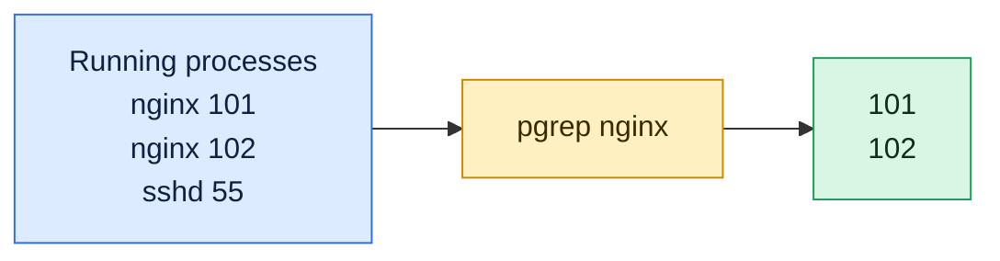

# pgrep

## What is it?
`pgrep` looks through the running processes and prints the **process IDs (PIDs)** of those that match a pattern. The pattern is a regular expression, matched against the process name or (with `-f`) the whole command line. It is the clean replacement for `ps aux | grep name | awk '{print $2}'`: it never finds itself, and the output is ready for scripts. Its sister command `pkill` uses the same options, but sends a signal to the matches.

## Syntax
```bash
pgrep [OPTIONS] PATTERN
```
Without a pattern you must give at least one other selection option (like `-u USER`). When several selection options are used, a process must match **all** of them.

### Exit status
| Code | Meaning |
|------|---------|
| `0` | At least one process matched |
| `1` | No process matched |
| `2` | Syntax error on the command line |
| `3` | Fatal error (for example out of memory) |

## Visual Overview
> `pgrep` finds processes by name and prints only their PIDs, so it is safe to use inside scripts and in `$(...)`.



## Options/Flags

### How the pattern is matched
| Flag | Description |
|------|-------------|
| `PATTERN` | An extended regular expression, matched against the process name (the first 15 characters of it) |
| `-f` / `--full` | Match against the whole command line, not only the name |
| `-x` / `--exact` | The pattern must match the whole name (or the whole command line with `-f`) |
| `-i` / `--ignore-case` | Ignore the case of the pattern |
| `-v` / `--inverse` | Negate the match: print the processes that do **not** match |

### Select by owner, group and family
| Flag | Description |
|------|-------------|
| `-u USER` / `--euid USER` | Only processes with this effective user (name or ID) |
| `-U USER` / `--uid USER` | Only processes with this real user |
| `-G GROUP` / `--group GROUP` | Only processes with this real group |
| `-g PGRP` / `--pgroup PGRP` | Only processes in this process group (`0` means the group of `pgrep` itself) |
| `-P PPID` / `--parent PPID` | Only the children of this parent process |
| `-s SID` / `--session SID` | Only processes in this session (`0` means the session of `pgrep`) |
| `-t TTY` / `--terminal TTY` | Only processes of this terminal |
| `-r STATE` / `--runstates STATE` | Only processes in this state (`R`, `S`, `D`, `T`, `Z` ...) |
| `-F FILE` / `--pidfile FILE` | Only the process whose PID is in this file |
| `-L` / `--logpidfile` | With `-F`, fail if the PID file is not locked |

### Which match to print
| Flag | Description |
|------|-------------|
| `-n` / `--newest` | Only the newest (the most recently started) match |
| `-o` / `--oldest` | Only the oldest match |

### Output format
| Flag | Description |
|------|-------------|
| `-l` / `--list-name` | Print the PID and the process name |
| `-a` / `--list-full` | Print the PID and the full command line |
| `-d DELIM` / `--delimiter DELIM` | Put `DELIM` between the PIDs (default is a newline) |
| `-c` / `--count` | Print only the number of matches |
| `-w` / `--lightweight` | List all the threads (light weight processes), not only the thread group leaders |
| `-V` / `--version` | Show the version |
| `--help` | Show the help text |

## Usage Examples

Let's say we have the server `web01` from the `ps` guide. We are logged in as the user `deploy` in a shell with PID `2302` on the terminal `pts/0`. These processes are running:

**Input (what is running)**:

| PID | PPID | User | Group | State | Started | Command line |
|-----|------|------|-------|-------|---------|--------------|
| 1 | 0 | root | root | `Ss` | Oct05 | `/sbin/init` |
| 640 | 1 | root | root | `Ss` | Oct05 | `/usr/sbin/sshd -D` |
| 812 | 1 | root | root | `Ss` | Oct05 | `nginx: master process /usr/sbin/nginx` |
| 813 | 812 | www-data | www-data | `S` | Oct05 | `nginx: worker process` |
| 814 | 812 | www-data | www-data | `S` | Oct05 | `nginx: worker process` |
| 1100 | 1 | postgres | postgres | `Ss` | Oct05 | `/usr/lib/postgresql/14/bin/postgres -D /var/lib/postgresql/14/main` |
| 2045 | 1 | deploy | deploy | `Sl` | 09:30 | `node /srv/myapp/server.js` (3 threads: 2045, 2046, 2047) |
| 2301 | 640 | deploy | deploy | `S` | 09:45 | `sshd: deploy@pts/0` |
| 2302 | 2301 | deploy | deploy | `Ss` | 09:45 | `-bash` (on `pts/0`) |
| 3120 | 2302 | deploy | deploy | `R` | 10:00 | `python3 worker.py` (on `pts/0`) |

The file `/run/nginx.pid` holds the number `812`.

### Example 1: Find PIDs by name
**Command:**
```bash
pgrep nginx
```
**Sample Output:**
```text
812
813
814
```

### Example 2: Show the name too (`-l`)
**Command:**
```bash
pgrep -l nginx
```
**Sample Output:**
```text
812 nginx
813 nginx
814 nginx
```

### Example 3: Show the full command line (`-a`)
**Command:**
```bash
pgrep -a nginx
```
**Sample Output:**
```text
812 nginx: master process /usr/sbin/nginx
813 nginx: worker process
814 nginx: worker process
```

### Example 4: Match the whole command line (`-f`)
The process name of `python3 worker.py` is only `python3`. To find it by its script name you need `-f`.

**Command:**
```bash
pgrep worker.py
pgrep -f worker.py
pgrep -fa worker.py
```
**Sample Output:**
```text
3120
3120 python3 worker.py
```
The first command finds nothing and prints nothing. The second prints the PID, and the third prints the PID with the command line.

### Example 5: Match the exact name (`-x`)
Without `-x`, the pattern is a regular expression that can match a part of the name.

**Command:**
```bash
pgrep -l post
pgrep -lx post
pgrep -lx postgres
```
**Sample Output:**
```text
1100 postgres
1100 postgres
```
The first command finds `postgres` because `post` is a part of the name. The second finds nothing. The third matches the whole name.

### Example 6: Ignore case (`-i`)
**Command:**
```bash
pgrep -i NGINX
```
**Sample Output:**
```text
812
813
814
```

### Example 7: Regular expressions
The pattern is an extended regular expression: `|` means "or", `^` and `$` are anchors.

**Command:**
```bash
pgrep -l 'nginx|postgres'
pgrep -l '^n'
```
**Sample Output:**
```text
812 nginx
813 nginx
814 nginx
1100 postgres
812 nginx
813 nginx
814 nginx
2045 node
```

### Example 8: Processes of a user (`-u`)
**Command:**
```bash
pgrep -u www-data
pgrep -l -u deploy
```
**Sample Output:**
```text
813
814
2045 node
2301 sshd
2302 bash
3120 python3
```

### Example 9: Real user and group (`-U` and `-G`)
**Command:**
```bash
pgrep -l -U postgres
pgrep -l -G www-data
```
**Sample Output:**
```text
1100 postgres
813 nginx
814 nginx
```

### Example 10: Combine the pattern with a user
All options must match. This finds the `nginx` processes of `root`.

**Command:**
```bash
pgrep -l -u root nginx
```
**Sample Output:**
```text
812 nginx
```

### Example 11: Children of a process (`-P`)
**Command:**
```bash
pgrep -l -P 812
```
**Sample Output:**
```text
813 nginx
814 nginx
```

### Example 12: Process group and session (`-g` and `-s`)
Everything that was started from the shell `2302` is in the session `2302`. A process that is started in the background as a job gets its own group.

**Command:**
```bash
pgrep -l -s 2302
pgrep -l -g 3120
```
**Sample Output:**
```text
2302 bash
3120 python3
3120 python3
```
The second command prints the group of the job `3120`. The group ID of the job is its PID.

### Example 13: Processes of a terminal (`-t`)
**Command:**
```bash
pgrep -l -t pts/0
```
**Sample Output:**
```text
2302 bash
3120 python3
```

### Example 14: The newest and the oldest match (`-n` and `-o`)
**Command:**
```bash
pgrep -n nginx
pgrep -o nginx
```
**Sample Output:**
```text
814
812
```
`-o` is the master process, which was started first. `-n` is the last worker.

### Example 15: Everything that does not match (`-v`)
`-v` needs another option, like a user. This prints the processes of `deploy` that are **not** `bash`.

**Command:**
```bash
pgrep -l -v -u deploy bash
```
**Sample Output:**
```text
2045 node
2301 sshd
3120 python3
```

### Example 16: Count the matches (`-c`)
**Command:**
```bash
pgrep -c nginx
pgrep -c nosuchprocess
```
**Sample Output:**
```text
3
0
```

### Example 17: A list on one line (`-d`)
Use it to build the argument of another command, like `top -p`.

**Command:**
```bash
pgrep -d, nginx
pgrep -d ' ' nginx
```
**Sample Output:**
```text
812,813,814
812 813 814
```

### Example 18: Use a PID file (`-F`)
**Command:**
```bash
pgrep -F /run/nginx.pid
pgrep -l -F /run/nginx.pid
```
**Sample Output:**
```text
812
812 nginx
```

### Example 19: Require a locked PID file (`-L`)
With `-L`, `pgrep` fails if the PID file is not locked, which means that the program that wrote it is probably not running any more.

**Command:**
```bash
pgrep -L -F /run/nginx.pid; echo "exit code: $?"
```
**Sample Output:**
```text
pgrep: pidfile not valid
exit code: 2
```
`nginx` does not lock its PID file, so the check fails. Use `-L` only for programs that lock their PID file.

### Example 20: Only the running processes (`-r`)
**Command:**
```bash
pgrep -l -r R
```
**Sample Output:**
```text
3120 python3
```
`pgrep` never lists itself, even though it is a running process at that moment.

### Example 21: List the threads (`-w`)
**Command:**
```bash
pgrep -w node
pgrep node
```
**Sample Output:**
```text
2045
2046
2047
2045
```
By default only the main thread `2045` is shown. With `-w`, the other threads `2046` and `2047` are shown, too.

### Example 22: No match gives exit code 1
**Command:**
```bash
pgrep -x nosuchprocess; echo "exit code: $?"
pgrep -x nginx > /dev/null; echo "exit code: $?"
```
**Sample Output:**
```text
exit code: 1
exit code: 0
```

### Example 23: Check the version (`-V`)
**Command:**
```bash
pgrep -V
```
**Sample Output:**
```text
pgrep from procps-ng 3.3.17
```

### Example 24: Show the help (`--help`)
**Command:**
```bash
pgrep --help | head -n 3
```
**Sample Output:**
```text

Usage:
 pgrep [options] <pattern>
```

## Pitfalls / Gotchas
- **The name is cut to 15 characters.** The kernel stores only 15 characters of the process name. A long name never matches without `-f`.
- **`-f` can match the shell that runs it.** `pgrep` never matches itself, but with `-f` it can match a parent process whose command line contains the pattern, such as `bash -c "pgrep -f myapp"`, `sudo` or `watch`. Use anchors (`^/usr/bin/myapp`) or `-x`, and check the result with `-a`.
- **The pattern is a regular expression.** A dot matches any character: `pgrep -f server.js` also matches `server_js`. Use `server\.js`.
- **A partial name matches several programs.** `pgrep ssh` matches `ssh`, `sshd` and `ssh-agent`. Use `-x` to be exact.
- **Different users own different processes.** A normal user sees all processes with `pgrep`, but can only signal their own.
- **No match is not an error message.** `pgrep` prints nothing and returns `1`. Always test the exit code in scripts.
- **The result can be empty when you use it in a command.** `kill $(pgrep foo)` runs `kill` without arguments when there is no match, which only prints a usage message. Use `pkill foo` or `xargs -r kill`.
- **The list can change between `pgrep` and the next command.** A PID can be reused. For critical actions use `pkill` in one step.
- **`pgrep -v` needs another selection** like `-u` or a pattern. It cannot select "all except".
- **Containers:** `pgrep` sees only the processes in its own PID namespace. On the host it also sees the processes of the containers, with the PIDs of the host.

## DevOps Use Cases

### Use Case 1: Check in a script that a service is running
**Situation:** A health check must run an action only when `nginx` is up.

**Input (what is running)**: the processes of `web01` from the Usage Examples.

**Command:**
```bash
if pgrep -x nginx > /dev/null; then
  echo "nginx is running"
else
  echo "nginx is DOWN"
fi
```
**Output:**
```text
nginx is running
```

### Use Case 2: Watch a service live with `top`
**Situation:** Monitor all the nginx processes in one window. `-d,` makes a comma separated list that `top -p` understands.

**Input (what is running)**: the processes of `web01` from the Usage Examples.

**Command:**
```bash
top -p "$(pgrep -d, nginx)"
```
**Output** (interactive, shows only the three nginx processes):
```text
    PID USER      PR  NI    VIRT    RES    SHR S  %CPU  %MEM     TIME+ COMMAND
    812 root      20   0   55276   5120   3500 S   0.0   0.1   0:00.40 nginx
    813 www-data  20   0   55920   4800   3100 S   0.1   0.1   0:01.30 nginx
    814 www-data  20   0   55920   4796   3100 S   0.1   0.1   0:01.28 nginx
```

### Use Case 3: Wait until a process has finished
**Situation:** A backup script runs in the background. Continue the pipeline only after it is done.

**Input (what is running)**: a process `backup.sh` with PID `4410`.

**Command:**
```bash
while pgrep -f backup.sh > /dev/null; do
  echo "backup is still running"
  sleep 5
done
echo "backup finished"
```
**Output:**
```text
backup is still running
backup is still running
backup finished
```

### Use Case 4: Count the workers of a service
**Situation:** An alert fires when fewer than 2 nginx workers run.

**Input (what is running)**: the processes of `web01` from the Usage Examples.

**Command:**
```bash
workers=$(pgrep -c -P "$(pgrep -o -x nginx)")
echo "workers: $workers"
[ "$workers" -ge 2 ] && echo OK || echo ALERT
```
**Output:**
```text
workers: 2
OK
```
`pgrep -o -x nginx` is the master process, and `-P` counts its children.

### Use Case 5: Prevent two copies of a cron job
**Situation:** A cron job must not start while the previous run is still active.

**Command:**
```bash
if pgrep -f "/usr/local/bin/sync-data.sh" > /dev/null; then
  echo "previous run is still active, skipping"
  exit 0
fi
```
**Output:**
```text
previous run is still active, skipping
```
For stronger guarantees use `flock`, because there is a small gap between the check and the start.

### Use Case 6: Find a Java application by its jar
**Situation:** All Java processes are called `java`. Find the one that runs `myapp.jar`.

**Input (what is running)**: a process `4100` with the command line `java -Xmx512m -jar /opt/myapp/myapp.jar`.

**Command:**
```bash
pgrep -fa 'myapp\.jar'
```
**Output:**
```text
4100 java -Xmx512m -jar /opt/myapp/myapp.jar
```

### Use Case 7: Find the newest process of a kind
**Situation:** A pool of worker processes was restarted several times. Which worker started last?

**Input (what is running)**: the processes of `web01` from the Usage Examples.

**Command:**
```bash
pgrep -n -a nginx
```
**Output:**
```text
814 nginx: worker process
```

### Use Case 8: Show the processes of a user, that are not a shell
**Situation:** A user left programs running after the logout. Show everything they run, except the shell and `sshd`.

**Input (what is running)**: the processes of `web01` from the Usage Examples.

**Command:**
```bash
pgrep -a -u deploy | grep -v -e bash -e sshd
```
**Output:**
```text
2045 node /srv/myapp/server.js
3120 python3 worker.py
```

### Use Case 9: Test if a PID file is valid
**Situation:** The PID file says the service runs. Check that the PID belongs to the expected program, not to a reused PID.

**Input file** (`/run/nginx.pid`):
```text
812
```
**Command:**
```bash
pgrep -x -F /run/nginx.pid nginx && echo "PID file is valid" || echo "stale PID file"
```
**Output:**
```text
812
PID file is valid
```

### Use Case 10: Stop the processes of a service in two steps
**Situation:** Find the PIDs, ask them to stop, and force them only if they are still there.

**Input (what is running)**: the processes of `web01` from the Usage Examples.

**Command:**
```bash
pgrep -x python3 | xargs -r kill
sleep 5
pgrep -x python3 | xargs -r kill -9
```
**Output:**
```text
```
There is no output. `xargs -r` avoids `kill` without arguments when `pgrep` finds nothing. `pkill` does this in one step.

## Related Commands
- [`pkill`](pkill.md) - send a signal to the processes that match
- [`kill`](kill.md) - send a signal to a PID
- [`killall`](killall.md) - send a signal to processes by exact name
- [`ps`](ps.md) - show the details of the processes you found
- [`top`](top.md) - monitor the processes with `top -p`
- [`jobs`](jobs.md) - the jobs of your own shell
- `pidof` - find the PID by exact program name
- `pstree` - show the process tree
- `flock` - a safe lock for scripts

---
<!-- nav -->
[← Previous: `nice`](nice.md) | [Learning path](../README.md) | [Next: `pkill` →](pkill.md)
