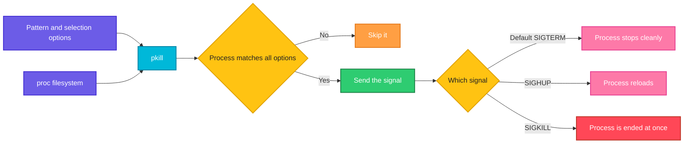

# pkill

## What is it?
`pkill` sends a **signal** to every process that matches a pattern: a name, a user, a terminal or a command line. It works like `pgrep` (it uses the same matching options) but it does not print the PIDs. It acts on them. The default signal is `SIGTERM` (15), which asks the processes to stop in a clean way. `pkill` saves you the steps "find the PID, then `kill` the PID".

## Syntax
```bash
pkill [OPTIONS] PATTERN
pkill [-SIGNAL] [OPTIONS] PATTERN
```
The pattern is an extended regular expression matched against the process name (the first 15 characters) or, with `-f`, against the whole command line. When you give several selection options, a process must match **all** of them. Because `pkill` acts at once, run `pgrep -a` with the same options first, to see what would be hit.

### Exit status
| Code | Meaning |
|------|---------|
| `0` | At least one process matched and a signal was sent |
| `1` | No process matched, or no signal could be sent |
| `2` | Syntax error on the command line |
| `3` | Fatal error |

## Visual Overview
> `pkill` finds the processes in the same way as `pgrep`, but instead of printing their PIDs it sends a signal to each of them.



## Options/Flags

### Which signal
| Flag | Description |
|------|-------------|
| `-SIGNAL` | The signal as a number or a name: `-9`, `-KILL`, `-SIGKILL`, `-HUP` |
| `--signal SIGNAL` | The same with a long option: `--signal 9`, `--signal HUP` |
| `-q VALUE` / `--queue VALUE` | Send the signal with `sigqueue`, with an integer value |

### How the pattern is matched
| Flag | Description |
|------|-------------|
| `PATTERN` | An extended regular expression, matched against the process name |
| `-f` / `--full` | Match against the whole command line |
| `-x` / `--exact` | The pattern must match the whole name |
| `-i` / `--ignore-case` | Ignore the case |
| `-v` / `--inverse` | Negate the match |

### Select by owner, group and family
| Flag | Description |
|------|-------------|
| `-u USER` / `--euid USER` | Processes with this effective user |
| `-U USER` / `--uid USER` | Processes with this real user |
| `-G GROUP` / `--group GROUP` | Processes with this real group |
| `-g PGRP` / `--pgroup PGRP` | Processes in this process group |
| `-P PPID` / `--parent PPID` | The children of this parent |
| `-s SID` / `--session SID` | Processes in this session |
| `-t TTY` / `--terminal TTY` | Processes of this terminal |
| `-F FILE` / `--pidfile FILE` | The process whose PID is in this file |
| `-L` / `--logpidfile` | With `-F`, fail if the PID file is not locked |
| `-n` / `--newest` | Only the newest match |
| `-o` / `--oldest` | Only the oldest match |

### Output
| Flag | Description |
|------|-------------|
| `-e` / `--echo` | Print the name and PID of each process that gets a signal |
| `-c` / `--count` | Print the number of matching processes |
| `-V` / `--version` | Show the version |
| `--help` | Show the help text |

## Usage Examples

Let's say we have the server `web01` from the `ps` guide. We are logged in as the user `deploy` in a shell with PID `2302` on the terminal `pts/0`. These processes are running:

**Input (what is running)**:

| PID | PPID | User | Started | Command line |
|-----|------|------|---------|--------------|
| 640 | 1 | root | Oct05 | `/usr/sbin/sshd -D` |
| 812 | 1 | root | Oct05 | `nginx: master process /usr/sbin/nginx` |
| 813 | 812 | www-data | Oct05 | `nginx: worker process` |
| 814 | 812 | www-data | Oct05 | `nginx: worker process` |
| 1100 | 1 | postgres | Oct05 | `/usr/lib/postgresql/14/bin/postgres -D /var/lib/postgresql/14/main` |
| 2045 | 1 | deploy | 09:30 | `node /srv/myapp/server.js` |
| 2301 | 640 | deploy | 09:45 | `sshd: deploy@pts/0` |
| 2302 | 2301 | deploy | 09:45 | `-bash` (on `pts/0`) |
| 3120 | 2302 | deploy | 10:00 | `python3 worker.py` (on `pts/0`) |
| 3125 | 2302 | deploy | 10:01 | `python3 worker.py` (a second copy, on `pts/0`) |
| 3130 | 2302 | deploy | 10:02 | `python3 report.py` (on `pts/0`) |

The file `/run/nginx.pid` holds the number `812`. `pkill` prints nothing when it works. We check the result with `pgrep`. Each example starts again from this list.

### Example 1: Stop processes by name
The default signal is `SIGTERM`. As `root` (or with `sudo`), because the processes belong to other users.

**Command:**
```bash
sudo pkill nginx
pgrep nginx; echo "exit code: $?"
```
**Sample Output:**
```text
exit code: 1
```
All three nginx processes got the signal and are gone, so `pgrep` finds nothing.

### Example 2: Choose the signal (`-9`, `-KILL`, `--signal`)
**Command:**
```bash
pkill -9 python3
pkill -KILL python3
pkill --signal 9 python3
pkill --signal KILL python3
```
**Sample Output:**
```text
```
All four lines are the same and send `SIGKILL` to every process called `python3`. The first of them already ends all three, so the next lines would find nothing (exit code `1`).

### Example 3: Reload instead of stop (`-HUP`)
**Command:**
```bash
sudo pkill -HUP -x nginx
pgrep -c nginx
```
**Sample Output:**
```text
3
```
`nginx` reads its configuration again and starts new workers. There are still 3 processes.

### Example 4: Match the whole command line (`-f`)
Both `python3 worker.py` and `python3 report.py` have the name `python3`. With `-f` only the one with `worker.py` is signalled.

**Command:**
```bash
pkill -f worker.py
pgrep -a python3
```
**Sample Output:**
```text
3130 python3 report.py
```
Both copies of `worker.py` (`3120` and `3125`) are gone.

### Example 5: Match the exact name (`-x`)
**Command:**
```bash
pkill -x ngin; echo "exit code: $?"
pkill -x nginx; echo "exit code: $?"
```
**Sample Output:**
```text
exit code: 1
exit code: 0
```
`-x` requires the whole name. `ngin` is only a part of it, so the first command does nothing.

### Example 6: Ignore case (`-i`)
**Command:**
```bash
sudo pkill -i NGINX; echo "exit code: $?"
```
**Sample Output:**
```text
exit code: 0
```

### Example 7: Processes of a user (`-u`)
This stops everything the user `www-data` runs, here the two nginx workers.

**Command:**
```bash
sudo pkill -u www-data
pgrep -l nginx
```
**Sample Output:**
```text
812 nginx
```
The master process `812` (owner `root`) stays, and starts new workers by itself.

### Example 8: Real user and group (`-U` and `-G`)
**Command:**
```bash
sudo pkill -U postgres
sudo pkill -G www-data
```
**Sample Output:**
```text
```
The first command stops the processes whose real user is `postgres`. The second command stops those whose real group is `www-data`.

### Example 9: Combine the pattern with a user
Only the `python3` processes of the user `deploy`.

**Command:**
```bash
pkill -u deploy python3
```
**Sample Output:**
```text
```

### Example 10: The children of a process (`-P`)
This keeps the master and stops only its workers.

**Command:**
```bash
sudo pkill -P 812
pgrep -P 812 -l
```
**Sample Output:**
```text
901 nginx
902 nginx
```
`pkill` stopped the old workers `813` and `814`. The master process started two new workers (`901` and `902`) in their place.

### Example 11: A process group (`-g`) and a session (`-s`)
Let's say the job `python3 worker.py` runs in its own process group `3120`.

**Command:**
```bash
pkill -g 3120
pkill -s 2302 python3
```
**Sample Output:**
```text
```
The first command sends the signal to the whole group `3120`. The second one stops the `python3` processes of the session `2302` (all the processes that were started from that shell).

### Example 12: Processes of a terminal (`-t`)
Stop everything that runs on the terminal `pts/0`, except the shell. `-v` with a pattern keeps `bash`.

**Command:**
```bash
pkill -t pts/0 -v bash
```
**Sample Output:**
```text
```
The shell `2302` stays and the three `python3` processes are stopped.

### Example 13: The newest or the oldest match (`-n` and `-o`)
**Command:**
```bash
pkill -n -f worker.py
pgrep -a -f worker.py
```
**Sample Output:**
```text
3120 python3 worker.py
```
`-n` stopped the newest copy, `3125`. The older one, `3120`, still runs. `-o` would stop the oldest copy.

### Example 14: Everything except a match (`-v`)
All processes of `deploy` on `pts/0` that are **not** the shell.

**Command:**
```bash
pkill -u deploy -t pts/0 -v -x bash
```
**Sample Output:**
```text
```
This is the same selection as in Example 12, but written with a user. Always test it first with `pgrep -a`.

### Example 15: Count the matches (`-c`)
`-c` prints the number of matching processes. Together with a signal, the signal is sent as well.

**Command:**
```bash
pkill -c -f worker.py
```
**Sample Output:**
```text
2
```

### Example 16: Show what was signalled (`-e`)
**Command:**
```bash
pkill -e -f worker.py
```
**Sample Output:**
```text
python3 killed (pid 3120)
python3 killed (pid 3125)
```
`-e` (`--echo`) prints a line for each process. Without it, `pkill` prints nothing.

### Example 17: Use a PID file (`-F`)
**Command:**
```bash
sudo pkill -F /run/nginx.pid
```
**Sample Output:**
```text
```
The PID `812` from the file is stopped (with `SIGTERM`), but only if a process with this PID exists. Add `-HUP` for a reload.

### Example 18: Require a locked PID file (`-L`)
**Command:**
```bash
sudo pkill -L -F /run/nginx.pid; echo "exit code: $?"
```
**Sample Output:**
```text
pkill: pidfile not valid
exit code: 2
```
`nginx` does not lock its PID file, so `pkill` refuses to act. Use `-L` only for programs that lock the file. It avoids killing a wrong process when the PID was reused.

### Example 19: Send a signal with a value (`-q`)
**Command:**
```bash
pkill -q 42 -USR1 -x node
```
**Sample Output:**
```text
```
The program `node` gets `SIGUSR1` together with the number `42`.

### Example 20: No match (exit code 1)
**Command:**
```bash
pkill -x nosuchprocess; echo "exit code: $?"
```
**Sample Output:**
```text
exit code: 1
```

### Example 21: You cannot signal other users' processes
**Command:**
```bash
pkill -x nginx; echo "exit code: $?"
```
**Sample Output:**
```text
pkill: killing pid 812 failed: Operation not permitted
pkill: killing pid 813 failed: Operation not permitted
pkill: killing pid 814 failed: Operation not permitted
exit code: 1
```
You are `deploy`, but the processes belong to `root` and `www-data`. Use `sudo`.

### Example 22: Check the version (`-V`)
**Command:**
```bash
pkill -V
```
**Sample Output:**
```text
pkill from procps-ng 3.3.17
```

### Example 23: Show the help (`--help`)
**Command:**
```bash
pkill --help | head -n 3
```
**Sample Output:**
```text

Usage:
 pkill [options] <pattern>
```

## Pitfalls / Gotchas
- **`pkill` acts at once and there is no undo.** Run `pgrep -a ...` with the same options first. Replace `pgrep` by `pkill` only when the list is right.
- **A short pattern matches many programs.** `pkill sh` also stops `bash`, `sshd`, `ssh-agent` and your own shell. Use `-x` and the exact name.
- **`pkill -f pattern` can hit your own terminal session.** If an SSH or shell command line contains the pattern (for example `ssh host "pkill -f myapp"`), `pkill` can match the parent shell and stop the session. Use a bracket trick (`[m]yapp`), an anchor (`^/usr/bin/myapp`) or `-x`.
- **`pkill -u USER` stops the shell of the user, too.** The user is logged out. Add a pattern, or `-v` for the shells.
- **The name is cut to 15 characters.** Long names need `-f`.
- **The default signal is polite, not strong.** `SIGTERM` can be handled or ignored. If the process stays, use `pkill -9`, but only then. A `kill -9` does not allow a clean exit.
- **No match is not an error message.** `pkill` is silent and returns `1`. In scripts with `set -e`, add `|| true`.
- **A supervisor restarts the process.** `systemd`, `supervisord` or Kubernetes will start a stopped service again. Stop the service with the manager (`systemctl stop`).
- **Processes in state `D` or `Z`** do not react to signals. See `ps`.
- **Exit code `0` means that a signal was sent, not that the process stopped.** Check with `pgrep` after a moment.
- **`-c` counts the matches**, and it sends the signal as well.
- **For the exact program name, `killall` is simpler**, but it behaves differently on other Unix systems. `pkill` is safer in portable scripts.

## DevOps Use Cases

### Use Case 1: Restart a stuck worker pool
**Situation:** The Python workers do not answer. Stop them and let the supervisor start new ones.

**Input (what is running)**: the processes of `web01` from the Usage Examples.

**Command:**
```bash
pkill -f 'python3 worker.py'
sleep 2
pgrep -af 'python3 worker.py' || echo "all workers stopped"
```
**Output:**
```text
all workers stopped
```

### Use Case 2: Graceful stop first, then force
**Situation:** A deployment script must be sure that the old application is gone before it starts the new one.

**Input (what is running)**: the processes of `web01` from the Usage Examples.

**Command:**
```bash
pkill -x node
for i in 1 2 3 4 5; do
  pgrep -x node > /dev/null || break
  sleep 1
done
pgrep -x node > /dev/null && { echo "still there, forcing"; pkill -9 -x node; }
echo "done"
```
**Output:**
```text
done
```

### Use Case 3: Reload a service
**Situation:** Reload the configuration of every `nginx` process group without stopping.

**Command:**
```bash
sudo pkill -HUP -x nginx
```
**Output:**
```text
```
`sudo systemctl reload nginx` does the same and is preferred when the service has a unit file.

### Use Case 4: Log out a user and stop everything they run
**Situation:** An employee has left the company. End all of the processes of the account.

**Command:**
```bash
sudo pkill -KILL -u bob
pgrep -u bob; echo "exit code: $?"
```
**Output:**
```text
exit code: 1
```
Lock the account (`sudo usermod -L bob`) before you do it, so a new login cannot start again.

### Use Case 5: Clean up after a failed CI job
**Situation:** A CI job left a headless browser and test servers running. Clean them in the "after script" step, and do not fail when nothing is found.

**Command:**
```bash
pkill -f chromium || true
pkill -f 'node .*test-server' || true
echo "cleanup finished"
```
**Output:**
```text
cleanup finished
```

### Use Case 6: Stop all the children of a parent, but keep the parent
**Situation:** A master process has hung workers. Stopping the workers makes the master start fresh ones.

**Input (what is running)**: the processes of `web01` from the Usage Examples.

**Command:**
```bash
sudo pkill -P 812
sleep 1
pgrep -l -P 812
```
**Output:**
```text
901 nginx
902 nginx
```
The PIDs are new, so the workers were replaced.

### Use Case 7: Stop a runaway background job of the current shell
**Situation:** Several `python3` jobs run in your terminal. Stop the ones that belong to this shell only.

**Input (what is running)**: the processes of `web01` from the Usage Examples.

**Command:**
```bash
pkill -P $$ python3
```
**Output:**
```text
```
`$$` is the PID of the current shell (`2302`). The command stops the `python3` children of this shell, and no other `python3` on the server.

### Use Case 8: Free a port quickly in a development setup
**Situation:** A previous run of the development server still holds port `3000`. Stop it by its command line.

**Command:**
```bash
pkill -f 'node /srv/myapp/server.js'
pgrep -f 'node /srv/myapp/server.js' || echo "port is free"
```
**Output:**
```text
port is free
```
For a precise stop use the process that owns the port: `kill "$(lsof -t -i :3000)"`.

### Use Case 9: Stop the oldest of several identical jobs
**Situation:** Two identical workers run, and you need to stop only the one that started first.

**Input (what is running)**: the processes of `web01` from the Usage Examples.

**Command:**
```bash
pkill -o -f 'python3 worker.py'
pgrep -af 'python3 worker.py'
```
**Output:**
```text
3125 python3 worker.py
```

### Use Case 10: Make a script safe against too wide patterns
**Situation:** Show what would be stopped, ask, and then stop.

**Input (what is running)**: the processes of `web01` from the Usage Examples.

**Command:**
```bash
pgrep -af 'python3 worker.py'
read -r -p "Stop these processes? [y/N] " answer
[ "$answer" = "y" ] && pkill -e -f 'python3 worker.py'
```
**Output:**
```text
3120 python3 worker.py
3125 python3 worker.py
Stop these processes? [y/N] y
python3 killed (pid 3120)
python3 killed (pid 3125)
```

## Related Commands
- [`pgrep`](pgrep.md) - test what `pkill` would hit, without sending a signal
- [`kill`](kill.md) - send a signal to a PID
- [`killall`](killall.md) - send a signal to the processes with an exact name
- [`ps`](ps.md) - the details of the processes
- [`top`](top.md) - watch the processes live
- [`nohup`](nohup.md) - a process that survives a `SIGHUP`
- [`timeout`](timeout.md) - stop a command after a time limit
- `systemctl` - stop and restart services in a managed way
- `lsof` - find the process by the port or the file it uses
