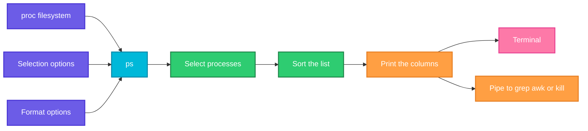

# ps

## What is it?
`ps` (process status) prints a **snapshot** of the processes that run on the system: their process ID (PID), owner, CPU and memory use, state, start time and command line. Unlike `top`, it prints once and exits, so it is the tool to use in scripts and pipelines. It is the first command to run when you ask "is my service running?" or "which process uses all the CPU?".

## Syntax
```bash
ps [OPTIONS]
ps aux                      # BSD style, no dash
ps -ef                      # UNIX style, with a dash
ps -p PID[,PID] -o FIELDS   # selected processes with chosen columns
```
`ps` accepts three styles of options: **UNIX** (with a dash, `-ef`), **BSD** (no dash, `aux`) and **GNU long** (`--sort`). The same letter can mean different things in different styles. `ps -aux` (with a dash) is not the same as `ps aux`. Without options, `ps` shows only the processes of the current user in the current terminal.

## Visual Overview
> `ps` reads the process information from `/proc`, keeps the processes that match your selection, and prints the columns you asked for.



## Options/Flags

### Select which processes
| Flag | Description |
|------|-------------|
| `-e` / `-A` | Select **all** processes |
| `-a` | All processes with a terminal, except session leaders |
| `-x` | Also processes without a terminal (daemons). Mostly used as `ps aux` or `ps ax` |
| `-u USER` / `-U USER` | Processes of this effective user (`-u`) or real user (`-U`), by name or ID |
| `-G GROUP` | Processes of this real group |
| `-p PID[,PID]` | Processes with these IDs |
| `--ppid PID` | Processes whose parent is `PID` |
| `-C NAME` | Processes whose command name is exactly `NAME` |
| `-t TTY` | Processes of this terminal (`pts/0`) |
| `-s SID` | Processes of this session |
| `-N` / `--deselect` | Invert the selection: everything except the selected |
| `r` (BSD) | Only running processes |

### What to print (columns)
| Flag | Description |
|------|-------------|
| `-f` | Full format: `UID PID PPID C STIME TTY TIME CMD` |
| `-F` | Extra full format: adds size, `RSS`, processor |
| `-l` | Long format: adds flags, state, priority, nice value |
| `u` (BSD) | User oriented format: `USER PID %CPU %MEM VSZ RSS TTY STAT START TIME COMMAND` |
| `j` (BSD) / `-j` | Job format: PID, PGID, SID |
| `-o FIELDS` / `-O FIELDS` | Your own columns (`-o pid,ppid,%cpu,cmd`). `-O` adds columns to the default ones |
| `--no-headers` | Do not print the header line |
| `-w` / `-ww` | Wider output. `-ww` does not cut the command line |
| `-L` / `-T` | Show threads (`LWP` and `NLWP` columns with `-L`, `SPID` with `-T`) |
| `-H` | Show the process hierarchy with indentation |
| `-f` with `--forest` / `f` (BSD) | Draw the process tree with ASCII lines |
| `-c` | Show the scheduler information |
| `n` (BSD) | Show numeric user and group IDs |
| `-m` / `m` | Show all threads after the process |
| `e` (BSD) | Show the environment of each command after the command |
| `-Z` | Show the SELinux security context |

### Sorting and other
| Flag | Description |
|------|-------------|
| `--sort=KEY` | Sort by a field. `-` before the key reverses it: `--sort=-%cpu`. Several keys are separated by commas |
| `-q PID` | Quick mode: select by PID and do not sort |
| `--cols N` / `--width N` | Set the output width |
| `--version` / `-V` | Show the version |
| `--help` | Show the help |

### Output fields for `-o`
| Field | Meaning |
|-------|---------|
| `pid` / `ppid` | Process ID / parent process ID |
| `user` / `uid` | Owner name / ID |
| `%cpu` / `pcpu` | CPU time divided by the time the process has run |
| `%mem` / `pmem` | Resident memory as a percentage of the RAM |
| `vsz` / `rss` | Virtual memory / resident memory, in KiB |
| `stat` / `s` | State |
| `etime` / `etimes` | Time since the start (`[[dd-]hh:]mm:ss` / in seconds) |
| `time` | Total CPU time |
| `lstart` | The start time as a full date |
| `ni` / `pri` | Nice value / priority |
| `nlwp` | Number of threads |
| `tty` | Terminal |
| `comm` / `cmd` / `args` | Command name / command with arguments / full command line |

### State codes (`STAT`)
| Code | Meaning |
|------|---------|
| `R` | Running or ready to run |
| `S` | Sleeping, can be interrupted (waiting for an event) |
| `D` | Uninterruptible sleep, usually waiting for disk or network I/O |
| `T` | Stopped (by a signal or a debugger) |
| `Z` | Zombie: finished, but its parent has not read the exit status |
| `I` | Idle kernel thread |
| `s` | Session leader |
| `l` | Multi-threaded |
| `+` | In the foreground process group of the terminal |
| `<` / `N` | High priority / low priority (nice) |
| `L` | Pages locked in memory |

## Usage Examples

Let's say we have a server `web01`. Today is `2026-10-12 10:05`. We are logged in as the user `deploy` in the terminal `pts/0`. These processes are running:

**Input (what is running)**:

| PID | PPID | User | State | Started | CPU time | Command line |
|-----|------|------|-------|---------|----------|--------------|
| 1 | 0 | root | `Ss` | Oct05 | 0:03 | `/sbin/init` |
| 640 | 1 | root | `Ss` | Oct05 | 0:00 | `/usr/sbin/sshd -D` |
| 812 | 1 | root | `Ss` | Oct05 | 0:00 | `nginx: master process /usr/sbin/nginx` |
| 813 | 812 | www-data | `S` | Oct05 | 0:01 | `nginx: worker process` |
| 814 | 812 | www-data | `S` | Oct05 | 0:01 | `nginx: worker process` |
| 1100 | 1 | postgres | `Ss` | Oct05 | 0:12 | `/usr/lib/postgresql/14/bin/postgres -D /var/lib/postgresql/14/main` |
| 2045 | 1 | deploy | `Sl` | 09:30 | 1:24 | `node /srv/myapp/server.js` (3 threads, 2.5% CPU, 4.0% memory) |
| 2301 | 640 | deploy | `S` | 09:45 | 0:00 | `sshd: deploy@pts/0` |
| 2302 | 2301 | deploy | `Ss` | 09:45 | 0:00 | `-bash` (the shell, on `pts/0`) |
| 3120 | 2302 | deploy | `R` | 10:00 | 4:51 | `python3 worker.py` (97% CPU, started from the shell) |

The `ps` command itself appears with PID `2410` when you run it. The order of the lines is by PID.

### Example 1: Processes of the current terminal (no options)
**Command:**
```bash
ps
```
**Sample Output:**
```text
    PID TTY          TIME CMD
   2302 pts/0    00:00:00 bash
   2410 pts/0    00:00:00 ps
   3120 pts/0    00:04:51 python3
```

### Example 2: Every process, full format (`-ef`)
**Command:**
```bash
ps -ef
```
**Sample Output:**
```text
UID          PID    PPID  C STIME TTY          TIME CMD
root           1       0  0 Oct05 ?        00:00:03 /sbin/init
root         640       1  0 Oct05 ?        00:00:00 /usr/sbin/sshd -D
root         812       1  0 Oct05 ?        00:00:00 nginx: master process /usr/sbin/nginx
www-data     813     812  0 Oct05 ?        00:00:01 nginx: worker process
www-data     814     812  0 Oct05 ?        00:00:01 nginx: worker process
postgres    1100       1  0 Oct05 ?        00:00:12 /usr/lib/postgresql/14/bin/postgres -D /var/lib/postgresql/14/main
deploy      2045       1  2 09:30 ?        00:01:24 node /srv/myapp/server.js
deploy      2301     640  0 09:45 ?        00:00:00 sshd: deploy@pts/0
deploy      2302    2301  0 09:45 pts/0    00:00:00 -bash
deploy      2410    2302  0 10:05 pts/0    00:00:00 ps -ef
deploy      3120    2302 97 10:00 pts/0    00:04:51 python3 worker.py
```
`C` is the CPU use in percent. `STIME` is the start time.

### Example 3: BSD style with CPU and memory (`aux`)
**Command:**
```bash
ps aux
```
**Sample Output:**
```text
USER         PID %CPU %MEM    VSZ   RSS TTY      STAT START   TIME COMMAND
root           1  0.0  0.1 167936 11772 ?        Ss   Oct05   0:03 /sbin/init
root         640  0.0  0.1  15424  6912 ?        Ss   Oct05   0:00 /usr/sbin/sshd -D
root         812  0.0  0.1  55276  5120 ?        Ss   Oct05   0:00 nginx: master process /usr/sbin/nginx
www-data     813  0.1  0.1  55920  4800 ?        S    Oct05   0:01 nginx: worker process
www-data     814  0.1  0.1  55920  4796 ?        S    Oct05   0:01 nginx: worker process
postgres    1100  0.3  1.2 215000 49000 ?        Ss   Oct05   0:12 /usr/lib/postgresql/14/bin/postgres -D /var/lib/postgresql/14/main
deploy      2045  2.5  4.0 1250000 164000 ?      Sl   09:30   1:24 node /srv/myapp/server.js
deploy      2301  0.0  0.1  17000  7800 ?        S    09:45   0:00 sshd: deploy@pts/0
deploy      2302  0.0  0.1  10000  5200 pts/0    Ss   09:45   0:00 -bash
deploy      2410  0.0  0.0  11500  3300 pts/0    R+   10:05   0:00 ps aux
deploy      3120 97.0  0.5  30000 20000 pts/0    R    10:00   4:51 python3 worker.py
```
This is the most used form. `a` shows the processes of all users, `u` the user oriented columns and `x` also the processes without a terminal.

### Example 4: All processes with the UNIX options (`-e`, `-A`, `-a`, `-x`)
`-e` and `-A` are the same. `-a` shows only the processes that have a terminal.

**Command:**
```bash
ps -a
ps -x | head -n 4
```
**Sample Output:**
```text
    PID TTY          TIME CMD
   2410 pts/0    00:00:00 ps
   3120 pts/0    00:04:51 python3
    PID TTY      STAT   TIME COMMAND
   2045 ?        Sl     1:24 node /srv/myapp/server.js
   2301 ?        S      0:00 sshd: deploy@pts/0
   2302 pts/0    Ss     0:00 -bash
```
The first command shows the processes with a terminal, except the session leader `bash`. The second one shows your own processes, including the ones without a terminal.

### Example 5: Processes of a user (`-u`)
**Command:**
```bash
ps -u www-data
```
**Sample Output:**
```text
    PID TTY          TIME CMD
    813 ?        00:00:01 nginx
    814 ?        00:00:01 nginx
```

### Example 6: Real user and group (`-U` and `-G`)
**Command:**
```bash
ps -U postgres
ps -G www-data
```
**Sample Output:**
```text
    PID TTY          TIME CMD
   1100 ?        00:00:12 postgres
    PID TTY          TIME CMD
    813 ?        00:00:01 nginx
    814 ?        00:00:01 nginx
```

### Example 7: A process by PID (`-p`)
**Command:**
```bash
ps -p 2045,812
```
**Sample Output:**
```text
    PID TTY          TIME CMD
    812 ?        00:00:00 nginx
   2045 ?        00:01:24 node
```

### Example 8: Children of a process (`--ppid`)
**Command:**
```bash
ps --ppid 812
```
**Sample Output:**
```text
    PID TTY          TIME CMD
    813 ?        00:00:01 nginx
    814 ?        00:00:01 nginx
```

### Example 9: By command name (`-C`)
`-C` needs the exact command name, not a part of it.

**Command:**
```bash
ps -C nginx
ps -C ngin
```
**Sample Output:**
```text
    PID TTY          TIME CMD
    812 ?        00:00:00 nginx
    813 ?        00:00:01 nginx
    814 ?        00:00:01 nginx
    PID TTY          TIME CMD
```
The second command finds nothing and prints only the header.

### Example 10: By terminal and session (`-t`, `-s`)
**Command:**
```bash
ps -t pts/0
ps -s 2302
```
**Sample Output:**
```text
    PID TTY          TIME CMD
   2302 pts/0    00:00:00 bash
   2410 pts/0    00:00:00 ps
   3120 pts/0    00:04:51 python3
    PID TTY          TIME CMD
   2302 pts/0    00:00:00 bash
   2410 pts/0    00:00:00 ps
   3120 pts/0    00:04:51 python3
```
Here the shell `2302` is the session leader. All the processes of the session have the session ID `2302`.

### Example 11: Everything except the selection (`-N` and `--deselect`)
**Command:**
```bash
ps -N -u root -u www-data -u postgres -o pid,user,cmd
```
**Sample Output:**
```text
  PID USER     CMD
 2045 deploy   node /srv/myapp/server.js
 2301 deploy   sshd: deploy@pts/0
 2302 deploy   -bash
 2410 deploy   ps -N -u root -u www-data -u postgres -o pid,user,cmd
 3120 deploy   python3 worker.py
```
`-N` turns the selection around: all the processes that do not belong to the listed users.

### Example 12: Only running processes (BSD `r`)
**Command:**
```bash
ps r
```
**Sample Output:**
```text
    PID TTY      STAT   TIME COMMAND
   2410 pts/0    R+     0:00 ps r
   3120 pts/0    R      4:51 python3 worker.py
```

### Example 13: Full format for the terminal (`-f`)
**Command:**
```bash
ps -f
```
**Sample Output:**
```text
UID          PID    PPID  C STIME TTY          TIME CMD
deploy      2302    2301  0 09:45 pts/0    00:00:00 -bash
deploy      2410    2302  0 10:05 pts/0    00:00:00 ps -f
deploy      3120    2302 97 10:00 pts/0    00:04:51 python3 worker.py
```

### Example 14: Long format with nice values (`-l`)
`NI` is the nice value and `PRI` the priority. `S` is the state.

**Command:**
```bash
ps -l
```
**Sample Output:**
```text
F S   UID     PID    PPID  C PRI  NI ADDR SZ WCHAN  TTY          TIME CMD
0 S  1001    2302    2301  0  80   0 -  2500 do_wai pts/0    00:00:00 bash
0 R  1001    3120    2302 97  80   0 -  7500 -      pts/0    00:04:51 python3
4 R  1001    2410    2302  0  80   0 -  2875 -      pts/0    00:00:00 ps
```

### Example 15: Extra full format (`-F`)
Adds the size, the resident set size (`RSS`) and the processor (`PSR`).

**Command:**
```bash
ps -F -p 3120
```
**Sample Output:**
```text
UID          PID    PPID  C    SZ   RSS PSR STIME TTY          TIME CMD
deploy      3120    2302 97  7500 20000   1 10:00 pts/0    00:04:51 python3 worker.py
```

### Example 16: Your own columns (`-o`)
**Command:**
```bash
ps -p 2045 -o pid,ppid,user,%cpu,%mem,rss,stat,etime,cmd
```
**Sample Output:**
```text
    PID    PPID USER     %CPU %MEM   RSS STAT     ELAPSED CMD
   2045       1 deploy    2.5  4.0 164000 Sl         35:00 node /srv/myapp/server.js
```
`ELAPSED` is the time since the start of the process: 35 minutes.

### Example 17: Add columns to the default ones (`-O`)
**Command:**
```bash
ps -O %cpu,%mem -p 2045
```
**Sample Output:**
```text
    PID %CPU %MEM S TTY          TIME COMMAND
   2045  2.5  4.0 S ?        00:01:24 node /srv/myapp/server.js
```

### Example 18: No header line (`--no-headers`)
Good for scripts.

**Command:**
```bash
ps -C nginx -o pid --no-headers
```
**Sample Output:**
```text
  812
  813
  814
```

### Example 19: Sort the list (`--sort`)
The 3 processes that use the most CPU. A `-` in front of the key means "highest first".

**Command:**
```bash
ps aux --sort=-%cpu | head -n 4
```
**Sample Output:**
```text
USER         PID %CPU %MEM    VSZ   RSS TTY      STAT START   TIME COMMAND
deploy      3120 97.0  0.5  30000 20000 pts/0    R    10:00   4:51 python3 worker.py
deploy      2045  2.5  4.0 1250000 164000 ?      Sl   09:30   1:24 node /srv/myapp/server.js
postgres    1100  0.3  1.2 215000 49000 ?        Ss   Oct05   0:12 /usr/lib/postgresql/14/bin/postgres -D /var/lib/postgresql/14/main
```

### Example 20: Sort by memory, and by several keys
**Command:**
```bash
ps -eo pid,user,%mem,cmd --sort=-%mem | head -n 3
ps -eo pid,user,cmd --sort=user,-pid | head -n 4
```
**Sample Output:**
```text
  PID USER     %MEM CMD
 2045 deploy    4.0 node /srv/myapp/server.js
 1100 postgres  1.2 /usr/lib/postgresql/14/bin/postgres -D /var/lib/postgresql/14/main
  PID USER     CMD
 3120 deploy   python3 worker.py
 2410 deploy   ps -eo pid,user,cmd --sort=user,-pid
 2302 deploy   -bash
```

### Example 21: The process tree (`--forest` and `-H`)
`--forest` draws the parent and child relation with lines.

**Command:**
```bash
ps -ef --forest | grep -v ' ps '
```
**Sample Output:**
```text
UID          PID    PPID  C STIME TTY          TIME CMD
root           1       0  0 Oct05 ?        00:00:03 /sbin/init
root         640       1  0 Oct05 ?        00:00:00 /usr/sbin/sshd -D
deploy      2301     640  0 09:45 ?        00:00:00  \_ sshd: deploy@pts/0
deploy      2302    2301  0 09:45 pts/0    00:00:00      \_ -bash
deploy      3120    2302 97 10:00 pts/0    00:04:51          \_ python3 worker.py
root         812       1  0 Oct05 ?        00:00:00 nginx: master process /usr/sbin/nginx
www-data     813     812  0 Oct05 ?        00:00:01  \_ nginx: worker process
www-data     814     812  0 Oct05 ?        00:00:01  \_ nginx: worker process
postgres    1100       1  0 Oct05 ?        00:00:12 /usr/lib/postgresql/14/bin/postgres -D /var/lib/postgresql/14/main
deploy      2045       1  2 09:30 ?        00:01:24 node /srv/myapp/server.js
```
`ps axjf` is the BSD form.

**Command:**
```bash
ps -eH -o pid,cmd | head -n 6
```
**Sample Output:**
```text
  PID CMD
    1 /sbin/init
  640   /usr/sbin/sshd -D
 2301     sshd: deploy@pts/0
 2302       -bash
 3120         python3 worker.py
```
`-H` shows the hierarchy with indentation only, without drawing lines.

### Example 22: Show threads (`-L` and `-T`)
`LWP` is the thread ID and `NLWP` the number of threads. `ps -T -p 2045` shows the same threads with the column `SPID` instead.

**Command:**
```bash
ps -L -p 2045 -o pid,lwp,nlwp,stat,cmd
```
**Sample Output:**
```text
    PID     LWP NLWP STAT CMD
   2045    2045    3 Sl   node /srv/myapp/server.js
   2045    2046    3 Sl   node /srv/myapp/server.js
   2045    2047    3 Sl   node /srv/myapp/server.js
```

### Example 23: Do not cut the command line (`-w` and `-ww`)
By default, `ps` cuts the lines to the width of the terminal when the output goes to a terminal. When you pipe it, the width is unlimited. `-ww` removes the limit.

**Command:**
```bash
ps -ef -ww | grep postgres | head -n 1
```
**Sample Output:**
```text
postgres    1100       1  0 Oct05 ?        00:00:12 /usr/lib/postgresql/14/bin/postgres -D /var/lib/postgresql/14/main
```

### Example 24: Quick selection without sorting (`-q`)
**Command:**
```bash
ps -q 2045 -o pid,cmd
```
**Sample Output:**
```text
    PID CMD
   2045 node /srv/myapp/server.js
```

### Example 25: Numeric user IDs (`n`)
**Command:**
```bash
ps n -p 2045
```
**Sample Output:**
```text
    PID TTY      STAT   TIME COMMAND
   2045 ?        Sl     1:24 node /srv/myapp/server.js
```
With the BSD `u` format, `ps nu -p 2045` shows `1001` (the user ID) in the `USER` column.

### Example 26: Job format with group and session (`-j` and `j`)
**Command:**
```bash
ps -j -p 2302,3120
```
**Sample Output:**
```text
    PID    PGID     SID TTY          TIME CMD
   2302    2302    2302 pts/0    00:00:00 bash
   3120    3120    2302 pts/0    00:04:51 python3
```

### Example 27: Threads after the process (`m`)
**Command:**
```bash
ps m -p 2045
```
**Sample Output:**
```text
    PID TTY      STAT   TIME COMMAND
   2045 ?        -      1:24 node /srv/myapp/server.js
      - -        Sl     1:10 -
      - -        Sl     0:08 -
      - -        Sl     0:06 -
```

### Example 28: Show the environment (`e`)
**Command:**
```bash
ps e -p 2302 | cut -c1-80
```
**Sample Output:**
```text
    PID TTY      STAT   TIME COMMAND
   2302 pts/0    Ss     0:00 -bash HOME=/home/deploy LANG=en_US.UTF-8 LOGNAME=deploy
```

### Example 29: Scheduler information (`-c`)
**Command:**
```bash
ps -c -p 3120
```
**Sample Output:**
```text
    PID CLS PRI TTY          TIME CMD
   3120 TS   19 pts/0    00:04:51 python3
```
`TS` is the normal time sharing scheduler.

### Example 30: SELinux context (`-Z`)
**Command:**
```bash
ps -Z -p 812
```
**Sample Output:**
```text
LABEL                               PID TTY          TIME CMD
system_u:system_r:httpd_t:s0        812 ?        00:00:00 nginx
```
On a system without SELinux the label is `unconfined` or `-`.

### Example 31: Set the output width (`--cols`)
**Command:**
```bash
ps -ef --cols 60 | head -n 2
```
**Sample Output:**
```text
UID          PID    PPID  C STIME TTY          TIME CMD
root           1       0  0 Oct05 ?        00:00:03 /sbin/init
```

### Example 32: Find a process and exclude `grep` itself
**Command:**
```bash
ps aux | grep '[n]ginx'
```
**Sample Output:**
```text
root         812  0.0  0.1  55276  5120 ?        Ss   Oct05   0:00 nginx: master process /usr/sbin/nginx
www-data     813  0.1  0.1  55920  4800 ?        S    Oct05   0:01 nginx: worker process
www-data     814  0.1  0.1  55920  4796 ?        S    Oct05   0:01 nginx: worker process
```
The pattern `[n]ginx` matches `nginx`, but the text of the `grep` command (`[n]ginx`) does not match, so `grep` does not find itself.

### Example 33: Check the version (`--version`)
**Command:**
```bash
ps --version
```
**Sample Output:**
```text
ps from procps-ng 3.3.17
```

### Example 34: Show the help (`--help`)
**Command:**
```bash
ps --help | head -n 3
```
**Sample Output:**
```text

Usage:
 ps [options]
```

## Pitfalls / Gotchas
- **`ps aux` and `ps -aux` are different.** With a dash, `-u` expects a user name. Linux `ps` guesses what you mean and prints a warning, but you should write `ps aux` or `ps -ef` correctly.
- **`ps aux | grep name` shows the `grep` itself.** Use `grep '[n]ame'`, `pgrep` or `ps -C name`.
- **The command line is cut** when the output goes to a terminal. Use `-ww` to see it all, for example long Java command lines with passwords in them.
- **`%CPU` is an average over the whole life** of the process (CPU time divided by running time), not the current value. For the current use, use `top`.
- **`VSZ` is not the memory in use.** It is the address space. The real RAM use is `RSS`.
- **`ps -C` needs the exact name** and the name is cut to 15 characters. Use `pgrep -f` to search the full command line.
- **Command names can be changed by the process**, like `nginx: worker process` or `sshd: deploy@pts/0`. They are not always the name of the file.
- **A process in state `D`** (uninterruptible sleep) cannot be killed, not even with `kill -9`. It waits for disk or network I/O. A growing number of `D` processes is a sign of a storage problem.
- **A zombie (`Z`)** is already dead. You cannot kill it. Fix or restart the **parent** process, so that it reads the exit status.
- **Passwords in the command line are visible** to all users in `ps` output. Never pass secrets as arguments. Use environment files or standard input.
- **BSD and Linux `ps` differ.** The options and the output of macOS and BSD `ps` are different. Scripts should use `ps -o` with named fields.
- **`ps` is a snapshot.** A short lived process may be gone before you see it. Use `top`, `watch ps` or `execsnoop` for those.

## DevOps Use Cases

### Use Case 1: Is my service running?
**Situation:** After a deployment, check that the nginx and the node processes are up.

**Input (what is running)**: the processes of `web01` from the Usage Examples.

**Command:**
```bash
ps -C nginx,node -o pid,user,stat,etime,cmd
```
**Output:**
```text
    PID USER     STAT     ELAPSED CMD
    812 root     Ss       7-04:20 nginx: master process /usr/sbin/nginx
    813 www-data S        7-04:20 nginx: worker process
    814 www-data S        7-04:20 nginx: worker process
   2045 deploy   Sl         35:00 node /srv/myapp/server.js
```
`ELAPSED` of `7-04:20` means 7 days and 4 hours 20 minutes.

### Use Case 2: Find the process that uses all the CPU
**Situation:** The server is slow. Which process is the cause?

**Input (what is running)**: the processes of `web01` from the Usage Examples.

**Command:**
```bash
ps -eo pid,user,%cpu,%mem,etime,cmd --sort=-%cpu | head -n 3
```
**Output:**
```text
  PID USER     %CPU %MEM     ELAPSED CMD
 3120 deploy   97.0  0.5       05:00 python3 worker.py
 2045 deploy    2.5  4.0       35:00 node /srv/myapp/server.js
```
`python3 worker.py` runs at 97% CPU. Next, look at what it does, or stop it with `kill 3120`.

### Use Case 3: Find the memory hogs
**Situation:** The server starts to use swap. List the top memory users, with their size in MiB.

**Input (what is running)**: the processes of `web01` from the Usage Examples.

**Command:**
```bash
ps -eo pid,user,rss,args --sort=-rss | head -n 3 | awk 'NR>1{printf "%d %s %.0f MiB\n", $1, $2, $3/1024}'
```
**Output:**
```text
2045 deploy 160 MiB
1100 postgres 48 MiB
```

### Use Case 4: Count processes per user
**Situation:** One user may be running too many processes (a fork bomb or a leak).

**Input (what is running)**: the processes of `web01` from the Usage Examples.

**Command:**
```bash
ps -eo user= | sort | uniq -c | sort -rn
```
**Output:**
```text
      5 deploy
      3 root
      2 www-data
      1 postgres
```
The `=` after `user` removes the header. The `ps` command itself is counted for `deploy`.

### Use Case 5: Find zombie processes and their parents
**Situation:** Monitoring reports zombies. Find them and the parent that forgot to wait for them.

**Command:**
```bash
ps -eo pid,ppid,stat,cmd | awk '$3 ~ /^Z/'
```
**Output:**
```text
 4120  4000 Z    [worker] <defunct>
```
The parent is process `4000`. Restart that program. Killing the zombie `4120` does nothing.

### Use Case 6: Find processes stuck in uninterruptible sleep
**Situation:** The load average is high but the CPU is idle. Processes in state `D` wait for I/O (a broken NFS mount or a slow disk).

**Command:**
```bash
ps -eo pid,stat,wchan:20,cmd | awk '$2 ~ /^D/'
```
**Output:**
```text
 5120 D    nfs_wait_on_request tar czf /mnt/nfs/backup.tgz /data
```

### Use Case 7: Find the oldest running processes
**Situation:** A job that should take a minute has been running for days. List the processes by their running time.

**Command:**
```bash
ps -eo pid,etimes,etime,cmd --sort=-etimes | head -n 3
```
**Output:**
```text
  PID ELAPSED     ELAPSED CMD
    1  620400  7-04:20:00 /sbin/init
  640  620390  7-04:19:50 /usr/sbin/sshd -D
```
`etimes` is in seconds, which is good for scripts and for comparisons.

### Use Case 8: Get the PID of a service for a script
**Situation:** A script needs the PID of the nginx master process, without using a PID file.

**Input (what is running)**: the processes of `web01` from the Usage Examples.

**Command:**
```bash
ps -C nginx -o pid=,ppid= | awk '$2==1{print $1}'
```
**Output:**
```text
812
```
The master process is the one whose parent is `init` (PID 1).

### Use Case 9: List the children of a service
**Situation:** Before a restart, see how many workers the master process has.

**Input (what is running)**: the processes of `web01` from the Usage Examples.

**Command:**
```bash
ps --ppid 812 -o pid,stat,etime,cmd
```
**Output:**
```text
    PID STAT     ELAPSED CMD
    813 S        7-04:20 nginx: worker process
    814 S        7-04:20 nginx: worker process
```

### Use Case 10: Monitor the processes of a container from the host
**Situation:** Containers are normal processes for the host. Show the processes of all Docker containers with their CPU and memory.

**Command:**
```bash
ps -eo pid,user,%cpu,%mem,cmd --sort=-%cpu | grep -E 'containerd-shim|docker-proxy' | head -n 2
```
**Output:**
```text
 3320 root      0.4  0.3 /usr/bin/containerd-shim-runc-v2 -namespace moby -id 8c5b1a52...
 3401 root      0.0  0.1 /usr/bin/docker-proxy -proto tcp -host-ip 0.0.0.0 -host-port 8080
```
`docker top NAME` and `docker stats` give the same information per container.

### Use Case 11: Check a process before you kill it
**Situation:** Before you stop `python3 worker.py`, make sure who owns it and what it is.

**Input (what is running)**: the processes of `web01` from the Usage Examples.

**Command:**
```bash
ps -p 3120 -o pid,ppid,user,lstart,etime,cmd
```
**Output:**
```text
    PID    PPID USER                      STARTED     ELAPSED CMD
   3120    2302 deploy  Mon Oct 12 10:00:02 2026       05:00 python3 worker.py
```

### Use Case 12: Watch a process live
**Situation:** See how the CPU and memory of the node process change every 2 seconds.

**Command:**
```bash
watch -n 2 'ps -p 2045 -o pid,%cpu,%mem,rss,etime,cmd'
```
**Output** (updates every 2 seconds, press `Ctrl+C` to stop):
```text
Every 2.0s: ps -p 2045 -o pid,%cpu,%mem,rss,etime,cmd       web01: Mon Oct 12 10:05:00 2026

    PID %CPU %MEM   RSS     ELAPSED CMD
   2045  2.5  4.0 164000       35:00 node /srv/myapp/server.js
```

## Related Commands
- [`top`](top.md) - live view of the processes, with the current CPU use
- [`pgrep`](pgrep.md) - find the PIDs of processes by name
- [`kill`](kill.md) / [`pkill`](pkill.md) / [`killall`](killall.md) - stop the processes you found
- [`watch`](watch.md) - repeat `ps` at an interval
- [`nice`](nice.md) / [`renice`](renice.md) - change the priority of a process
- [`jobs`](jobs.md) - the jobs of the current shell
- [`lsof`](lsof.md) - the files and ports that a process has open
- `pstree` - the process tree, drawn as a tree
- `uptime` - the load average
- `free` - the memory of the whole system
