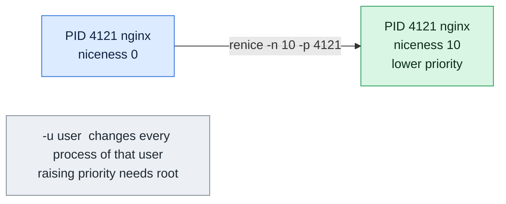

# renice

## What is it?
`renice` changes the **niceness** (the scheduling priority) of processes that are **already running**. The niceness is a number from `-20` (highest priority) to `19` (lowest priority). The default is `0`. A process with a higher niceness gives way to the others when the CPU is busy. `renice` is the tool you use when a running process (a runaway script, a backup, a build) slows down the machine and you do not want to stop it. For a command that you have not yet started, use `nice`.

## Syntax
```bash
renice [-n] PRIORITY [-g | -p | -u] IDENTIFIER...
renice [-n] PRIORITY IDENTIFIER...        # IDENTIFIER is a process ID (default)
```
The `PRIORITY` is the **new niceness**. The identifiers are process IDs (`-p`, the default), process group IDs (`-g`) or users (`-u`, by name or number).

### What may a normal user do?
| Action | Normal user | `root` |
|--------|-------------|--------|
| Make **their own** process nicer (a higher number) | Yes | Yes |
| Make their own process **less nice** (a lower number) | No | Yes |
| Change the process of **another** user | No | Yes |
| Use values below `0` | No | Yes |

## Visual Overview
> `nice` sets priority when a program starts. `renice` changes it later for a process that is already running.



## Options/Flags
| Flag | Description |
|------|-------------|
| `-n PRIORITY` / `--priority PRIORITY` | The new niceness. The option is optional, but if you use it, it must come first (`renice -n 10 -p 2045` is the same as `renice 10 -p 2045`) |
| `--relative` | (newer `util-linux`) Add the number to the current niceness, instead of setting it |
| `-p` / `--pid` | The identifiers are process IDs (default) |
| `-g` / `--pgrp` | The identifiers are process group IDs. All processes of the group are changed |
| `-u` / `--user` | The identifiers are user names or user IDs. All processes of the user are changed |
| `-h` / `--help` | Show the help text |
| `-V` / `--version` | Show the version |

## Usage Examples

Let's say we have the server `web01` from the `ps` guide. We are logged in as the user `deploy`. Today is `2026-10-12 10:05`. These processes are running (the niceness is the `NI` column of `ps -o ni`):

**Input (what is running)**:

| PID | PGID | User | Niceness | Command line |
|-----|------|------|----------|--------------|
| 812 | 812 | root | 0 | `nginx: master process /usr/sbin/nginx` |
| 813, 814 | 812 | www-data | 0 | `nginx: worker process` |
| 1100 | 1100 | postgres | 0 | `/usr/lib/postgresql/14/bin/postgres -D /var/lib/postgresql/14/main` |
| 2045 | 2045 | deploy | 0 | `node /srv/myapp/server.js` |
| 3120 | 3120 | deploy | 0 | `python3 worker.py` (uses 97% CPU) |
| 3125 | 3120 | deploy | 0 | `python3 worker.py` (a child in the same group `3120`) |

Each example starts again from this state. The output uses the format of `util-linux` 2.37.

### Example 1: Make a process nicer (`renice -n`)
**Command:**
```bash
renice -n 10 -p 3120
```
**Sample Output:**
```text
3120 (process ID) old priority 0, new priority 10
```
`python3 worker.py` now gets less CPU when something else needs it.

### Example 2: The shorter form without `-n`
**Command:**
```bash
renice 10 3120
```
**Sample Output:**
```text
3120 (process ID) old priority 0, new priority 10
```
Without a flag, the numbers after the priority are process IDs.

### Example 3: Check the result with `ps`
**Command:**
```bash
ps -o pid,ni,pcpu,cmd -p 3120
renice -n 19 -p 3120
ps -o pid,ni,pcpu,cmd -p 3120
```
**Sample Output:**
```text
    PID  NI %CPU CMD
   3120   0 97.0 python3 worker.py
3120 (process ID) old priority 0, new priority 19
    PID  NI %CPU CMD
   3120  19 97.0 python3 worker.py
```
On a busy machine the `%CPU` drops after a few seconds. Here the machine has a free core, so the value stays high. The niceness only decides who wins when the CPU is short.

### Example 4: Several processes at once (`-p`)
**Command:**
```bash
renice -n 5 -p 3120 3125
```
**Sample Output:**
```text
3120 (process ID) old priority 0, new priority 5
3125 (process ID) old priority 0, new priority 5
```

### Example 5: A whole process group (`-g`)
`3120` and `3125` are in the process group `3120`.

**Command:**
```bash
renice -n 10 -g 3120
```
**Sample Output:**
```text
3120 (process group ID) old priority 0, new priority 10
```
All the processes of the group (`3120` and `3125`) are changed with one command.

### Example 6: All the processes of a user (`-u`)
**Command:**
```bash
sudo renice -n 10 -u deploy
```
**Sample Output:**
```text
1001 (user ID) old priority 0, new priority 10
```
Every process of the user `deploy` that exists now gets niceness `10`: `node`, the shell and `python3`. Processes that start later are not changed by this command.

### Example 7: A user by number
**Command:**
```bash
sudo renice -n 10 -u 1001
```
**Sample Output:**
```text
1001 (user ID) old priority 0, new priority 10
```

### Example 8: More priority needs `root` (negative values)
**Command:**
```bash
renice -n -5 -p 2045
sudo renice -n -5 -p 2045
```
**Sample Output:**
```text
renice: failed to set priority for 2045 (process ID): Permission denied
2045 (process ID) old priority 0, new priority -5
```
A normal user cannot lower the niceness, even of their own process.

### Example 9: Change a process of another user
**Command:**
```bash
renice -n 10 -p 1100
sudo renice -n 10 -p 1100
```
**Sample Output:**
```text
renice: failed to set priority for 1100 (process ID): Permission denied
1100 (process ID) old priority 0, new priority 10
```
`1100` belongs to `postgres`.

### Example 10: You cannot go back without `root`
Let's say `3120` has niceness `10` (from Example 1).

**Command:**
```bash
renice -n 0 -p 3120
sudo renice -n 0 -p 3120
```
**Sample Output:**
```text
renice: failed to set priority for 3120 (process ID): Permission denied
3120 (process ID) old priority 10, new priority 0
```

### Example 11: Add to the current niceness (`--relative`)
With `--relative`, the number is added to the current niceness. This option exists in newer versions of `util-linux` (2.38 and above).

**Command:**
```bash
renice --relative 5 -p 3120
renice --relative 5 -p 3120
```
**Sample Output:**
```text
3120 (process ID) old priority 0, new priority 5
3120 (process ID) old priority 5, new priority 10
```

### Example 12: A process that does not exist
**Command:**
```bash
renice -n 10 -p 99999
```
**Sample Output:**
```text
renice: failed to get priority for 99999 (process ID): No such process
```

### Example 13: A bad value
**Command:**
```bash
renice -n abc -p 3120
```
**Sample Output:**
```text
renice: invalid priority 'abc'
Try 'renice --help' for more information.
```

### Example 14: Values above 19 are cut to 19
**Command:**
```bash
renice -n 30 -p 3120
```
**Sample Output:**
```text
3120 (process ID) old priority 0, new priority 19
```

### Example 15: Check the version (`-V`)
**Command:**
```bash
renice -V
```
**Sample Output:**
```text
renice from util-linux 2.37.2
```

### Example 16: Show the help (`-h`)
**Command:**
```bash
renice -h | head -n 4
```
**Sample Output:**
```text

Usage:
 renice [-n] <priority> [-p|--pid] <pid>...
 renice [-n] <priority>  -g|--pgrp <pgid>...
```

## Pitfalls / Gotchas
- **`renice` takes the new niceness, not a change.** `renice -n 5 -p PID` sets the value `5`, it does not add 5. Only `--relative` (newer versions) adds.
- **A normal user can only go up.** You can make your own process nicer, but you cannot undo it. Think before you act, or you need `root` to go back.
- **`-u` changes all the existing processes of the user,** including the shell and the `sshd` session. New processes start with the default value again.
- **`-g` only changes the processes that are in the group at that moment.** A child that is started later has the niceness of its parent, so it inherits the change.
- **Old argument order.** The very old BSD syntax `renice +5 -p PID` is accepted, but the priority must be the first argument (after `-n`).
- **Only the CPU is affected.** Disk and network use are not changed. Use `ionice` for the disk.
- **Threads can have different values.** On Linux the niceness is per thread. `renice -p PID` changes the main thread. With many threads, use `renice -n 10 -p $(ls /proc/PID/task)`.
- **It does not help against a lack of CPU.** If a machine is overloaded, find out why with `top`. A nice process still uses the CPU when nothing else needs it.
- **Control groups (containers, systemd services) matter more.** The CPU share of a cgroup is decided before the niceness is considered. Use `systemctl set-property SERVICE CPUWeight=...` for services.
- **The changes are lost on a restart** of the process. Make them permanent with `Nice=` in the systemd unit, or with `nice` in the start script.

## DevOps Use Cases

### Use Case 1: Calm down a runaway process without stopping it
**Situation:** `python3 worker.py` uses a full core and the website is slow. You cannot stop the job yet, because it is half way, but you can make it nicer.

**Input (what is running)**: the processes of `web01` from the Usage Examples.

**Command:**
```bash
renice -n 19 -p 3120
```
**Output:**
```text
3120 (process ID) old priority 0, new priority 19
```
The website gets its CPU time again, and the job finishes when there is some free time.

### Use Case 2: Find the biggest CPU user and renice it in one line
**Situation:** Take the process with the highest CPU use and give it a low priority, in a script.

**Input (what is running)**: the processes of `web01` from the Usage Examples.

**Command:**
```bash
pid=$(ps -eo pid --sort=-%cpu --no-headers | head -n 1 | tr -d ' ')
renice -n 15 -p "$pid"
```
**Output:**
```text
3120 (process ID) old priority 0, new priority 15
```

### Use Case 3: Lower the priority of all the workers of a service
**Situation:** During a batch window you want all the `nginx` workers to use less CPU than the application. Combine `pgrep` and `renice`.

**Input (what is running)**: the processes of `web01` from the Usage Examples.

**Command:**
```bash
sudo renice -n 5 -p $(pgrep -x nginx)
```
**Output:**
```text
812 (process ID) old priority 0, new priority 5
813 (process ID) old priority 0, new priority 5
814 (process ID) old priority 0, new priority 5
```

### Use Case 4: Give the database more priority
**Situation:** The database must always be fast. Give it a better priority than the other programs on the server. Only `root` can do this.

**Input (what is running)**: the processes of `web01` from the Usage Examples.

**Command:**
```bash
sudo renice -n -5 -p 1100
```
**Output:**
```text
1100 (process ID) old priority 0, new priority -5
```
For a permanent setting add `Nice=-5` in the `[Service]` section of the unit file.

### Use Case 5: Lower the priority of a user who runs heavy jobs
**Situation:** A data scientist runs a long simulation on the shared server, and others complain. Set a lower priority for all the processes of the user.

**Command:**
```bash
sudo renice -n 10 -u alice
```
**Output:**
```text
1005 (user ID) old priority 0, new priority 10
```
To make it permanent for new logins, use a `nice` entry in `/etc/security/limits.conf` (`alice  hard  priority  10`) or a systemd slice.

### Use Case 6: Lower the priority of a whole job and its children
**Situation:** A build script started many compiler processes. They share one process group. Lower them all at once.

**Input (what is running)**: the processes `3120` and `3125` of the group `3120`.

**Command:**
```bash
renice -n 10 -g 3120
```
**Output:**
```text
3120 (process group ID) old priority 0, new priority 10
```

### Use Case 7: Raise the priority of a stuck deployment
**Situation:** A deployment runs too slowly, because a batch job eats the CPU. Instead of killing anything, give the deployment more priority.

**Command:**
```bash
sudo renice -n -10 -p "$(pgrep -f deploy.sh)"
```
**Output:**
```text
5120 (process ID) old priority 0, new priority -10
```

### Use Case 8: Use `top` to renice
**Situation:** You are already in `top`. Press `r`, type the PID and the value, and press `Enter`.

**Command:**
```bash
top
```
**Output** (after pressing `r`):
```text
PID to renice [default pid = 3120] 3120
Renice PID 3120 to value 10
```
`top` uses the same system call as `renice`, with the same rules for permissions.

## Related Commands
- [`nice`](nice.md) - start a new command with a given niceness
- [`ps`](ps.md) - show the niceness (`-o ni`) of the processes
- [`top`](top.md) - find the busy processes, and renice with the `r` key
- [`pgrep`](pgrep.md) - find the PIDs to renice
- [`kill`](kill.md) - stop a process when renice is not enough
- [`pkill`](pkill.md) - signal processes by name
- [`watch`](watch.md) - watch the effect with `watch -n 2 'ps -o pid,ni,pcpu,cmd -p PID'`
- `ionice` - set the priority of the disk access
- `chrt` - change the real-time scheduling policy
- `taskset` - pin a process to some CPU cores
- `systemctl set-property` - set CPU weights for services
