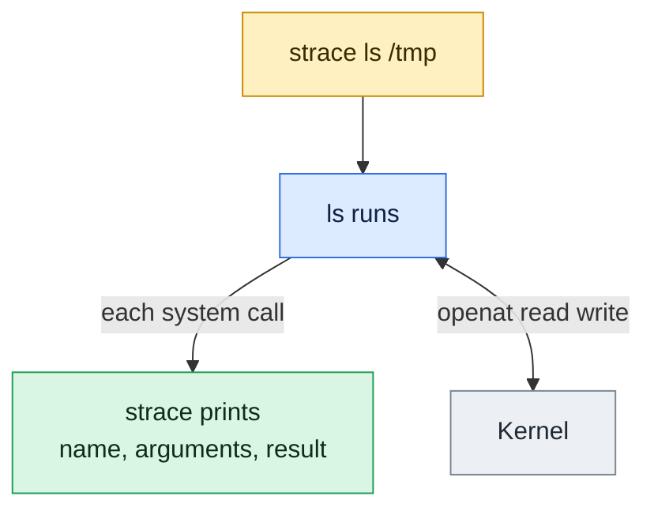

# strace

## What is it?
`strace` runs a command, or attaches to a running process, and prints every **system call** it makes to the kernel, with the arguments and the return value. It is the fastest way to answer "what is this program really doing?", for example which file it cannot open or where it is stuck.

## Syntax
```bash
strace [OPTIONS] COMMAND [ARGS]
strace [OPTIONS] -p PID
```

## Visual Overview
> `strace` sits next to a program and prints every system call it makes. It shows which files it opens and where it fails.



## Options/Flags
| Flag | Description |
|------|-------------|
| `-e trace=NAME,NAME` | Show only these system calls (`openat`, `read`, `execve`, `network`, `file`, `process`) |
| `-c` | Print a summary table of calls, errors and time instead of the trace |
| `-o FILE` | Write the trace to `FILE` (keeps it apart from the program output) |
| `-f` | Follow child processes and threads |
| `-T` | Show the time spent in each call |
| `-p PID` | Attach to a running process (needs the same user or root) |
| `-s N` | Print up to `N` characters of strings (default 32) |

## Usage Examples

### Example 1: Trace a command and filter calls (`-e`, `-o`)
Let's say we have this file `note.txt`:

**Input file** (`note.txt`):
```text
hello kernel
```

**Command:**
```bash
strace -o trace.txt -e trace=openat,read,write,close cat note.txt
grep -A6 'note.txt' trace.txt
```
**Sample Output:**
```text
hello kernel
openat(AT_FDCWD, "note.txt", O_RDONLY)  = 3
read(3, "hello kernel\n", 131072)       = 13
write(1, "hello kernel\n", 13)          = 13
read(3, "", 131072)                     = 0
close(3)                                = 0
close(1)                                = 0
close(2)                                = 0
```

### Example 2: Summary table (`-c`)
Using the `note.txt` file from Example 1.

**Command:**
```bash
strace -c -o sum.txt cat note.txt > /dev/null
head -6 sum.txt
```
**Sample Output:**
```text
% time     seconds  usecs/call     calls    errors syscall
------ ----------- ----------- --------- --------- ----------------
 25.52    0.002328          75        31        13 openat
 18.45    0.001683          76        22           mmap
 12.33    0.001125          56        20           close
 11.58    0.001056          55        19           newfstatat
```

### Example 3: Follow child processes (`-f`)
**Command:**
```bash
strace -f -e trace=execve,clone,wait4 -o t2.txt bash -c 'ls /tmp/os2 >/dev/null'
cut -c1-110 t2.txt | head -5
```
**Sample Output:**
```text
4007  execve("/usr/bin/bash", ["bash", "-c", "ls /tmp/os2 >/dev/null"], 0x7fffc4ad1578 /* 23 vars */) = 0
4007  clone(child_stack=NULL, flags=CLONE_CHILD_CLEARTID|CLONE_CHILD_SETTID|SIGCHLD, child_tidptr=0x7cfa128c3a
4007  wait4(-1,  <unfinished ...>
4042  execve("/usr/bin/ls", ["ls", "/tmp/os2"], 0x5705fe690ad0 /* 23 vars */) = 0
4042  +++ exited with 0 +++
```

### Example 4: Time per call (`-T`)
Using the `note.txt` file from Example 1.

**Command:**
```bash
strace -T -e trace=openat -o t4.txt cat note.txt > /dev/null
grep note.txt t4.txt
```
**Sample Output:**
```text
openat(AT_FDCWD, "note.txt", O_RDONLY)  = 3 <0.000179>
```

### Example 5: Attach to a process you may not trace (`-p`)
**Command:**
```bash
strace -p 1
```
**Sample Output:**
```text
strace: Could not attach to process. If your uid matches the uid of the target process, check the setting of /proc/sys/kernel/yama/ptrace_scope, or try again as the root user. For more details, see /etc/sysctl.d/10-ptrace.conf: Operation not permitted
strace: attach: ptrace(PTRACE_SEIZE, 1): Operation not permitted
```
A normal user can only attach to their own processes, and `ptrace_scope` may restrict even that. Use `sudo strace -p PID`.

### Example 6: A failing call
**Command:**
```bash
strace -e trace=openat -o t3.txt cat missing.txt 2>/dev/null
grep missing t3.txt
```
**Sample Output:**
```text
openat(AT_FDCWD, "missing.txt", O_RDONLY) = -1 ENOENT (No such file or directory)
```

## Pitfalls / Gotchas
- `strace` slows the program down a lot. Do not leave it on a busy production process.
- Traces can contain passwords and tokens. Check before sharing them.
- Without `-f` you see only the parent. Most shell scripts and servers need `-f`.
- Without `-o`, the trace goes to stderr and mixes with the program output.
- Some containers block `ptrace`. Add the `SYS_PTRACE` capability or use the host.
- Failed calls are often normal, for example library path searches.

## DevOps Use Cases

### Use Case 1: Find the file a service cannot open
**Situation:** A service exits at start with "configuration error" and no details.

**Command:**
```bash
strace -f -e trace=openat -o t3.txt cat missing.txt 2>/dev/null
grep -E 'ENOENT|EACCES' t3.txt | grep missing
```
**Sample Output:**
```text
openat(AT_FDCWD, "missing.txt", O_RDONLY) = -1 ENOENT (No such file or directory)
```
Replace `cat missing.txt` with the real start command. `ENOENT` means not found, `EACCES` means permission denied.

### Use Case 2: List every program a script runs
**Situation:** Audit which binaries a start script launches.

**Command:**
```bash
strace -f -e trace=execve -o t5.txt bash -c 'ls /tmp > /dev/null; date > /dev/null'
grep -o 'execve("[^"]*"' t5.txt
```
**Sample Output:**
```text
execve("/usr/bin/bash"
execve("/usr/bin/ls"
execve("/usr/bin/date"
```

## Related Commands
- [System calls](../os-internals/03-system-calls.md) - what the trace lines mean
- [`ps`](ps.md) - find the PID to attach to
- [`lsof`](lsof.md) - open files and sockets of a process
- [`kill`](kill.md) - signals shown in a trace
- `ltrace` - trace library calls instead of system calls
- `perf` - lower overhead profiling

---
<!-- nav -->
[← Previous: `renice`](renice.md) | [Learning path](../README.md) | [Next: `timeout` →](timeout.md)
