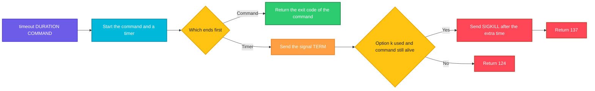

# timeout

## What is it?
`timeout` runs a command and **stops it if it runs longer than a time limit**. After the limit, it sends a signal (`SIGTERM` by default) to the command. It can send a second, stronger signal if the command does not react. A command that hangs (a network call, a database query, a test) cannot block a script or a pipeline for ever. It is part of GNU coreutils.

## Syntax
```bash
timeout [OPTIONS] DURATION COMMAND [ARGUMENTS]...
```
`DURATION` is a number with an optional unit: `s` seconds (default), `m` minutes, `h` hours, `d` days. Fractions are allowed (`0.5`, `1.5m`). A duration of `0` means "no limit".

### Exit status
| Code | Meaning |
|------|---------|
| `124` | The command **timed out** (and `--preserve-status` was not used) |
| `125` | `timeout` itself failed (for example a bad option or a bad duration) |
| `126` | The command was found but could not be run |
| `127` | The command was not found |
| `137` | The command was killed by `SIGKILL` (`128 + 9`) |
| Other | If the command ended in time, `timeout` returns its exit status |

## Visual Overview
> `timeout` starts the command and a timer. If the command ends first, its exit code is returned. If the timer ends first, the signal is sent, and exit code `124` is returned.



## Options/Flags
| Flag | Description |
|------|-------------|
| `-s SIGNAL` / `--signal=SIGNAL` | The signal to send on timeout (name or number). The default is `TERM` |
| `-k DURATION` / `--kill-after=DURATION` | If the command is still running `DURATION` after the first signal, send `SIGKILL` |
| `--preserve-status` | Return the exit status of the command (`128` plus the signal number if it was killed), even when the timeout was reached |
| `--foreground` | Run the command in the foreground of the terminal, so that it can read from it and get `Ctrl+C`. The children of the command are **not** timed out |
| `-v` / `--verbose` | Print a message to standard error when `timeout` sends a signal |
| `--help` | Show the help text |
| `--version` | Show the version |

## Usage Examples

Let's say we have this script `slow.sh`. It needs 5 seconds to finish:

**Input file** (`slow.sh`):
```text
#!/bin/bash
echo "start"
sleep 5
echo "end"
```
And this script `stubborn.sh`. It ignores `SIGTERM` and runs for 10 seconds:

**Input file** (`stubborn.sh`):
```text
#!/bin/bash
trap '' TERM
echo "stubborn started"
sleep 10
```

### Example 1: The command is too slow
The limit is 1 second, and `sleep 5` needs 5.

**Command:**
```bash
timeout 1 sleep 5; echo "exit code: $?"
```
**Sample Output:**
```text
exit code: 124
```
`sleep` got `SIGTERM` after 1 second. Exit code `124` means "timed out".

### Example 2: The command is fast enough
**Command:**
```bash
timeout 5 sleep 1; echo "exit code: $?"
```
**Sample Output:**
```text
exit code: 0
```
The command finished before the limit. `timeout` returns its exit code (`0`).

### Example 3: A script is stopped in the middle
**Command:**
```bash
timeout 2 ./slow.sh; echo "exit code: $?"
```
**Sample Output:**
```text
start
exit code: 124
```
`start` was printed, but `end` was not, because the script was stopped after 2 seconds.

### Example 4: The exit code of the command is kept
**Command:**
```bash
timeout 5 false; echo "exit code: $?"
timeout 5 ls /nonexistent; echo "exit code: $?"
```
**Sample Output:**
```text
exit code: 1
ls: cannot access '/nonexistent': No such file or directory
exit code: 2
```

### Example 5: Units for the duration
**Command:**
```bash
timeout 0.5 sleep 2; echo "exit code: $?"
timeout 1m echo "one minute is a lot"
timeout 2h echo "two hours"
timeout 1d echo "one day"
```
**Sample Output:**
```text
exit code: 124
one minute is a lot
two hours
one day
```
The units are `s` (default), `m`, `h` and `d`.

### Example 6: No limit
**Command:**
```bash
timeout 0 echo "no limit"
```
**Sample Output:**
```text
no limit
```

### Example 7: Choose the signal (`-s`)
`SIGKILL` cannot be caught, so the command is ended at once. The shell reports `Killed`.

**Command:**
```bash
timeout -s KILL 1 sleep 5; echo "exit code: $?"
timeout -s INT 1 sleep 5; echo "exit code: $?"
timeout --signal=HUP 1 sleep 5; echo "exit code: $?"
```
**Sample Output:**
```text
Killed
exit code: 137
exit code: 124
exit code: 124
```
After `SIGKILL`, the exit code is `137` (`128 + 9`). For the other signals it is `124`.

### Example 8: Use a signal number
**Command:**
```bash
timeout -s 2 1 sleep 5; echo "exit code: $?"
```
**Sample Output:**
```text
exit code: 124
```

### Example 9: Force a stubborn command (`-k`)
`stubborn.sh` ignores `SIGTERM`. Without `-k`, it keeps running until it ends by itself. With `-k 2`, `timeout` sends `SIGKILL` 2 seconds after the first signal.

**Command:**
```bash
timeout 1 ./stubborn.sh; echo "exit code: $?"
timeout -k 2 1 ./stubborn.sh; echo "exit code: $?"
```
**Sample Output:**
```text
stubborn started
exit code: 124
stubborn started
Killed
exit code: 137
```
The first command waits for the full 10 seconds, because the script ignores `SIGTERM`. The second command ends after 3 seconds (1 + 2).

### Example 10: Keep the status of the command (`--preserve-status`)
Normally, a timeout returns `124`. With `--preserve-status`, it returns what the command returned. For a command that was ended by the signal this is `128 + signal number`.

**Command:**
```bash
timeout 1 sleep 5; echo "without: $?"
timeout --preserve-status 1 sleep 5; echo "with: $?"
```
**Sample Output:**
```text
without: 124
with: 143
```
`143` is `128 + 15` (`SIGTERM`). Use it when you need to tell a timeout from other failures by the signal.

### Example 11: Say what happens (`-v`)
`-v` prints a message to standard error when `timeout` sends a signal.

**Command:**
```bash
timeout -v 1 sleep 5; echo "exit code: $?"
```
**Sample Output:**
```text
timeout: sending signal TERM to command ‘sleep’
exit code: 124
```

### Example 12: Interactive commands (`--foreground`)
By default, `timeout` puts the command into a background process group, so that it does not get the keys that you type (like `Ctrl+C`). With `--foreground`, the command can read from the terminal, but its children are **not** stopped on a timeout.

**Command:**
```bash
timeout --foreground 5 bash -c 'read -p "Name: " name; echo "Hello $name"'
```
**Sample Output** (you type `Anna`):
```text
Name: Anna
Hello Anna
```

### Example 13: The command does not exist
**Command:**
```bash
timeout 5 nosuchcommand; echo "exit code: $?"
```
**Sample Output:**
```text
timeout: failed to run command ‘nosuchcommand’: No such file or directory
exit code: 127
```

### Example 14: A command that cannot be run
**Command:**
```bash
timeout 5 /etc; echo "exit code: $?"
```
**Sample Output:**
```text
timeout: failed to run command ‘/etc’: Permission denied
exit code: 126
```

### Example 15: A bad duration
**Command:**
```bash
timeout abc sleep 1; echo "exit code: $?"
```
**Sample Output:**
```text
timeout: invalid time interval ‘abc’
Try 'timeout --help' for more information.
exit code: 125
```

### Example 16: The limit applies to the whole command
A pipeline needs a shell around it. Only `timeout`'s own command is limited.

**Command:**
```bash
timeout 2 bash -c 'sleep 1; echo "first"; sleep 5; echo "second"'; echo "exit code: $?"
```
**Sample Output:**
```text
first
exit code: 124
```

### Example 17: A loop with a limit
**Command:**
```bash
timeout 3 bash -c 'while true; do echo tick; sleep 1; done'; echo "exit code: $?"
```
**Sample Output:**
```text
tick
tick
tick
exit code: 124
```

### Example 18: Check the version (`--version`)
**Command:**
```bash
timeout --version | head -n 1
```
**Sample Output:**
```text
timeout (GNU coreutils) 8.32
```

### Example 19: Show the help (`--help`)
**Command:**
```bash
timeout --help | head -n 3
```
**Sample Output:**
```text
Usage: timeout [OPTION] DURATION COMMAND [ARG]...
  or:  timeout [OPTION]
Start COMMAND, and kill it if still running after DURATION.
```

## Pitfalls / Gotchas
- **`124` is the exit code of a timeout.** In scripts test it: `timeout 10 cmd; [ $? -eq 124 ] && echo "timed out"`. With `set -e`, a timeout stops the script, as for any error.
- **The default signal can be ignored.** A program that handles `SIGTERM` (or ignores it) keeps running. Add `-k` to guarantee the end: `timeout -k 5 30 command`.
- **`SIGKILL` gives no time to clean up.** Temporary files, lock files and child processes can stay behind. Use `-k` with a time that is long enough for a clean exit.
- **Children can survive.** `timeout` signals the command, and, unless `--foreground` is used, the command's process group. But a child that started its own group or session continues. Use `pkill -P` or a process group for a full cleanup.
- **A pipeline or `&&` is not one command.** `timeout 5 a | b` limits only `a`. Wrap it: `timeout 5 bash -c 'a | b'`.
- **Shell functions and builtins do not work** directly. `timeout 5 my_function` fails, because `timeout` starts a program. Use `timeout 5 bash -c 'my_function'` after `export -f my_function`.
- **`timeout` measures wall clock time,** not CPU time. A command that sleeps counts the same as one that computes.
- **The limit includes the start-up time** of the command, e.g. a slow DNS lookup before a `curl` connects.
- **`--foreground` has a price.** The grandchildren of the command are not stopped. Use it only for interactive commands.
- **A time limit is not a retry.** Combine it with a loop if you need retries.
- **BSD and macOS** have no `timeout` by default. Install GNU coreutils (`gtimeout`).
- **Many tools have their own timeout** (`curl --max-time`, `ssh -o ConnectTimeout`, `kubectl --request-timeout`). Use those when they exist, because they can close the connection in a clean way.

## DevOps Use Cases

### Use Case 1: Limit the time of a step in a CI pipeline
**Situation:** The integration tests sometimes hang. A job must not block the runner for hours.

**Command:**
```bash
timeout -k 30 15m ./run-tests.sh
status=$?
if [ "$status" -eq 124 ] || [ "$status" -eq 137 ]; then
  echo "ERROR: tests timed out"
  exit 1
fi
```
**Output:**
```text
ERROR: tests timed out
```
After 15 minutes the tests get `SIGTERM`. After 30 more seconds they get `SIGKILL`.

### Use Case 2: Health check that cannot hang
**Situation:** A monitoring script calls a service. If the service accepts the connection but never answers, `curl` waits for a very long time.

**Command:**
```bash
timeout 5 curl -s http://localhost:3000/health || echo "service did not answer in 5 seconds"
```
**Output:**
```text
service did not answer in 5 seconds
```
`curl --max-time 5` does the same for `curl` alone. `timeout` works for every command.

### Use Case 3: Wait for a port with a limit
**Situation:** A deployment script must wait until the database is up, but give up after 60 seconds.

**Command:**
```bash
if timeout 60 bash -c 'until nc -z db01 5432; do sleep 1; done'; then
  echo "database is up"
else
  echo "database did not start in 60 seconds"
  exit 1
fi
```
**Output:**
```text
database is up
```

### Use Case 4: Follow a log for a short time
**Situation:** Capture 30 seconds of a live log into a file and then continue, for example during a reproduction of a bug.

**Command:**
```bash
timeout 30 tail -f /var/log/myapp/app.log > /tmp/capture.log
wc -l /tmp/capture.log
```
**Output:**
```text
214 /tmp/capture.log
```
The exit code is `124`, because `tail -f` never ends by itself. That is normal here.

### Use Case 5: Protect a cron job against a hung run
**Situation:** A nightly sync sometimes hangs and blocks the next night's run. Give it a maximum of 2 hours.

**Input file** (`/etc/cron.d/sync-data`):
```text
0 2 * * * deploy timeout -k 60 2h /usr/local/bin/sync-data.sh >> /var/log/sync-data.log 2>&1
```
**Command:**
```bash
cat /etc/cron.d/sync-data
```
**Output:**
```text
0 2 * * * deploy timeout -k 60 2h /usr/local/bin/sync-data.sh >> /var/log/sync-data.log 2>&1
```

### Use Case 6: Retry a flaky command with a time limit per try
**Situation:** A package download sometimes stalls. Try up to 3 times, with 30 seconds per try.

**Command:**
```bash
for attempt in 1 2 3; do
  if timeout 30 wget -q https://example.com/pkg.tar.gz; then
    echo "downloaded on attempt $attempt"
    break
  fi
  echo "attempt $attempt failed"
done
```
**Output:**
```text
attempt 1 failed
downloaded on attempt 2
```

### Use Case 7: Run a command on a remote host without hanging
**Situation:** `ssh` to an overloaded server can hang. Limit the whole call.

**Command:**
```bash
timeout 20 ssh -o BatchMode=yes web01 uptime || echo "web01 did not answer"
```
**Output:**
```text
 10:05:00 up 7 days,  4:20,  2 users,  load average: 1.02, 0.85, 0.60
```
If the host does not answer within 20 seconds, the message `web01 did not answer` appears instead.

### Use Case 8: Limit a database query
**Situation:** A report query must not run longer than 60 seconds on the production database.

**Command:**
```bash
timeout 60 psql -U report -d shop -c "SELECT count(*) FROM orders;"
echo "exit code: $?"
```
**Output:**
```text
 count
--------
 482113
(1 row)

exit code: 0
```
Note that the server may still run the query after the client was stopped. Set `statement_timeout` in the database too.

### Use Case 9: Clean shutdown first, hard kill later
**Situation:** Stop a worker: ask nicely for 20 seconds, then force it.

**Command:**
```bash
timeout -s TERM -k 5 20 ./worker.sh
echo "exit code: $?"
```
**Output:**
```text
exit code: 124
```
`124` means that the worker did not finish in 20 seconds, and `137` would mean that it had to be killed with `SIGKILL`.

### Use Case 10: Find out what ended the command
**Situation:** Log the reason when a job stops.

**Command:**
```bash
timeout --preserve-status 10 ./job.sh
code=$?
case $code in
  0)   echo "job finished" ;;
  143) echo "job was stopped by the timeout (SIGTERM)" ;;
  137) echo "job was killed (SIGKILL)" ;;
  *)   echo "job failed with code $code" ;;
esac
```
**Output:**
```text
job was stopped by the timeout (SIGTERM)
```

## Related Commands
- [`kill`](kill.md) - send a signal by hand
- [`pkill`](pkill.md) - stop processes by name, for example the children that survive
- [`nohup`](nohup.md) - keep a long job running after the logout
- [`watch`](watch.md) - repeat a command, and `-g` to wait for a change
- [`nice`](nice.md) - lower the priority of a long job
- [`ps`](ps.md) - find what is still running after a timeout
- [`jobs`](jobs.md) - the background jobs of the shell
- `sleep` - wait for a fixed time
- `curl --max-time` / `wget -T` - built in timeouts of network tools
- `flock -w` - wait for a lock, with a limit
